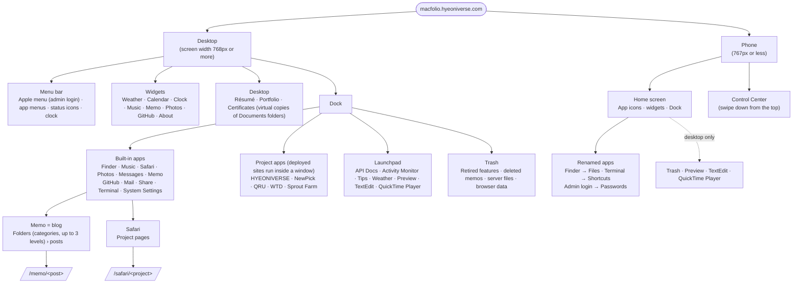
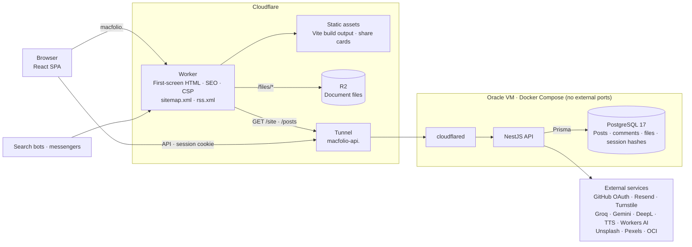
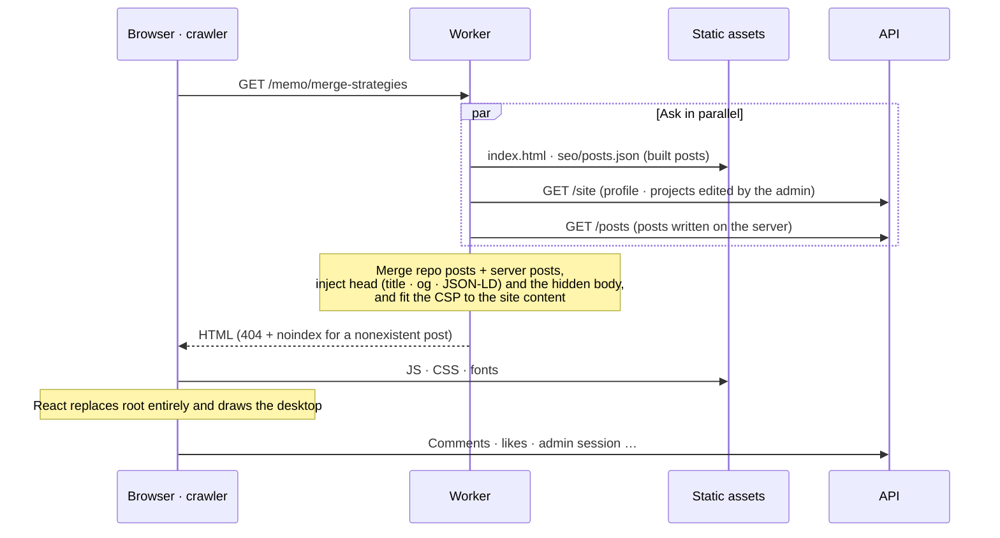
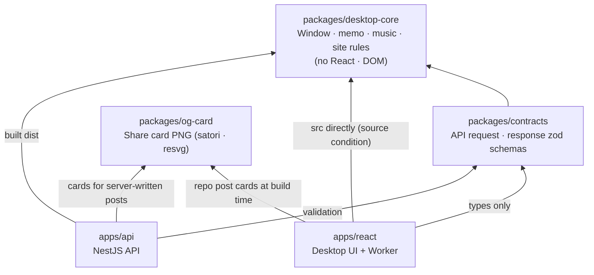
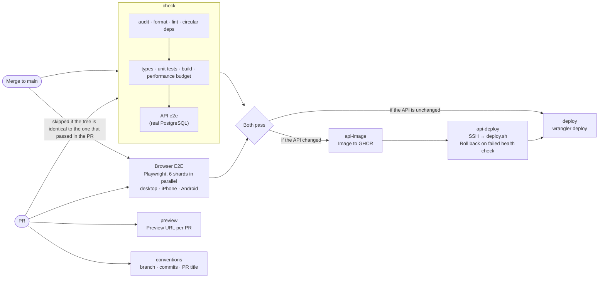

<div align="center">

# MacFolio

**English** · [한국어](README.md)

**A portfolio that brings the macOS desktop to the web**

Open apps from the Dock, drag windows around, and read the blog in the Memo app.<br>
Open it on a phone and it becomes an iOS home screen.

<a href="https://macfolio.hyeoniverse.com"></a>
<a href="https://macfolio-api.hyeoniverse.com/docs"></a>
<a href="https://macfolio.hyeoniverse.com/memo/day-1020"></a>

[](https://github.com/hyeoniverse/MacFolio/actions/workflows/ci.yml)


<picture>
  <source media="(prefers-color-scheme: dark)" srcset="docs/images/readme-hero-dark.jpg">
  
</picture>

<sub>View GitHub in dark mode and the site shows in dark mode too.</sub>

<br>

<table>
  <tr>
    <td align="center" width="25%"><h3>1</h3>developer</td>
    <td align="center" width="25%"><h3>$0</h3>running cost</td>
    <td align="center" width="25%"><h3>0</h3>open ports</td>
    <td align="center" width="25%"><h3>230+</h3>dev log posts</td>
  </tr>
</table>

| [🖥️ Overview](#overview) | [🧭 Usage](#usage) | [🏗️ Architecture](#architecture) | [⚡ Performance](#performance) | [🛠️ Development](#development) | [📚 Docs](#docs) |
| :----------------------: | :----------------: | :------------------------------: | :----------------------------: | :----------------------------: | :--------------: |

</div>

## Overview

[Demo](#demo) · [Features](#features)

### Demo

<div align="center">
  
  <br>
  <sub>Open Memo from the Dock → read a post → drag the window → open Music (the deployed site as-is)</sub>
</div>

### Features

About 20 apps open as windows, just like on macOS. Every screenshot below was taken from the actual running site.

<table>
  <tr>
    <td width="50%" valign="top">
      
      <h4>📝 Memo = blog</h4>
      Folders (categories) · #tags in the body · list/gallery view · search and find & replace. Each post shows its view count, and the 10 <b>popular posts</b> picked by views, comments, and likes are collected separately. When logged in as admin, the post itself becomes the editor, with drafts · publishing · version history · scheduled publishing · secret posts (shown only to the admin) · locking · Recently Deleted (kept for 30 days).
    </td>
    <td width="50%" valign="top">
      
      <h4>🗂️ Finder</h4>
      Browse documents · blog · photos · music like files, through a Macintosh HD › Users › home tree. The repo's README and docs can be read here too, and the admin uploads files by dragging them in.
    </td>
  </tr>
  <tr>
    <td valign="top">
      
      <h4>🧭 Safari = projects</h4>
      Flip through each project's intro page as tabs. Deployed sites (such as the game Sprout Farm (새싹 농장)) run right inside a window as project apps in the Dock.
    </td>
    <td valign="top">
      
      <h4>🎵 Music</h4>
      Playlists · shuffle · repeat · queue. Playback can also be controlled from the menu bar and widgets. On a phone, Now Playing follows the iOS 18 Music layout (swipe down to close, queue view, ••• menu), and tapping the loading screen grants playback so background music starts right away even in iOS Safari.
    </td>
  </tr>
  <tr>
    <td valign="top">
      
      <h4>🖼️ Photos</h4>
      Groups each project's screenshots into albums and shows them in an aspect-ratio-preserving grid. Folders created in Finder › Pictures also become albums, and videos live in the same library.
    </td>
    <td valign="top">
      
      <h4>⌨️ Terminal</h4>
      <code>help</code> · <code>whoami</code> · <code>neofetch</code> · <code>skills</code> · <code>projects</code> · <code>open memo</code>. On a phone it becomes <b>Shortcuts</b>, where you tap a command to run it.
    </td>
  </tr>
  <tr>
    <td valign="top">
      
      <h4>⚙️ System Settings</h4>
      Appearance (light · dark · auto), wallpaper (including photos · videos uploaded by the admin), sound, privacy, admin account.
    </td>
    <td valign="top">
      
      <h4>📈 Activity Monitor</h4>
      Visits · unique visitors · app opens · time on site, referrers, search terms (Google Search Console), region · device, real time, server status. Counted with a daily hash, no cookies, and refreshed periodically only while the window is visible.
    </td>
  </tr>
  <tr>
    <td valign="top">
      
      <h4>⛅ Weather</h4>
      Search for a city to see hourly · 10-day forecasts, feels-like temperature, humidity, and wind ([Open-Meteo](https://open-meteo.com/)).
    </td>
    <td valign="top">
      
      <h4>📚 API Docs</h4>
      Opens the backend's OpenAPI docs as an app inside the site. Each endpoint shows request · response examples.
    </td>
  </tr>
  <tr>
    <td valign="top">
      
      <h4>💡 Tips · tour</h4>
      A one-minute tour for first-time visitors that points out the Dock · menu bar · résumé. The Tips app lets you revisit tips by topic, such as how to read the blog or how to handle windows and the Dock.
    </td>
    <td valign="top">
      
      <h4>📄 TextEdit = résumé</h4>
      The résumé is a single Markdown page. Read it in preview in TextEdit and download it as a PDF; the admin edits it directly with the formatting bar.
    </td>
  </tr>
</table>

<table>
  <tr>
    <td width="50%"></td>
    <td width="50%" valign="top">
      <h4>🧩 Widgets</h4>
      Widgets go on the desktop like macOS Sonoma, and on each home screen page like iOS. Nine kinds — weather · calendar · clock · music · memo · photos · GitHub contribution graph · about · quote — are shared by desktop and phone.<br><br>
      On the desktop, open the gallery with <b>Edit Widgets…</b> to add them and drag them onto the cell grid. The Memo widget shows recent, popular, or random posts, and the Photos widget cycles through photos and videos from an album or the Pictures folder and opens the current one full size when tapped. On a phone, long-press the home screen to drag widgets into a new order or onto the next page.
    </td>
  </tr>
</table>

<table>
  <tr>
    <td width="25%"></td>
    <td width="25%"></td>
    <td width="50%" valign="top">
      <h4>📱 Phone</h4>
      At a screen width of 767px or less it becomes an iOS home screen. Widgets on every page (long-press to remove, add, and drag to move), a swipeable paged home screen, swipe up from the bottom to go home, swipe down from the top for Control Center.<br><br>
      Finder becomes <b>Files</b>, Terminal becomes <b>Shortcuts</b>, and admin login becomes the <b>Passwords</b> app. The share button opens the share sheet.
    </td>
  </tr>
</table>

<table>
  <tr>
    <td width="33%" valign="top"><h4>💬 Messages</h4>Leave feedback and replies without logging in. Your name is set by a visitor cookie (🦊 날쌘 여우, "swift fox"), and you can delete your own messages from the same browser. Help (도움말) › Report a Problem (문제 알리기…) in the menu bar opens this screen too, with a link to GitHub issues for bugs.</td>
    <td width="33%" valign="top"><h4>🗨️ Comments · likes</h4>Written under your visitor name and deletable from the same browser. The server keeps only HMACs of the visitor token and IP.</td>
    <td width="33%" valign="top"><h4>🔐 Admin login</h4>GitHub OAuth lets in only my account. There is no password, and the DB holds only hashes of session tokens.</td>
  </tr>
</table>

<p align="right"><a href="#macfolio">↑ Back to tabs</a></p>

## Usage

[Visitors](#visitors) · [Admin](#admin) · [Information architecture](#information-architecture)

### Visitors

| What you want          | How                                                                                                                                                                             |
| ---------------------- | ------------------------------------------------------------------------------------------------------------------------------------------------------------------------------- |
| Open an app            | Click its icon in the Dock. You can also open it from Terminal, e.g. `open memo`                                                                                                |
| Handle windows         | Drag the title bar to move, drag the edges to resize. 🔴 close · 🟡 minimize · 🟢 full screen                                                                                   |
| Read the blog          | Memo app. Narrow down with the folders on the left, switch list/gallery with the buttons on top, and search in the search field                                                 |
| Share a link           | Press the share button on a post in Memo or a project in Safari to copy the address (share sheet on phones)                                                                     |
| Leave feedback         | Just type your message in the Messages app or Help (도움말) › Report a Problem (문제 알리기…). Your name is assigned automatically, and you can delete it from the same browser |
| Learn about me         | In Terminal: `help`, `whoami`, `neofetch`, `skills`, `projects`, `contact`                                                                                                      |
| First look around      | Follow the tour shown on your first visit, or see tips by topic in the Tips app in Launchpad                                                                                    |
| See the résumé         | The Résumé folder on the desktop or `resume` in Terminal. Read it in TextEdit and download it as a PDF                                                                          |
| Place widgets          | Right-click the desktop → Edit Widgets… (위젯 편집…); on a phone, long-press the home screen                                                                                    |
| Change the look        | System Settings → Appearance (light · dark), Wallpaper                                                                                                                          |
| Clear data left behind | Trash at the right end of the Dock → see and empty the settings · search terms this site stored in your browser                                                                 |

Every post and project has an address. Arriving at `/memo/<post>` (e.g. `/memo/cra-to-vite`) or `/safari/<project>` (e.g. `/safari/sproutfarm`) opens that app on that screen after the loading screen. When you select a post or tab, the browser's address bar also changes to the frontmost window's address.

On a phone, tap icons on the home screen and swipe up the bottom bar to return home. Swiping down from the top opens Control Center. Terminal becomes **Shortcuts** (단축어), where you tap a command to run it.

### Admin

1. On desktop, log in with GitHub via **Apple menu on the left of the menu bar → Admin login (관리자 로그인)**; on a phone, via the **Passwords (암호)** app. If the server is briefly unreachable, **Check again (다시 확인)** in the Apple menu asks again right away.
2. Clicking a post in the Memo app lets you edit it directly. While editing, only drafts are saved; it is visible to visitors only after you **Publish (게시)**. Publishing with a future date schedules it.
3. Creating · renaming folders, moving posts (drag and drop), pinning, marking posts secret, locking, restoring from Recently Deleted, deleting comments, and uploading photos to Finder › Pictures also work only when logged in.
4. Login status and sessions are shown in **System Settings → Account (계정)**. Sessions last 12 hours.
5. Images · attachments that remain on the server after being removed from posts are shown in **Trash → Server files (서버 파일)**. Only files that nothing uses can be deleted.

Hiding the edit buttons on screen is only a UI hint; the server checks permissions on every request.

### Information architecture

The site draws one desktop at a single address (`/`). At a screen width of 767px or less, the same apps are shown as an iOS home screen. App names · icons · Dock positions are defined in one place, `src/apps/manifest.ts`, and the Dock · Launchpad · Terminal `open` · phone home screen all read this list.



<details>
<summary><b>Finder's file tree</b></summary>

**Finder's file tree**: as on macOS, there is a user folder under the disk, and you browse the site's documents · posts · photos · music like files.

```text
Macintosh HD
├── 응용 프로그램        App list (opening one opens that app)
└── 사용자
    └── hyeoniverse      Home
        ├── 데스크탑      Files placed on the desktop
        ├── 문서          Résumé · Portfolio (project folders) · Certificates · repo docs
        ├── 블로그        Memo app folders and posts
        ├── 그림          Photos app albums and uploaded pictures (picked by the Photos widget)
        ├── 음악          Music app artist › album › song
        └── 공용 · 다운로드 · 동영상
```

(Folder names are the Korean UI labels: 응용 프로그램 = Applications, 사용자 = Users, 데스크탑 = Desktop, 문서 = Documents, 블로그 = Blog, 그림 = Pictures, 음악 = Music, 공용 · 다운로드 · 동영상 = Public · Downloads · Movies.)

</details>

<details>
<summary><b>Screens by address and what search bots receive</b></summary>

**Addresses**: only app screens worth sharing get an address. Arriving at one shows the loading screen and then opens that app on that screen; selecting a window changes the address bar to the frontmost window's address.

| Address                            | Screen                    | What search bots get                                                   |
| ---------------------------------- | ------------------------- | ---------------------------------------------------------------------- |
| `/`                                | Desktop                   | Intro, links to all posts · projects, Person · WebSite structured data |
| `/memo/<post>`                     | That post in the Memo app | Post body (with images), BlogPosting, share card                       |
| `/safari/<project>`                | That project in Safari    | Project intro, CreativeWork                                            |
| `/sitemap.xml`                     | Sitemap                   | Home · all posts (last modified) · all projects                        |
| `/rss.xml`                         | RSS feed                  | Titles · summaries of all posts                                        |
| Nonexistent post · project address | Desktop (404, `noindex`)  |                                                                        |

</details>

<p align="right"><a href="#macfolio">↑ Back to tabs</a></p>

## Architecture

[System overview](#system-overview) · [How the first screen gets rendered](#how-the-first-screen-gets-rendered) · [Packages](#packages) · [CI/CD](#cicd) · [Tech stack](#tech-stack) · [Structure](#structure)

### System overview

The frontend is a Worker and static files on Cloudflare; the API is a single free VM on Oracle Cloud. The server opens no inbound ports and receives requests only through [Cloudflare Tunnel](https://developers.cloudflare.com/cloudflare-one/connections/connect-networks/). Running cost is $0.



- **Same site, different subdomains**: the frontend (`macfolio.`) and the API (`macfolio-api.`) are both under `hyeoniverse.com`, so the `SameSite=Lax` session cookie is sent along.
- **The Worker handles only the first screen**: existing files (`/assets/*`, images) are served by Cloudflare directly without going through the Worker. Only the first screen, app addresses, sitemap · RSS, and `/files/*` reach the Worker.
- **The site loads even if the API is down**: the Worker waits only 1.5 seconds for the API, and if it can't reach it, renders with the repo's posts and the default profile in code. The UI also runs without the API, with only login · editing turned off.

The layers a request passes through, the data model, and the design decision table are in [docs/en/backend-design.md](docs/en/backend-design.md).

### How the first screen gets rendered

The site is rendered only with JavaScript, so crawlers that don't run scripts see a blank page. So the Worker injects a title · description · structured data and a hidden body for each address into `index.html` before sending it.



### Packages

A monorepo tied together with pnpm workspaces and Turborepo. Shared packages were extracted so the UI and the server use the same rules.



- **The same rules, written once**: checks for post slug · date · length, folder paths, and the site profile live in `desktop-core`; the shape of API requests · responses lives in `contracts`. The UI and the server validate with the same functions, so one side can't change alone.
- **Development without rebuilding**: the UI (Vite · Vitest) reads packages' `src` directly, while the server (Node) uses the built `dist`. Turborepo builds packages first (`dependsOn: ["^build"]`).

### CI/CD



There are also scheduled checks: Semgrep static analysis (`sast`), gitleaks secret scanning (`secrets`), and a site · API health check every 10 minutes (`uptime`).

### Tech stack

<p align="center">
  
</p>

The decision process is in [#8](https://github.com/hyeoniverse/MacFolio/issues/8).

| Area       | What I used                                                                                                                                                                                                                                                         |
| ---------- | ------------------------------------------------------------------------------------------------------------------------------------------------------------------------------------------------------------------------------------------------------------------- |
| Frontend   | [React](https://react.dev/) 19, [TypeScript](https://www.typescriptlang.org/), [Vite](https://vite.dev/), [Milkdown](https://milkdown.dev/) (editor), [react-markdown](https://github.com/remarkjs/react-markdown) + [lowlight](https://github.com/wooorm/lowlight) |
| Backend    | [NestJS](https://docs.nestjs.com/), [Prisma](https://www.prisma.io/docs) 7, [PostgreSQL](https://www.postgresql.org/docs/), Swagger                                                                                                                                 |
| Monorepo   | [pnpm workspaces](https://pnpm.io/workspaces), [Turborepo](https://turborepo.com/docs)                                                                                                                                                                              |
| Testing    | [Vitest](https://vitest.dev/) (unit), [Playwright](https://playwright.dev/) (E2E: desktop · iPhone · Android), [supertest](https://github.com/ladjs/supertest) (API e2e)                                                                                            |
| Deployment | [Cloudflare Workers](https://developers.cloudflare.com/workers/) (frontend), [Oracle Cloud](https://www.oracle.com/cloud/free/) VM + Docker Compose + Cloudflare Tunnel (API)                                                                                       |
| CI         | [GitHub Actions](https://docs.github.com/en/actions): format → lint → circular deps → types → tests → build → performance budget → API e2e → E2E, security checks                                                                                                   |

Expand each item to see **why I chose it and where and how I used it**.

<details>
<summary><b>Frontend</b> — React 19 · Vite · Milkdown · react-markdown</summary>

**React 19 + TypeScript + Vite**

- **Why:** there is only one screen, the desktop, and window dragging, audio, and gestures all run in the browser. Routing and server rendering aren't needed, so I kept it an SPA instead of Next.js. Create React App, which I used at first, was deprecated in February 2025, so I moved to Vite, and dev server startup dropped from 5.05s to 0.58s ([measurements](docs/en/migration-cra-to-vite.md))
- **How:**
  - Each app gets one folder (`src/apps/<app>`), and names · icons · window sizes · mobile names are defined in one place, `manifest.ts`. The Dock, Launchpad, Terminal's `open`, and the mobile home screen all read this list
  - Window positions · stacking order, admin login state, and music playback live in small stores (`createStore`) subscribed to with `useSyncExternalStore`
  - Framework-independent logic is split out into `packages/desktop-core` ([#16](https://github.com/hyeoniverse/MacFolio/issues/16)). It currently holds the store, window management (open · close · minimize · stacking order), memo logic (reading · sorting · filtering posts, tags, folder organization, find, post validation), and the music playback queue (shuffle · repeat, next · previous track); the React side keeps only hooks that subscribe to stores and the UI. This package is blocked from importing DOM types and React
  - The server (`apps/api`) also takes memo organization validation, folder paths, and post length · date rules from `desktop-core`. React reads `src` directly, and the server uses the built `dist` (`exports` conditions in `package.json`)
  - Vite's `import.meta.glob` bundles blog posts (Markdown) and images at build time. `VITE_API_URL` is also baked into the code at build time
  - The Memo window uses CSS container queries to change the toolbar and list layout based on window width. Because the reference is the window width, not the screen width, it adapts correctly when the window is shrunk

**Milkdown (editor)**

- **Why:** I wanted the admin to edit posts **as they appear** while storing them as Markdown. Milkdown reads and writes Markdown directly on top of ProseMirror. Post files in the repo and posts saved on the server share the same format, so one can be overlaid on the other
- **How:** the 가가 (formatting) menu, checklist · table · image blocks, table handles, and ⌘F find & replace are built as ProseMirror plugins and commands (`src/apps/memo/writer/`). The editing and reading views share the same CSS, so a post looks the same when logged in

**react-markdown + remark-gfm + lowlight (reading view)**

- **Why:** visitors don't need an editor. A lightweight renderer shows even tables · checklists (GFM), and code highlighting uses the same lowlight as the editor so both views have identical colors
- **How:** images are rendered by a component with a caption · enlarge · download buttons, and in-post find paints matches with the CSS Custom Highlight API (`::highlight()`) without touching the DOM

</details>

<details>
<summary><b>Backend</b> — NestJS · Prisma 7 · PostgreSQL · GitHub OAuth</summary>

The architecture diagram, request flow, data model, and design decision table are in [docs/en/backend-design.md](docs/en/backend-design.md).

**NestJS**

- **Why:** a static site alone can't distinguish the admin, and Firebase, which I used at first, had open rules so anyone could read the password in plain text. I needed an API that validates on the server. I also considered Hono · Cloudflare Workers, but chose NestJS because it appears often in Korean job postings and its module · guard · pipe structure resembles Spring, making the design clear
- **How:**
  - `AdminGuard`: admin-only APIs (writing posts, organizing memos, uploads) check the session cookie against the DB on every request. The server blocks access regardless of whether the edit buttons are hidden on screen
  - `ValidationPipe` + class-validator: every input is validated with a DTO, and undeclared fields are rejected
  - `@nestjs/throttler`: per-IP rate limits on each write route (`@RateLimit`). Behind the tunnel, `TRUST_PROXY` is used to read the real IP
  - helmet (security headers); CORS allows only the site's address and gives no cookies to PR preview addresses; the server is reachable only by SSH key and the API container runs as a non-root user (checked with `ops/audit.sh`); a global exception filter unifies the error shape and hides the details of unexpected errors
  - Swagger: the [API docs](https://macfolio-api.hyeoniverse.com/docs) are generated automatically from the controllers

**Prisma 7 + PostgreSQL**

- **Why:** types and migrations both come from a single schema, so the DB is handled in the same TypeScript as the frontend. I chose PostgreSQL because CHECK constraints let the DB enforce the rules one more time
- **How:**
  - A post keeps **two copies in one row, the published content and the draft**, and a version (`PostRevision`) is recorded on every publish. Rules like "if published, it must have a title · body" are enforced with CHECK constraints (in migration SQL, since the Prisma schema can't express them)
  - Sessions store only the SHA-256 hash instead of the raw token, and visitor cookie tokens and IPs only as HMACs (comments from the era when a name · password was required store an scrypt hash of the password)
  - Uploaded images · attachments also live in the DB (`bytea`). With a single server there's no separate file storage, and one backup keeps posts and files together. Posts and files are linked only by `/files/<id>` strings in the body, so for files left behind after being removed from a post, the admin looks up where they're used (current posts · old versions · wallpaper) and deletes them
  - On startup the server applies migrations with `prisma migrate deploy` (local `pnpm dev:api` · `dev:all` do the same, so saving doesn't fail with a 500 even if the DB is behind after checking out a branch)

**GitHub OAuth (admin login)**

- **Why:** there is one admin: me. Creating passwords would mean building hashing · reset as well, so I verify with the GitHub account I already use
- **How:** a `state` cookie prevents login CSRF, and the admin is identified by the immutable numeric ID rather than the account name. The session cookie is `httpOnly` · `Secure` · `SameSite=Lax`, 12 hours

</details>

<details>
<summary><b>Monorepo: pnpm workspaces + Turborepo</b></summary>

- **Why:** I put the frontend and API in one repo as a monorepo so I can change and test them together. pnpm installs fast with strict dependencies, and Turborepo handles build order and caching between packages
- **How:** the root `pnpm build` · `pnpm test` · `pnpm lint` run the two apps and three packages (`desktop-core`, `contracts`, `og-card`) together. `pnpm dev:all` starts the frontend and API together. `pnpm cycles` ([madge](https://github.com/pahen/madge)) blocks circular imports

</details>

<details>
<summary><b>Testing</b> — Vitest · Playwright · supertest</summary>

**Vitest (unit)**: checks pure functions separated from the UI, such as window position calculations, memo organization · search · find rules, input rules, and sessions · hashes. It shares config with Vite, so there's no separate bundling setup

**Playwright (E2E)**

- **Why:** this site has many behaviors that only show up in a real browser, such as dragging, swiping, and animations
- **How:**
  - Runs on three screens: desktop Chrome, iPhone, and Android
  - Admin features are tested with a **fake API** built with `page.route`. Login · writing · publishing · comments are verified without a server, and the screenshots in the README and blog were taken with the same fake API
  - Runs against the build output (`vite preview`), so it checks the same code that gets deployed

**supertest (API e2e)**: attaches to a real PostgreSQL and checks permissions (401 for non-admins, 400 for rule violations), that only hashes are stored, and even rate limits (429). Only the requests to GitHub are faked

</details>

<details>
<summary><b>Deployment</b> — Cloudflare Workers · Oracle Cloud VM · Cloudflare Tunnel</summary>

**Cloudflare Workers (frontend)**

- **Why:** the UI is static files and needs no server, and the domain's DNS is already on Cloudflare. Merging to main builds · deploys it, and every PR gets a preview URL
- **How:** `dist` is uploaded as static assets, with a small Worker (`apps/react/worker/`) in front of it
  - First screen and app addresses: injects the site content edited by the admin into `index.html`, and attaches a CSP that also allows those demo addresses
  - Search: injects a title · description · Open Graph · structured data and a hidden body for each address, and builds sitemap · RSS including posts written on the server. Nonexistent post addresses return 404
  - Document files (`/files/<key>`) are served from an R2 bucket at the same address (so Finder can show PDFs in an iframe)
  - At build time, repo posts are pre-rendered to HTML (`seo/posts.json`), and posts without a photo get a share card (1200×630 PNG) drawn from their title

**Oracle Cloud Always Free VM + Docker Compose (API)**

- **Why:** it's a VM that's free with no time limit. Free hosting like Render goes to sleep after 15 minutes without requests and takes about a minute to wake up. It has the same structure as EC2 (Linux VM + Docker), so I get to operate it myself
- **How:** Postgres, the API, and cloudflared run together with compose. A multi-stage Dockerfile puts only the compiled output and runtime dependencies in the runtime image. When an API change lands on main, Actions pushes the image to GHCR and calls the server's `ops/deploy.sh` over SSH. If the new container fails its health check, it rolls back to the previous image ([rollback drill](docs/en/rollback-drill.md)). The deploy key is restricted to running only `deploy.sh`

**Cloudflare Tunnel (HTTPS)**

- **Why:** with nginx + Let's Encrypt I'd have to open ports 80/443 and renew certificates. The tunnel only makes **outbound** connections from the server to Cloudflare, so no port other than SSH is open, and the server IP isn't exposed
- **How:** the frontend (`macfolio.`) and the API (`macfolio-api.`) are subdomains of the same site (`hyeoniverse.com`), so the session cookie is sent along even with `SameSite=Lax`

The detailed steps are in [docs/en/deployment.md](docs/en/deployment.md).

</details>

<details>
<summary><b>CI: GitHub Actions</b></summary>

- On every PR and push to main, a single `check` job runs dependency vulnerabilities → format → lint → circular deps → type check → unit tests → build → performance budget → API e2e (PostgreSQL service container), while browser E2E runs at the same time split into 6 shards. On failure, the Playwright report is uploaded. On main, E2E isn't rerun if the code is the same as what already passed in the PR
- The dependency vulnerability check can fail without any code change when a new advisory is published. Transitive dependencies are pinned to fixed versions with `overrides` in `pnpm-workspace.yaml`, in a PR separate from feature work ([#371](https://github.com/hyeoniverse/MacFolio/pull/371), [#374](https://github.com/hyeoniverse/MacFolio/pull/374), [write-up (Korean)](https://macfolio.hyeoniverse.com/memo/ci-failures-after-merges))
- Performance budget: `check` fails if the brotli size of the built `boot` bundle or the first-visit bundle exceeds its limit (`apps/react/scripts/perf/budget.mjs`, [docs/en/performance.md](docs/en/performance.md))
- `conventions`: checks that the branch name, PR title, and commit messages follow the [contribution rules](CONTRIBUTING.md)
- Commits on main are deployed only after passing tests. If the API changed, the API is deployed first (`api-image` → `api-deploy`), then `deploy` uploads to Cloudflare Workers. This order keeps the new UI from hitting the old API first
- For PRs from the same repo, `preview` posts a preview URL as a PR comment (only for PRs that change the frontend). Previews are `noindex`, so they don't show up in search
- `sast` (Semgrep), `secrets` (gitleaks), and `uptime` (health check every 10 minutes) run separately
- A Ruleset on `main` makes `check` and `conventions` required checks, so both must pass to merge ([how to set it up](CONTRIBUTING.md#저장소-설정))

</details>

### Structure

<details>
<summary><b>Folder structure</b></summary>

```
apps/
  react/                  Desktop UI (Vite + React)
    src/apps/             One folder per app (manifest.ts is the single source of the app list, registry.ts wires up components)
    src/apps/memo/content Blog posts (Markdown) and images
    src/desktop/          Windows, Dock, menu bar, mobile shell (connects the UI and hooks)
    src/shared/           Common UI components (ui/), API calls, storage, profile · projects
    worker/               Cloudflare Worker: first screen, SEO, CSP, sitemap · RSS, R2 document files
    seo/                  Search files generated at build time (post HTML, sitemap, RSS, share cards)
    e2e/                  Playwright (fake API: e2e/fakeApi.ts)
  api/                    NestJS API (admin login, posts, comments, messages, files, demos, resource monitoring)
    prisma/               Schema and migrations (CHECK constraints in SQL)
packages/
  desktop-core/           Framework-independent logic: stores, window management, memo, music, site rules (tested without React · DOM)
  contracts/              zod schemas for API requests · responses (validation on the server, types in the UI)
  og-card/                Share card images for posts (the build draws repo posts, the API draws server-written posts)
ops/                      Server scripts: deploy · rollback, backup · restore, security audit
docs/                     Backend design, deployment, UI components, security scan, privacy, migration notes
wrangler.jsonc            Cloudflare Workers config
```

</details>

<p align="right"><a href="#macfolio">↑ Back to tabs</a></p>

## Performance

I measured first-visit performance with Lighthouse, fixed the bottlenecks (3.8MB of fonts, 2.4MB of raw blog text and all app code in the initial bundle, large images · videos, a loading screen rendered by JS, and a desktop pre-rendered behind the loading screen) in three rounds, and measured again under the same conditions. The re-measurement (Round 4) split the quote widget data that had crept into the initial bundle, bringing the `boot` bundle back from 65KB to 47KB compressed. Round 5 fixed why phone LCP was sometimes counted again in the 4-second range (React removed the HTML's first render before it was recorded as LCP) and added CI limits on first-visit bundle size (a performance budget). The drop in first-visit transfer in Round 5 comes from deferring the body font and wallpaper until the loading screen is tapped.

**Local** (ranges across alternating runs)

| Item                         | Phone before → Round 3 → Round 5 | Desktop before → Round 3 → Round 5 |
| ---------------------------- | -------------------------------- | ---------------------------------- |
| Lighthouse performance       | 55 → 78\~87 → **85\~99**         | 62 → 98 → **100**                  |
| FCP                          | 14.3s → 3.2s → **1.7\~3.3s**     | 2.5s → 0.7s → **0.5\~0.7s**        |
| LCP                          | 25.7s → 3.2s → **1.7\~3.4s**     | 5.8s → 1.1s → **0.5\~0.7s**        |
| Transfer size on first visit | 4,893KB → 483KB → **278KB**      | 9,050KB → 771KB → **278KB**        |

**Production** (median of 5 runs)

| Item                         | Phone before → after Round 1 → after Round 3 | Desktop before → after Round 1 → after Round 3 |
| ---------------------------- | -------------------------------------------- | ---------------------------------------------- |
| Lighthouse performance       | 53 → 73 → **98**                             | 60 → 89 → **97**                               |
| LCP                          | 31.5s → 7.1s → **1.9s**                      | 5.8s → 2.1s → **1.0s**                         |
| Transfer size on first visit | 6,342KB → 1,239KB → **602KB**                | 7,134KB → 3,229KB → **889KB**                  |

Measurement conditions, bottlenecks, fixes, and how to measure again are in [docs/en/performance.md](docs/en/performance.md); the re-measurement is written up in [the re-measurement post](apps/react/src/apps/memo/content/site-performance-remeasure.md) (Korean).

### CRA → Vite migration

<details>
<summary><b>Before/after measurements</b></summary>

Moved from the deprecated Create React App to Vite.

| Item               | CRA      | Vite     |
| ------------------ | -------- | -------- |
| Dev server startup | 5.05s    | 0.58s    |
| Production build   | 6.33s    | 1.88s    |
| JS bundle (gzip)   | 138.2 KB | 127.7 KB |
| Installed packages | 1,438    | 171      |

The measurement method and migration process are in [docs/en/migration-cra-to-vite.md](docs/en/migration-cra-to-vite.md).

</details>

<p align="right"><a href="#macfolio">↑ Back to tabs</a></p>

## Development

[Running locally](#running-locally) · [Writing blog posts](#writing-blog-posts) · [Deployment](#deployment)

### Running locally

Requires Node 22 and pnpm (versions pinned in `.node-version` and `package.json`).

```bash
corepack enable
pnpm install
pnpm dev          # Frontend only: http://localhost:5173
```

It starts right away with no configuration. Without the API, only login and editing are turned off, and the blog is shown from the repo's Markdown.

The Messages app stores data on the server, so without the API it shows "메시지를 열 수 없습니다" ("Can't open messages") and doesn't open. To see the Messages screen without the API, make it store data only in this browser.

```bash
echo 'VITE_MESSAGES_STORE=local' >> apps/react/.env.local
```

Running the API as well requires Docker.

```bash
cp apps/api/.env.example apps/api/.env          # Use a development OAuth App for the GitHub OAuth values
echo 'VITE_API_URL=http://localhost:4000' > apps/react/.env.local
pnpm --filter @macfolio/api db:up                # PostgreSQL
pnpm dev:all                                     # Frontend 5173 + API 4000 (docs: /docs)
```

<details>
<summary><b>Command reference</b></summary>

| Command                                  | Description                      |
| ---------------------------------------- | -------------------------------- |
| `pnpm dev`                               | Frontend dev server              |
| `pnpm dev:api`                           | API dev server                   |
| `pnpm dev:all`                           | Both                             |
| `pnpm build`                             | Build all packages               |
| `pnpm typecheck`                         | Type check                       |
| `pnpm lint`                              | Lint                             |
| `pnpm test`                              | Unit tests                       |
| `pnpm --filter @macfolio/api test:e2e`   | API e2e (requires DB)            |
| `pnpm --filter @macfolio/react test:e2e` | Browser E2E (after `pnpm build`) |

</details>

### Writing blog posts

There are two ways.

- **On the site:** log in as admin and write directly in the Memo app. Posts are saved on the server (DB), and if you edit a repo post, the server post is shown in its place at the same address.
- **In the repo:** add a Markdown file to `apps/react/src/apps/memo/content/`. The file name becomes the post's address (e.g. `my-first-post.md`). Merging to main deploys it.

<details>
<summary><b>Front matter example and rules</b></summary>

```md
---
title: 글 제목
date: 2026-09-28
category: 개발기/MacFolio
summary: 목록에 보일 한 줄 요약 (없으면 본문 앞부분)
pinned: true # Pin to the top of the list (optional)
---

본문은 Markdown으로 씁니다. 표, 코드 블록, 링크를 쓸 수 있습니다.

')
```

(In the example: `title` = post title, `category` = 개발기 (dev log)/MacFolio, `summary` = a one-line summary shown in the list (defaults to the start of the body); the body says it's written in Markdown with tables, code blocks, and links; the image line has alt text and an optional caption shown below the image.)

- `title` and `date` (YYYY-MM-DD) are required. If missing or malformed, the post is left out of the list and a warning appears in the dev server console.
- `category` becomes the folder on the left. `/` creates subfolders, and selecting a parent folder also shows posts in its subfolders. Without it, the post goes into "기타" (Other).
- Put images in `content/images/` and reference them with a path relative to the post file. In gallery view, the first image in the body becomes the card preview.
- On build, posts go into the search HTML · sitemap · RSS. The image used when a link is shared is the first photo in the body (JPG · PNG · WebP · GIF), or a card drawn from the title if there's no photo (`packages/og-card`). Cards for posts written on the site are drawn by the API (`GET /posts/<post>/og.png`). The sitemap's `lastmod` is the date of the file's last commit.

</details>

### Deployment

| What      | Where                                                        | How                                                                                                    |
| --------- | ------------------------------------------------------------ | ------------------------------------------------------------------------------------------------------ |
| Frontend  | Cloudflare Workers (+ R2 document files)                     | On merge to main, GitHub Actions runs `wrangler deploy`                                                |
| API       | Oracle Cloud Always Free VM (Docker Compose)                 | For commits that change the API, Actions builds a GHCR image → SSH `deploy.sh` (rolls back on failure) |
| DB backup | Server and R2                                                | `ops/backup.sh` via daily cron and right before each deploy; restore with `ops/restore.sh`             |
| HTTPS     | Cloudflare Tunnel (the server opens no ports other than SSH) |                                                                                                        |

Everything from creating the VM to the OAuth App, tunnel, environment variables, and troubleshooting is in [docs/en/deployment.md](docs/en/deployment.md).

<p align="right"><a href="#macfolio">↑ Back to tabs</a></p>

## Docs

- [Contribution rules](CONTRIBUTING.md): branches, commits, issues, PRs, repo settings (required checks)
- [Backend design](docs/en/backend-design.md): architecture diagram, request flow, data model, design decisions
- [Common UI components](docs/en/ui.md): components and props in `shared/ui`, where they're used, candidates to extract next
- [Deployment](docs/en/deployment.md): Cloudflare Workers, Oracle VM, Cloudflare Tunnel, GitHub OAuth
- [Rollback drill](docs/en/rollback-drill.md): the procedure for deliberately deploying a version that fails the health check to the server to verify automatic rollback
- [CRA → Vite migration](docs/en/migration-cra-to-vite.md)
- [Performance measurement](docs/en/performance.md): Lighthouse measurement conditions and results, bottlenecks and fixes, how to measure again
- [Security scan](docs/en/security-scan.md): Semgrep · pnpm audit · osv-scanner results with per-item verdicts, licenses, CI criteria
- [Privacy](docs/en/privacy.md): what is stored, how, and when it's deleted
- [API](apps/api/README.md): running locally, tests, structure
- Dev log: the Memo app on the site → the 개발기 (dev log) folder (`apps/react/src/apps/memo/content/`). Good posts to start with (Korean):
  - [MacFolio 백엔드 한 장으로 보기](https://macfolio.hyeoniverse.com/memo/backend-design)
  - [자바스크립트로만 그리는 데스크톱을 검색엔진이 읽게 하기](https://macfolio.hyeoniverse.com/memo/seo-crawlable)
  - [API 서버를 무료로 띄우기 - Oracle VM과 Cloudflare Tunnel](https://macfolio.hyeoniverse.com/memo/deploy-api-oracle-tunnel)
  - [첫 방문 전송량 9MB를 0.8MB로](https://macfolio.hyeoniverse.com/memo/site-performance-diet)
  - [성능 5차 — 휴대폰 LCP가 4초대로 다시 집계되던 원인과 CI 성능 예산](https://macfolio.hyeoniverse.com/memo/site-performance-lcp-budget)
  - [PR을 머지하자 CI가 연달아 실패한 원인 네 가지](https://macfolio.hyeoniverse.com/memo/ci-failures-after-merges)
  - [리팩터링 계획을 마치며 — 일곱 단계 전후](https://macfolio.hyeoniverse.com/memo/refactor-retrospective)

### Roadmap

Architecture decisions and future plans are tracked in [#8](https://github.com/hyeoniverse/MacFolio/issues/8).

### License

- Source code: [MIT](LICENSE)
- Blog posts, images, the résumé and profile, and third-party assets such as fonts, music and wallpapers are not covered by the MIT License. See [LICENSE-CONTENT.md](LICENSE-CONTENT.md) for the scope.
- Report security vulnerabilities privately as described in [SECURITY.md](SECURITY.md), not in public issues.

<p align="right"><a href="#macfolio">↑ Back to tabs</a></p>
