<div align="center">

# MacFolio

**한국어** · [English](README.en.md)

**macOS 데스크톱을 웹으로 옮긴 포트폴리오**

Dock에서 앱을 열고, 창을 끌어 옮기고, 메모 앱에서 블로그를 읽습니다.<br>
휴대폰으로 열면 iOS 홈 화면이 됩니다.

<a href="https://macfolio.hyeoniverse.com"></a>
<a href="https://macfolio-api.hyeoniverse.com/docs"></a>
<a href="https://macfolio.hyeoniverse.com/memo/day-1020"></a>

[](https://github.com/hyeoniverse/MacFolio/actions/workflows/ci.yml)


<picture>
  <source media="(prefers-color-scheme: dark)" srcset="docs/images/readme-hero-dark.jpg">
  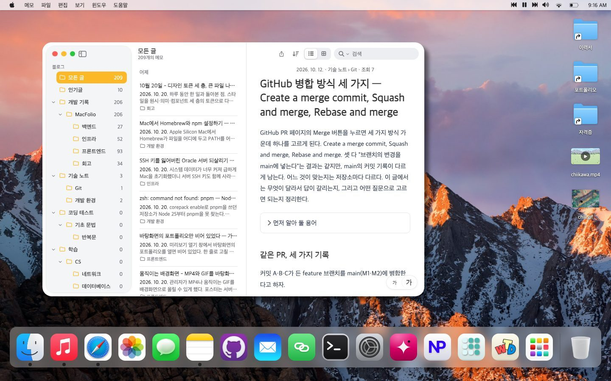
</picture>

<sub>GitHub를 다크 모드로 보면 사이트도 다크 모드로 보입니다.</sub>

<br>

<table>
  <tr>
    <td align="center" width="25%"><h3>1인</h3>개발</td>
    <td align="center" width="25%"><h3>0원</h3>운영비</td>
    <td align="center" width="25%"><h3>0개</h3>열린 포트</td>
    <td align="center" width="25%"><h3>230편+</h3>개발기</td>
  </tr>
</table>

| [🖥️ 소개](#소개) | [🧭 사용법](#사용법) | [🏗️ 아키텍처](#아키텍처) | [⚡ 성능](#성능) | [🛠️ 개발](#개발) | [📚 문서](#문서) |
| :--------------: | :------------------: | :----------------------: | :--------------: | :--------------: | :--------------: |

</div>

## 소개

[데모](#데모) · [기능](#기능)

### 데모

<div align="center">
  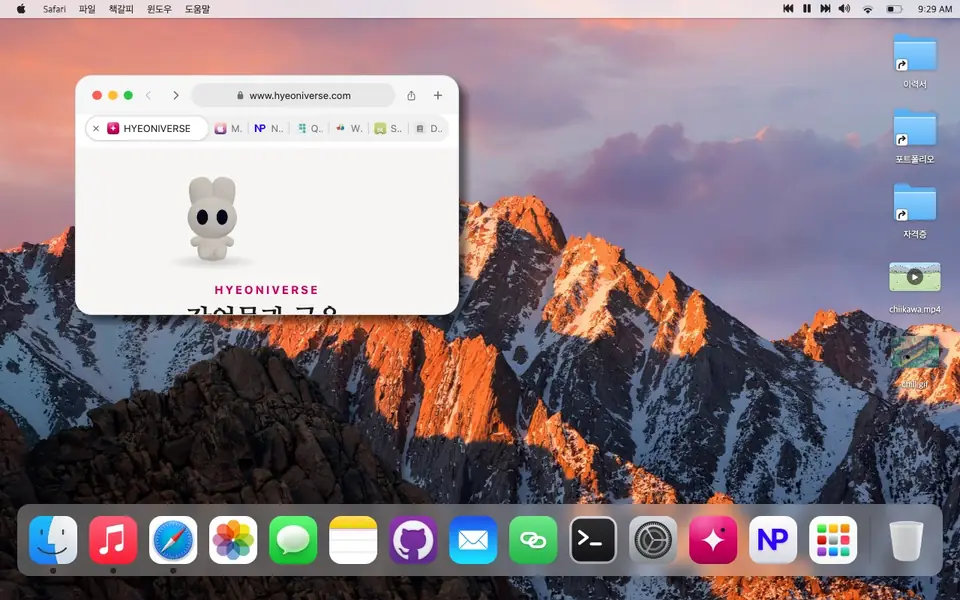
  <br>
  <sub>Dock에서 메모 앱 열기 → 글 읽기 → 창 끌어 옮기기 → 음악 앱 열기 (배포한 사이트 그대로)</sub>
</div>

### 기능

앱 20여 개가 macOS처럼 창으로 열립니다. 아래는 모두 사이트를 실제로 실행해 캡처한 화면입니다.

<table>
  <tr>
    <td width="50%" valign="top">
      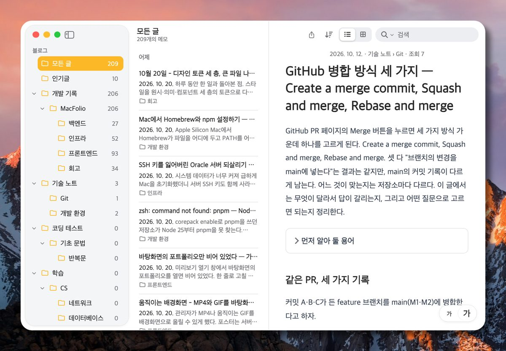
      <h4>📝 메모 = 블로그</h4>
      폴더(분류) · 본문의 #태그 · 목록/갤러리 보기 · 검색과 찾기·대치. 글마다 조회수를 표시하고, 조회·댓글·좋아요로 선정한 <b>인기글</b> 10편을 별도 폴더로 보여 줍니다. 관리자로 로그인하면 읽던 화면이 그대로 편집기가 되고, 임시 저장 · 게시 · 버전 기록 · 예약 발행 · 비밀 글(관리자에게만 표시) · 잠금 · 최근 삭제된 항목(30일 보관)을 지원합니다.
    </td>
    <td width="50%" valign="top">
      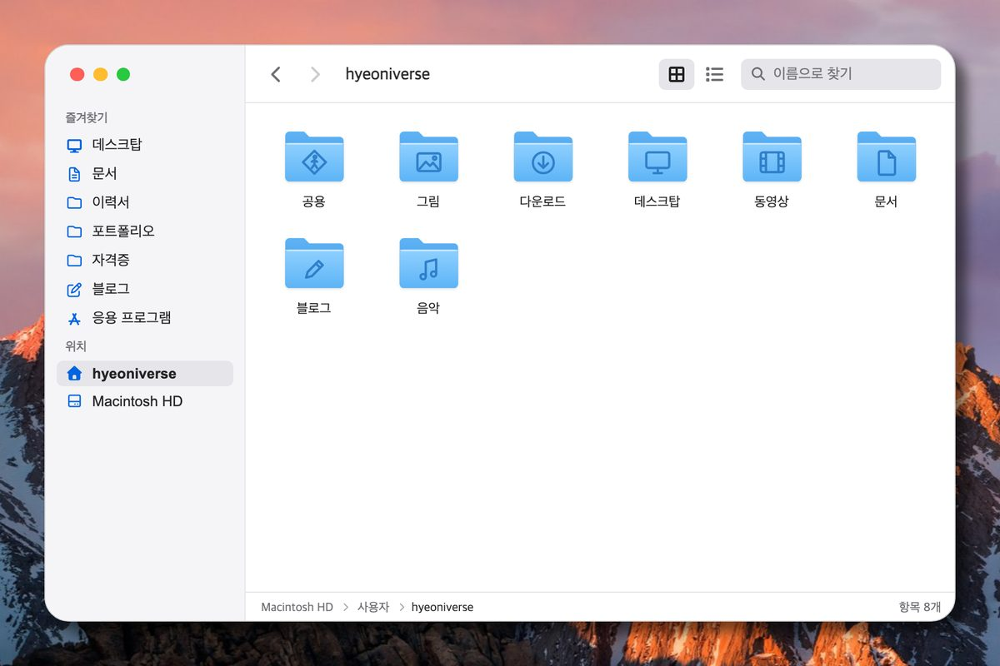
      <h4>🗂️ Finder</h4>
      Macintosh HD › 사용자 › 홈 트리로 문서 · 블로그 · 사진 · 음악을 파일처럼 둘러봅니다. 저장소의 README와 docs도 여기서 읽고, 관리자는 파일을 끌어다 놓아 업로드합니다.
    </td>
  </tr>
  <tr>
    <td valign="top">
      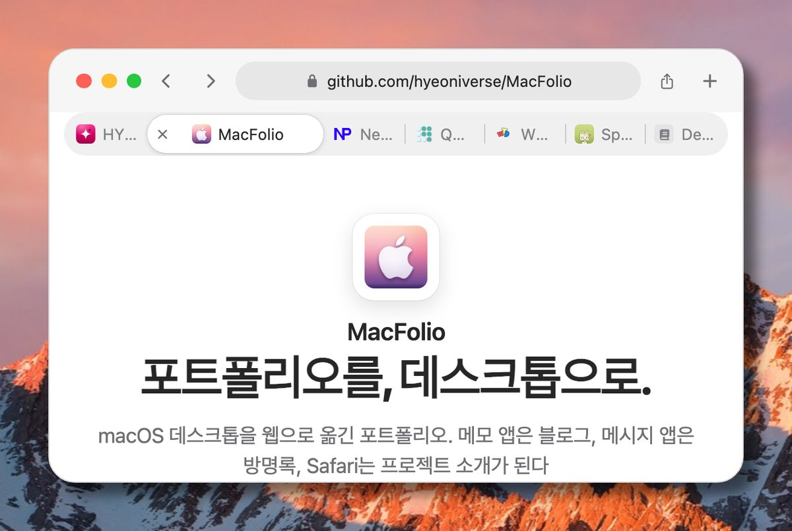
      <h4>🧭 Safari = 프로젝트</h4>
      프로젝트마다 소개 페이지를 탭으로 넘겨 봅니다. 배포한 사이트(게임 새싹 농장 등)는 Dock의 프로젝트 앱으로 창 안에서 바로 실행합니다.
    </td>
    <td valign="top">
      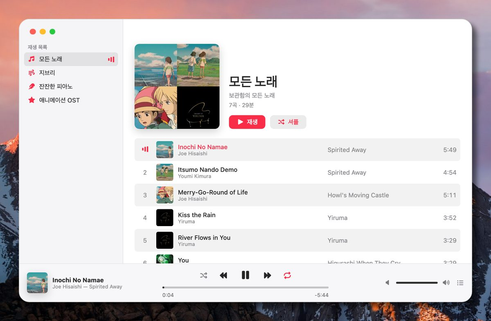
      <h4>🎵 음악</h4>
      재생 목록 · 셔플 · 반복 · 대기열. 메뉴 막대와 위젯에서도 재생을 조작합니다. 휴대폰의 지금 재생 중 화면은 iOS 18 음악 앱 구성(쓸어내려 닫기, 대기열 화면, ••• 메뉴)이고, 로딩 화면을 누르는 동작으로 재생을 허용받아 iOS Safari에서도 배경 음악이 바로 재생됩니다.
    </td>
  </tr>
  <tr>
    <td valign="top">
      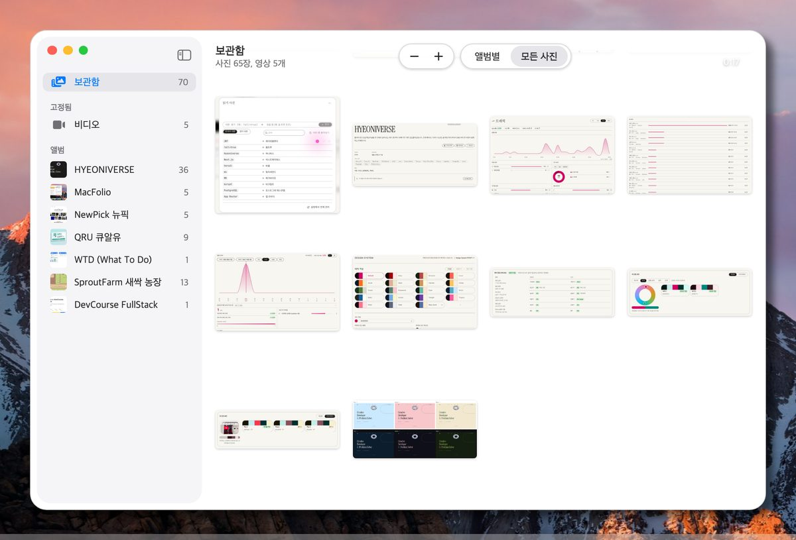
      <h4>🖼️ 사진</h4>
      프로젝트 화면 모음을 앨범으로 묶어 비율을 지킨 격자로 보여 줍니다. Finder › 그림에 만든 폴더도 앨범이 되고, 동영상도 같은 보관함에 보관합니다.
    </td>
    <td valign="top">
      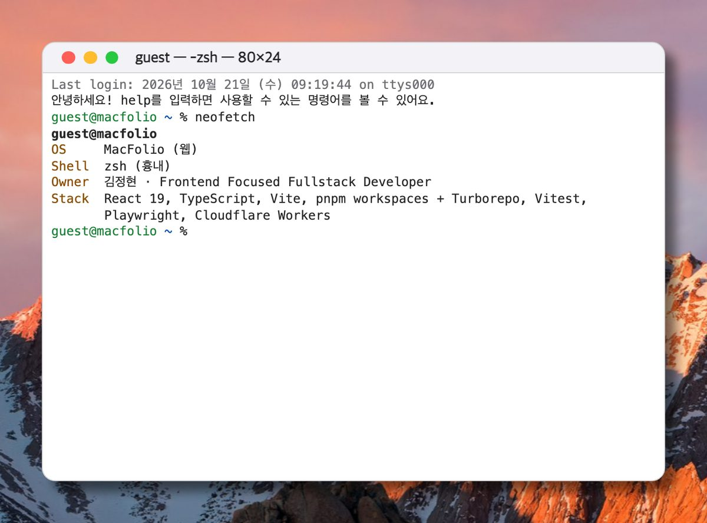
      <h4>⌨️ 터미널</h4>
      <code>help</code> · <code>whoami</code> · <code>neofetch</code> · <code>skills</code> · <code>projects</code> · <code>open memo</code>. 휴대폰에서는 명령을 눌러 실행하는 <b>단축어</b>가 됩니다.
    </td>
  </tr>
  <tr>
    <td valign="top">
      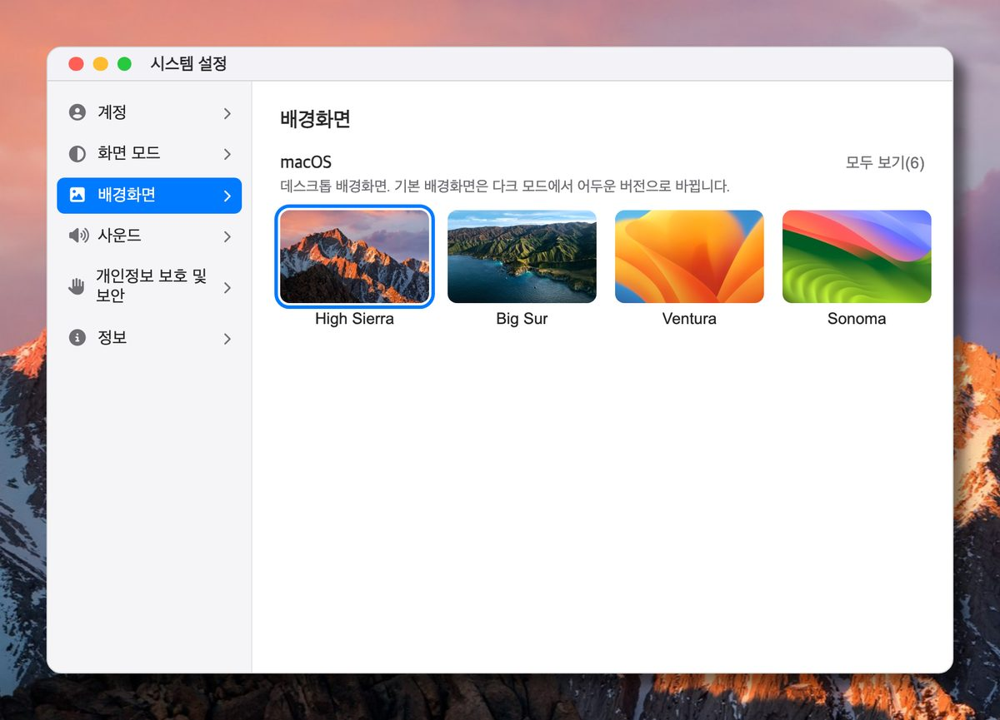
      <h4>⚙️ 시스템 설정</h4>
      화면 모드(라이트 · 다크 · 자동), 배경화면(관리자가 올린 사진 · 동영상 포함), 사운드, 개인정보, 관리자 계정.
    </td>
    <td valign="top">
      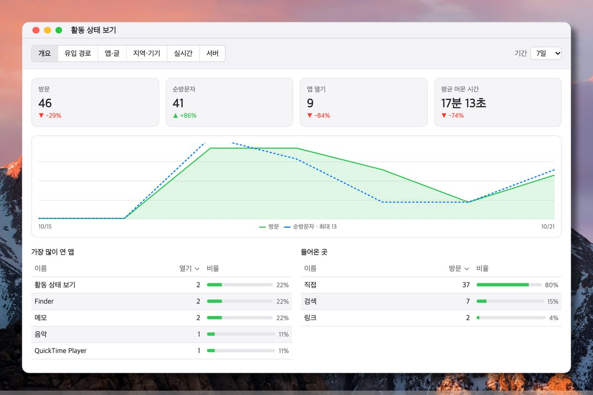
      <h4>📈 활동 상태 보기</h4>
      방문 · 순방문자 · 앱 열기 · 체류 시간, 유입 경로, 검색어(Google Search Console), 지역 · 기기, 실시간, 서버 상태. 쿠키 없이 일별 해시로 집계하고, 창이 보이는 동안만 주기적으로 다시 조회합니다.
    </td>
  </tr>
  <tr>
    <td valign="top">
      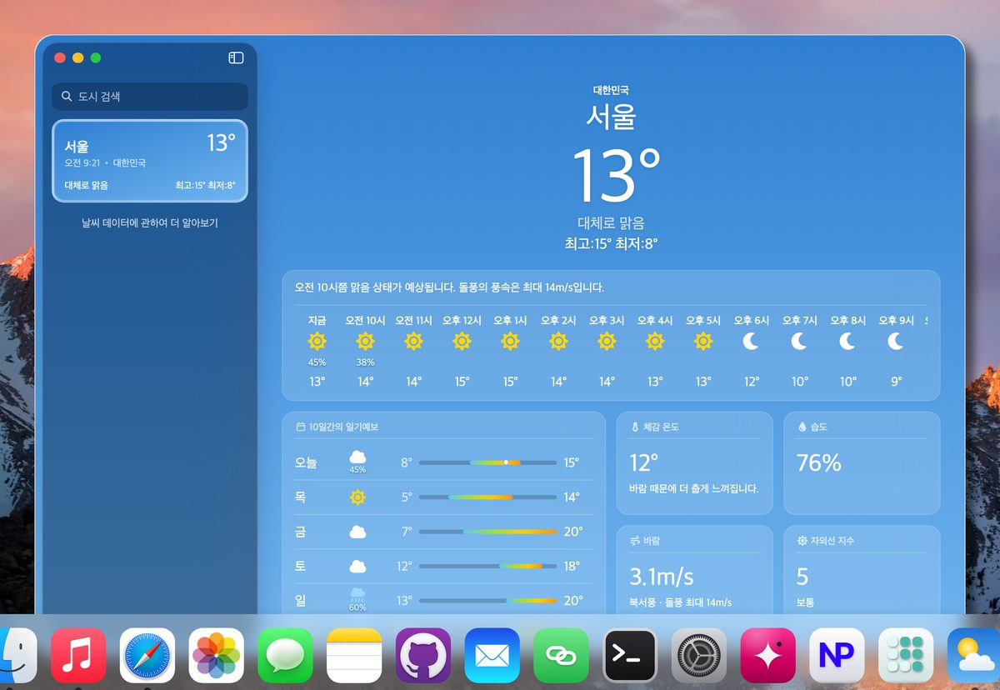
      <h4>⛅ 날씨</h4>
      도시를 검색해 시간별 · 10일 예보, 체감 온도, 습도, 바람을 조회합니다 ([Open-Meteo](https://open-meteo.com/)).
    </td>
    <td valign="top">
      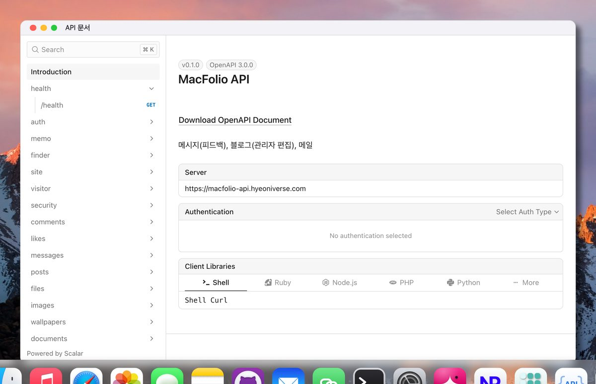
      <h4>📚 API 문서</h4>
      백엔드의 OpenAPI 문서를 사이트 안 앱으로 엽니다. 엔드포인트마다 요청 · 응답 예시를 확인합니다.
    </td>
  </tr>
  <tr>
    <td valign="top">
      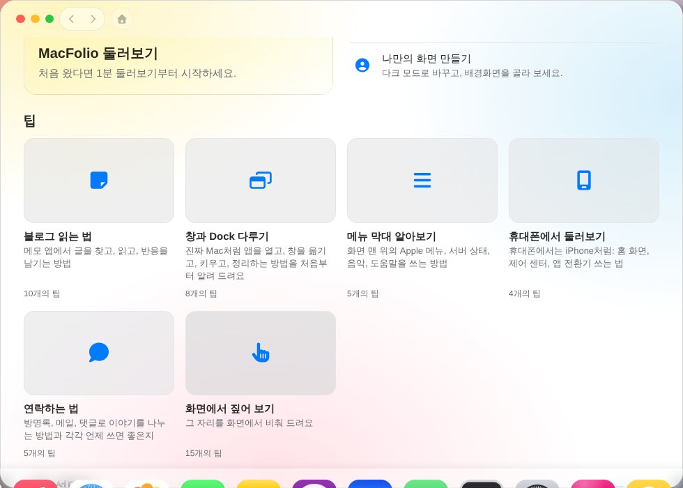
      <h4>💡 팁 · 둘러보기</h4>
      처음 온 방문자에게 Dock · 메뉴 막대 · 이력서를 짚어 주는 1분 둘러보기. 팁 앱에서 블로그 읽는 법, 창과 Dock 다루기 같은 주제별 팁을 다시 확인합니다.
    </td>
    <td valign="top">
      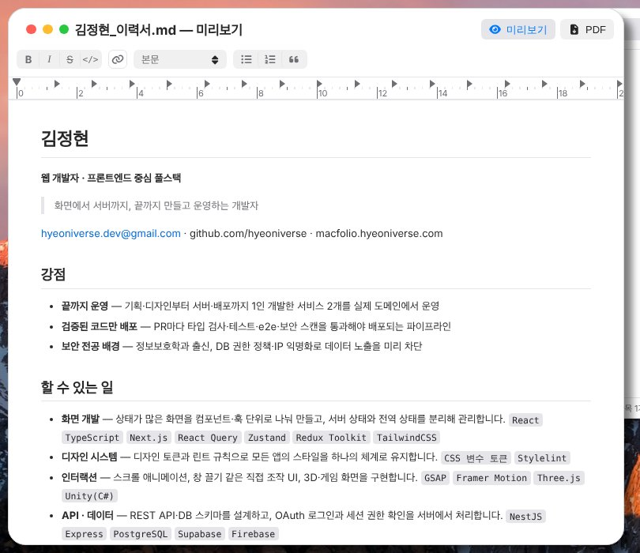
      <h4>📄 텍스트 편집기 = 이력서</h4>
      이력서는 Markdown 한 장입니다. 텍스트 편집기에서 미리보기로 읽고 PDF로 내려받으며, 관리자는 서식 막대로 바로 수정합니다.
    </td>
  </tr>
</table>

<table>
  <tr>
    <td width="50%">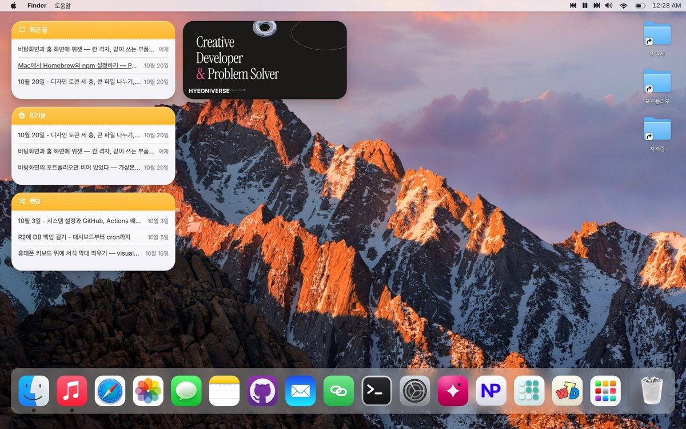</td>
    <td width="50%" valign="top">
      <h4>🧩 위젯</h4>
      macOS Sonoma처럼 바탕화면에, iOS처럼 홈 화면 페이지마다 위젯을 배치합니다. 날씨 · 캘린더 · 시계 · 음악 · 메모 · 사진 · GitHub 잔디 · 소개 · 명언 9종을 데스크톱과 휴대폰이 같이 씁니다.<br><br>
      바탕화면은 <b>위젯 편집…</b>으로 갤러리를 열어 더하고 칸 격자에 끌어 놓습니다. 메모 위젯은 최근 글 · 인기글 · 랜덤 중 고르고, 사진 위젯은 앨범이나 그림 폴더의 사진과 영상을 넘기고, 누르면 그 사진을 크게 보기로 엽니다. 휴대폰은 홈 화면을 길게 눌러 위젯을 끌어 순서를 바꾸거나 옆 페이지로 옮깁니다.
    </td>
  </tr>
</table>

<table>
  <tr>
    <td width="25%">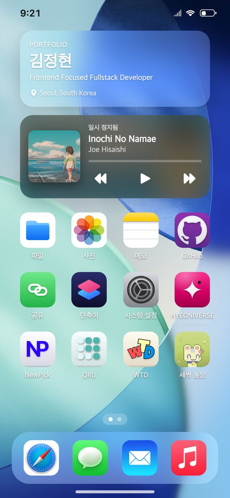</td>
    <td width="25%">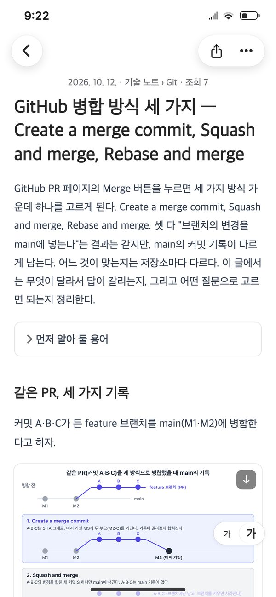</td>
    <td width="50%" valign="top">
      <h4>📱 휴대폰</h4>
      화면 폭이 767px 이하면 iOS 홈 화면이 됩니다. 페이지마다 위젯(길게 눌러 빼고 더하고, 끌어서 옮기기), 페이지를 넘기는 홈 화면, 아래에서 쓸어 올려 홈으로, 위에서 쓸어 내려 제어 센터.<br><br>
      Finder는 <b>파일</b>, 터미널은 <b>단축어</b>, 관리자 로그인은 <b>암호</b> 앱으로 바뀝니다. 공유 버튼은 공유 시트를 엽니다.
    </td>
  </tr>
</table>

<table>
  <tr>
    <td width="33%" valign="top"><h4>💬 메시지</h4>로그인 없이 피드백을 남기고 답글을 답니다. 이름은 방문자 쿠키로 정해지고(🦊 날쌘 여우), 같은 브라우저에서 내 글을 삭제합니다. 메뉴 막대의 도움말 › 문제 알리기…도 이 화면을 열고, 버그는 GitHub 이슈 링크로 안내합니다.</td>
    <td width="33%" valign="top">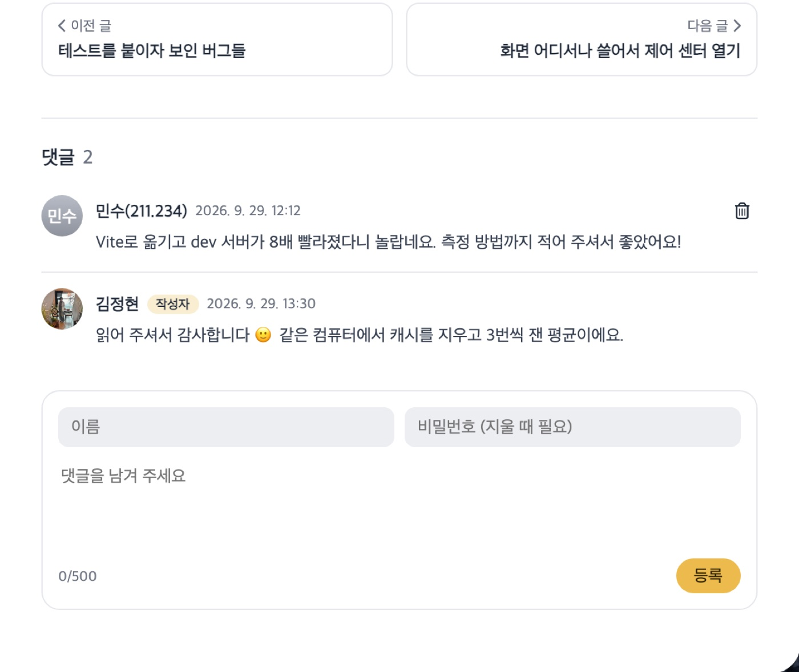<h4>🗨️ 댓글 · 좋아요</h4>방문자 이름으로 작성하고 같은 브라우저에서 삭제합니다. 서버에는 방문자 토큰과 IP의 HMAC만 남습니다.</td>
    <td width="33%" valign="top">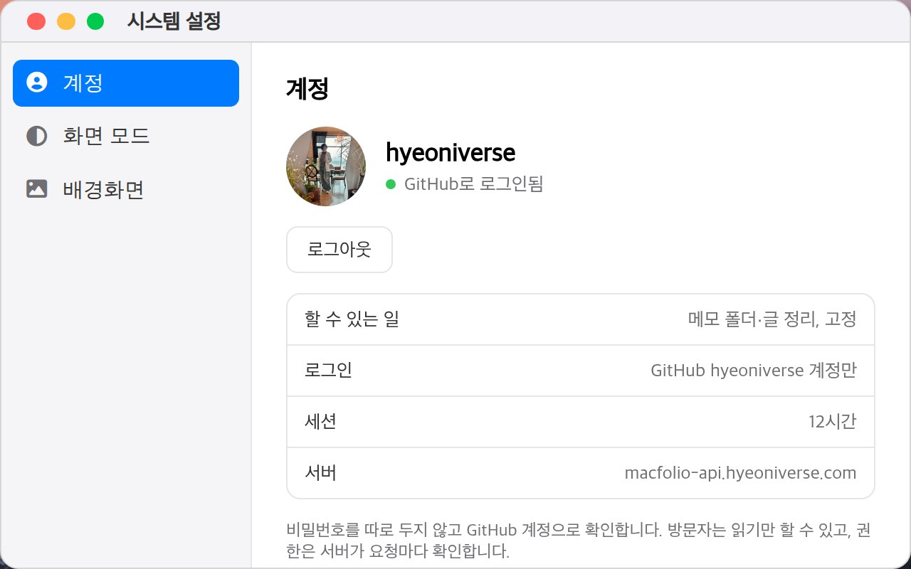<h4>🔐 관리자 로그인</h4>GitHub OAuth로 내 계정만 허용합니다. 비밀번호가 없고, DB에는 세션 토큰의 해시만 저장합니다.</td>
  </tr>
</table>

<p align="right"><a href="#macfolio">↑ 탭 목록으로</a></p>

## 사용법

[방문자](#방문자) · [관리자](#관리자) · [정보 구조](#정보-구조)

### 방문자

| 하고 싶은 것       | 방법                                                                                                                      |
| ------------------ | ------------------------------------------------------------------------------------------------------------------------- |
| 앱 열기            | Dock의 아이콘을 누릅니다. 터미널에서 `open memo`처럼 열 수도 있습니다                                                     |
| 창 다루기          | 제목 막대를 끌어 옮기고, 가장자리를 끌어 크기를 바꿉니다. 🔴 닫기 · 🟡 최소화 · 🟢 전체 화면                              |
| 블로그 읽기        | 메모 앱. 왼쪽 폴더로 좁히고, 위의 버튼으로 목록/갤러리를 전환하고, 검색 칸에서 찾습니다                                   |
| 링크 공유하기      | 메모의 글, Safari의 프로젝트에서 공유 버튼을 누르면 주소가 복사됩니다 (휴대폰은 공유 시트)                                |
| 피드백 남기기      | 메시지 앱이나 도움말 › 문제 알리기…에서 내용만 입력합니다. 이름은 자동으로 정해지고, 같은 브라우저에서 삭제할 수 있습니다 |
| 저에 대해 알아보기 | 터미널에서 `help`, `whoami`, `neofetch`, `skills`, `projects`, `contact`                                                  |
| 처음 둘러보기      | 첫 방문에 표시되는 둘러보기를 따라가거나, Launchpad의 팁 앱에서 주제별 팁을 확인합니다                                    |
| 이력서 보기        | 바탕화면의 이력서 폴더나 터미널 `resume`. 텍스트 편집기에서 읽고 PDF로 내려받습니다                                       |
| 위젯 놓기          | 바탕화면을 오른쪽 클릭 → 위젯 편집…, 휴대폰은 홈 화면을 길게 누릅니다                                                     |
| 화면 바꾸기        | 시스템 설정 → 화면 모드(라이트·다크), 배경화면                                                                            |
| 남긴 데이터 지우기 | Dock 오른쪽 끝의 휴지통 → 이 사이트가 브라우저에 저장한 설정·검색어를 확인하고 비웁니다                                   |

글과 프로젝트마다 주소가 있습니다. `/memo/<글>`(예: `/memo/cra-to-vite`)이나 `/safari/<프로젝트>`(예: `/safari/sproutfarm`)로 들어오면, 로딩 화면 다음에 그 앱이 그 화면으로 열립니다. 글이나 탭을 고르면 브라우저 주소 막대도 맨 앞 창의 주소로 바뀝니다.

휴대폰에서는 홈 화면의 아이콘을 누르고, 아래쪽 막대를 위로 쓸어 올려 홈으로 돌아갑니다. 위에서 아래로 쓸면 제어 센터가 열립니다. 터미널은 명령을 눌러 실행하는 **단축어**로 바뀝니다.

### 관리자

1. 데스크톱은 **메뉴 막대 왼쪽의 Apple 메뉴 → 관리자 로그인**, 휴대폰은 **암호** 앱에서 GitHub로 로그인합니다. 서버에 잠깐 닿지 못하면 Apple 메뉴의 **다시 확인**으로 바로 다시 묻습니다.
2. 메모 앱에서 글을 누르면 바로 수정할 수 있습니다. 수정하는 동안은 임시 저장만 되고, **게시**해야 방문자에게 보입니다. 미래 날짜로 게시하면 예약됩니다.
3. 폴더 만들기·이름 바꾸기, 글 옮기기(끌어 놓기), 고정, 비밀 글 지정, 잠금, 최근 삭제된 항목에서 복구, 댓글 삭제, Finder › 그림에 사진 업로드도 로그인했을 때만 가능합니다.
4. 로그인 상태와 세션은 **시스템 설정 → 계정**에서 확인합니다. 세션은 12시간입니다.
5. 글에서 빼도 서버에 남는 이미지·첨부는 **휴지통 → 서버 파일**에서 확인합니다. 사용하는 곳이 없는 파일만 삭제할 수 있습니다.

화면의 편집 버튼을 숨기는 것은 안내일 뿐이고, 권한은 서버가 요청마다 확인합니다.

### 정보 구조

사이트는 주소 하나(`/`)에서 데스크톱 하나를 렌더링합니다. 화면 폭이 767px 이하면 같은 앱을 iOS 홈 화면으로 보여 줍니다. 앱 이름·아이콘·Dock 자리는 `src/apps/manifest.ts` 한 곳에서 정하고, Dock·Launchpad·터미널 `open`·휴대폰 홈 화면이 모두 이 목록을 읽습니다.

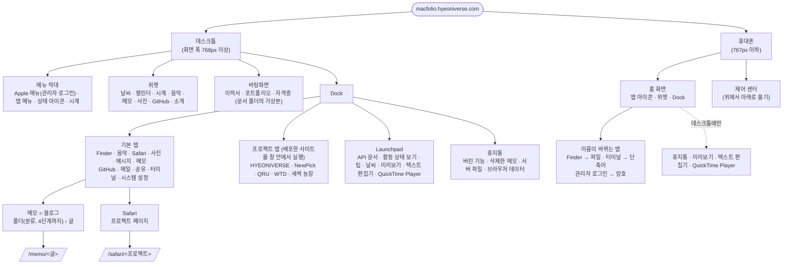

<details>
<summary><b>Finder의 파일 트리</b></summary>

**Finder의 파일 트리**: macOS처럼 디스크 아래에 사용자 폴더가 있고, 사이트의 문서·글·사진·음악을 파일처럼 둘러봅니다.

```text
Macintosh HD
├── 응용 프로그램        앱 목록 (열면 그 앱이 열린다)
└── 사용자
    └── hyeoniverse      홈
        ├── 데스크탑      바탕화면에 올린 파일
        ├── 문서          이력서 · 포트폴리오(프로젝트 폴더) · 자격증 · 저장소 문서
        ├── 블로그        메모 앱의 폴더와 글
        ├── 그림          사진 앱의 앨범과 올린 그림 (사진 위젯이 고른다)
        ├── 음악          음악 앱의 아티스트 › 앨범 › 곡
        └── 공용 · 다운로드 · 동영상
```

</details>

<details>
<summary><b>주소별 화면과 검색 로봇이 수신하는 내용</b></summary>

**주소**: 앱 화면 중 공유할 만한 것만 주소가 있습니다. 들어오면 로딩 화면 다음에 그 앱이 그 화면으로 열리고, 창을 고르면 주소 막대가 맨 앞 창의 주소로 바뀝니다.

| 주소                  | 화면                      | 검색 로봇이 수신하는 내용                                 |
| --------------------- | ------------------------- | --------------------------------------------------------- |
| `/`                   | 데스크톱                  | 소개, 모든 글·프로젝트 링크, Person·WebSite 구조화 데이터 |
| `/memo/<글>`          | 메모 앱에서 그 글         | 글 본문(그림 포함), BlogPosting, 공유 카드                |
| `/safari/<프로젝트>`  | Safari에서 그 프로젝트    | 프로젝트 소개, CreativeWork                               |
| `/sitemap.xml`        | 사이트맵                  | 첫 화면·모든 글(수정일)·모든 프로젝트                     |
| `/rss.xml`            | RSS 피드                  | 모든 글의 제목·요약                                       |
| 없는 글·프로젝트 주소 | 데스크톱 (404, `noindex`) |                                                           |

</details>

<p align="right"><a href="#macfolio">↑ 탭 목록으로</a></p>

## 아키텍처

[시스템 구성](#시스템-구성) · [첫 화면이 렌더링되기까지](#첫-화면이-렌더링되기까지) · [패키지](#패키지) · [CI/CD](#cicd) · [기술 스택](#기술-스택) · [구조](#구조)

### 시스템 구성

프론트엔드는 Cloudflare 위의 Worker와 정적 파일, API는 Oracle Cloud의 무료 VM 한 대입니다. 서버는 인바운드 포트를 개방하지 않고, [Cloudflare Tunnel](https://developers.cloudflare.com/cloudflare-one/connections/connect-networks/)로만 요청을 받습니다. 운영비는 0원입니다.

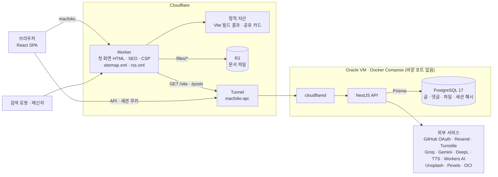

- **같은 사이트, 다른 하위 도메인**: 프론트엔드(`macfolio.`)와 API(`macfolio-api.`)가 `hyeoniverse.com` 아래에 있어서 `SameSite=Lax` 세션 쿠키가 함께 갑니다.
- **Worker는 첫 화면만**: 존재하는 파일(`/assets/*`, 그림)은 Cloudflare가 Worker를 거치지 않고 바로 응답합니다. Worker에는 첫 화면, 앱 주소, sitemap·RSS, `/files/*` 요청만 전달됩니다.
- **API가 중단되어도 사이트는 열린다**: Worker는 API 응답을 1.5초만 기다리고, 응답이 없으면 저장소의 글과 코드의 기본 프로필로 렌더링합니다. 화면도 API 없이 로그인·편집만 비활성화된 채 동작합니다.

요청이 지나가는 층, 데이터 모델, 설계 결정 표는 [docs/backend-design.md](docs/backend-design.md)에 정리했습니다.

### 첫 화면이 렌더링되기까지

사이트는 자바스크립트로만 렌더링해서, 스크립트를 실행하지 않는 크롤러에게는 빈 화면입니다. 그래서 Worker가 주소마다 제목·설명·구조화 데이터와 숨긴 본문을 `index.html`에 넣어 보냅니다.

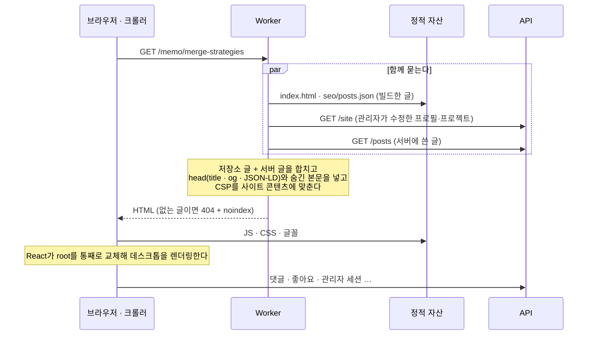

### 패키지

pnpm workspaces와 Turborepo로 묶은 모노레포입니다. 화면과 서버가 같은 규칙을 쓰도록 공용 패키지로 뺐습니다.

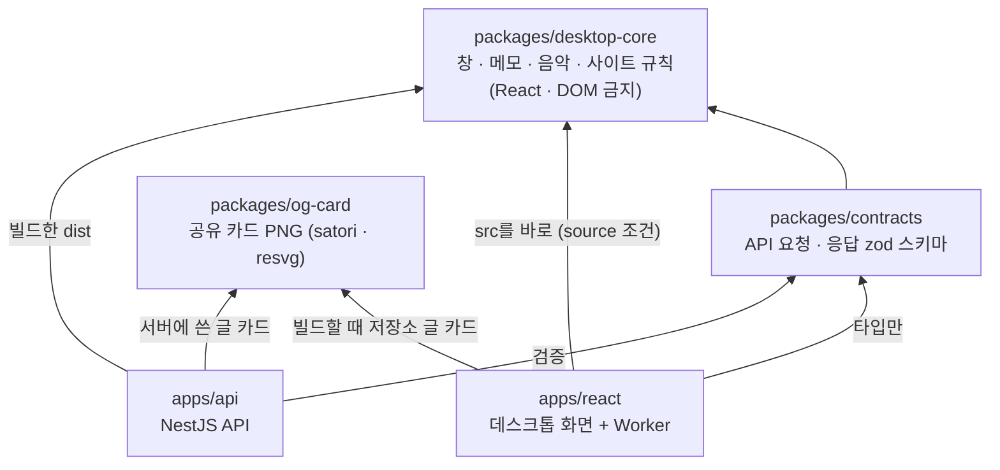

- **같은 규칙을 한 번만**: 글 주소·날짜·길이, 폴더 경로, 사이트 프로필 검사는 `desktop-core`에, API의 요청·응답 모양은 `contracts`에 있습니다. 화면과 서버가 같은 함수로 검사해서 한쪽만 바뀌지 않습니다.
- **다시 빌드하지 않는 개발**: 화면(Vite·Vitest)은 패키지의 `src`를 바로 읽고, 서버(Node)는 빌드한 `dist`를 씁니다. Turborepo가 패키지를 먼저 빌드합니다(`dependsOn: ["^build"]`).

### CI/CD

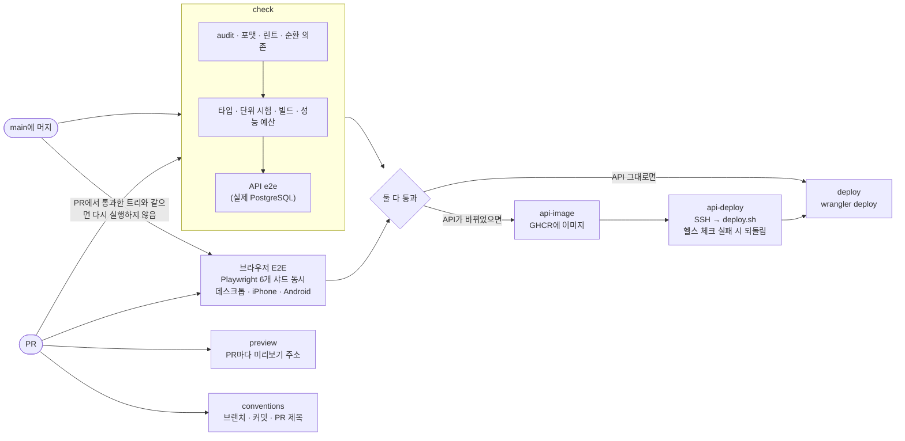

그 밖에 정해진 시간마다 도는 검사가 있습니다: Semgrep 정적 분석(`sast`), gitleaks 비밀 값 스캔(`secrets`), 10분마다 사이트·API 헬스 체크(`uptime`).

### 기술 스택

<p align="center">
  
</p>

결정 과정은 [#8](https://github.com/hyeoniverse/MacFolio/issues/8)에 있습니다.

| 영역       | 사용한 것                                                                                                                                                                                                                                                          |
| ---------- | ------------------------------------------------------------------------------------------------------------------------------------------------------------------------------------------------------------------------------------------------------------------ |
| 프론트엔드 | [React](https://react.dev/) 19, [TypeScript](https://www.typescriptlang.org/), [Vite](https://vite.dev/), [Milkdown](https://milkdown.dev/)(편집기), [react-markdown](https://github.com/remarkjs/react-markdown) + [lowlight](https://github.com/wooorm/lowlight) |
| 백엔드     | [NestJS](https://docs.nestjs.com/), [Prisma](https://www.prisma.io/docs) 7, [PostgreSQL](https://www.postgresql.org/docs/), Swagger                                                                                                                                |
| 모노레포   | [pnpm workspaces](https://pnpm.io/workspaces), [Turborepo](https://turborepo.com/docs)                                                                                                                                                                             |
| 테스트     | [Vitest](https://vitest.dev/)(단위), [Playwright](https://playwright.dev/)(E2E: 데스크톱·iPhone·Android), [supertest](https://github.com/ladjs/supertest)(API e2e)                                                                                                 |
| 배포       | [Cloudflare Workers](https://developers.cloudflare.com/workers/)(프론트엔드), [Oracle Cloud](https://www.oracle.com/cloud/free/) VM + Docker Compose + Cloudflare Tunnel(API)                                                                                      |
| CI         | [GitHub Actions](https://docs.github.com/en/actions): 포맷 → 린트 → 순환 의존 → 타입 → 테스트 → 빌드 → 성능 예산 → API e2e → E2E, 보안 검사                                                                                                                        |

각 항목을 펼치면 **왜 골랐는지, 어디에 어떻게 썼는지**가 나옵니다.

<details>
<summary><b>프론트엔드</b> — React 19 · Vite · Milkdown · react-markdown</summary>

**React 19 + TypeScript + Vite**

- **왜:** 화면이 데스크톱 하나뿐이고 창 끌기, 오디오, 제스처가 모두 브라우저에서 동작합니다. 라우팅이나 서버 렌더링이 필요 없어서 Next.js 대신 SPA로 만들었습니다. 처음 쓰던 Create React App이 2025년 2월 deprecated되어 Vite로 옮겼고, dev 서버 시작이 5.05초에서 0.58초로 줄었습니다([측정](docs/migration-cra-to-vite.md))
- **어떻게:**
  - 앱마다 폴더 하나(`src/apps/<앱>`)를 두고, `manifest.ts` 한 곳에서 이름·아이콘·창 크기·모바일 이름을 정합니다. Dock, Launchpad, 터미널의 `open`, 모바일 홈 화면이 모두 이 목록을 읽습니다
  - 창 위치·앞뒤 순서, 관리자 로그인 상태, 음악 재생은 작은 저장소(`createStore`)에 보관하고 `useSyncExternalStore`로 구독합니다
  - 프레임워크와 무관한 로직은 `packages/desktop-core`로 떼어 냅니다([#16](https://github.com/hyeoniverse/MacFolio/issues/16)). 지금은 저장소, 창 관리(열기·닫기·최소화·앞뒤 순서), 메모 로직(글 읽기·정렬·필터, 태그, 폴더 정리, 찾기, 글 검사), 음악 재생 대기열(셔플·반복, 다음·이전 곡)이 있고, React 쪽에는 store를 구독하는 hook과 화면만 남깁니다. 이 패키지는 DOM 타입과 React를 import하지 못하게 막았습니다
  - 메모 정리 내용의 검사, 폴더 경로, 글 길이·날짜 규칙은 서버(`apps/api`)도 `desktop-core`에서 가져다 씁니다. React는 `src`를 바로 읽고, 서버는 빌드한 `dist`를 씁니다(`package.json`의 `exports` 조건)
  - Vite의 `import.meta.glob`으로 블로그 글(Markdown)과 이미지를 빌드할 때 함께 묶습니다. `VITE_API_URL`도 빌드할 때 코드에 들어갑니다
  - 메모 창은 CSS 컨테이너 쿼리로 창 폭에 따라 도구 막대와 목록 배치를 바꿉니다. 화면 폭이 아니라 창 폭이 기준이라 창을 줄여도 맞게 바뀝니다

**Milkdown (편집기)**

- **왜:** 관리자가 글을 **보이는 그대로** 수정하고, 저장은 Markdown으로 하고 싶었습니다. Milkdown은 ProseMirror 위에서 Markdown을 그대로 읽고 씁니다. 저장소의 글 파일과 서버에 저장한 글이 같은 형식이라 서로 겹쳐 보여 줄 수 있습니다
- **어떻게:** 가가(서식) 메뉴, 체크리스트·표·이미지 블록, 표 손잡이, ⌘F 찾기·대치를 ProseMirror 플러그인과 명령으로 만들었습니다(`src/apps/memo/writer/`). 편집 화면과 읽기 화면이 같은 CSS를 쓰게 맞춰서, 로그인해도 글 모양이 바뀌지 않습니다

**react-markdown + remark-gfm + lowlight (읽기 화면)**

- **왜:** 방문자에게는 편집기가 필요 없습니다. 가벼운 렌더러로 표·체크리스트(GFM)까지 보여 주고, 코드 문법 강조는 편집기와 같은 lowlight를 써서 두 화면의 색을 똑같이 맞췄습니다
- **어떻게:** 이미지는 캡션·크게 보기·내려받기 버튼이 있는 컴포넌트로 교체해 렌더링하고, 글 안에서 찾기는 DOM을 건드리지 않고 CSS Custom Highlight API(`::highlight()`)로 칠합니다

</details>

<details>
<summary><b>백엔드</b> — NestJS · Prisma 7 · PostgreSQL · GitHub OAuth</summary>

구성도, 요청 흐름, 데이터 모델, 설계 결정 표는 [docs/backend-design.md](docs/backend-design.md)에 정리했습니다.

**NestJS**

- **왜:** 정적 사이트만으로는 관리자를 가릴 수 없고, 처음 쓰던 Firebase는 규칙이 열려 있어 누구나 비밀번호를 평문으로 읽을 수 있었습니다. 검증을 서버에서 하는 API가 필요했습니다. Hono·Cloudflare Workers도 검토했지만 국내 채용 공고에 자주 나오고, 모듈·가드·파이프 구조가 Spring과 닮아 설계가 잘 드러나는 NestJS를 골랐습니다
- **어떻게:**
  - `AdminGuard`: 관리자 전용 API(글쓰기, 메모 정리, 업로드)가 요청마다 세션 쿠키를 DB에서 확인합니다. 화면의 편집 버튼을 숨기는 것과 상관없이 서버가 차단합니다
  - `ValidationPipe` + class-validator: 모든 입력을 DTO로 검사하고, 정해 두지 않은 필드는 거절합니다
  - `@nestjs/throttler`: 쓰기 경로마다 IP별 요청 제한 (`@RateLimit`). 터널 뒤에서는 `TRUST_PROXY`로 실제 IP를 읽습니다
  - helmet(보안 헤더), CORS는 사이트 주소만 허용하고 PR 미리보기 주소에는 쿠키를 주지 않으며, 서버는 SSH 키로만 접속하고 API 컨테이너는 root가 아닌 사용자로 실행합니다(`ops/audit.sh`로 점검), 전역 예외 필터로 에러 형식을 통일하고 예상하지 못한 에러는 내용을 숨깁니다
  - Swagger: 컨트롤러에서 [API 문서](https://macfolio-api.hyeoniverse.com/docs)를 자동으로 만듭니다

**Prisma 7 + PostgreSQL**

- **왜:** 스키마 하나에서 타입과 마이그레이션이 함께 나와, 프론트엔드와 같은 TypeScript로 DB를 다룹니다. PostgreSQL은 CHECK 제약으로 규칙을 DB에서도 한 번 더 지킬 수 있어서 골랐습니다
- **어떻게:**
  - 글은 **게시한 내용과 임시 저장을 한 행에 두 벌** 저장하고, 게시할 때마다 버전(`PostRevision`)을 남깁니다. "게시했다면 제목·본문이 있어야 한다" 같은 규칙은 CHECK 제약으로 지정합니다(Prisma 스키마로는 표현할 수 없어 마이그레이션 SQL로)
  - 세션은 토큰 원문 대신 SHA-256 해시만, 방문자 쿠키 토큰과 IP는 HMAC만 저장합니다 (이름·비밀번호를 받던 때의 댓글은 비밀번호의 scrypt 해시)
  - 업로드한 이미지·첨부 파일도 DB(`bytea`)에 저장합니다. 서버 한 대라 파일 저장소를 따로 두지 않고, 백업 한 번에 글과 파일이 함께 남습니다. 글과 파일은 본문의 `/files/<id>` 문자열로만 이어져 있어서, 글에서 빼도 남는 파일은 쓰는 곳(지금 글·예전 버전·배경화면)을 찾아 관리자가 삭제합니다
  - 서버가 시작할 때 `prisma migrate deploy`로 마이그레이션을 적용합니다 (로컬 `pnpm dev:api`·`dev:all`도 같아서, 브랜치를 내려받은 뒤 DB가 뒤처져 있어도 저장이 500으로 떨어지지 않습니다)

**GitHub OAuth (관리자 로그인)**

- **왜:** 관리자는 저 한 명입니다. 비밀번호를 만들면 해시·재설정까지 만들어야 해서, 이미 쓰는 GitHub 계정으로 확인합니다
- **어떻게:** `state` 쿠키로 로그인 CSRF를 막고, 계정 이름이 아니라 변경되지 않는 숫자 ID로 관리자를 판별합니다. 세션 쿠키는 `httpOnly`·`Secure`·`SameSite=Lax`, 12시간

</details>

<details>
<summary><b>모노레포: pnpm workspaces + Turborepo</b></summary>

- **왜:** 프론트엔드와 API를 한 저장소에 두고 한 번에 수정하고 테스트하려고 모노레포로 묶었습니다. pnpm은 설치가 빠르고 의존성이 엄격하고, Turborepo는 패키지 사이 빌드 순서와 캐시를 관리합니다
- **어떻게:** 루트의 `pnpm build`·`pnpm test`·`pnpm lint`가 두 앱과 세 패키지(`desktop-core`, `contracts`, `og-card`)를 함께 실행합니다. `pnpm dev:all`로 프론트엔드와 API를 함께 실행합니다. `pnpm cycles`([madge](https://github.com/pahen/madge))가 순환 import를 차단합니다

</details>

<details>
<summary><b>테스트</b> — Vitest · Playwright · supertest</summary>

**Vitest (단위)**: 창 위치 계산, 메모 정리·검색·찾기 규칙, 입력 규칙, 세션·해시처럼 화면과 떨어진 순수 함수를 확인합니다. Vite와 설정을 같이 써서 따로 번들 설정이 없습니다

**Playwright (E2E)**

- **왜:** 이 사이트는 끌기, 쓸어 넘기기, 애니메이션처럼 실제 브라우저에서만 드러나는 동작이 많습니다
- **어떻게:**
  - 데스크톱 Chrome, iPhone, Android 세 가지 화면에서 실행합니다
  - 관리자 기능은 `page.route`로 만든 **가짜 API**로 테스트합니다. 서버 없이 로그인·글쓰기·게시·댓글을 확인하고, README와 블로그의 스크린샷도 같은 가짜 API로 찍었습니다
  - 빌드한 결과(`vite preview`)를 대상으로 돌려서 배포될 코드와 같은 것을 확인합니다

**supertest (API e2e)**: 실제 PostgreSQL에 붙여 권한(비관리자는 401, 규칙 위반은 400), 해시만 저장하는지, 요청 제한(429)까지 확인합니다. GitHub에 요청하는 부분만 가짜로 바꿉니다

</details>

<details>
<summary><b>배포</b> — Cloudflare Workers · Oracle Cloud VM · Cloudflare Tunnel</summary>

**Cloudflare Workers (프론트엔드)**

- **왜:** 화면은 정적 파일이라 서버가 필요 없고, 도메인 DNS가 이미 Cloudflare에 있습니다. main에 머지하면 빌드·배포되고, PR마다 미리보기 주소가 생깁니다
- **어떻게:** `dist`를 정적 자산으로 올리고, 그 앞에 작은 Worker(`apps/react/worker/`)를 배치합니다
  - 첫 화면과 앱 주소: 관리자가 수정한 사이트 콘텐츠를 `index.html`에 넣고, 그 데모 주소까지 허용하는 CSP를 붙입니다
  - 검색: 주소마다 제목·설명·Open Graph·구조화 데이터와 숨긴 본문을 넣고, sitemap·RSS를 서버에 쓴 글까지 합쳐 만듭니다. 없는 글 주소는 404입니다
  - 문서 파일(`/files/<키>`)은 R2 버킷에서 같은 출처로 응답합니다 (Finder가 PDF를 iframe에 표시하도록)
  - 빌드할 때 저장소 글을 HTML로 렌더링하고(`seo/posts.json`), 사진이 없는 글은 제목으로 공유 카드(1200×630 PNG)를 생성합니다

**Oracle Cloud Always Free VM + Docker Compose (API)**

- **왜:** 기간 제한 없이 무료인 VM입니다. Render 같은 무료 호스팅은 15분 동안 요청이 없으면 잠들어, 깨어나는 데 1분쯤 걸립니다. EC2와 같은 구조(리눅스 VM + Docker)라 직접 운영해 볼 수 있습니다
- **어떻게:** Postgres, API, cloudflared를 compose로 함께 실행합니다. 멀티 스테이지 Dockerfile로 실행 이미지에는 컴파일 결과와 실행 의존성만 넣습니다. main에 API 변경이 들어오면 Actions가 이미지를 GHCR에 업로드하고, SSH로 서버의 `ops/deploy.sh`를 호출합니다. 새 컨테이너가 헬스 체크를 통과하지 못하면 이전 이미지로 되돌립니다([되돌리기 훈련](docs/rollback-drill.md)). 배포 키는 `deploy.sh`만 실행할 수 있게 제한되어 있습니다

**Cloudflare Tunnel (HTTPS)**

- **왜:** nginx + Let's Encrypt를 쓰면 80/443 포트를 열고 인증서를 갱신해야 합니다. 터널은 서버가 Cloudflare로 **나가는** 연결만 만들어서 SSH 말고는 포트를 열지 않고, 서버 IP도 드러나지 않습니다
- **어떻게:** 프론트엔드(`macfolio.`)와 API(`macfolio-api.`)를 같은 사이트(`hyeoniverse.com`)의 하위 도메인으로 배치해, 세션 쿠키가 `SameSite=Lax`로도 함께 전송됩니다

자세한 순서는 [docs/deployment.md](docs/deployment.md)에 있습니다.

</details>

<details>
<summary><b>CI: GitHub Actions</b></summary>

- PR과 main push마다 의존성 취약점 → 포맷 → 린트 → 순환 의존 → 타입 체크 → 단위 테스트 → 빌드 → 성능 예산 → API e2e(PostgreSQL 서비스 컨테이너)를 `check` 한 잡에서 실행하고, 브라우저 E2E는 그와 동시에 6개 샤드로 나눠 실행합니다. 실패하면 Playwright 리포트를 아티팩트로 업로드합니다. main에서는 PR에서 이미 통과한 것과 같은 코드면 E2E를 다시 실행하지 않습니다
- 의존성 취약점 검사는 코드가 바뀌지 않아도 새로 공개된 권고로 실패합니다. 하위 의존성은 `pnpm-workspace.yaml`의 `overrides`로 수정판을 지정하고, 기능 PR과 분리해 고칩니다([#371](https://github.com/hyeoniverse/MacFolio/pull/371), [#374](https://github.com/hyeoniverse/MacFolio/pull/374), [과정](https://macfolio.hyeoniverse.com/memo/ci-failures-after-merges))
- 성능 예산: 빌드 결과의 `boot` 번들과 첫 방문 번들의 brotli 크기가 상한을 넘으면 `check`가 실패합니다(`apps/react/scripts/perf/budget.mjs`, [docs/performance.md](docs/performance.md#성능-예산))
- `conventions`: 브랜치 이름, PR 제목, 커밋 메시지가 [작업 규칙](CONTRIBUTING.md)을 따르는지 확인합니다
- main에 들어온 커밋은 시험을 통과해야 배포됩니다. API가 바뀌었으면 API를 먼저 배포하고(`api-image` → `api-deploy`), 그다음 `deploy`가 Cloudflare Workers에 올립니다. 새 화면이 옛 API에 먼저 닿지 않게 하는 순서입니다
- 같은 저장소의 PR은 `preview`가 미리보기 주소를 PR 댓글에 남깁니다 (프론트엔드가 바뀐 PR만). 미리보기는 `noindex`라 검색에 나오지 않습니다
- `sast`(Semgrep), `secrets`(gitleaks), `uptime`(10분마다 헬스 체크)은 별도 워크플로로 실행합니다
- `main`의 Ruleset이 `check`와 `conventions`를 필수 검사로 지정해, 둘 다 통과해야 머지됩니다([설정 방법](CONTRIBUTING.md#저장소-설정))

</details>

### 구조

<details>
<summary><b>폴더 구조</b></summary>

```
apps/
  react/                  데스크톱 UI (Vite + React)
    src/apps/             앱마다 폴더 하나 (manifest.ts가 앱 목록의 단일 출처, registry.ts가 컴포넌트 연결)
    src/apps/memo/content 블로그 글 (Markdown)과 그림
    src/desktop/          창, Dock, 메뉴 막대, 모바일 셸 (화면과 hook 연결)
    src/shared/           공통 UI 부품(ui/), API 호출, 저장소, 프로필·프로젝트
    worker/               Cloudflare Worker: 첫 화면, SEO, CSP, sitemap·RSS, R2 문서 파일
    seo/                  빌드할 때 만드는 검색용 파일 (글 HTML, sitemap, RSS, 공유 카드)
    e2e/                  Playwright (가짜 API: e2e/fakeApi.ts)
  api/                    NestJS API (관리자 로그인, 글, 댓글, 메시지, 파일, 데모, 자원 감시)
    prisma/               스키마와 마이그레이션 (CHECK 제약은 SQL로)
packages/
  desktop-core/           프레임워크와 무관한 로직: 저장소, 창 관리, 메모, 음악, 사이트 규칙 (React·DOM 없이 테스트)
  contracts/              API 요청·응답의 zod 스키마 (서버는 검증, 화면은 타입)
  og-card/                글의 공유 카드 그림 (빌드는 저장소 글, API는 서버에 쓴 글을 그린다)
ops/                      서버 스크립트: 배포·되돌리기, 백업·복원, 보안 점검
docs/                     백엔드 설계, 배포, UI 부품, 보안 점검, 개인정보, 마이그레이션 기록
wrangler.jsonc            Cloudflare Workers 설정
```

</details>

<p align="right"><a href="#macfolio">↑ 탭 목록으로</a></p>

## 성능

첫 방문 성능을 Lighthouse로 측정하고, 병목(3.8MB 글꼴, 첫 번들에 포함된 블로그 원문 2.4MB와 모든 앱 코드, 큰 이미지·영상, JS가 렌더링하던 로딩 화면, 로딩 화면 뒤에서 미리 렌더링하던 바탕화면)을 세 차례 개선한 뒤 같은 조건으로 다시 측정했습니다. 재측정(4차)에서는 그 사이 첫 번들에 포함된 명언 위젯 데이터를 분리해 `boot` 번들을 압축 65KB에서 47KB로 되돌렸습니다. 5차에서는 휴대폰 LCP가 회차에 따라 4초대로 다시 집계되던 원인(React가 HTML의 첫 렌더링을 LCP로 기록되기 전에 삭제)을 해결하고, 첫 방문 번들 크기에 CI 상한(성능 예산)을 추가했습니다. 5차의 첫 방문 전송량 감소는 본문 글꼴과 배경화면을 로딩 화면을 누른 뒤로 지연한 것입니다.

**로컬** (번갈아 측정한 회차의 범위)

| 항목            | 휴대폰 개선 전 → 3차 → 5차      | 데스크톱 개선 전 → 3차 → 5차   |
| --------------- | ------------------------------- | ------------------------------ |
| Lighthouse 성능 | 55 → 78\~87 → **85\~99**        | 62 → 98 → **100**              |
| FCP             | 14.3초 → 3.2초 → **1.7\~3.3초** | 2.5초 → 0.7초 → **0.5\~0.7초** |
| LCP             | 25.7초 → 3.2초 → **1.7\~3.4초** | 5.8초 → 1.1초 → **0.5\~0.7초** |
| 첫 방문 전송량  | 4,893KB → 483KB → **278KB**     | 9,050KB → 771KB → **278KB**    |

**운영 사이트** (5회 측정 중앙값)

| 항목            | 휴대폰 개선 전 → 1차 배포 후 → 3차 배포 후 | 데스크톱 개선 전 → 1차 배포 후 → 3차 배포 후 |
| --------------- | ------------------------------------------ | -------------------------------------------- |
| Lighthouse 성능 | 53 → 73 → **98**                           | 60 → 89 → **97**                             |
| LCP             | 31.5초 → 7.1초 → **1.9초**                 | 5.8초 → 2.1초 → **1.0초**                    |
| 첫 방문 전송량  | 6,342KB → 1,239KB → **602KB**              | 7,134KB → 3,229KB → **889KB**                |

측정 조건, 병목, 개선 내역, 재측정 방법은 [docs/performance.md](docs/performance.md)에, 재측정 과정은 [성능 재측정 글](apps/react/src/apps/memo/content/site-performance-remeasure.md)에 정리했습니다.

### CRA → Vite 마이그레이션

<details>
<summary><b>전환 전후 측정값</b></summary>

deprecated된 Create React App에서 Vite로 옮겼습니다.

| 항목           | CRA      | Vite     |
| -------------- | -------- | -------- |
| dev 서버 시작  | 5.05초   | 0.58초   |
| 프로덕션 빌드  | 6.33초   | 1.88초   |
| JS 번들 (gzip) | 138.2 KB | 127.7 KB |
| 설치 패키지 수 | 1,438개  | 171개    |

측정 방법과 전환 과정은 [docs/migration-cra-to-vite.md](docs/migration-cra-to-vite.md)에 정리했습니다.

</details>

<p align="right"><a href="#macfolio">↑ 탭 목록으로</a></p>

## 개발

[로컬에서 실행](#로컬에서-실행) · [블로그 글 쓰기](#블로그-글-쓰기) · [배포](#배포)

### 로컬에서 실행

Node 22와 pnpm이 필요합니다(버전은 `.node-version`과 `package.json`에 고정).

```bash
corepack enable
pnpm install
pnpm dev          # 프론트엔드만: http://localhost:5173
```

설정 없이 바로 실행됩니다. API가 없으면 로그인과 편집만 비활성화되고, 블로그는 저장소의 Markdown으로 표시됩니다.

메시지 앱은 서버에 저장해서, API가 없으면 "메시지를 열 수 없습니다"를 표시하고 열리지 않습니다. API 없이 메시지 화면을 보려면 이 브라우저에만 저장하게 합니다.

```bash
echo 'VITE_MESSAGES_STORE=local' >> apps/react/.env.local
```

API까지 실행하려면 Docker가 필요합니다.

```bash
cp apps/api/.env.example apps/api/.env          # GitHub OAuth 값은 개발용 OAuth App으로
echo 'VITE_API_URL=http://localhost:4000' > apps/react/.env.local
pnpm --filter @macfolio/api db:up                # PostgreSQL
pnpm dev:all                                     # 프론트엔드 5173 + API 4000 (문서: /docs)
```

<details>
<summary><b>명령 모음</b></summary>

| 명령                                     | 설명                           |
| ---------------------------------------- | ------------------------------ |
| `pnpm dev`                               | 프론트엔드 개발 서버           |
| `pnpm dev:api`                           | API 개발 서버                  |
| `pnpm dev:all`                           | 둘 다                          |
| `pnpm build`                             | 모든 패키지 빌드               |
| `pnpm typecheck`                         | 타입 체크                      |
| `pnpm lint`                              | 린트                           |
| `pnpm test`                              | 단위 테스트                    |
| `pnpm --filter @macfolio/api test:e2e`   | API e2e (DB 필요)              |
| `pnpm --filter @macfolio/react test:e2e` | 브라우저 E2E (`pnpm build` 후) |

</details>

### 블로그 글 쓰기

두 가지 방법이 있습니다.

- **사이트에서:** 관리자로 로그인해 메모 앱에서 바로 씁니다. 글은 서버(DB)에 저장되고, 저장소의 글을 수정하면 같은 주소에서 서버 글이 대신 표시됩니다.
- **저장소에서:** `apps/react/src/apps/memo/content/`에 Markdown 파일을 추가합니다. 파일 이름이 글의 주소 이름이 됩니다(예: `my-first-post.md`). main에 머지하면 배포됩니다.

<details>
<summary><b>머리말 예시와 규칙</b></summary>

```md
---
title: 글 제목
date: 2026-09-28
category: 개발 기록/MacFolio/기능
summary: 목록에 보일 한 줄 요약 (없으면 본문 앞부분)
pinned: true # 목록 맨 위에 고정 (선택)
---

본문은 Markdown으로 씁니다. 표, 코드 블록, 링크를 쓸 수 있습니다.

')
```

- `title`과 `date`(YYYY-MM-DD)는 필수입니다. 없거나 형식이 틀리면 목록에서 빠지고, 개발 서버 콘솔에 경고가 나옵니다.
- `category`는 왼쪽 폴더가 됩니다. `/`로 하위 폴더를 만들 수 있고, 상위 폴더를 고르면 하위 폴더의 글까지 보입니다. 없으면 "기타"로 들어갑니다.
- 이미지는 `content/images/`에 넣고 글 파일 기준 상대 경로로 씁니다. 갤러리 보기에서는 본문의 첫 이미지가 카드 미리보기가 됩니다.
- 빌드하면 글이 검색용 HTML·sitemap·RSS에 들어갑니다. 링크를 공유했을 때의 그림은 본문의 첫 사진(JPG·PNG·WebP·GIF)이고, 사진이 없으면 제목으로 생성한 카드입니다(`packages/og-card`). 사이트에서 쓴 글의 카드는 API가 생성합니다(`GET /posts/<글>/og.png`). sitemap의 `lastmod`는 그 파일의 마지막 커밋 날입니다.

</details>

### 배포

| 무엇       | 어디에                                               | 어떻게                                                                       |
| ---------- | ---------------------------------------------------- | ---------------------------------------------------------------------------- |
| 프론트엔드 | Cloudflare Workers (+ R2 문서 파일)                  | main에 머지하면 GitHub Actions가 `wrangler deploy`                           |
| API        | Oracle Cloud Always Free VM (Docker Compose)         | API가 바뀐 커밋이면 Actions가 GHCR 이미지 → SSH `deploy.sh` (실패 시 되돌림) |
| DB 백업    | 서버와 R2                                            | 매일 cron과 배포 직전에 `ops/backup.sh`, 복원은 `ops/restore.sh`             |
| HTTPS      | Cloudflare Tunnel (서버는 SSH 말고 포트를 열지 않음) |                                                                              |

VM 만들기부터 OAuth App, 터널, 환경 변수, 문제 해결까지 [docs/deployment.md](docs/deployment.md)에 정리했습니다.

<p align="right"><a href="#macfolio">↑ 탭 목록으로</a></p>

## 문서

- [작업 규칙](CONTRIBUTING.md): 브랜치, 커밋, 이슈, PR, 저장소 설정(필수 검사)
- [백엔드 설계](docs/backend-design.md): 구성도, 요청 흐름, 데이터 모델, 설계 결정
- [공통 UI 부품](docs/ui.md): `shared/ui`의 부품과 props, 쓰는 곳, 새로 뽑을 후보
- [배포](docs/deployment.md): Cloudflare Workers, Oracle VM, Cloudflare Tunnel, GitHub OAuth
- [되돌리기 훈련](docs/rollback-drill.md): 헬스 체크가 실패하는 버전을 서버에 의도적으로 배포해 자동 되돌리기를 확인하는 절차
- [CRA → Vite 마이그레이션](docs/migration-cra-to-vite.md)
- [성능 측정](docs/performance.md): Lighthouse 측정 조건과 결과, 병목과 개선 내역, 재측정 방법
- [보안 점검](docs/security-scan.md): Semgrep·pnpm audit·osv-scanner 결과와 항목별 판정, 라이선스, CI 기준
- [개인정보 처리](docs/privacy.md): 수집 항목, 저장 방식, 보관 기간
- [API](apps/api/README.md): 로컬 실행, 테스트, 구조
- 개발기: 사이트의 메모 앱 → 개발기 폴더 (`apps/react/src/apps/memo/content/`). 처음 읽기 좋은 글:
  - [MacFolio 백엔드 한 장으로 보기](https://macfolio.hyeoniverse.com/memo/backend-design)
  - [자바스크립트로만 그리는 데스크톱을 검색엔진이 읽게 하기](https://macfolio.hyeoniverse.com/memo/seo-crawlable)
  - [API 서버를 무료로 띄우기 - Oracle VM과 Cloudflare Tunnel](https://macfolio.hyeoniverse.com/memo/deploy-api-oracle-tunnel)
  - [첫 방문 전송량 9MB를 0.8MB로](https://macfolio.hyeoniverse.com/memo/site-performance-diet)
  - [성능 5차 — 휴대폰 LCP가 4초대로 다시 집계되던 원인과 CI 성능 예산](https://macfolio.hyeoniverse.com/memo/site-performance-lcp-budget)
  - [PR을 머지하자 CI가 연달아 실패한 원인 네 가지](https://macfolio.hyeoniverse.com/memo/ci-failures-after-merges)
  - [리팩터링 계획을 마치며 — 일곱 단계 전후](https://macfolio.hyeoniverse.com/memo/refactor-retrospective)

### 로드맵

아키텍처 결정과 앞으로의 계획은 [#8](https://github.com/hyeoniverse/MacFolio/issues/8)에서 관리합니다.

### 라이선스

- 소스 코드: [MIT](LICENSE)
- 블로그 글·이미지·이력서·프로필, 그리고 글꼴·음악·배경화면 같은 제3자 자산에는 MIT가 적용되지 않습니다. 범위는 [LICENSE-CONTENT.md](LICENSE-CONTENT.md)에 있습니다.
- 보안 취약점은 공개 이슈 대신 [SECURITY.md](SECURITY.md)의 비공개 제보 경로로 알려 주세요.

<p align="right"><a href="#macfolio">↑ 탭 목록으로</a></p>
