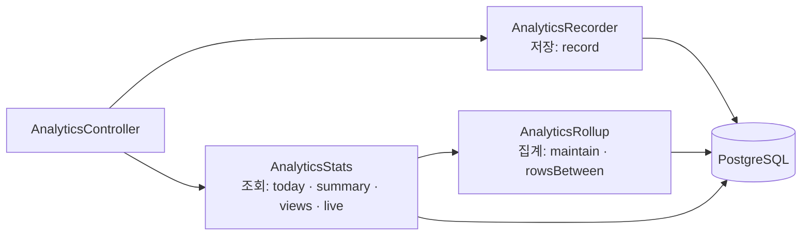

트래픽 분석(#102)은 사이트가 보낸 이벤트를 받아 두었다가, 하루가 지나면 날짜별 통계로 모으고, '활동 상태 보기' 앱과 블로그 조회수에 숫자를 내준다. 이 세 가지 일을 `AnalyticsService` 클래스 하나가 했다.

## 한 클래스가 하던 일

| 일   | 메서드                                      | 상태                           |
| ---- | ------------------------------------------- | ------------------------------ |
| 저장 | `record`                                    | IP마다 1분 묶음 수 (요청 제한) |
| 집계 | `maintain`, 한 시간마다 도는 타이머         | 마지막으로 모은 시각           |
| 조회 | `todayVisitors`, `summary`, `views`, `live` | 오늘 방문자 수, 1분 캐시       |

메서드마다 쓰는 상태가 다르다. 요청 제한 표는 `record`만 쓰고, 1분 캐시는 조회만 쓴다. 그런데 한 클래스 안에 있으니 `summary`를 고치려고 열면 요청 제한과 타이머 코드까지 같이 읽어야 했다.

## 셋으로 나누기

NestJS에서 서비스(`@Injectable`)는 다른 서비스를 생성자로 받아 쓸 수 있다. 이 성질로 일을 나눴다.

- **AnalyticsRecorder (저장, 68줄)**: 이벤트 묶음을 검사하고, IP마다 1분에 30번까지 받고, 로봇과 관리자를 빼고 저장한다.
- **AnalyticsRollup (집계, 80줄)**: 한 시간마다(그리고 요약을 열 때) 지난 날의 이벤트를 날짜별 통계로 모으고, 90일 지난 이벤트와 7일 지난 가린 IP를 지운다. 기간의 행을 돌려주는 `rowsBetween`도 여기 둔다. 지난 날은 모은 통계에서, 오늘은 이벤트에서 바로 읽는 규칙이 집계의 일이기 때문이다.
- **AnalyticsStats (조회, 203줄)**: 오늘 방문자·요약·조회수·최근 방문을 만든다. 누구나 부르는 값은 1분 동안 같은 값을 준다. 모으기가 필요하면 `AnalyticsRollup`에 맡긴다.

## 바꾸지 않은 것

경로, 요청 제한, 응답 모양, 캐시 시간은 하나도 바꾸지 않았다. 그래서 API 시험(e2e) 124개는 시험 안에서 집계를 직접 부르던 한 줄(`AnalyticsService` → `AnalyticsRollup`)만 고치고 그대로 통과했다. 개인정보 처리 안내(`docs/privacy.md`)의 "지난 날을 모으는 곳" 경로도 새 파일로 바꿨다.

#MacFolio #NestJS #리팩터링 #트래픽분석
