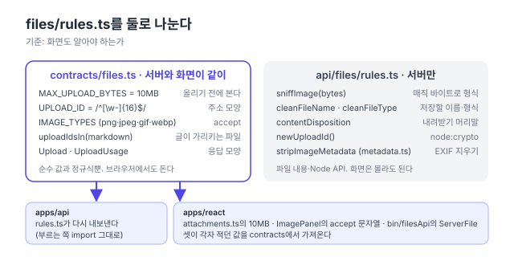

리팩터링 계획([#150](https://github.com/hyeoniverse/MacFolio/issues/150)) 1단계의 여섯째 PR([#205](https://github.com/hyeoniverse/MacFolio/pull/205))이다. [댓글](/memo/contracts-comments)·[글](/memo/contracts-posts)·[메시지](/memo/contracts-messages)·[연락 메일](/memo/contracts-contact)·[배경화면](/memo/contracts-wallpapers)에 이어 업로드 파일(`/files`) 도메인을 옮겼다. 이번 도메인은 "무엇을 옮길지"보다 "무엇을 옮기지 않을지"를 정하는 것이 핵심이었다.

## 배경: 같은 한도 값이 여러 곳에 정의되어 있었다

`@macfolio/contracts`는 API 요청·응답의 데이터 구조를 [zod](https://zod.dev/) 스키마로 정의하는 패키지다. 서버(NestJS)는 이 스키마로 요청 본문을 검증하고, 화면(React)은 같은 스키마에서 타입을 추출해 사용한다. 앞의 다섯 도메인은 대부분 "요청 본문 검증"이 중심이었다.

업로드 파일은 상황이 다르다. 업로드 요청은 [`multipart/form-data`](https://developer.mozilla.org/en-US/docs/Web/API/FormData)라서 zod로 검증할 JSON 본문이 없다. 대신 서버와 화면이 각각 정의한 상수가 있었다. 관리자가 글 편집기에서 11MB 사진을 선택하면 다음 순서로 거절된다.

1. 화면: `attachments.ts`의 `10 * 1024 * 1024`와 비교해 업로드 전에 거절한다.
2. 서버: 화면 검사를 우회하더라도 `rules.ts`의 같은 값으로 다시 검사하고 [413 Content Too Large](https://developer.mozilla.org/en-US/docs/Web/HTTP/Reference/Status/413)를 반환한다.
3. DB: `size BETWEEN 1 AND 10485760` [CHECK 제약](https://www.postgresql.org/docs/current/ddl-constraints.html)이 마지막으로 거절한다.

같은 값이 세 곳에 정의되어 있었고, 그중 코드 두 곳은 서로를 참조하지 않은 채 같은 값을 유지하고 있었다.

현재는 값이 일치하지만, 한도를 20MB로 올리면서 한쪽만 수정하면 다음과 같은 결과가 생긴다.

| 수정한 곳 | 15MB 파일을 업로드한 결과                      |
| --------- | ---------------------------------------------- |
| 화면만    | 화면 검사는 통과하고, 서버가 413을 반환한다    |
| 서버만    | 서버는 허용하지만, 화면이 업로드 전에 거절한다 |

두 경우 모두 증상은 "업로드되어야 할 파일이 업로드되지 않는다"이고, 원인을 찾으려면 두 패키지의 코드를 모두 확인해야 한다.

## 한 파일에 성격이 다른 두 종류의 코드가 있었다

서버 `files/rules.ts`에는 다음 코드가 있었다.

- **화면도 사용하는 값**: `MAX_UPLOAD_BYTES = 10MB`, `UPLOAD_ID = /^[\w-]{16}$/`, `IMAGE_TYPES`, `uploadIdsIn(markdown)`
- **서버만 사용하는 함수**: `sniffImage(bytes)`, `cleanFileName`, `cleanFileType`, `contentDisposition`, `newUploadId()`

첫째 묶음은 화면에도 같은 값이 있었다.

| 화면 위치                    | 정의되어 있던 값                                                                                                                           |
| ---------------------------- | ------------------------------------------------------------------------------------------------------------------------------------------ |
| 편집기 `attachments.ts`      | 업로드 전 크기 검사용 `10 * 1024 * 1024`                                                                                                   |
| 이미지 선택 `ImagePanel.tsx` | 파일 선택 창의 [`accept`](https://developer.mozilla.org/en-US/docs/Web/HTML/Reference/Attributes/accept) 문자열 `"image/png,image/jpeg,…"` |
| 휴지통 `filesApi.ts`         | 응답 타입 `ServerFile` 인터페이스                                                                                                          |

둘째 묶음은 화면이 알 필요가 없다. 파일 내용(매직 바이트[^magic])을 읽고, Node의 `crypto` 모듈을 사용하고, HTTP 헤더([`Content-Disposition`](https://developer.mozilla.org/en-US/docs/Web/HTTP/Reference/Headers/Content-Disposition))를 생성한다.



## 분리 기준 선택

분리 방법 세 가지를 비교했다.

| 방법                                           | 좋은 점                      | 나쁜 점                                                                                 |
| ---------------------------------------------- | ---------------------------- | --------------------------------------------------------------------------------------- |
| `rules.ts` 전체를 contracts로 이동             | 한 번에 끝난다               | `node:crypto`·`Buffer`가 함께 포함되어 브라우저 번들 빌드가 실패한다                    |
| 화면이 서버 파일을 직접 import                 | 새 파일이 없다               | React 앱이 `apps/api`에 의존한다. 서버 의존성(Nest·Prisma)이 화면 번들에 포함될 수 있다 |
| "화면도 알아야 하는가"로 나눠 첫째 묶음만 이동 | contracts에 순수 값만 남는다 | 서버 `rules.ts`가 re-export해야 한다                                                    |

세 번째를 선택했다. contracts에 넣는 기준을 "서버와 화면이 함께 사용하는 값·타입"으로 정하고, 첫째 묶음만 옮겼다.

```ts
// packages/contracts/src/files.ts
export const MAX_UPLOAD_BYTES = 10 * 1024 * 1024;
export const UPLOAD_ID = /^[\w-]{16}$/;
export const IMAGE_TYPES: readonly string[] = ['image/png', 'image/jpeg', 'image/gif', 'image/webp'];
export function uploadIdsIn(text: string | null | undefined): string[] {
	/* /files/<16자> */
}

export const Upload = z.object({ id, name, type, size, image, path });
export const UploadUsage = Upload.extend({ createdAt, createdBy, usedBy: { posts, revisions, wallpaper } });
```

모두 순수한 값과 정규식이라 브라우저에서도 그대로 실행된다. `sniffImage`와 `newUploadId`는 옮기지 않았다. 화면에서 사용하지 않고, Node API에 의존하는 코드를 contracts에 넣으면 패키지를 브라우저에서 실행할 수 없게 된다.

`IMAGE_TYPES`를 `readonly string[]`로 선언한 데도 이유가 있다. `as const`로 선언하면 요소 타입이 `'image/png' | 'image/jpeg' | …` 리터럴 유니언이 되어, `includes(file.type)`처럼 임의의 `string`을 인자로 넘기는 곳에서 타입 오류가 난다. 서버는 `sniffImage`의 반환값이 이 배열에 있는지 검사하고, 화면은 `join(',')`만 사용하므로 넓은 타입이 적합했다.

`uploadIdsIn`은 정규식 하나로 된 함수지만 화면과 서버가 같은 결과를 내야 한다. 서버는 글을 저장할 시각에 본문이 참조하는 파일을 찾아 "사용처" 목록을 만들고, 화면의 휴지통은 저장소 Markdown 글이 참조하는 파일을 같은 방법으로 찾아 "삭제해도 되는 파일"을 판별한다. 두 결과가 다르면 사용 중인 파일을 삭제 가능하다고 표시할 수 있다. 휴지통의 판별 과정은 [사용처 없는 파일 정리 글](/memo/server-files-cleanup)에 정리했다.

## 서버 쪽은 re-export

서버 `rules.ts`는 옮긴 네 개를 contracts에서 import해 다시 export한다. 그래서 `files.service.ts`·`wallpapers.service.ts`·컨트롤러의 import 문은 변경되지 않았다. 시험도 `uploadIdsIn`의 경우만 contracts로 옮기고 나머지는 유지했다.

```ts
// apps/api/src/files/rules.ts (후)
import { randomBytes } from 'node:crypto';
export { IMAGE_TYPES, MAX_UPLOAD_BYTES, UPLOAD_ID, uploadIdsIn } from '@macfolio/contracts';

export const newUploadId = () => randomBytes(12).toString('base64url');
export function sniffImage(data: Uint8Array): string | null {
	if (startsWith(data, [0x89, 0x50, 0x4e, 0x47, 0x0d, 0x0a, 0x1a, 0x0a])) return 'image/png';
	// jpeg ff d8 ff, gif 'GIF8', webp 'RIFF'…'WEBP'
}
```

`sniffImage`가 서버에 남아야 하는 이유는 하나 더 있다. 브라우저가 보내는 `type`은 사용자가 확장자만 바꿔도 달라진다. 서버는 파일 이름을 신뢰하지 않고 파일 앞부분의 바이트로 형식을 판별해 `type`에 저장한다.

| 형식 | 판별 바이트                                      |
| ---- | ------------------------------------------------ |
| PNG  | `89 50 4E 47 0D 0A 1A 0A`                        |
| JPEG | `FF D8 FF`                                       |
| GIF  | `47 49 46 38` (`GIF8`)                           |
| WebP | `52 49 46 46` (`RIFF`) + 8번째 바이트부터 `WEBP` |

SVG는 스크립트를 포함할 수 있어서 의도적으로 이미지로 판별하지 않는다. 이 판단은 서버가 저장하기 전에 하는 보안 검사라 화면에 둘 이유가 없다.

`files.service.ts`에 있던 `UploadView`·`UploadUsageView` 인터페이스 두 개(23줄)는 contracts 타입의 별칭 두 줄로 바뀌었다.

```ts
// 전: 서버와 화면이 같은 타입을 각각 정의했다
export interface UploadUsageView extends UploadView { createdAt: string; createdBy: string; usedBy: {…} }
// 후
export type UploadView = Upload;
export type UploadUsageView = UploadUsage;
```


화면은 다음 곳이 바뀌었다.

| 파일                  | 전                                            | 후                      |
| --------------------- | --------------------------------------------- | ----------------------- |
| `attachments.ts`      | `10 * 1024 * 1024`                            | `MAX_UPLOAD_BYTES`      |
| `ImagePanel.tsx`      | `accept="image/png,image/jpeg,…"`             | `IMAGE_TYPES.join(',')` |
| `filesApi.ts`         | `ServerFile` 인터페이스                       | `UploadUsage`의 별칭    |
| 글 편집기 업로드 응답 | `as Omit<Uploaded, 'url'> & { path: string }` | `as Upload`             |

## 결과

| 항목             | 전                        | 후                         |
| ---------------- | ------------------------- | -------------------------- |
| 코드에 적힌 10MB | 2 (서버·화면)             | 1                          |
| 이미지 형식 목록 | 2 (서버 배열·화면 문자열) | 1                          |
| 파일 응답 타입   | 2 (서버·화면)             | 1                          |
| 서버 `rules.ts`  | 9개                       | 5개 (서버 전용 함수)       |
| 동작 변화        |                           | 없음 (e2e 파일 8개 그대로) |
| 변경 크기        |                           | 파일 12개, +212 / −75      |

## 확인

- 단위 시험: `packages/contracts/src/files.test.ts`에 시험 세 개를 새로 작성했다. "한도는 10MB, 주소는 16자", "글에서 가리키는 파일 id를 찾는다 (전체 주소든 경로든, 같은 id는 한 번)", "응답 모양: 올린 파일과 쓰는 곳". 마지막 시험은 응답에 `data` 같은 정의되지 않은 필드가 포함되어도 `parse`가 제거하는지 검사한다. 서버 `rules.test.ts`에서는 옮긴 `uploadIdsIn` 시험 18줄을 삭제했고, `sniffImage`·`contentDisposition` 시험은 유지했다.
- 타입 검사: 서버·화면 모두 import 경로만 바뀌고 사용하는 코드는 그대로이므로, `tsc`가 통과하면 두 타입이 같다는 뜻이다.
- E2E: 동작을 바꾸지 않는 PR이라 새 E2E는 없다. 파일 업로드·휴지통·배경화면을 검사하는 기존 E2E 8개가 수정 없이 통과했다.
- 변경 크기: 커밋 전체는 파일 12개, +212/−75다. 글과 그림을 제외하면 코드는 +108/−75다.

## 남긴 것과 정리

이 PR 이후 [배경화면 동영상](/memo/video-wallpaper) 기능을 추가하면서 `VIDEO_TYPES`와 `MAX_WALLPAPER_VIDEO_BYTES`(30MB)가 같은 파일에 추가되었다. 기준이 정해져 있어서 두 값은 바로 contracts에 배치했고, MP4의 `ftyp` 박스를 읽는 `sniffVideo`는 서버 `rules.ts`에 배치했다.

DB CHECK 제약의 `10485760`은 SQL 마이그레이션 파일에 별도로 남아 있다. 마이그레이션 파일은 한 번 적용하면 수정하지 않는 기록이라 contracts 값을 참조할 수 없다. 한도를 바꿀 때는 새 마이그레이션을 작성하고 contracts 값을 함께 수정해야 하며, 이 일치 여부는 시험으로 검사하지 못했다. 실제로 동영상 배경화면을 추가할 때 마이그레이션 `20261020100000_wallpaper_video`가 CHECK 제약을 `31457280`(30MB)으로 바꾸고, contracts에 `MAX_WALLPAPER_VIDEO_BYTES`를 함께 추가했다.

> 공유 패키지에는 브라우저와 Node 양쪽에서 실행되는 코드만 넣는다.

Node API를 사용하는 코드가 하나라도 포함되면 그 패키지를 import하는 화면 번들 빌드가 실패한다. 무엇을 옮길지보다 무엇을 남길지를 먼저 정하면 패키지 경계를 명확하게 정할 수 있다.

다음 도메인은 [분석(analytics)](/memo/contracts-analytics)과 [사이트 프로필](/memo/contracts-site)이다. 두 도메인까지 옮기면 화면 코드에서 직접 작성한 응답 타입이 모두 사라진다.

## 직접 확인하는 방법

계약(요청·응답 스키마)을 바꿀 때는 `packages/contracts`를 먼저 수정하고, 서버와 화면이 모두 새 형태를 따르는지 확인한다.

```bash
pnpm --filter @macfolio/contracts test          # 스키마 시험
pnpm --filter @macfolio/contracts build         # 서버는 빌드된 JS를 읽는다
pnpm typecheck                                  # 화면·서버가 새 모양을 따르는지
pnpm --filter @macfolio/api test -- src/files/rules.test.ts
```

필드 이름 하나를 바꾸면 `pnpm typecheck`가 서버와 화면에서 동시에 실패한다. 이 작업의 목적이 바로 이 검사다. 확인한 뒤에는 변경을 되돌린다. 패키지를 나눈 이유는 [댓글 계약 글](/memo/contracts-comments)에 정리했다.

## 관련 글

- [응답 타입을 두 번 적지 않기 — @macfolio/contracts와 zod](/memo/contracts-comments)
- [숫자 40이 세 곳에 — 배경화면 도메인 옮기기](/memo/contracts-wallpapers)
- [움직이는 배경화면 - MP4와 GIF를 바탕화면에 깔기](/memo/video-wallpaper)
- [올린 사진의 EXIF를 지우되 방향은 남기기](/memo/upload-strip-exif)
- [글에서 지운 이미지는 서버에 남는다 - 쓰는 곳이 없는 파일 찾기](/memo/server-files-cleanup)
- [이미 한 곳이었다, 자리만 옮겼다 — 사이트 프로필로 1단계 마무리](/memo/contracts-site)

[^magic]: 파일 형식마다 정해진 파일 앞부분의 고정 바이트열(매직 넘버, 파일 시그니처). 확장자나 브라우저가 보낸 MIME 타입과 달리 파일 내용 자체에서 읽으므로 이름을 바꿔도 달라지지 않는다.

#MacFolio #리팩터링 #zod #TypeScript
