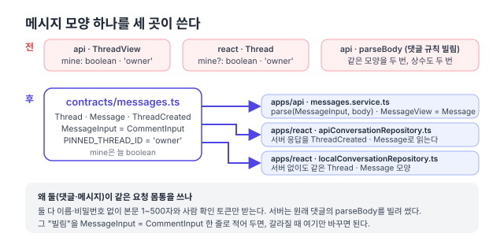

리팩터링 계획([#150](https://github.com/hyeoniverse/MacFolio/issues/150)) 1단계의 셋째 PR([#202](https://github.com/hyeoniverse/MacFolio/pull/202))이다. [댓글](/memo/contracts-comments), [글](/memo/contracts-posts)에 이어 메시지 앱의 요청·응답 스키마를 `@macfolio/contracts`로 옮겼다.

메시지 앱은 방문자가 사이트에 대한 의견을 남기는 앱이다. macOS 메시지처럼 왼쪽 사이드바에 대화 목록, 오른쪽에 말풍선이 있다. 목록 맨 위에는 사이트 주인(필자)의 안내가 고정되어 있고, 누구나 그 안내에 답글을 작성할 수 있다. 작성 버튼으로 새 의견을 남기면 목록에 항목이 하나 추가된다. 현재 방문자가 작성한 말풍선은 오른쪽, 다른 사람이 작성한 말풍선은 왼쪽에 배치된다. 이 좌우 배치를 결정하는 필드가 이번 작업에서 타입이 서로 달랐던 `mine`이다.

## 메시지 앱의 저장소 구현은 두 가지다

메시지 앱은 기본적으로 서버 API(`/messages`)에 저장하고, 환경 변수 `VITE_MESSAGES_STORE=local`로 빌드하면 브라우저의 [`localStorage`](https://developer.mozilla.org/en-US/docs/Web/API/Window/localStorage)에 저장한다(서버 없이 로컬에서 개발할 때 사용한다. 자세한 내용은 [메시지 저장소 선택 글](/memo/messages-offline)). 두 구현 모두 `ConversationRepository` 인터페이스를 구현하고, 화면은 어느 구현인지 알지 못한다. 그래서 대화(`Thread`)와 말풍선(`Message`)의 데이터 구조는 다음 **세 곳**이 일치해야 한다.

1. 서버가 응답으로 보내는 값
2. 서버 저장소(`apiConversationRepository.ts`)가 응답을 읽는 타입
3. 로컬 저장소(`localConversationRepository.ts`)가 생성하는 값

변경 전에는 서버 `messages.service.ts`의 `ThreadView`·`MessageView`와 화면 `conversations.ts`의 `Thread`·`Message`가 각각 정의되어 있었다. 서버 쪽 주석에는 "apps/react/src/apps/messages/conversations.ts의 Message와 같은 모양"이라고 적혀 있었다. 두 타입이 같다는 규칙을 주석으로만 유지하고 있었다. 비교해 보니 필드 하나가 달랐다.

| 위치                       | `mine` 타입      | 실제 동작             |
| -------------------------- | ---------------- | --------------------- |
| 화면 `conversations.ts`    | `mine?: boolean` | 없어도 타입 검사 통과 |
| 서버 `messages.service.ts` | `mine: boolean`  | 항상 응답에 포함      |
| 로컬 저장소                | (화면 타입 사용) | 항상 값을 채움        |

두 저장소 모두 항상 값을 채우고 있어서 실제로 `mine`이 없는 경우는 없었다. 화면 타입만 느슨했고, 이 차이를 검사하는 시험은 없었다.

느슨한 타입이 당장 오류를 일으키지는 않았다. 하지만 `mine`이 선택 필드이면 화면 코드는 `thread.mine ?? false`처럼 값이 없는 경우를 처리하거나, 처리하지 않고 `undefined`를 거짓으로 취급한다. 이후 세 번째 저장소(예: 시험용 가짜 저장소)를 구현하면서 `mine`을 빠뜨려도 타입 검사가 오류를 내지 않는다. 그 결과 본인이 작성한 말풍선이 왼쪽에 배치되는데, 화면상으로는 오류로 보이지 않아 오래 발견되지 않을 수 있다.

저장소 구현을 선택하는 코드는 한 곳이다.

```ts
// apps/react/src/apps/messages/repository/index.ts
export function getConversationRepository(): ConversationRepository {
	if (!repository) {
		repository =
			env.messagesStore === 'local'
				? createLocalConversationRepository(visitorId())
				: createApiConversationRepository(env.apiUrl);
	}
	return repository;
}
```

`ConversationRepository`는 `listThreads`·`listMessages`·`createThread`·`postMessage`·`removeMessage`·`myName` 여섯 메서드를 정의한다. 작성자 구분과 `mine` 값 계산은 저장소가 담당한다. 서버는 방문자 쿠키로, 로컬 저장소는 `localStorage`에 저장한 브라우저 id로 "현재 방문자가 작성한 글인지"를 판단해 반환한다. 화면은 수신한 `mine` 값만 보고 말풍선을 좌우에 배치한다.




## 고른 방법

세 곳을 일치시키는 방법 세 가지를 비교했다.

| 방법                                             | 좋은 점                           | 나쁜 점                                                                  |
| ------------------------------------------------ | --------------------------------- | ------------------------------------------------------------------------ |
| 지금처럼 각자 정의하고 주석으로 "같은 모양" 표시 | 변경할 코드가 없다                | 이미 `mine` 하나가 달라졌다. 이후의 차이도 시험이 검출하지 못한다        |
| 화면 `conversations.ts`를 서버가 import          | 한쪽에만 정의한다                 | 서버가 React 앱 폴더에 의존한다. 패키지 빌드 순서가 맞지 않는다          |
| contracts에 zod 스키마로 정의하고 양쪽이 import  | 서버 검증·화면 타입의 원본이 하나 | 패키지를 하나 거친다. 앞의 두 PR에서 구조를 이미 만들어 추가 비용이 작다 |

앞의 두 도메인에서 사용한 셋째 방법을 그대로 적용했다.

## 옮긴 것

```ts
// packages/contracts/src/messages.ts
export const PINNED_THREAD_ID = 'owner';

/** 새 피드백·답글 요청 몸통. 댓글과 같은 규칙(1~500자, 사람 확인 토큰) */
export const MessageInput = CommentInput;

export const Thread = z.object({
	id: z.string(),
	title: z.string(),
	ipPrefix: z.string().optional(),
	createdAt: z.string(),
	pinned: z.boolean().optional(),
	mine: z.boolean(),
	summary: z.string().optional(),
	lastMessage: z.object({ text: z.string(), createdAt: z.string() }).optional(),
});
export const ThreadCreated = z.object({ thread: Thread, message: Message });
```

`Message` 스키마도 같은 파일에 있다. `id`·`threadId`·`text`·`createdAt`·`authorId`·`nickname`·`fromOwner`·`mine`이 필수이고 `ipPrefix`만 선택 필드다. `authorId`는 같은 작성자의 말풍선을 묶는 데만 사용하는 불투명한 값(opaque value)[^opaque]이다. 서버는 저장한 방문자 해시를 응답에 그대로 포함하지 않는다.

## 구현

**서버**는 `parse(MessageInput, body)`로 요청을 검증하고, `ThreadView`·`MessageView`는 contracts 타입의 별칭(type alias)으로 바꿨다. 서비스 로직은 변경하지 않았다.

```ts
// apps/api/src/messages/messages.service.ts
-import { hashIp, maskIp, parseBody } from '../comments/rules.js';
+import { hashIp, maskIp } from '../comments/rules.js';
+import { type Message, MessageInput, parse, PINNED_THREAD_ID, type Thread } from '@macfolio/contracts';

-export interface MessageView { id: string; threadId: string; … mine: boolean }
-export interface ThreadView { id: string; title: string; … mine: boolean }
+export type MessageView = Message;
+export type ThreadView = Thread;

-		const parsed = parseBody(input);
+		const parsed = parse(MessageInput, input);
```

인터페이스 두 개를 삭제하면서 서비스 파일은 39줄이 변경되었다(대부분 삭제한 줄이다).

**화면**의 `conversations.ts`는 `Thread`·`Message` 인터페이스를 삭제하고 contracts에서 import해 다시 export한다. 컴포넌트와 로컬 저장소의 import 경로는 그대로라 변경된 파일이 적다. `mine`이 필수가 되면서 시험 픽스처 하나(`conversations.test.ts`)에 `mine: false`를 추가했고, 화면 쪽 수정은 그것뿐이었다. 서버 저장소 `apiConversationRepository.ts`는 응답을 `as Thread[]`로 읽던 타입의 출처만 바뀌었다.

화면 쪽 `conversations.ts`에서는 인터페이스 두 개(34줄)가 삭제되고 re-export 한 줄이 남았다. 주석으로 달려 있던 필드 설명(`ipPrefix`는 "IP 앞 두 자리", `mine`은 "오른쪽 말풍선" 등)은 contracts 스키마 옆으로 옮겨 한 곳에서 확인할 수 있다.

## 요청 본문 규칙은 댓글과 같다

메시지와 댓글 모두 이름·비밀번호 없이 본문 1~500자와 사람 확인 토큰(Cloudflare Turnstile[^turnstile])만 받는다. 서버는 기존에 `comments/rules.ts`의 `parseBody`를 import해 사용했다. 메시지 서비스가 댓글 모듈에 의존하는 이유는 "검증 함수가 그 모듈에 있어서"뿐이었다.

contracts에서는 `MessageInput = CommentInput` 한 줄로 정의했다. 두 규칙이 같다는 사실은 유지하되, 규칙이 달라질 때(예: 메시지만 1,000자까지 허용) 이 줄만 별도 스키마로 바꾸면 된다. 서버 메시지 모듈은 이제 댓글 모듈에서 IP 마스킹(`maskIp`)·해시(`hashIp`) 함수만 import한다.

## 고정 항목 id

사이드바 맨 위의 사이트 주인 안내는 id가 `'owner'`다. 서버에는 그 안내에 작성된 답글만 저장되고(`threadId`가 빈 글), 안내 글 자체는 화면 코드에 있다. 이 `'owner'`가 서버 `PINNED_THREAD_ID`와 화면 `PINNED_THREAD_ID`에 각각 정의되어 있었다. 한쪽만 변경하면 서버에 저장된 답글과 화면의 안내 글이 서로 연결되지 않는 값이다. contracts에 하나만 정의하고 양쪽이 re-export한다.

## 확인

- 단위 시험 `packages/contracts/src/messages.test.ts`에 시험 세 개를 새로 작성했다. "댓글과 같은 규칙: 다듬고, 비었거나 500자를 넘으면 이유를 알린다", "말풍선과 항목 (ipPrefix·summary·lastMessage는 없어도 된다)", "방문자 해시 같은 모르는 필드는 버린다". 마지막 시험은 서버가 실수로 내부 값을 응답에 포함해도 스키마를 거치면 제거되는지 검사한다.
- 화면 쪽 `localConversationRepository.test.ts`는 수정하지 않고 통과했다. 로컬 저장소가 이미 `mine`을 항상 채우고 있었다는 뜻이다.
- E2E `apps/react/e2e/messages.spec.ts`는 수정 없이 통과했다. "처음에는 김정현의 안내가 열리고, 누구나 답글을 달 수 있다"가 고정 항목 `'owner'`를, "다른 사람의 피드백에 답글을 달 수 있고, 사람마다 구분되어 보인다"가 `mine`과 `authorId`를 검사한다.
- 커밋 크기는 파일 10개, +223/−65. 글과 그림을 빼면 코드는 +113/−65다.

## 결과

| 항목                         | 전                   | 후                           |
| ---------------------------- | -------------------- | ---------------------------- |
| `Thread`·`Message`가 적힌 곳 | 2 (서버·화면)        | 1                            |
| `'owner'` 상수               | 2                    | 1                            |
| `mine` 타입                  | 서버 필수, 화면 선택 | 필수                         |
| 메시지 → 댓글 모듈 의존      | 검증 함수 + IP 함수  | IP 함수만                    |
| 동작 변화                    |                      | 없음 (e2e 메시지 4개 그대로) |

## 남긴 것과 정리

`MessageInput = CommentInput`은 "현재 규칙이 같다"는 사실을 표현한 것이지 "항상 같아야 한다"는 제약이 아니다. 메시지에 첨부 파일을 허용하거나 글자 수 한도를 늘리면 그 시점에 별도 스키마를 만든다. 서버 메시지 모듈은 여전히 댓글 모듈에서 `hashIp`·`maskIp`를 import한다. 두 함수는 방문자 식별용이라 이후 공용 모듈로 옮길 후보다(방문자 식별 방식은 [방문자 식별 글](/memo/visitor-identity)에 정리했다).

두 타입이 같다는 규칙을 주석으로만 유지하면 결국 차이가 생긴다. 이번 차이는 선택/필수 필드 하나였지만, 스키마를 한 곳에 정의한 뒤에야 발견되었다. 저장소 구현이 둘 이상인 기능일수록 타입을 하나의 원본에서 import해야 한다.

다음 도메인은 [연락 메일](/memo/contracts-contact)·[배경화면](/memo/contracts-wallpapers)·[파일](/memo/contracts-files)·[분석](/memo/contracts-analytics) 순서로 같은 방식을 적용했다.

## 직접 확인하는 방법

계약(요청·응답 스키마)을 바꿀 때는 `packages/contracts`를 먼저 수정하고, 서버와 화면이 모두 새 형태를 따르는지 확인한다.

```bash
pnpm --filter @macfolio/contracts test          # 스키마 시험
pnpm --filter @macfolio/contracts build         # 서버는 빌드된 JS를 읽는다
pnpm typecheck                                  # 화면·서버가 새 모양을 따르는지
cd apps/react && npx playwright test e2e/messages.spec.ts --project=desktop-chromium
```

필드 이름 하나를 바꾸면 `pnpm typecheck`가 서버와 화면에서 동시에 실패한다. 이 작업의 목적이 바로 이 검사다. 확인한 뒤에는 변경을 되돌린다. 스키마는 [Zod](https://zod.dev/)로 작성하고, 패키지를 나눈 이유는 [댓글 계약 글](/memo/contracts-comments)에 정리했다.

## 관련 글

- [응답 타입을 두 번 적지 않기 — @macfolio/contracts와 zod](/memo/contracts-comments)
- [타입은 desktop-core에, 스키마는 contracts에 — 글 도메인 옮기기](/memo/contracts-posts)
- [서버가 없으면 메시지 앱을 열지 않기 - 저장소를 .env로 고르기](/memo/messages-offline)
- [이름·비밀번호 없이 쓰는 메시지와 댓글 - 방문자 쿠키로 정하는 이름](/memo/visitor-identity)
- [리팩터링 1단계 — 타입과 데이터 구조](/memo/refactor-step1-types)

[^opaque]: 의미를 해석하지 않고 같은지 비교하는 용도로만 쓰는 값. 화면은 `authorId`가 무엇에서 계산되었는지 알 필요가 없다.

[^turnstile]: Cloudflare가 제공하는 CAPTCHA 대체 서비스. 화면이 받은 토큰을 서버가 Cloudflare에 확인 요청한다. [공식 문서](https://developers.cloudflare.com/turnstile/)

#MacFolio #리팩터링 #zod #TypeScript
