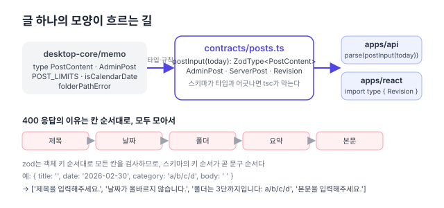
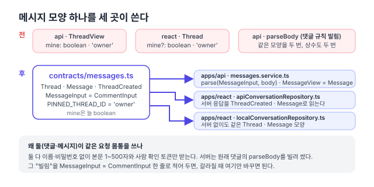

## 배경: 요청·응답의 모양과 계약

웹 화면(React)과 API 서버(NestJS)는 HTTP로 JSON을 주고받는다. 예를 들어 방문자가 댓글을 작성하면 화면은 `POST /posts/<글 주소>/comments`에 다음 본문을 보내고, 서버는 저장한 댓글을 JSON으로 돌려준다(값은 예시).

```text
POST /posts/cra-to-vite/comments
요청 본문  { "body": "좋은 글입니다", "turnstileToken": "<사람 확인 토큰>" }
응답 본문  { "id": "…", "name": "…", "ipPrefix": "203.0", "isAdmin": false, "body": "좋은 글입니다",
             "createdAt": "2026-10-11T03:00:00.000Z", "mine": true, "likes": 0, "liked": false }
```

이렇게 "어떤 필드가 어떤 타입으로 오가는가"를 요청·응답의 **모양**(shape)이라고 하고, 양쪽이 지키기로 한 모양을 **계약**(contract)이라고 부른다. 패키지 이름 `contracts`도 여기서 왔다. 계약을 지키려면 화면과 서버가 같은 정의를 읽어야 하는데, TypeScript 타입은 컴파일 시에만 존재하고 실행 시에는 사라진다. 그래서 서버가 실제로 들어온 JSON을 검사하려면 타입과 별도로 검사 코드(`if` 문)가 필요하고, 화면은 그 검사 규칙을 모른 채 타입만 따로 적게 된다.

리팩터링 계획([#150](https://github.com/hyeoniverse/MacFolio/issues/150)) 1단계 "타입과 데이터 구조"의 작업이다. 3단계에서 서버 요청을 [공통 API 클라이언트 api()·apiFetch()로 fetch 호출과 401 처리 통합하기](/memo/shared-modules#서버-호출-apiapifetch) 하나로 모았으므로, 다음 순서는 그 요청과 응답의 **모양**을 한 곳에 정의하는 것이다.

패키지는 첫 PR([#200](https://github.com/hyeoniverse/MacFolio/pull/200), 댓글·좋아요)에서 만들었고, 같은 날 글([#201](https://github.com/hyeoniverse/MacFolio/pull/201))·메시지([#202](https://github.com/hyeoniverse/MacFolio/pull/202))·분석 이벤트([#206](https://github.com/hyeoniverse/MacFolio/pull/206))의 응답 모양을 옮겼다. 입력 검사 규칙이 중심인 나머지 도메인(연락 메일·배경화면·파일·사이트 프로필·관리자 설정·데모)은 [검사 규칙 배치 글](/memo/contracts-validation)에 있다.

## 서버와 화면이 같은 모양을 각자 정의했다

댓글 하나의 모양은 서버 `comments.service.ts`의 `CommentView`와 화면 `commentsApi.ts`의 `Comment`에 각각 정의되어 있었다. 필드 열 개가 글자 그대로 같다. 서버에 `likes` 필드를 추가한 시각에 화면 쪽도 수정했는지는 사람이 기억해야 했다. 두 파일은 서로를 import하지 않으므로, ==둘이 어긋나도 타입 검사는 오류를 내지 않는다==.

예를 들어 서버에서 `likes`의 이름을 `likeCount`로 바꾸고 화면 타입은 고치지 않았다고 하자.

```ts
// 예시: 서버 apps/api/src/comments/comments.service.ts만 수정한 경우
interface CommentView {
	id: string;
	name: string;
	body: string;
	likeCount: number; /* … */
}
// 화면 apps/react/src/apps/memo/comments/commentsApi.ts는 그대로
interface Comment {
	id: string;
	name: string;
	body: string;
	likes: number; /* … */
}
```

두 파일이 각각 타입 검사를 통과하므로 `pnpm typecheck`는 성공한다. 실행하면 서버 응답에는 `likes`가 없어서 화면의 `comment.likes`는 `undefined`가 되고, 좋아요 수 자리에 빈 값이 표시된다.

검증도 마찬가지다. "내용은 1~500자"라는 규칙과 "내용을 입력해주세요."라는 문구는 서버 `rules.ts`의 `if`문 안에만 있었다. 화면은 규칙을 모른 채 요청을 보내고, 400 응답이 오면 서버가 보낸 문구를 그대로 표시한다. 화면에서 글자 수를 안내하려면 `500`을 화면 코드에 한 번 더 적어야 한다.

다른 도메인도 구조가 같았다.

| 도메인      | 같은 모양이 정의된 곳                                                                                                  | 이미 어긋나 있던 것                         |
| ----------- | ---------------------------------------------------------------------------------------------------------------------- | ------------------------------------------- |
| 댓글·좋아요 | 서버 `CommentView`, 화면 `Comment`·`Likes`·`PostCounts`                                                                | 없음 (규칙과 문구는 서버에만)               |
| 블로그 글   | desktop-core `PostContent`·`AdminPost`·`ServerPost`, 서버 `PostInput`·`PublicPost`·`AdminPost`, 화면 `RevisionSummary` | `AdminPost.deletedAt`의 선택/필수           |
| 메시지      | 서버 `ThreadView`·`MessageView`, 화면 `Thread`·`Message`                                                               | `mine`의 선택/필수                          |
| 분석 이벤트 | 사이트 `AnalyticsEvent`, 서버 `parseBatch`, 화면·서버 각각의 `Summary`·`LiveVisit`                                     | 묶음 상한 30과 표 목록 `BREAKDOWNS`가 두 벌 |


## @macfolio/contracts 패키지 구조

`packages/contracts`(`@macfolio/contracts`)를 만들고 [zod](https://zod.dev/) 스키마를 정의했다. zod는 "이 값은 1~500자 문자열이어야 한다" 같은 규칙을 `z.string().min(1).max(500)`처럼 코드로 선언하고, 실제 값이 그 규칙에 맞는지 실행 시에 검사하는 TypeScript 라이브러리다. zod 스키마는 실행 시에 값을 검사하는 객체이면서, `z.infer`로 TypeScript 타입도 만들어 낸다. 그래서 스키마와 타입에 같은 이름을 붙인다.

```ts
// packages/contracts/src/comments.ts
export const CommentInput = requestBody({
	body: z
		.string({ error: '내용을 입력해주세요.' })
		.trim()
		.min(1, '내용을 입력해주세요.')
		.max(COMMENT_BODY_MAX, `내용은 ${COMMENT_BODY_MAX}자까지 입력할 수 있습니다.`),
	turnstileToken: z.string().optional(),
});
export type CommentInput = z.infer<typeof CommentInput>;

export const Comment = z.object({ id: z.string(), name: z.string(), ipPrefix: z.string().nullable() /* … */ });
export type Comment = z.infer<typeof Comment>;
```

| 사용처 | 가져오는 방법                                               | 쓰는 것                     |
| ------ | ----------------------------------------------------------- | --------------------------- |
| 서버   | `import { CommentInput, parse } from '@macfolio/contracts'` | 스키마(값)로 요청 본문 검사 |
| 화면   | `import type { Comment } from '@macfolio/contracts'`        | 타입만                      |

**서버**는 `parse(CommentInput, body)`로 검사한다. 반환 모양은 서버가 이미 쓰던 `{ value } | { errors: string[] }` 그대로라, 서비스의 `if ('errors' in parsed) throw new BadRequestException(parsed.errors)`는 수정하지 않았다.

**화면**은 [`import type`](https://www.typescriptlang.org/docs/handbook/release-notes/typescript-3-8.html#type-only-imports-and-export)으로 타입만 가져온다. `import type`은 컴파일 후 제거되므로 ==화면 번들에 zod가 포함되지 않는다==(추가 크기 0바이트).

같은 `CommentInput`에 실제 값을 넣으면 다음 결과가 나온다. 앞뒤 공백은 `.trim()`이 제거하고, 스키마에 없는 `name`·`password`는 `z.object`가 결과에서 제거한다.

| 입력                                                            | `parse(CommentInput, 입력)`                            |
| --------------------------------------------------------------- | ------------------------------------------------------ |
| `{ body: '  좋은 글입니다  ', name: '익명', password: '1234' }` | `{ value: { body: '좋은 글입니다' } }`                 |
| `{ body: '' }`                                                  | `{ errors: ['내용을 입력해주세요.'] }`                 |
| `null`                                                          | `{ errors: ['내용을 입력해주세요.'] }`                 |
| `{ body: 'a' × 501 }`                                           | `{ errors: ['내용은 500자까지 입력할 수 있습니다.'] }` |


### 패키지 해석: source 조건

패키지 구조는 `desktop-core`와 같다. `package.json`의 [conditional exports](https://nodejs.org/api/packages.html#conditional-exports)에 `source` 조건을 지정해, 화면(Vite)은 `src`를 직접 읽고 서버는 빌드한 `dist`를 읽는다. Dockerfile은 `desktop-core`와 `contracts`를 함께 빌드한다.

conditional exports는 `import '@macfolio/contracts'` 한 줄이 실행 환경에 따라 서로 다른 파일을 가리키게 하는 Node.js 패키지 기능이다. `exports` 객체의 조건을 위에서부터 확인해 처음 일치하는 경로를 사용한다. `source`는 Node.js가 정의한 조건이 아니라 이 저장소가 붙인 이름이라서, Vite 설정(`resolve.conditions`)과 화면의 `tsconfig.json`(`customConditions`)에서 지정한 도구만 이 조건을 사용한다.


이 구성의 결과로 화면에서는 스키마를 고치면 Vite 개발 서버가 바로 반영하고, 서버는 `pnpm --filter @macfolio/contracts build`로 `dist`를 다시 만든 뒤에야 바뀐 스키마를 사용한다.

### parse와 requestBody

`parse`는 zod의 [`safeParse`](https://zod.dev/basics#handling-errors) 결과를 `{ value }` 또는 `{ errors: string[] }`로 변환하고, 같은 문구는 한 번만 담는다. 요청 본문이 `null`이나 문자열이면 zod는 "Invalid input: expected object"를 반환하는데, 사용자에게 보여 줄 문구가 아니다. `requestBody()`는 객체가 아닌 본문을 빈 객체로 간주해 각 필드의 문구를 내게 하는 도우미다. 이전에 `parseBody(null)`이 "내용을 입력해주세요."를 반환하던 동작이 유지된다.

<details>
<summary>parse와 requestBody 전체 코드</summary>

```ts
// packages/contracts/src/parse.ts
export type Parsed<T> = { value: T } | { errors: string[] };

export function parse<S extends z.ZodType>(schema: S, input: unknown): Parsed<z.output<S>> {
	const result = schema.safeParse(input);
	if (result.success) return { value: result.data };
	return { errors: [...new Set(result.error.issues.map((issue) => issue.message))] };
}

export const requestBody = <T extends z.ZodRawShape>(shape: T) =>
	z.preprocess((input) => (typeof input === 'object' && input !== null ? input : {}), z.object(shape));
```

</details>

## 검토한 방법

| 방법                                        | 서버 검증  | 화면 타입 | 문제                                                                        |
| ------------------------------------------- | ---------- | --------- | --------------------------------------------------------------------------- |
| 기존처럼 각자 정의하고 주석으로 "같은 모양" | `if`문     | 직접 작성 | 둘이 어긋나도 감지할 수 없다. 메시지의 `mine`은 이미 달라져 있었다          |
| `class-validator` DTO를 화면도 사용         | 데코레이터 | 클래스    | 데코레이터와 `reflect-metadata`가 화면 번들에 들어간다                      |
| 타입만 공유하는 패키지 (`.d.ts`)            | `if`문     | 공유      | 규칙(500자)과 문구는 여전히 서버에만 있다                                   |
| OpenAPI 문서에서 화면 타입 생성             | 데코레이터 | 생성      | 코드 생성 단계가 추가되고, 사이트의 전송 형식(sendBeacon)은 포함하지 못한다 |
| 화면 파일을 서버가 import                   | 공유       | 공유      | 서버가 React 앱 폴더에 의존한다. 패키지 빌드 순서가 맞지 않는다             |
| **zod 스키마 패키지 (채택)**                | `parse`    | `z.infer` | 서버가 zod를 런타임 의존성으로 쓴다                                         |

- **zod 4**. 스키마에 오류 문구를 한국어로 적을 수 있고(`.min(1, '…')`), 타입이 추론되며, 화면은 타입만 가져다 쓸 수 있다. NestJS의 [`class-validator`](https://docs.nestjs.com/techniques/validation)는 클래스 데코레이터 기반이라 화면 번들에 넣기 부적합해 선택하지 않았다.
- **응답 스키마도 정의한다**. 현재 화면은 응답을 검증하지 않고 타입만 쓴다. 스키마가 있으므로 필요해지면 `parse(Comment, json)` 한 줄로 서버 응답을 검증할 수 있다.
- **한 도메인씩 옮긴다**. 첫 PR에서는 댓글·좋아요(요청 스키마 1개, 응답 스키마 3개)만 옮기고, 나머지는 도메인마다 PR 하나씩 같은 방식으로 진행했다. 처음부터 전부 옮기면 PR이 너무 커서 검토하기 어렵다.

## 댓글·좋아요 스키마 (#200)

첫 PR은 패키지 구조, Dockerfile, CI, `requestBody()`·`parse()` 도우미를 정했다. 댓글 도메인 자체의 변경은 작다. `rules.ts`의 `parseBody`는 8줄짜리 `if`문에서 1줄이 됐고, 화면에 직접 적어 두었던 `interface Comment`·`Likes`·`PostCounts`는 삭제했다.

| 항목                    | 전   | 후                              |
| ----------------------- | ---- | ------------------------------- |
| 댓글 모양이 적힌 곳     | 2    | 1                               |
| `parseBody` 줄 수       | 8    | 1                               |
| 검증 문구가 적힌 곳     | 서버 | contracts (화면도 읽을 수 있다) |
| 화면 번들에 추가된 크기 | -    | 0 B (타입만)                    |

코드가 바뀐 파일은 서버 3개(`comments.service.ts`, `comments/rules.ts`, `likes.service.ts`)와 화면 2개(`commentsApi.ts`, `likesApi.ts`)다. 이 다섯 파일에서 61줄이 삭제되고 19줄이 추가되었다. 나머지는 새 패키지(스키마 43줄, 도우미 19줄, 시험 65줄)와 빌드 설정이다.

- `packages/contracts/src/comments.test.ts`(시험 4개): **앞뒤 공백을 다듬고, 모르는 필드(이름·비밀번호)는 버린다**, **비었거나 500자를 넘으면 이유를 알린다**, **사람 확인 토큰은 있으면 그대로**, **서버가 주는 댓글 모양을 받아들이고, 해시 같은 여분 필드는 거른다**
- `packages/contracts/src/parse.test.ts`(시험 2개): **실패하면 스키마에 적은 문구를 순서대로, 같은 문구는 한 번만**
- 서버 e2e(`apps/api/test/comments.e2e.test.ts`)는 수정하지 않고 통과했다. ==400 응답 문구가 이전과 한 글자도 다르지 않다==는 뜻이다.

## 블로그 글 스키마를 desktop-core 타입에 고정하기 (#201)

### 글 하나의 처리 경로

이 블로그의 글은 두 곳에서 온다. 저장소의 Markdown 파일(지금 읽는 이 글)과, 관리자가 메모 앱 편집기로 써서 서버 DB에 저장한 글이다. 관리자 글은 `POST /posts`·`PUT /posts/:slug`로 서버에 전송되고, 서버는 요청 본문(body)의 공백을 정리하고 검증한 뒤 저장한다. 검증에 실패하면 [400 Bad Request](https://developer.mozilla.org/en-US/docs/Web/HTTP/Reference/Status/400)와 함께 이유 목록을 반환하고, 편집기는 그 이유를 입력 칸 아래에 표시한다.

이 경로에서 글의 데이터 구조(타입)는 세 곳에 정의되어 있었다.

- `packages/desktop-core/src/memo/posts.ts`: `PostContent`·`AdminPost`·`ServerPost`. 화면이 저장소 글과 서버 글을 병합하는 코드가 사용한다.
- `apps/api/src/posts/rules.ts`: `PostInput` 인터페이스와 `parsePostInput` 함수.
- `apps/api/src/posts/posts.service.ts`: `PublicPost`·`AdminPost`·`RevisionSummary` 인터페이스. 화면 `postsApi.ts`에도 `RevisionSummary`가 별도로 정의되어 있었다.

### 타입이 이미 존재하는 도메인

댓글은 contracts에 새로 정의하면 충분했다. 글은 `PostContent`·`AdminPost`·`ServerPost` 타입이 이미 `desktop-core/memo`에 있고, 화면의 글 목록 병합(`mergeAdminPosts`)과 휴지통 계산이 그 타입을 사용한다. contracts에 다시 정의하면 세 번째 사본이 생긴다.

| 방법                                                     | 좋은 점                               | 나쁜 점                                                                  |
| -------------------------------------------------------- | ------------------------------------- | ------------------------------------------------------------------------ |
| contracts에 스키마를 적고 `z.infer`로 타입을 추출한다    | 댓글과 같은 방식                      | desktop-core 타입과 사본이 둘이 된다. 어느 쪽이 원본인지 불분명하다      |
| desktop-core 타입을 삭제하고 contracts 타입으로 교체한다 | 원본이 하나                           | desktop-core가 contracts(그리고 zod)에 의존한다. 의존 방향이 반대가 된다 |
| desktop-core 타입은 유지하고, 스키마를 그 타입에 맞춘다  | 원본은 desktop-core, 검사는 contracts | 스키마 선언에 타입 인자를 직접 명시해야 한다                             |

셋째를 골랐다. 스키마를 **그 타입에 맞춰 선언**했다.

```ts
import type { PostContent as PostContentShape } from '@macfolio/desktop-core/memo';

export const PostContent: z.ZodType<PostContentShape> = z.object({
	title: z.string(),
	date: z.string(),
	category: z.string(),
	summary: z.string(),
	body: z.string(),
});
```

`z.ZodType<PostContentShape>`로 선언하면 스키마의 출력 값이 그 타입과 다르면 tsc[^tsc]가 컴파일 오류를 낸다. 필드를 빠뜨리거나 `nullable`을 잘못 붙이면 컴파일되지 않는다. ==타입의 원본은 desktop-core 한 곳==이고, contracts는 "그 타입대로 검증하는 스키마"만 보관한다.



의존 방향은 `contracts → desktop-core` 한쪽이다. 길이 한도(`POST_LIMITS`), 날짜 검사(`isCalendarDate`), 폴더 경로 규칙(`folderPathError`)도 desktop-core에 있던 것을 그대로 import한다. 반대로 desktop-core가 contracts를 import하면 순환 의존이 생긴다. 순환 import를 CI에서 검사하는 방법은 [순환 import 글](/memo/break-import-cycles)에 정리했다.

### 서버의 if문 스물한 줄

변경 전 서버 `posts/rules.ts`의 `parsePostInput`은 필드마다 값을 정리하고 검증하는 `if`문이 스물한 줄이었다.

```ts
// 전: apps/api/src/posts/rules.ts (일부)
const text = (key: string) => (typeof raw[key] === 'string' ? (raw[key] as string).trim() : '');
const value: PostInput = { title: text('title'), date: text('date') || today, … };
const errors: string[] = [];
if (!value.title) errors.push('제목을 입력해주세요.');
else if (value.title.length > POST_LIMITS.title) errors.push(`제목은 ${POST_LIMITS.title}자까지 …`);
if (!isCalendarDate(value.date)) errors.push('날짜가 올바르지 않습니다.');
// … 폴더, 요약, 본문
return errors.length > 0 ? { errors } : { value };
```

| 필드       | 정리                 | 검증                                             |
| ---------- | -------------------- | ------------------------------------------------ |
| `title`    | 앞뒤 공백 제거       | 비었는지, 100자 이하인지                         |
| `date`     | 비면 오늘 날짜(서울) | 실제 존재하는 날짜인지(`isCalendarDate`)         |
| `category` | 앞뒤 공백 제거       | 비면 "폴더를 골라주세요.", 아니면 폴더 경로 규칙 |
| `summary`  | 앞뒤 공백 제거       | 200자 이하인지                                   |
| `body`     | 끝 공백만 제거       | 비었는지, 50,000자 이하인지                      |

스키마로 옮기면서 동작을 바꾸지 않기 위해 기존 시험(`rules.test.ts`)의 경우를 contracts 시험으로 그대로 옮겨 통과시켰다.

```ts
export const postInput = (today: string): z.ZodType<PostContentShape, unknown> =>
	requestBody({
		title: text()
			.refine((t) => t.length > 0, '제목을 입력해주세요.')
			.refine(/* 100자 */),
		date: text()
			.transform((d) => d || today)
			.refine(isCalendarDate, '날짜가 올바르지 않습니다.'),
		category: text().superRefine((c, ctx) => {
			/* 비면 '폴더를 골라주세요.', 아니면 folderPathError */
		}),
		summary: text().refine(/* 200자 */),
		body: z
			.preprocess((v) => (typeof v === 'string' ? v.replace(/\s+$/, '') : ''), z.string())
			.refine(/* 비었는지, 50,000자 */),
	});
```

서버 쪽에는 한 줄만 남았다. 함수 이름과 반환 형태(`{ value } | { errors }`)가 같아서 `posts.service.ts`의 호출부는 수정하지 않았다.

```ts
// 후: apps/api/src/posts/rules.ts
export const parsePostInput = (input: unknown, today: string) => parse(postInput(today), input);
```


옛 함수와 같은 결과를 내려고 맞춘 동작은 세 가지다.

| 동작                      | 옛 함수                                               | 스키마의 처리                                                                                                                                  |
| ------------------------- | ----------------------------------------------------- | ---------------------------------------------------------------------------------------------------------------------------------------------- |
| "날짜가 비면 오늘"의 기준 | 요청마다 서버 시각(서울)으로 계산                     | `postInput(today)`를 요청마다 생성. 모듈 로드 시각에 한 번만 생성하면 서버를 시작한 날의 날짜가 고정된다                                       |
| 이유의 순서               | 제목 → 날짜 → 폴더 → 요약 → 본문 (E2E가 순서를 검사)  | zod는 객체의 키 순서대로 검증하므로 키를 그 순서로 선언. 별도 정렬 코드는 없다                                                                 |
| 문자열이 아닌 필드        | 빈 문자열로 간주 (숫자 날짜 `20260929`는 오늘 날짜로) | `z.string()`은 "expected string" 오류를 내므로, 앞단에 [`z.preprocess`](https://zod.dev/api#preprocess)로 빈 문자열로 변환하는 `text()`를 배치 |

서버는 [`Intl.DateTimeFormat`](https://developer.mozilla.org/en-US/docs/Web/JavaScript/Reference/Global_Objects/Intl/DateTimeFormat)`('en-CA', { timeZone: 'Asia/Seoul' })`로 오늘 날짜(`YYYY-MM-DD`)를 계산한다. 요청마다 스키마를 새로 생성하는 비용은 객체 몇 개 수준이라 무시할 수 있다.

### 함께 맞춘 deletedAt 타입

`AdminPost.deletedAt`이 desktop-core에서는 `?: string | null`, 서버에서는 `string | null`이었다. 서버는 이 필드를 항상 응답에 포함하는데, 화면 타입은 필드가 없을 수도 있다고 선언한 것이다. 스키마를 하나로 통합하자 차이가 드러나서 `string | null`로 맞췄다. 변경은 시험 픽스처 한 곳에 `deletedAt: null`을 추가한 것뿐이다.

| 위치                                | 전                           | 후                          |
| ----------------------------------- | ---------------------------- | --------------------------- |
| desktop-core `AdminPost`            | `deletedAt?: string \| null` | `deletedAt: string \| null` |
| 서버 `AdminPost` (contracts로 이동) | `deletedAt: string \| null`  | (desktop-core 타입 사용)    |

글 주소(`POST_SLUG`, `newSlug`)는 서버 `rules.ts`에 남겼다. 주소는 서버가 생성하고 화면은 응답 값을 사용할 뿐이라 공유할 필요가 없다. 글 주소 타입은 이후 [브랜드 타입 글](/memo/branded-ids)에서 `PostSlug`로 바뀌었다.

### 글 도메인의 확인

- `packages/contracts/src/posts.test.ts`에 시험 다섯 개를 작성했다. "다듬고, 날짜가 없으면 오늘, 모르는 필드는 버린다", "이유를 칸 순서대로 모두 모은다", "길이를 넘으면 이유", "문자열이 아닌 칸은 빈 칸으로 본다 (숫자 날짜 → 오늘)", "관리자 글·공개 글·버전 모양을 받아들인다".
- 서버 `apps/api/src/posts/rules.test.ts`의 `parsePostInput` 시험은 수정하지 않았다. 제목 빈칸·`2026-02-30`·깊이 4 폴더·공백 본문을 한 번에 보내 이유 네 개가 순서대로 나오는 경우가 그대로 통과했다.
- `packages/desktop-core/src/memo/posts.test.ts`에는 `deletedAt: null` 한 줄을 추가했다.
- E2E는 글 15개와 메모 정리 4개가 그대로 통과했다. E2E는 가짜 API(`e2e/fakeApi.ts`)를 사용하므로 서버 문구 자체는 검사하지 않는다. 문구와 순서의 일치는 위의 서버 시험이 검사한다.
- 커밋은 파일 12개, +316/−73. 글·그림·잠금 파일을 빼면 코드는 +191/−73이고, 그중 시험이 80줄이다.

## 메시지 스키마와 두 저장소 구현 (#202)

메시지 앱은 방문자가 사이트에 대한 의견을 남기는 앱이다. macOS 메시지처럼 왼쪽 사이드바에 대화 목록, 오른쪽에 말풍선이 있다. 목록 맨 위에는 사이트 주인(필자)의 안내가 고정되어 있고, 누구나 그 안내에 답글을 작성할 수 있다. 현재 방문자가 작성한 말풍선은 오른쪽, 다른 사람이 작성한 말풍선은 왼쪽에 배치된다. 이 좌우 배치를 결정하는 필드가 서버와 화면에서 타입이 달랐던 `mine`이다.

### 저장소 구현 두 가지가 같은 타입을 반환한다

메시지 앱은 기본적으로 서버 API(`/messages`)에 저장하고, 환경 변수 `VITE_MESSAGES_STORE=local`로 빌드하면 브라우저의 [`localStorage`](https://developer.mozilla.org/en-US/docs/Web/API/Window/localStorage)에 저장한다(서버 없이 로컬에서 개발하는 용도. 자세한 내용은 [메시지 저장소 선택 글](/memo/messages-offline)). 두 구현 모두 `ConversationRepository` 인터페이스를 구현하고, 화면은 어느 구현인지 알지 못한다. 그래서 대화(`Thread`)와 말풍선(`Message`)의 데이터 구조는 다음 **세 곳**이 일치해야 한다.

1. 서버가 응답으로 보내는 값
2. 서버 저장소(`apiConversationRepository.ts`)가 응답을 읽는 타입
3. 로컬 저장소(`localConversationRepository.ts`)가 생성하는 값

```ts
// apps/react/src/apps/messages/repository/index.ts
export function getConversationRepository(): ConversationRepository {
	if (!repository) {
		repository =
			env.messagesStore === 'local'
				? createLocalConversationRepository(visitorId())
				: createApiConversationRepository(env.apiUrl);
	}
	return repository;
}
```

`ConversationRepository`는 `listThreads`·`listMessages`·`createThread`·`postMessage`·`removeMessage`·`myName` 여섯 메서드를 정의한다. 작성자 구분과 `mine` 값 계산은 저장소가 담당한다. 서버는 방문자 쿠키로, 로컬 저장소는 `localStorage`에 저장한 브라우저 id로 "현재 방문자가 작성한 글인지"를 판단해 반환한다. 화면은 수신한 `mine` 값만 보고 말풍선을 좌우에 배치한다.


### 주석으로만 유지하던 "같은 모양"

서버 `messages.service.ts`의 주석에는 "apps/react/src/apps/messages/conversations.ts의 Message와 같은 모양"이라고 적혀 있었다. 비교해 보니 필드 하나가 달랐다.

| 위치                       | `mine` 타입      | 실제 동작             |
| -------------------------- | ---------------- | --------------------- |
| 화면 `conversations.ts`    | `mine?: boolean` | 없어도 타입 검사 통과 |
| 서버 `messages.service.ts` | `mine: boolean`  | 항상 응답에 포함      |
| 로컬 저장소                | (화면 타입 사용) | 항상 값을 채움        |

> [!WARNING] 선택 필드로 남은 mine
> 두 저장소 모두 항상 값을 채우고 있어서 실제로 `mine`이 없는 경우는 없었다. 하지만 `mine`이 선택 필드이면 세 번째 저장소(예: 시험용 가짜 저장소)를 구현하면서 `mine`을 빠뜨려도 타입 검사가 오류를 내지 않는다. 그 결과 본인이 작성한 말풍선이 왼쪽에 배치되는데, 화면상으로는 오류로 보이지 않아 오래 발견되지 않을 수 있다.



### 옮긴 스키마

```ts
// packages/contracts/src/messages.ts
export const PINNED_THREAD_ID = 'owner';

/** 새 피드백·답글 요청 몸통. 댓글과 같은 규칙(1~500자, 사람 확인 토큰) */
export const MessageInput = CommentInput;

export const Thread = z.object({
	id: z.string(),
	title: z.string(),
	ipPrefix: z.string().optional(),
	createdAt: z.string(),
	pinned: z.boolean().optional(),
	mine: z.boolean(),
	summary: z.string().optional(),
	lastMessage: z.object({ text: z.string(), createdAt: z.string() }).optional(),
});
export const ThreadCreated = z.object({ thread: Thread, message: Message });
```

`Message` 스키마도 같은 파일에 있다. `id`·`threadId`·`text`·`createdAt`·`authorId`·`nickname`·`fromOwner`·`mine`이 필수이고 `ipPrefix`만 선택 필드다. `authorId`는 같은 작성자의 말풍선을 묶는 데만 사용하는 불투명한 값(opaque value)[^opaque]이다. 서버는 저장한 방문자 해시를 응답에 그대로 포함하지 않는다.

- **요청 본문은 댓글과 같다.** 메시지와 댓글 모두 이름·비밀번호 없이 본문 1~500자와 사람 확인 토큰(Cloudflare Turnstile[^turnstile])만 받는다. 서버 메시지 서비스는 기존에 `comments/rules.ts`의 `parseBody`를 import해 사용했다. 댓글 모듈에 의존하는 이유는 "검증 함수가 그 모듈에 있어서"뿐이었다. contracts에서는 `MessageInput = CommentInput` 한 줄로 정의했다. 규칙이 달라지면(예: 메시지만 1,000자까지 허용) 이 줄만 별도 스키마로 바꾸면 된다.
- **고정 항목 id.** 사이드바 맨 위의 사이트 주인 안내는 id가 `'owner'`다. 서버에는 그 안내에 작성된 답글만 저장되고(`threadId`가 빈 글), 안내 글 자체는 화면 코드에 있다. 이 `'owner'`가 서버와 화면의 `PINNED_THREAD_ID`에 각각 정의되어 있었다. 한쪽만 변경하면 서버에 저장된 답글과 화면의 안내 글이 연결되지 않는다. contracts에 하나만 정의하고 양쪽이 re-export한다.

### 서버와 화면의 변경

**서버**는 `parse(MessageInput, body)`로 요청을 검증하고, `ThreadView`·`MessageView`는 contracts 타입의 별칭(type alias)으로 바꿨다. 서비스 로직은 변경하지 않았다.

```ts
// apps/api/src/messages/messages.service.ts
-import { hashIp, maskIp, parseBody } from '../comments/rules.js';
+import { hashIp, maskIp } from '../comments/rules.js';
+import { type Message, MessageInput, parse, PINNED_THREAD_ID, type Thread } from '@macfolio/contracts';

-export interface MessageView { id: string; threadId: string; … mine: boolean }
-export interface ThreadView { id: string; title: string; … mine: boolean }
+export type MessageView = Message;
+export type ThreadView = Thread;

-		const parsed = parseBody(input);
+		const parsed = parse(MessageInput, input);
```

인터페이스 두 개를 삭제하면서 서비스 파일은 39줄이 변경되었다(대부분 삭제한 줄이다).

**화면**의 `conversations.ts`는 `Thread`·`Message` 인터페이스(34줄)를 삭제하고 contracts에서 import해 다시 export한다. 컴포넌트와 로컬 저장소의 import 경로는 그대로라 변경된 파일이 적다. `mine`이 필수가 되면서 시험 픽스처 하나(`conversations.test.ts`)에 `mine: false`를 추가했고, 화면 쪽 수정은 그것뿐이었다. 서버 저장소 `apiConversationRepository.ts`는 응답을 `as Thread[]`로 읽던 타입의 출처만 바뀌었다. 주석으로 달려 있던 필드 설명(`ipPrefix`는 "IP 앞 두 자리", `mine`은 "오른쪽 말풍선" 등)은 contracts 스키마 옆으로 옮겼다.

### 메시지 도메인의 확인

- `packages/contracts/src/messages.test.ts`에 시험 세 개를 새로 작성했다. "댓글과 같은 규칙: 다듬고, 비었거나 500자를 넘으면 이유를 알린다", "말풍선과 항목 (ipPrefix·summary·lastMessage는 없어도 된다)", "방문자 해시 같은 모르는 필드는 버린다". 마지막 시험은 서버가 실수로 내부 값을 응답에 포함해도 스키마를 거치면 제거되는지 검사한다.
- 화면 쪽 `localConversationRepository.test.ts`는 수정하지 않고 통과했다. 로컬 저장소가 이미 `mine`을 항상 채우고 있었다는 뜻이다.
- E2E `apps/react/e2e/messages.spec.ts`는 수정 없이 통과했다. "처음에는 김정현의 안내가 열리고, 누구나 답글을 달 수 있다"가 고정 항목 `'owner'`를, "다른 사람의 피드백에 답글을 달 수 있고, 사람마다 구분되어 보인다"가 `mine`과 `authorId`를 검사한다.
- 커밋 크기는 파일 10개, +223/−65. 글과 그림을 빼면 코드는 +113/−65다.

## 분석 이벤트의 전송·수신·조회 형식 (#206)

여덟 도메인 중 요청 본문의 필드가 가장 많은 도메인이다. 트래픽 분석(`/analytics`)은 다음 순서로 동작한다.

1. 사이트의 `analytics.ts`가 방문(`visit`)·앱 열기(`app`)·글 조회(`item`)·링크(`link`)·이탈(`leave`) 이벤트를 수집한다.
2. 5초(`FLUSH_MS = 5000`)마다, 또는 30개(`MAX_EVENTS`)가 쌓이면 [`navigator.sendBeacon`](https://developer.mozilla.org/en-US/docs/Web/API/Navigator/sendBeacon)으로 `/analytics/events`에 전송한다.
3. 서버는 `parseBatch`로 검증하고, 요청 헤더에서 추출한 값(국가, 브라우저, 일별 해시[^hmac])을 붙여 DB에 저장한다.
4. 관리자 화면 '활동 상태 보기'는 `/analytics/summary`와 `/analytics/live`를 조회한다.

그래서 데이터 형식이 세 가지이고, 각각 다른 파일에 정의되어 있었다.

| 형식                    | 정의 위치                                                                                         |
| ----------------------- | ------------------------------------------------------------------------------------------------- |
| 전송 형식 (사이트)      | `analytics.ts`의 `AnalyticsEvent`                                                                 |
| 수신 검증 (서버)        | `rules.ts`의 `parseBatch` (55줄, `if`문 열한 개)                                                  |
| 조회 응답 (관리자 화면) | 화면 `activityApi.ts`의 `Totals`·`Summary`·`LiveVisit`, 서버 `analytics.service.ts`에도 별도 정의 |


세 형식이 따로 정의되어 있으면 사이트가 이벤트에 필드를 추가해도 서버 검증은 그 필드를 알지 못하고, 화면 타입은 서버의 실제 응답과 직접 대조해 맞춰야 한다.

### 이벤트 묶음 EventBatch

```ts
// packages/contracts/src/analytics.ts
export const EventInput = z.object({
	type: z.enum(EVENT_TYPES, { error: 'type이 올바르지 않습니다.' }),
	app: text(32, 'app').refine((app) => !app || APP_NAME.test(app), 'app이 올바르지 않습니다.'),
	referrer: text(253, 'referrer')
		.transform((r) => r?.toLowerCase())
		.refine(/* 호스트만 */),
	device: z.enum(['desktop', 'mobile']).optional(),
	duration: z.number().int().min(0).max(MAX_DURATION_MS).optional(),
	// item, path, utm*, language …
});

export const EventBatch = z.preprocess(
	(input) => (typeof input === 'string' ? tryJson(input) : input),
	z.object({ visitId: z.string().regex(VISIT_ID), events: z.array(EventInput).min(1).max(MAX_EVENTS) })
);
```

**JSON 문자열도 허용한다.** `sendBeacon`에 문자열을 넘기면 `Content-Type: text/plain;charset=UTF-8`로 전송되고, 이 형식은 [CORS 단순 요청](https://developer.mozilla.org/en-US/docs/Web/HTTP/Guides/CORS#simple_requests) 조건을 만족해 [사전 요청(preflight)](https://developer.mozilla.org/en-US/docs/Glossary/Preflight_request)이 발생하지 않는다. 그래서 ==요청 본문이 JSON 객체가 아니라 JSON 문자열로 도착==한다. `z.preprocess`에서 문자열이면 `JSON.parse`를 시도하고, 파싱에 실패하면 값을 그대로 넘겨 "본문이 없습니다." 문구가 나오게 했다.


**빈 문자열은 값이 없는 것으로, 정의되지 않은 필드는 제거한다.** 서버는 검증한 이벤트를 [`createMany`](https://www.prisma.io/docs/orm/reference/prisma-client-reference#createmany)`({ data: events.map((e) => ({ ...e, ...shared })) })`로 그대로 DB에 저장한다. 검증 결과가 곧 DB 행이다.

| 입력에 남은 값     | 처리하지 않으면 생기는 결과         | 스키마의 처리                        |
| ------------------ | ----------------------------------- | ------------------------------------ |
| `''` (빈 문자열)   | 빈 문자열이 DB에 저장된다           | `text()` 전처리가 `undefined`로 변환 |
| 정의되지 않은 필드 | Prisma가 알 수 없는 열이라 거부한다 | `z.object`가 정의되지 않은 키를 제거 |

서버 `parseBatch`는 `parse(EventBatch, input)` 한 줄로 바뀌었다. 400 응답 문구는 그대로다.

### 서버에 남긴 코드

`rules.ts`에는 요청 헤더나 비밀 키가 필요한 코드만 남겼다. [User-Agent](https://developer.mozilla.org/en-US/docs/Web/HTTP/Reference/Headers/User-Agent) 헤더를 브라우저·OS 이름으로 축약하는 함수, IP 마스킹, 국가 코드(두 글자), 일별 해시(HMAC), 일별 집계다. 기준은 [파일 도메인](/memo/contracts-validation)에서 정한 "화면도 알아야 하는가"다. 화면은 이 값을 알 필요가 없고, 해시용 비밀 키는 화면에 노출되어서도 안 된다.

### 조회 응답과 BREAKDOWNS

활동 상태 보기의 `activityApi.ts`는 `Totals`·`Summary`·`LiveVisit`·`Breakdown`·`Row` 인터페이스를 삭제하고 contracts의 같은 이름을 re-export한다. 화면 컴포넌트의 import 문은 그대로다. 요약 화면의 표 열두 개 목록(`BREAKDOWNS`)은 서버 서비스에는 배열로, 화면에는 유니언 타입으로 각각 정의되어 있었는데, 이제 contracts의 `as const` 배열 하나에서 두 가지를 모두 만든다. `Summary.breakdown`은 그 배열로 생성한 `z.object`라서 표 하나가 빠지면 스키마가 거부한다.

```ts
// packages/contracts/src/analytics.ts (일부)
export const BREAKDOWNS = ['referrerGroup' /* … */] as const;
export type Breakdown = (typeof BREAKDOWNS)[number]; // 화면의 유니언 타입
// 서버는 BREAKDOWNS 배열을 순회해 표마다 집계한다
```


`packages/contracts/src/analytics.test.ts`의 시험이 위의 처리를 고정한다. **sendBeacon의 text/plain(JSON 글자)과 JSON 객체를 모두 받는다. 호스트는 소문자로**, **빈 글자는 없는 것으로, 모르는 필드는 버린다 (DB 열과 같은 모양으로)**, **하나라도 틀리면 전부 거절한다**. 서버 e2e(`apps/api/test/analytics.e2e.test.ts`)는 수정 없이 통과했다. 필드가 가장 많은 요청 본문을 옮겼는데도 e2e가 그대로 통과한 것은 400 문구를 스키마의 [`error` 옵션](https://zod.dev/error-customization)으로 그대로 옮겼기 때문이다.

### UTM을 추가한 시각의 변경 범위

일주일 뒤 UTM[^utm] 매개변수 다섯 가지와 조합 표를 추가했다([출처·매체·캠페인 조합 키로 집계하는 UTM 분석](/memo/utm-analytics)). 그 시각에 수정한 스키마는 contracts의 `EventInput`과 `BREAKDOWNS` 두 곳뿐이었고, 전송하는 사이트·수신하는 서버·조회하는 화면이 모두 이 변경을 따랐다. 표는 열두 개에서 열여섯 개로 늘었고, 시험 **요약은 표 열여섯 개를 모두 가진다**가 누락된 표를 검출한다. 사이트에서 UTM 값을 정리하는 규칙(소문자, 공백은 `-`, 100자)도 contracts의 `cleanUtm` 하나를 화면과 서버가 함께 사용한다.

## 도메인별 결과

| 도메인      | 항목                         | 전                        | 후                       |
| ----------- | ---------------------------- | ------------------------- | ------------------------ |
| 블로그 글   | 서버 `parsePostInput`        | 21줄                      | 1줄 (스키마는 contracts) |
| 블로그 글   | `RevisionSummary`가 적힌 곳  | 2 (서버·화면)             | 1                        |
| 블로그 글   | `AdminPost.deletedAt` 타입   | 2가지                     | 1가지                    |
| 메시지      | `Thread`·`Message`가 적힌 곳 | 2 (서버·화면)             | 1                        |
| 메시지      | `'owner'` 상수               | 2                         | 1                        |
| 메시지      | `mine` 타입                  | 서버 필수, 화면 선택      | 필수                     |
| 메시지      | 메시지 → 댓글 모듈 의존      | 검증 함수 + IP 함수       | IP 함수만                |
| 분석 이벤트 | 서버 `parseBatch`            | 55줄, `if` 11개           | 1줄                      |
| 분석 이벤트 | `Summary`·`LiveVisit`        | 2 (서버 서비스·화면)      | 1                        |
| 분석 이벤트 | 표 목록 `BREAKDOWNS`         | 2 (서버 배열·화면 유니언) | 1                        |
| 분석 이벤트 | 묶음 상한 30                 | 2 (서버·화면)             | 1                        |

동작 변화는 네 도메인 모두 없었다. 기존 e2e가 그대로 통과했다(글 15개·메모 정리 4개, 메시지 4개, 분석 9개).

## 이후 도메인 확장

같은 날 PR 일곱 개가 더 이어졌다. 그 뒤로는 새 기능도 처음부터 contracts에 스키마를 정의하고 시작했다.


<details>
<summary>도메인별 PR과 글 (12개)</summary>

| PR                                                       | 스키마 파일     | 도메인                            | 옮긴 것                                    | 글                                                                                            |
| -------------------------------------------------------- | --------------- | --------------------------------- | ------------------------------------------ | --------------------------------------------------------------------------------------------- |
| [#200](https://github.com/hyeoniverse/MacFolio/pull/200) | `comments.ts`   | 댓글·좋아요                       | 패키지 자체, CommentInput·Comment          | [이 글](#댓글좋아요-스키마-200)                                                               |
| [#201](https://github.com/hyeoniverse/MacFolio/pull/201) | `posts.ts`      | 블로그 글                         | postInput(today), desktop-core 타입에 고정 | [이 글](#블로그-글-스키마를-desktop-core-타입에-고정하기-201)                                 |
| [#202](https://github.com/hyeoniverse/MacFolio/pull/202) | `messages.ts`   | 메시지                            | Thread·Message, 로컬 저장소까지 같은 타입  | [이 글](#메시지-스키마와-두-저장소-구현-202)                                                  |
| [#203](https://github.com/hyeoniverse/MacFolio/pull/203) | `contact.ts`    | 연락 메일                         | 화면·서버의 다른 문구를 하나로             | [연락 메일](/memo/contracts-validation)                                                       |
| [#204](https://github.com/hyeoniverse/MacFolio/pull/204) | `wallpapers.ts` | 배경화면                          | 세 곳의 40                                 | [배경화면](/memo/contracts-validation)                                                        |
| [#205](https://github.com/hyeoniverse/MacFolio/pull/205) | `files.ts`      | 올린 파일                         | "화면도 알아야 하는가"로 나누기            | [파일](/memo/contracts-validation)                                                            |
| [#206](https://github.com/hyeoniverse/MacFolio/pull/206) | `analytics.ts`  | 분석 이벤트                       | 보내는 쪽·받는 쪽·읽는 쪽                  | [이 글](#분석-이벤트의-전송수신조회-형식-206)                                                 |
| [#207](https://github.com/hyeoniverse/MacFolio/pull/207) | `site.ts`       | 사이트 프로필                     | 배치 정리, 문구·순서 고정                  | [사이트 프로필](/memo/contracts-validation)                                                   |
| [#235](https://github.com/hyeoniverse/MacFolio/pull/235) | `settings.ts`   | 사진 캡션·사람 확인·GitHub 저장소 |                                            | [설정 입력 검사](/memo/contracts-validation)                                                  |
| [#236](https://github.com/hyeoniverse/MacFolio/pull/236) | `demos.ts`      | 데모 입력                         |                                            | [설정 입력 검사](/memo/contracts-validation)                                                  |
| [#255](https://github.com/hyeoniverse/MacFolio/pull/255) | `documents.ts`  | 문서 파일 (새 기능)               |                                            | [Finder 문서 파일](/memo/finder-files)                                                        |
| [#263](https://github.com/hyeoniverse/MacFolio/pull/263) | `finder.ts`     | 폴더 구조 (새 기능)               |                                            | [표시 위치 JSON과 가상본 종류로 구성한 Finder 단일 루트 파일 시스템](/memo/finder-filesystem) |

</details>

')

첫날 여덟 PR로 화면 코드에서 직접 작성한 응답 타입은 모두 contracts 타입으로 교체되었다. 현재 `packages/contracts/src`에는 시험을 제외한 파일이 14개(도메인 스키마 12개, `parse.ts`, `index.ts`)다. `CONTRIBUTING.md`에도 "API 요청·응답의 모양은 `packages/contracts`의 zod 스키마에 정의한다"를 규칙으로 적었다.

## 남은 과제와 배운 점

- **화면은 응답을 실행 시에 검증하지 않는다.** `parse(Comment, json)` 한 줄이면 되지만, 그러면 화면 번들에 zod가 포함된다. 서버가 잘못된 형식을 반환하면 화면에서 런타임 오류가 발생한다. 서버와 화면이 같은 저장소에서 함께 배포되므로 타입 검사만으로 충분하다고 판단했다.
- **`ZodType<T>` 고정의 한계.** tsc는 스키마의 출력 값이 그 타입에 **할당 가능한지**만 검사한다. 타입에 선택 필드(`?:`)를 새로 추가하면, 스키마가 그 필드를 모른 채 버려도 컴파일은 통과한다. 그래서 타입에 필드를 추가하면 스키마도 함께 수정해야 한다.
- **`MessageInput = CommentInput`은 제약이 아니다.** "현재 규칙이 같다"는 사실을 표현한 것이다. 메시지에 첨부 파일을 허용하거나 글자 수 한도를 늘리면 그 시점에 별도 스키마를 만든다.
- **`hashIp`·`maskIp`의 위치.** 서버 메시지 모듈은 여전히 댓글 모듈에서 두 함수를 import한다. 방문자 식별용이라 이후 공용 모듈로 옮길 후보다(방문자 식별 방식은 [방문자 식별 글](/memo/visitor-identity)에 정리했다).

작업에서 확인한 점은 네 가지다.

1. 핵심은 ==스키마가 "값이면서 타입"==이라는 점이다. 타입만 공유하면 규칙이 서버에 남고, 규칙만 공유하면 타입이 따로 관리된다.
2. 두 타입이 같다는 규칙을 주석으로만 유지하면 결국 차이가 생긴다. 메시지의 `mine`과 글의 `deletedAt`은 스키마를 한 곳에 정의한 뒤에야 발견되었다.
3. 첫 PR을 한 도메인으로 작게 나눈 덕분에 나머지 일곱 PR을 하루에 마칠 수 있었다. 이후 PR은 스키마만 옮기면 됐다.
4. 동작을 바꾸지 않는 리팩터링에서는 기존 시험을 수정하지 않고 통과시키는 것이 가장 강한 근거다. 글 도메인의 숫자 날짜 같은 경우까지 기존 시험에 이미 있어서, 새 스키마가 같은 결과를 내는지 바로 확인할 수 있었다.

## 직접 확인하는 방법

계약(요청·응답 스키마)을 바꾸려면 `packages/contracts`를 먼저 수정하고, 서버와 화면이 모두 새 형태를 따르는지 확인한다.

```bash
pnpm --filter @macfolio/contracts test          # 스키마 시험
pnpm --filter @macfolio/contracts build         # 서버는 빌드된 JS를 읽는다
pnpm typecheck                                  # 화면·서버가 새 모양을 따르는지
pnpm --filter @macfolio/api test -- src/posts/rules.test.ts
pnpm --filter @macfolio/desktop-core test
pnpm --filter @macfolio/api test:e2e test/comments.e2e.test.ts test/analytics.e2e.test.ts
cd apps/react && npx playwright test e2e/messages.spec.ts --project=desktop-chromium
```

> [!TIP] 계약 변경을 직접 확인하기
> `Comment`의 필드 이름을 하나 바꿔 보면 `pnpm typecheck`가 서버와 화면에서 동시에 실패한다. 계약을 바꾸면 양쪽에서 컴파일 오류로 드러나는 것이 이 작업의 효과다. 확인한 뒤에는 변경을 되돌린다. HTTP 경계 시험(e2e)을 실행하려면 먼저 `pnpm --filter @macfolio/api db:up`으로 로컬 PostgreSQL을 실행한다.

## 관련 글

- [공통 API 클라이언트 api()·apiFetch()로 fetch 호출과 401 처리 통합하기](/memo/shared-modules#서버-호출-apiapifetch)
- [입력 검사 규칙을 contracts·서버·desktop-core로 나누는 기준과 if 문 검사의 zod 이전](/memo/contracts-validation): 연락 메일·배경화면·파일·사이트 프로필·관리자 설정·데모 도메인
- [zod 스키마와 브랜드 타입으로 화면과 서버의 타입 통합하기](/memo/refactor-retrospective#1단계-타입과-데이터-구조)
- [게시본과 임시본을 한 행에 담고 CHECK 제약으로 지키는 Post 테이블](/memo/drafts-and-versions)
- [desktop-core로 메모 로직을 옮기며 값 검사와 localStorage 읽기·쓰기 나누기](/memo/desktop-core-stores#메모-값-검사와-localstorage-읽기쓰기-분리)
- [PostSlug·FolderPath 브랜드 타입과 검사 지점으로 글 주소 문자열 구분하기](/memo/branded-ids)
- [첫 요청 실패와 사용 중 연결 끊김을 구분하는 메시지 앱 오류 처리](/memo/messages-offline)
- [httpOnly 방문자 쿠키의 HMAC 해시로 가입 없이 방문자 식별하기](/memo/visitor-identity)
- [쿠키 없는 하루 해시 순방문자 집계와 세션별로 응답 범위를 나누는 분석 API](/memo/analytics-api)
- [sendBeacon으로 5초마다 묶어 보내는 방문 이벤트](/memo/analytics-collect)
- [차트 라이브러리 없이 SVG 하나로 그리는 지표 그래프](/memo/analytics-activity-monitor)
- [출처·매체·캠페인 조합 키로 집계하는 UTM 분석](/memo/utm-analytics)
- [상태 기준으로 AnalyticsService를 저장·집계·조회 서비스로 나누기](/memo/analytics-service-split)

<details>
<summary>참고 문헌</summary>

- Zod, [Intro](https://zod.dev/), [Basic usage](https://zod.dev/basics), [Defining schemas](https://zod.dev/api), [Customizing errors](https://zod.dev/error-customization)
- TypeScript, [TypeScript 3.8 Release Notes: Type-Only Imports and Export](https://www.typescriptlang.org/docs/handbook/release-notes/typescript-3-8.html#type-only-imports-and-export)
- TypeScript, [TSConfig Reference: customConditions](https://www.typescriptlang.org/tsconfig/#customConditions)
- Node.js, [Packages: Conditional exports](https://nodejs.org/api/packages.html#conditional-exports)
- Vite, [Shared Options: resolve.conditions](https://vite.dev/config/shared-options.html#resolve-conditions)
- Turborepo, [Configuring tasks: dependsOn](https://turborepo.com/docs/reference/configuration#dependson)
- NestJS, [Validation](https://docs.nestjs.com/techniques/validation)
- MDN, [Navigator.sendBeacon()](https://developer.mozilla.org/en-US/docs/Web/API/Navigator/sendBeacon), [CORS: Simple requests](https://developer.mozilla.org/en-US/docs/Web/HTTP/Guides/CORS#simple_requests)

</details>

[^tsc]: TypeScript 컴파일러. 이 저장소에서는 `pnpm typecheck`가 패키지마다 `tsc`를 실행해 타입만 검사한다.

[^opaque]: 의미를 해석하지 않고 같은지 비교하는 용도로만 쓰는 값. 화면은 `authorId`가 무엇에서 계산되었는지 알 필요가 없다.

[^turnstile]: Cloudflare가 제공하는 CAPTCHA 대체 서비스. 화면이 받은 토큰을 서버가 Cloudflare에 확인 요청한다. [공식 문서](https://developers.cloudflare.com/turnstile/)

[^hmac]: `날짜:IP:User-Agent` 문자열을 서버의 비밀 키로 [HMAC](https://developer.mozilla.org/en-US/docs/Glossary/HMAC)-SHA256 해시한 값(`dayHash`). 같은 날 같은 IP·브라우저면 같은 값이고, 날짜가 바뀌면 다른 값이 되어 날짜를 넘어 방문자를 추적할 수 없다. 자세한 방식은 [쿠키 없는 하루 해시 순방문자 집계와 세션별로 응답 범위를 나누는 분석 API](/memo/analytics-api)에 정리했다.

[^utm]: 링크 주소에 붙이는 `utm_source`·`utm_medium`·`utm_campaign`·`utm_term`·`utm_content` 매개변수. 방문자가 어떤 캠페인 링크로 유입되었는지 집계하는 데 사용한다.

#MacFolio #리팩터링 #zod #TypeScript
