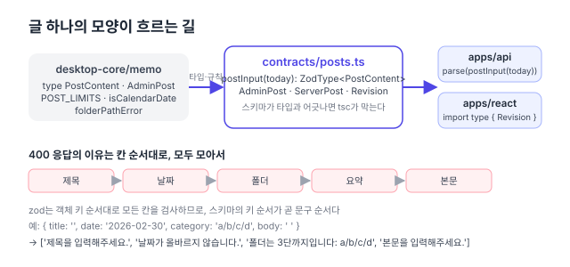

리팩터링 계획([#150](https://github.com/hyeoniverse/MacFolio/issues/150)) 1단계의 둘째 PR([#201](https://github.com/hyeoniverse/MacFolio/pull/201))이다. [댓글·좋아요](/memo/contracts-comments)에서 정한 방식을 글(posts)에 적용했다. contracts는 서버와 화면이 함께 쓰는 요청·응답 스키마 패키지(`packages/contracts`)이고, 스키마는 [Zod](https://zod.dev/)로 작성한다.

## 배경: 글 하나의 처리 경로

이 블로그의 글은 두 곳에서 온다. 저장소의 Markdown 파일(지금 읽는 이 글)과, 관리자가 메모 앱 편집기로 써서 서버 DB에 저장한 글이다. 관리자 글은 `POST /posts`·`PUT /posts/:slug`로 서버에 전송되고, 서버는 요청 본문(body)의 공백을 정리하고 검증한 뒤 저장한다. 검증에 실패하면 [400 Bad Request](https://developer.mozilla.org/en-US/docs/Web/HTTP/Reference/Status/400)와 함께 이유 목록을 반환하고, 편집기는 그 이유를 입력 칸 아래에 표시한다.

이 경로에서 글의 데이터 구조(타입)는 세 곳에 정의되어 있었다.

- `packages/desktop-core/src/memo/posts.ts`: `PostContent`·`AdminPost`·`ServerPost`. 화면이 저장소 글과 서버 글을 병합하는 코드가 사용한다.
- `apps/api/src/posts/rules.ts`: `PostInput` 인터페이스와 `parsePostInput` 함수.
- `apps/api/src/posts/posts.service.ts`: `PublicPost`·`AdminPost`·`RevisionSummary` 인터페이스. 화면 `postsApi.ts`에도 `RevisionSummary`가 별도로 정의되어 있었다.

같은 이름의 `AdminPost`가 desktop-core와 서버에 각각 있었고, 그중 `deletedAt` 필드 하나의 타입이 서로 달랐다(아래 "함께 맞춘 타입 차이").

## 댓글 도메인과 다른 점: 타입이 이미 존재한다

댓글은 데이터 구조가 서버와 화면에 각각 정의되어 있어서 contracts에 새로 정의하면 충분했다. 글은 상황이 다르다. `PostContent`·`AdminPost`·`ServerPost` 타입이 이미 `desktop-core/memo`에 있고, 화면의 글 목록 병합(`mergeAdminPosts`)과 휴지통 계산이 그 타입을 사용한다. contracts에 다시 정의하면 세 번째 사본이 생긴다.

세 가지 방법을 비교했다.

| 방법                                                     | 좋은 점                               | 나쁜 점                                                                  |
| -------------------------------------------------------- | ------------------------------------- | ------------------------------------------------------------------------ |
| contracts에 스키마를 적고 `z.infer`로 타입을 추출한다    | 댓글과 같은 방식                      | desktop-core 타입과 사본이 둘이 된다. 어느 쪽이 원본인지 불분명하다      |
| desktop-core 타입을 삭제하고 contracts 타입으로 교체한다 | 원본이 하나                           | desktop-core가 contracts(그리고 zod)에 의존한다. 의존 방향이 반대가 된다 |
| desktop-core 타입은 유지하고, 스키마를 그 타입에 맞춘다  | 원본은 desktop-core, 검사는 contracts | 스키마 선언에 타입 인자를 직접 명시해야 한다                             |

셋째를 골랐다. 스키마를 **그 타입에 맞춰 선언**했다.

```ts
import type { PostContent as PostContentShape } from '@macfolio/desktop-core/memo';

export const PostContent: z.ZodType<PostContentShape> = z.object({
	title: z.string(),
	date: z.string(),
	category: z.string(),
	summary: z.string(),
	body: z.string(),
});
```

`z.ZodType<PostContentShape>`로 선언하면 스키마의 출력 값이 그 타입과 다를 때 tsc[^tsc]가 컴파일 오류를 낸다. 필드를 빠뜨리거나 `nullable`을 잘못 붙이면 컴파일되지 않는다. 타입의 원본은 desktop-core 한 곳이고, contracts는 "그 타입대로 검증하는 스키마"만 보관한다.



의존 방향은 `contracts → desktop-core` 한쪽이다. 길이 한도(`POST_LIMITS`), 날짜 검사(`isCalendarDate`), 폴더 경로 규칙(`folderPathError`)도 desktop-core에 있던 것을 그대로 import한다. 반대로 desktop-core가 contracts를 import하면 순환 의존이 생긴다. 순환 import를 CI에서 검사하는 방법은 [순환 import 글](/memo/break-import-cycles)에 정리했다.

## 서버의 if문 스물한 줄

변경 전 서버 `posts/rules.ts`의 `parsePostInput`은 다음과 같았다.

```ts
// 전: apps/api/src/posts/rules.ts (일부)
const text = (key: string) => (typeof raw[key] === 'string' ? (raw[key] as string).trim() : '');
const value: PostInput = { title: text('title'), date: text('date') || today, … };
const errors: string[] = [];
if (!value.title) errors.push('제목을 입력해주세요.');
else if (value.title.length > POST_LIMITS.title) errors.push(`제목은 ${POST_LIMITS.title}자까지 …`);
if (!isCalendarDate(value.date)) errors.push('날짜가 올바르지 않습니다.');
// … 폴더, 요약, 본문
return errors.length > 0 ? { errors } : { value };
```

이 함수는 필드마다 값을 정리하고 검증하는 `if`문이 스물한 줄이었다. 규칙은 다음과 같다.

| 필드       | 정리                 | 검증                                             |
| ---------- | -------------------- | ------------------------------------------------ |
| `title`    | 앞뒤 공백 제거       | 비었는지, 100자 이하인지                         |
| `date`     | 비면 오늘 날짜(서울) | 실제 존재하는 날짜인지(`isCalendarDate`)         |
| `category` | 앞뒤 공백 제거       | 비면 "폴더를 골라주세요.", 아니면 폴더 경로 규칙 |
| `summary`  | 앞뒤 공백 제거       | 200자 이하인지                                   |
| `body`     | 끝 공백만 제거       | 비었는지, 50,000자 이하인지                      |

스키마로 옮기면서 동작을 바꾸지 않기 위해 기존 시험(`rules.test.ts`)의 경우를 contracts 시험으로 그대로 옮겨 통과시켰다.

```ts
export const postInput = (today: string): z.ZodType<PostContentShape, unknown> =>
	requestBody({
		title: text()
			.refine((t) => t.length > 0, '제목을 입력해주세요.')
			.refine(/* 100자 */),
		date: text()
			.transform((d) => d || today)
			.refine(isCalendarDate, '날짜가 올바르지 않습니다.'),
		category: text().superRefine((c, ctx) => {
			/* 비면 '폴더를 골라주세요.', 아니면 folderPathError */
		}),
		summary: text().refine(/* 200자 */),
		body: z
			.preprocess((v) => (typeof v === 'string' ? v.replace(/\s+$/, '') : ''), z.string())
			.refine(/* 비었는지, 50,000자 */),
	});
```

서버 쪽에는 한 줄만 남았다. 함수 이름과 반환 형태(`{ value } | { errors }`)가 같아서 `posts.service.ts`의 호출부는 수정하지 않았다.

```ts
// 후: apps/api/src/posts/rules.ts
export const parsePostInput = (input: unknown, today: string) => parse(postInput(today), input);
```

`parse`는 contracts의 공용 함수(`packages/contracts/src/parse.ts`)다. zod의 [`safeParse`](https://zod.dev/basics#handling-errors) 결과를 `{ value }` 또는 `{ errors: string[] }`로 변환하고, 같은 문구는 한 번만 담는다. `requestBody`는 요청 본문이 객체가 아니면(null, 문자열) 빈 객체로 간주해 필드마다 문구를 내게 한다. zod 기본 문구 "Invalid input: expected object"가 사용자에게 노출되지 않게 하기 위해서다.

<details>
<summary>parse와 requestBody 전체 코드</summary>

```ts
// packages/contracts/src/parse.ts
export type Parsed<T> = { value: T } | { errors: string[] };

export function parse<S extends z.ZodType>(schema: S, input: unknown): Parsed<z.output<S>> {
	const result = schema.safeParse(input);
	if (result.success) return { value: result.data };
	return { errors: [...new Set(result.error.issues.map((issue) => issue.message))] };
}

export const requestBody = <T extends z.ZodRawShape>(shape: T) =>
	z.preprocess((input) => (typeof input === 'object' && input !== null ? input : {}), z.object(shape));
```

</details>


`postInput`이 `today`를 인자로 받는 함수인 이유는 "날짜가 비면 오늘"의 기준이 서버 시각(서울)이기 때문이다. 서버는 [`Intl.DateTimeFormat`](https://developer.mozilla.org/en-US/docs/Web/JavaScript/Reference/Global_Objects/Intl/DateTimeFormat)`('en-CA', { timeZone: 'Asia/Seoul' })`로 오늘 날짜(`YYYY-MM-DD`)를 계산한다. 스키마를 모듈 로드 시각에 한 번만 생성하면 서버를 시작한 날의 날짜가 고정되어, 다음 날 작성한 글도 전날 날짜로 저장된다. 요청마다 스키마를 새로 생성하는 비용은 객체 몇 개 수준이라 무시할 수 있다.

**이유의 순서.** 기존 코드는 제목 → 날짜 → 폴더 → 요약 → 본문 순서로 이유를 수집했고 E2E 시험이 그 순서를 검사한다. zod는 객체의 키 순서대로 모든 필드를 검증하므로, 스키마의 키를 그 순서로 선언하면 같은 배열이 나온다. 별도의 정렬 코드는 없다.

**문자열이 아닌 필드.** 기존 코드는 `typeof raw[key] === 'string'`이 아니면 빈 문자열로 간주했다. 숫자 날짜 `20260929`를 보내면 "날짜가 올바르지 않습니다"가 아니라 오늘 날짜가 저장된다. `z.string()`은 숫자에 "expected string" 오류를 내므로, 앞단에 [`z.preprocess`](https://zod.dev/api#preprocess)로 빈 문자열로 변환하는 `text()` 함수를 배치했다. 사소한 경우지만 동작을 그대로 유지하려면 이 차이까지 맞춰야 한다.

## 함께 맞춘 타입 차이

`AdminPost.deletedAt`이 desktop-core에서는 `?: string | null`, 서버에서는 `string | null`이었다. 서버는 이 필드를 항상 응답에 포함하는데, 화면 타입은 필드가 없을 수도 있다고 선언한 것이다. 스키마를 하나로 통합하자 차이가 드러나서 `string | null`로 맞췄다. 변경은 시험 픽스처 한 곳에 `deletedAt: null`을 추가한 것뿐이다.

| 위치                                | 전                           | 후                          |
| ----------------------------------- | ---------------------------- | --------------------------- |
| desktop-core `AdminPost`            | `deletedAt?: string \| null` | `deletedAt: string \| null` |
| 서버 `AdminPost` (contracts로 이동) | `deletedAt: string \| null`  | (desktop-core 타입 사용)    |

## 확인

- `packages/contracts/src/posts.test.ts`에 시험 다섯 개를 작성했다. "다듬고, 날짜가 없으면 오늘, 모르는 필드는 버린다", "이유를 칸 순서대로 모두 모은다", "길이를 넘으면 이유", "문자열이 아닌 칸은 빈 칸으로 본다 (숫자 날짜 → 오늘)", "관리자 글·공개 글·버전 모양을 받아들인다".
- 서버 `apps/api/src/posts/rules.test.ts`의 `parsePostInput` 시험은 수정하지 않았다. 함수 내부가 스키마로 바뀌어도 같은 입력에 같은 결과가 나와야 하기 때문이다. 제목 빈칸·`2026-02-30`·깊이 4 폴더·공백 본문을 한 번에 보내 이유 네 개가 순서대로 나오는 경우가 그대로 통과했다.
- `packages/desktop-core/src/memo/posts.test.ts`에는 `deletedAt: null` 한 줄을 추가했다.
- E2E는 글 15개와 메모 정리 4개가 그대로 통과했다. E2E는 가짜 API(`e2e/fakeApi.ts`)를 사용하므로 서버 문구 자체는 검사하지 않는다. 문구와 순서의 일치는 위의 서버 시험이 검사한다.
- 커밋은 파일 12개, +316/−73. 글·그림·잠금 파일을 빼면 코드는 +191/−73이고, 그중 시험이 80줄이다.

## 숫자

| 항목                        | 전            | 후                                      |
| --------------------------- | ------------- | --------------------------------------- |
| 서버 `parsePostInput`       | 21줄          | 1줄 (스키마는 contracts)                |
| `RevisionSummary`가 적힌 곳 | 2 (서버·화면) | 1                                       |
| `AdminPost.deletedAt` 타입  | 2가지         | 1가지                                   |
| 동작 변화                   |               | 없음 (e2e 글 15개·메모 정리 4개 그대로) |

## 남긴 것과 정리

글 주소(`POST_SLUG`, `newSlug`)는 서버 `rules.ts`에 남겼다. 주소는 서버가 생성하고 화면은 응답 값을 사용할 뿐이라 공유할 필요가 없다. 글 주소 타입은 이후 [브랜드 타입 글](/memo/branded-ids)에서 `PostSlug`로 바뀌었다.

`z.ZodType<PostContentShape>`로 고정하는 방법은 타입이 이미 다른 패키지에 있을 때 유용하다. 다만 한계가 있다.

> tsc는 스키마의 출력 값이 그 타입에 **할당 가능한지**만 검사한다. 타입에 선택 필드(`?:`)를 새로 추가하면, 스키마가 그 필드를 모른 채 버려도 컴파일은 통과한다.

그래서 타입에 필드를 추가할 때는 스키마도 함께 수정해야 한다.

동작을 바꾸지 않는 리팩터링에서는 기존 시험을 수정하지 않고 통과시키는 것이 가장 강한 근거다. 이번에는 숫자 날짜 같은 경우까지 기존 시험에 이미 있어서, 새 스키마가 같은 결과를 내는지 바로 확인할 수 있었다.

## 직접 확인하는 방법

계약(요청·응답 스키마)을 바꿀 때는 `packages/contracts`를 먼저 수정하고, 서버와 화면이 모두 새 형태를 따르는지 확인한다.

```bash
pnpm --filter @macfolio/contracts test          # 스키마 시험
pnpm --filter @macfolio/contracts build         # 서버는 빌드된 JS를 읽는다
pnpm typecheck                                  # 화면·서버가 새 모양을 따르는지
pnpm --filter @macfolio/api test -- src/posts/rules.test.ts
pnpm --filter @macfolio/desktop-core test
```

필드 이름 하나를 바꾸면 `pnpm typecheck`가 서버와 화면에서 동시에 실패한다. 이 작업의 목적이 바로 이 검사다. 확인한 뒤에는 변경을 되돌린다. 패키지를 나눈 이유는 [댓글 계약 글](/memo/contracts-comments)에 정리했다.

다음 도메인은 [메시지](/memo/contracts-messages)·[연락 메일](/memo/contracts-contact)·[배경화면](/memo/contracts-wallpapers)·[파일](/memo/contracts-files)·[분석](/memo/contracts-analytics) 순서로 같은 방식을 적용했다.

## 관련 글

- [응답 타입을 두 번 적지 않기 — @macfolio/contracts와 zod](/memo/contracts-comments)
- [바로 고치는 블로그에 임시 저장과 버전 기록 붙이기](/memo/drafts-and-versions)
- [메모 로직을 desktop-core로 - localStorage는 어디에 둘까](/memo/desktop-core-memo)
- [문자열은 문을 지나야 글 주소가 된다 — PostSlug·FolderPath 브랜드 타입](/memo/branded-ids)
- [리팩터링 1단계 — 타입과 데이터 구조](/memo/refactor-step1-types)

[^tsc]: TypeScript 컴파일러. 이 저장소에서는 `pnpm typecheck`가 패키지마다 `tsc`를 실행해 타입만 검사한다.

#MacFolio #리팩터링 #zod #TypeScript
