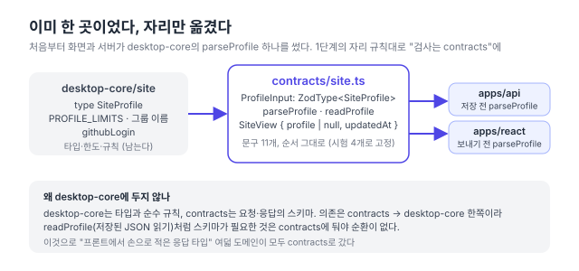

리팩터링 계획([#150](https://github.com/hyeoniverse/MacFolio/issues/150)) 1단계의 여덟째, 마지막 도메인([#207](https://github.com/hyeoniverse/MacFolio/pull/207))이다. 댓글·글·메시지·연락 메일·배경화면·파일·[분석](/memo/contracts-analytics)에 이어 사이트 프로필을 옮겼다.

## 이미 한 곳이었다

사이트 프로필(이름·직무·GitHub·기술 목록)은 관리자가 시스템 설정 › 정보에서 수정하고 서버에 저장한다. 방문자는 같은 값을 "이 Mac에 관하여" 창과 시스템 설정 › 정보에서 조회만 한다. 서버에 저장한 값이 없으면 코드(`profileStore.ts`)에 정의된 기본값이 표시된다. 편집 기능은 [사이트 프로필 편집 글](/memo/site-profile-editing)에 정리했다.


화면은 `GET /site`로 `{ profile, updatedAt }`을 수신하고, 관리자가 저장하면 `PUT /site/profile`로 전송한다. 이 도메인은 다른 일곱 도메인과 달랐다. 검증 함수 `parseProfile`이 처음부터 `@macfolio/desktop-core/site`에 있어서, 화면은 전송하기 전에, 서버는 저장하기 전에 같은 함수를 호출했다. 화면과 서버가 같은 규칙을 쓴다는 사실이 주석이 아니라 코드로 보장되어 있었다.

다만 응답 타입은 곳곳에 따로 정의되어 있었다.

| 위치                          | 정의                                                |
| ----------------------------- | --------------------------------------------------- |
| 서버 `site.service.ts`        | `SiteView` 인터페이스                               |
| 화면 `profileStore.ts` (조회) | `api<{ profile: SiteProfile \| null }>('/site')`    |
| 화면 `profileStore.ts` (저장) | `api<{ profile?: SiteProfile \| null } \| null>(…)` |

같은 응답을 세 가지 형태로 정의하고 있었다.

검증 함수가 이미 공유되고 있었지만 옮기기로 했다. 앞의 일곱 도메인을 거치며 배치 규칙이 정해졌기 때문이다.

> **타입과 순수 규칙은 desktop-core, 요청·응답 스키마는 contracts.**

프로필만 desktop-core에 검증 함수가 남아 있으면, 다음 작업자가 검증 코드의 위치를 두 패키지에서 찾아야 한다.



## 선택한 방법

| 방법                                                   | 좋은 점                   | 나쁜 점                                                                              |
| ------------------------------------------------------ | ------------------------- | ------------------------------------------------------------------------------------ |
| 그대로 유지 (검증은 desktop-core, 응답만 contracts)    | 변경할 코드가 적다        | 검증 함수의 위치가 도메인마다 다르다. 찾아야 할 패키지가 둘이 된다                   |
| desktop-core에 zod를 추가해 검증을 스키마로 작성       | 패키지를 옮기지 않는다    | 순수 규칙만 보관하던 desktop-core가 zod에 의존한다. 다른 일곱 도메인과 규칙이 다르다 |
| 검증·응답은 contracts, 타입·한도는 desktop-core에 유지 | 여덟 도메인의 배치가 같다 | `readProfile`까지 함께 옮겨야 한다(아래)                                             |

셋째를 선택했다. 첫째는 변경량이 가장 작지만 "검증은 contracts"라는 규칙에 예외를 하나 남긴다. 예외가 하나 있으면 다음 도메인을 추가할 때도 어느 규칙을 따를지 다시 판단해야 한다.

## 옮기면서 유지한 동작

`parseProfile`은 `if`문으로 된 58줄이었다. 검증 순서는 다음과 같다.

- **텍스트 필드**: "문자열인지 → 비었는지 → 80자 이하인지 → 허용되지 않는 문자가 있는지" 순으로 검사하고, 처음 실패한 이유 하나만 반환한다.
- **기술 목록**: "배열인지 → 항목이 문자열인지 → 20개 이하인지 → 항목이 40자 이하·한 줄인지" 순으로 검사하고, 실패한 이유를 모두 반환한다.

오류 문구는 열한 개이고, E2E 시험이 그중 두 문구의 순서를 검사한다.

zod로 옮길 때 이 문구와 순서를 그대로 유지했다. 필드마다 [`z.unknown().optional().transform((raw, ctx) => …)`](https://zod.dev/api#transforms)로 기존 함수의 로직을 거의 그대로 옮겼고, 스키마의 키 순서가 곧 이유의 순서다. 기존 desktop-core 시험 세 개를 contracts로 옮기고, E2E가 검사하던 `['이름을(를) 입력해 주세요.', '이메일 주소가 올바르지 않습니다.']`도 contracts 시험에 추가했다.

```ts
// packages/contracts/src/site.ts
export const ProfileInput: z.ZodType<SiteProfile, unknown> = z.object(
	{
		name: text('이름', true),
		// nameEn, role, school, location …
		github: text('GitHub 주소', true)
			.refine(
				(github) => !github || githubLogin({ github }) !== '',
				'GitHub 주소는 https://github.com/아이디 모양이어야 합니다.'
			)
			.transform((github) => github.replace(/\/$/, '')),
		email: text('이메일', true).refine((email) => !email || EMAIL.test(email), '이메일 주소가 올바르지 않습니다.'),
		skills: z.object(
			{ frontend: list('프론트엔드 기술') /* … */ },
			{ error: '기술은 묶음(frontend·backend·interaction)이어야 합니다.' }
		),
		siteStack: list('이 사이트를 만든 기술'),
	},
	{ error: '프로필을 보내 주세요.' }
);
```

`z.ZodType<SiteProfile>`로 선언해 스키마의 출력 값이 desktop-core 타입과 다르면 tsc가 컴파일 오류를 낸다. [글 도메인](/memo/contracts-posts)에서 사용한 방식과 같다.

작업 중 발생한 오류가 하나 있다. `z.unknown().transform()`을 객체 키에 그대로 쓰면 키가 없을 때 zod가 "expected nonoptional" 오류를 낸다. 중간에 [`.optional()`](https://zod.dev/api#optionals)을 추가해 "키가 없으면 undefined로 받아 transform에서 처리한다"고 명시해야 한다.

```ts
// 키가 없으면 "expected nonoptional"
name: z.unknown().transform(check),
// 키가 없어도 transform이 undefined를 받아 '입력해 주세요' 문구를 낸다
name: z.unknown().optional().transform(check),
```

## desktop-core에 남기지 않는 이유

`readProfile`(DB에 저장된 JSON을 읽어 규칙에 맞으면 그 값, 아니면 `null`을 반환)은 `parseProfile`을 호출한다. 스키마가 contracts로 이동하면 `readProfile`도 함께 이동해야 한다. desktop-core가 contracts를 import하면 순환 의존(contracts → desktop-core → contracts)이 생기기 때문이다. 의존 방향은 한쪽이어야 하므로, 스키마를 사용하는 코드는 모두 contracts에 있어야 한다.

desktop-core에는 `SiteProfile` 타입, `PROFILE_LIMITS`, `SKILL_GROUPS`, `githubLogin`이 남는다. 화면 입력 칸의 `maxLength`와 설정 화면이 사용하는 값이다.

## 변경한 파일

커밋은 파일 11개, +310/−157이다. 글·그림을 제외하면 +199/−157로, 삭제한 줄 수가 추가한 줄 수에 가깝다. 대부분은 desktop-core에서 contracts로 이동한 코드다.

1. `packages/contracts/src/site.ts`(103줄)를 새로 만들었다. `ProfileInput`, `parseProfile`, `readProfile`, `SiteView`.
2. `packages/desktop-core/src/site/profile.ts`에서 검증 코드 약 83줄을 삭제했다. 타입·한도·`githubLogin`만 남았다.
3. 서버 `site.service.ts`는 import 한 줄을 바꾸고 `SiteView` 인터페이스를 contracts 타입의 re-export로 교체했다.
4. 화면 `AboutPane.tsx`는 `parseProfile`만 contracts에서 import한다. `PROFILE_LIMITS`는 그대로 desktop-core에서 import한다.
5. 화면 `profileStore.ts`에서 직접 작성한 제네릭 인자 두 개를 `SiteView`·`Partial<SiteView>`로 교체했다.

```ts
// apps/react/src/shared/site/profileStore.ts
-const body = await api<{ profile: SiteProfile | null }>('/site', { fetchImpl });
+const body = await api<SiteView>('/site', { fetchImpl });
-const body = await api<{ profile?: SiteProfile | null } | null>('/site/profile', {
+const body = await api<Partial<SiteView> | null>('/site/profile', {
```

## 확인

- `packages/contracts/src/site.test.ts`의 네 시험: "앞뒤 공백·빈 항목·겹친 항목을 정리하고 모르는 필드는 버린다", "이름·이메일·GitHub 주소는 꼭 있어야 하고 모양도 맞아야 한다 (이유는 칸 순서대로)", "길이·개수·줄바꿈·타입이 틀리면 거절한다", "저장해 둔 값 읽기 (틀렸으면 null), 응답 모양".
- `packages/desktop-core/src/site/profile.test.ts`는 67줄이 변경되었다. 검증 시험을 contracts로 옮기고 `githubLogin`처럼 desktop-core에 남은 함수의 시험만 유지했다.
- E2E `apps/react/e2e/site-profile.spec.ts`는 수정 없이 통과했다. "서버에 저장한 프로필이 있으면 방문자에게 그 프로필이 보이고, 편집 버튼은 없다"가 응답 형태를, 관리자가 이름과 이메일을 비우고 저장하는 시험이 두 이유의 순서를 검사한다. 가짜 API(`e2e/fakeApi.ts`)는 주석 한 줄만 변경되었다.

## 1단계 둘째 항목 완료

| 도메인    | PR                                                       | 옮긴 것                                    |
| --------- | -------------------------------------------------------- | ------------------------------------------ |
| 댓글      | [#200](https://github.com/hyeoniverse/MacFolio/pull/200) | 패키지 자체, CommentInput·Comment          |
| 글        | [#201](https://github.com/hyeoniverse/MacFolio/pull/201) | postInput(today), desktop-core 타입에 고정 |
| 메시지    | [#202](https://github.com/hyeoniverse/MacFolio/pull/202) | Thread·Message, 로컬 저장소까지 같은 타입  |
| 연락 메일 | [#203](https://github.com/hyeoniverse/MacFolio/pull/203) | 화면·서버의 다른 문구를 하나로             |
| 배경화면  | [#204](https://github.com/hyeoniverse/MacFolio/pull/204) | 세 곳의 40                                 |
| 파일      | [#205](https://github.com/hyeoniverse/MacFolio/pull/205) | "화면도 알아야 하는가"로 나누기            |
| 분석      | [#206](https://github.com/hyeoniverse/MacFolio/pull/206) | 보내는 쪽·받는 쪽·읽는 쪽                  |
| 프로필    | [#207](https://github.com/hyeoniverse/MacFolio/pull/207) | 배치 정리, 문구·순서 고정                  |

이로써 화면 코드에서 직접 작성한 응답 타입은 모두 contracts 타입으로 교체되었다.

')

## 남긴 것과 정리

1단계의 남은 항목은 `shared/profile.ts` 분할([프로필 파일 분할 글](/memo/profile-split))과 유니언·브랜드 타입([브랜드 타입 글](/memo/branded-ids))이다. 프로필 도메인에서는 기본 프로필(서버 값이 없을 때 표시하는 값)이 아직 화면 코드(`profileStore.ts`)에 있다. 서버는 기본값을 알지 못하므로 `GET /site`가 `profile: null`을 반환하면 화면이 기본값으로 채운다. 현재 구조에서는 이 방식이 맞지만, 다른 곳(예: 서버가 렌더링하는 OG 이미지)이 프로필을 사용하게 되면 기본값의 위치를 다시 정해야 한다.

정리하면 두 가지다.

1. 이미 정상 동작하는 코드도 배치 규칙에 맞추기 위해 옮길 가치가 있다. 여덟 도메인 중 하나만 다르면 다음 작업자가 그 예외 때문에 규칙 자체를 다시 확인해야 한다.
2. 직접 작성한 `if`문을 스키마로 옮길 때는 오류 문구와 순서를 시험으로 먼저 고정한 뒤 옮긴다. 그래야 "동작 변화 없음"을 시험 결과로 확인할 수 있다.

## 직접 확인하는 방법

계약(요청·응답 스키마)을 바꿀 때는 `packages/contracts`를 먼저 수정하고, 서버와 화면이 모두 새 형태를 따르는지 확인한다.

```bash
pnpm --filter @macfolio/contracts test          # 스키마 시험
pnpm --filter @macfolio/contracts build         # 서버는 빌드된 JS를 읽는다
pnpm typecheck                                  # 화면·서버가 새 모양을 따르는지
cd apps/react && npx playwright test e2e/site-profile.spec.ts --project=desktop-chromium
```

필드 이름 하나를 바꾸면 `pnpm typecheck`가 서버와 화면에서 동시에 실패한다. 이 작업의 목적이 바로 이 검사다. 확인한 뒤에는 변경을 되돌린다. 스키마는 [Zod](https://zod.dev/)로 작성하고, 패키지를 나눈 이유는 [댓글 계약 글](/memo/contracts-comments)에 정리했다.

## 관련 글

- [응답 타입을 두 번 적지 않기 — @macfolio/contracts와 zod](/memo/contracts-comments)
- [타입은 desktop-core에, 스키마는 contracts에 — 글 도메인 옮기기](/memo/contracts-posts)
- [서버 저장소와 로컬 저장소가 같은 모양을 쓰게 — 메시지 도메인 옮기기](/memo/contracts-messages)
- [화면도 알아야 하는가 — 올린 파일 규칙을 둘로 나누기](/memo/contracts-files)
- [보내는 쪽과 받는 쪽 — 분석 이벤트의 모양을 하나로](/memo/contracts-analytics)
- [1,629줄 한 파일을 폴더로 — 프로젝트마다 한 파일, 경로는 그대로](/memo/profile-split)
- [리팩터링 1단계 — 타입과 데이터 구조](/memo/refactor-step1-types)

#MacFolio #리팩터링 #zod #TypeScript
