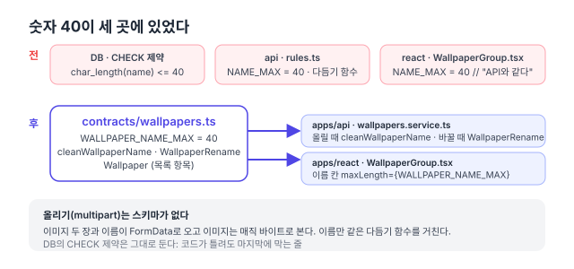
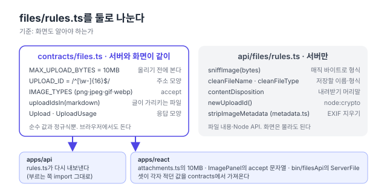
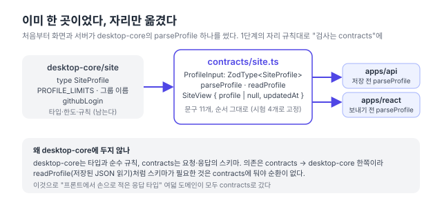

## 배경: 입력 검사를 화면과 서버가 함께 하는 이유

입력 검사(validation)는 사용자가 보낸 값이 규칙에 맞는지 확인하는 작업이다. 예를 들어 연락 메일의 이름 칸은 "비어 있지 않고, 30자 이하이고, 한 줄"이어야 한다. 이 검사는 보통 두 번 한다.

- **화면 검사**: 요청을 보내기 전에 칸 아래에 문구를 표시해 사용자가 바로 고치게 한다. 이름을 비우면 "이름을 입력해주세요."가 칸 아래에 표시된다.
- **서버 검사**: 화면을 거치지 않은 요청(curl, 다른 클라이언트)도 거절한다. 같은 값을 curl로 보내면 400 응답에 같은 문구가 담긴다.

화면 검사는 사용자 편의를 위한 것이고, 데이터를 지키는 검사는 서버 검사다. 두 검사의 규칙이 같아야 화면에서 통과한 값이 서버에서 거절되는 일이 없다.

[@macfolio/contracts 패키지 글](/memo/contracts-package)에서 서버와 화면이 같은 요청·응답 모양을 쓰게 했다. 이어서 **입력 검사 규칙**이 중심인 도메인을 옮겼다. 리팩터링 계획([#150](https://github.com/hyeoniverse/MacFolio/issues/150)) 1단계의 연락 메일([#203](https://github.com/hyeoniverse/MacFolio/pull/203))·배경화면([#204](https://github.com/hyeoniverse/MacFolio/pull/204))·업로드 파일([#205](https://github.com/hyeoniverse/MacFolio/pull/205))·사이트 프로필([#207](https://github.com/hyeoniverse/MacFolio/pull/207))과, 6단계(서버)에서 옮긴 관리자 설정([#235](https://github.com/hyeoniverse/MacFolio/pull/235))·AI 데모 입력([#236](https://github.com/hyeoniverse/MacFolio/pull/236))이다.

`@macfolio/contracts`[^contracts]는 API 요청·응답의 데이터 구조를 [zod](https://zod.dev/) 스키마로 정의하는 패키지다. zod는 `z.string().max(30)`처럼 규칙을 코드로 선언하고 실제 값이 그 규칙에 맞는지 실행 시에 검사하는 라이브러리다. 서버(NestJS)는 공유 함수 `parse(스키마, 입력)`로 요청 본문을 검사하고, 화면(React)은 같은 스키마에서 타입과 상수를 가져온다. `parse`는 내부에서 `safeParse`를 실행해 `{ value } | { errors: string[] }`를 반환하고, `requestBody`는 객체가 아닌 본문을 빈 객체로 간주해 칸마다 문구를 내게 한다.

## 주석으로만 맞추던 같은 규칙

여섯 도메인 모두 같은 규칙을 화면과 서버가 각자 정의하고, "서버와 같다"는 주석으로만 일치를 유지했다.

| 도메인        | 같은 값이 정의된 곳                                                                    | 이미 생긴 차이                                   |
| ------------- | -------------------------------------------------------------------------------------- | ------------------------------------------------ |
| 연락 메일     | 화면 `validateContact`, 서버 `parseContact`                                            | 문구 2가지가 다르고, 서버만 검사하는 규칙 2개    |
| 배경화면 이름 | DB `CHECK (char_length(name) <= 40)`, 서버 `NAME_MAX = 40`, 화면 `const NAME_MAX = 40` | 화면 타입에 `createdAt` 누락                     |
| 업로드 파일   | DB `size BETWEEN 1 AND 10485760`, 서버 `MAX_UPLOAD_BYTES`, 화면 `10 * 1024 * 1024`     | 없음 (값은 일치)                                 |
| 사이트 프로필 | 검증은 desktop-core 하나, 응답 타입은 서버 `SiteView`와 화면 제네릭 인자 두 가지       | 같은 응답을 세 가지 형태로 정의                  |
| 관리자 설정   | 서버 `if` 문, 화면 `CAPTION_MAX`·`HUMAN_CHECKS`·`MAX_SHOWCASE`·저장소 이름 정규식      | 없음 (정규식 두 벌)                              |
| AI 데모       | 서버 `demoText`, 화면 `MAX_*_CHARS` 네 개                                              | 음성 데모만 검사를 별도 구현, 오류 클래스도 별도 |

주석은 코드로 강제되지 않는다. 한쪽만 수정하면 다음과 같은 결과가 생긴다.

| 수정한 곳                       | 결과                                                                        |
| ------------------------------- | --------------------------------------------------------------------------- |
| 업로드 한도를 화면만 20MB로     | 15MB 파일이 화면 검사는 통과하고, 서버가 413을 반환한다                     |
| 업로드 한도를 서버만 20MB로     | 서버는 허용하지만, 화면이 업로드 전에 거절한다                              |
| 배경화면 이름 한도를 서버만 50  | 서버는 50자를 허용하지만, 화면 이름 칸은 40자 이후 입력을 막는다            |
| 배경화면 이름 한도를 화면만 50  | 화면은 50자까지 입력받지만, 서버가 40자로 잘라 저장하고 사용자는 알 수 없다 |
| GitHub 저장소 수를 서버만 8개로 | 화면은 7번째 저장소를 선택하지 못하게 막는다                                |

증상은 모두 "되어야 할 것이 되지 않는다"이고, ==원인을 찾으려면 두 패키지의 코드를 모두 확인해야 한다==.

## 규칙을 배치하는 기준

도메인을 옮기며 정한 기준은 다음 네 가지다.

| 코드의 성격                                                | 위치          | 예                                                                |
| ---------------------------------------------------------- | ------------- | ----------------------------------------------------------------- |
| 서버와 화면이 함께 쓰는 값·검사 스키마·응답 모양           | contracts     | 길이 한도, 정규식, `uploadIdsIn`, 이름 정리 함수, `ContactInput`  |
| Node API·비밀 키·요청 헤더가 필요한 코드, 서버의 보안 판단 | 서버          | 매직 바이트 판별, `Content-Disposition`, `newUploadId`, 일별 해시 |
| zod에 의존하지 않는 타입과 순수 규칙                       | desktop-core  | `SiteProfile` 타입, `PROFILE_LIMITS`, `githubLogin`               |
| 코드에 오류가 있어도 마지막에 거절하는 방어선              | DB CHECK 제약 | 업로드 10MB, 배경화면 이름 40자, 캡션 200자                       |

> [!IMPORTANT]
> 공유 패키지에는 브라우저와 Node 양쪽에서 실행되는 코드만 넣는다.

Node API를 사용하는 코드가 하나라도 포함되면 그 패키지를 import하는 화면 번들 빌드가 실패한다. 무엇을 옮길지보다 무엇을 남길지를 먼저 정하면 패키지 경계를 명확하게 정할 수 있다.

> [!IMPORTANT]
> 목표는 "모든 요청을 스키마로"가 아니라 "같은 규칙은 한 곳에"다.

`multipart/form-data` 업로드처럼 zod로 검사할 JSON 본문이 없는 요청은 함수 하나를 공유하는 것으로 충분하다.

## 연락 메일: 칸마다 첫 실패 문구 하나 (#203)

### 규칙은 같고 문구가 달랐다

연락 메일의 네 칸(이름·이메일·제목·내용)은 화면 `contact.ts`의 `validateContact`와 서버 `contact/rules.ts`의 `parseContact`가 각각 검사했다. 길이 상한(이름 30자·제목 100자·내용 2,000자)은 같았지만 문구가 달랐고 서버만 검사하는 규칙이 두 개 있었다.

| 경우           | 화면                                | 서버                             |
| -------------- | ----------------------------------- | -------------------------------- |
| 이름 30자 초과 | 이름은 30자까지 입력할 수 있습니다. | 이름은 30자까지입니다.           |
| 이메일 비움    | 답장받을 이메일을 입력해주세요.     | 이메일 형식을 확인해주세요.      |
| 제목에 줄바꿈  | (검사하지 않음)                     | 이름과 제목은 한 줄로 써 주세요. |
| 제어 문자[^cc] | (검사하지 않음)                     | 읽을 수 없는 글자가 있습니다.    |

화면이 먼저 필터링하므로 사이트에서 메일을 보내는 사용자가 서버 문구를 볼 일은 거의 없다. 그래서 차이가 드러나지 않았다.

서버만 검사하던 두 규칙(한 줄, 제어 문자)은 메일 헤더를 보호하는 규칙이다. 메일 헤더는 `Subject: …`처럼 한 줄에 하나씩 적는 형식이라, 제목에 줄바꿈이 섞이면 그 뒤의 글자가 새 헤더로 해석될 수 있다.

에서 거절된다')


### [검사, 문구] 목록과 superRefine

댓글·글 도메인에서는 zod의 `.min()`·`.max()`를 그대로 썼다. 연락 메일은 칸 하나에 규칙이 최대 네 개(빈 값, 길이, 한 줄, 제어 문자)라 방식을 바꿨다. 규칙을 `[검사, 문구]` 목록으로 적고, 처음 어긋난 규칙 하나만 issue[^issue]로 기록한다.

```ts
// packages/contracts/src/contact.ts
const field = (rules: [test: (value: string) => boolean, message: string][]) =>
	z.preprocess(contactText, z.string()).superRefine((value, ctx) => {
		const failed = rules.find(([test]) => !test(value));
		if (failed) ctx.addIssue({ code: 'custom', message: failed[1] });
	});

export const ContactInput = requestBody({
	name: field([
		[nonEmpty, '이름을 입력해주세요.'],
		[(v) => v.length <= CONTACT_LIMITS.name, `이름은 ${CONTACT_LIMITS.name}자까지 입력할 수 있습니다.`],
		[oneLine, '이름과 제목은 한 줄로 써 주세요.'],
		[readable, '읽을 수 없는 글자가 있습니다.'],
	]),
	// email, subject, body …
});
```

<details>
<summary>네 칸의 규칙 전체 (packages/contracts/src/contact.ts)</summary>

| 칸        | 순서대로 검사하는 규칙                             | 문구                                                                                      |
| --------- | -------------------------------------------------- | ----------------------------------------------------------------------------------------- |
| `name`    | 빈 값 → 30자 이하 → 한 줄 → 제어 문자 없음         | 이름을 입력해주세요. / 이름은 30자까지 입력할 수 있습니다. / 한 줄로 / 읽을 수 없는 글자  |
| `email`   | 빈 값 → 형식(`a@b.cc`)과 254자 이하                | 답장받을 이메일을 입력해주세요. / 이메일 형식을 확인해주세요.                             |
| `subject` | 빈 값 → 100자 이하 → 한 줄 → 제어 문자 없음        | 제목을 입력해주세요. / 제목은 100자까지 입력할 수 있습니다. / 한 줄로 / 읽을 수 없는 글자 |
| `body`    | 빈 값 → 2,000자 이하 → 제어 문자 없음(줄바꿈 허용) | 내용을 입력해주세요. / 내용은 2000자까지 입력할 수 있습니다. / 읽을 수 없는 글자          |

모든 칸은 검사 전에 `contactText`를 거친다. 문자열이 아니면 빈 문자열로 바꾸고, `\r\n`·`\r`을 `\n`으로 통일하고, 앞뒤 공백을 제거한다. 관리자 답장(`ReplyInput.body`)도 같은 `field`로 만들며 상한은 5,000자다.

</details>

핵심은 **문구를 하나만 반환한다**는 점이다. 화면은 칸 아래에 문구 한 줄을 표시하므로 문구가 둘이면 표시할 자리가 없다. 또 빈 이름에 "30자까지" 문구가 함께 붙으면 사용자는 무엇을 고쳐야 하는지 알 수 없다. zod의 `.refine()`을 여러 개 이어 붙이면 ==앞의 검사가 실패해도 뒤의 검사가 모두 실행되어 issue가 여럿 쌓인다==. 그래서 [`superRefine`](https://zod.dev/api#superrefine) 하나 안에서 [`Array.prototype.find`](https://developer.mozilla.org/en-US/docs/Web/JavaScript/Reference/Global_Objects/Array/find)로 첫 실패에서 멈춘다.


| 방법                                         | 문구 수          | 문제                                                                         |
| -------------------------------------------- | ---------------- | ---------------------------------------------------------------------------- |
| `.min().max().refine().refine()` 이어 붙이기 | 실패한 만큼 여럿 | 빈 이름에 "30자까지"는 붙지 않지만, 한 줄·제어 문자 문구가 함께 나올 수 있다 |
| 칸마다 `if`문 (이전 화면 코드)               | 하나             | 서버와 같은 규칙인지 사람이 직접 맞춰야 한다                                 |
| `[검사, 문구]` 목록 + `find` (선택한 방법)   | 하나             | 규칙의 순서가 곧 우선순위이므로 순서를 정해야 한다                           |

### 같은 issue를 화면과 서버가 다르게 사용한다

**화면**의 `validateContact`는 [`safeParse`](https://zod.dev/basics) 결과의 issue를 `path[0]`(칸 이름)으로 묶어 칸마다 첫 문구를 고른다. 반환 모양 `{ value, errors: ContactErrors }`는 이전과 같아서 `ComposeView`는 수정하지 않았다. 화면도 이제 서버만 검사하던 규칙(한 줄, 제어 문자)을 함께 검사한다.

**서버**의 `parseContact`는 `parse(ContactInput, input)` 한 줄이다. 반환하는 `{ errors: string[] }`가 [400 Bad Request](https://developer.mozilla.org/en-US/docs/Web/HTTP/Reference/Status/400) 응답의 `message`가 된다. 문구는 화면 쪽에 맞췄다. 이메일이 빈 경우 서버는 "이메일 형식을 확인해주세요."라고만 했지만, 화면 문구 "답장받을 이메일을 입력해주세요."는 무엇을 입력해야 하는지까지 알려 준다. API는 누구나 직접 호출할 수 있고, 사이트 밖 클라이언트가 받는 문구는 서버 문구다.

관리자 답장(`ReplyInput`)과 응답 모양(`ContactMail`·`ContactSent`·`ContactStatus`)도 함께 옮겼다. 서버의 `ContactMailView`, 화면의 `ContactMail`·`ContactStatus` 인터페이스는 contracts 타입의 별칭으로 바뀌었다.

화면과 서버의 검사 코드에서 159줄이 삭제되었고(`rules.ts` 53줄, `rules.test.ts` 38줄, 화면 `contact.ts` 34줄 등), contracts에 스키마 92줄과 시험 79줄이 추가되었다.

- `packages/contracts/src/contact.test.ts`(시험 5개): **칸마다 처음 어긋난 규칙 하나를, 칸 순서대로 알린다**, **이름·제목은 한 줄, 제어 문자는 받지 않는다 (메일 머리에 끼워 넣기 막기). 같은 문구는 한 번만** 등
- 화면 E2E(`e2e/mail.spec.ts`)의 **네 칸이 모두 차야 보내기를 누를 수 있고, 형식이 틀리면 경고창으로 알린다**와 **서버가 거절하면 이유를 보여 주고 쓰던 글은 그대로**는 시험 코드를 수정하지 않고 통과했다.
- 서버 e2e(`apps/api/test/contact.e2e.test.ts`)는 상태 코드만 검사하므로 그대로 통과했다. 반대로 말하면 ==문구가 바뀐 것을 이 시험은 감지하지 못한다==. 그래서 문구는 contracts 시험이, 상태 코드는 e2e가 검증하도록 역할을 나눴다.

## 배경화면 이름: 한도 40과 정리 함수 (#204)

시스템 설정 › 배경화면에는 macOS 기본 배경화면 묶음이 있다. 관리자로 로그인하면 그 아래에 직접 업로드한 사진 묶음이 하나 더 표시된다. 사진을 선택하면 브라우저가 썸네일을 생성하고, 원본·썸네일 이미지 두 장과 이름을 서버로 전송한다. 업로드한 뒤에는 이름을 변경하거나 삭제할 수 있다. 기능 자체는 [직접 올리는 배경화면](/memo/custom-wallpapers) 글에 정리했다.


여덟 도메인 중 변경량이 가장 작았지만, 이 도메인에서 "모든 요청을 스키마로 바꿀 필요는 없다"는 기준을 처음 정했다. 관리자가 추가한 배경화면 이름의 한도 40자는 세 곳에 있었다.

- DB: `CHECK (char_length(name) <= 40)`
- 서버 `wallpapers/rules.ts`: `NAME_MAX = 40`과 `cleanWallpaperName` (확장자·제어 문자를 제거하고 40자까지)
- 화면 `WallpaperGroup.tsx`: `const NAME_MAX = 40` 위에 주석 "이름 칸과 같은 한도 (API의 NAME_MAX)"



검토한 방법은 세 가지다.

- 주석을 더 자세히 작성: 변경할 코드는 없지만 일치를 검사하는 코드가 없다는 문제가 그대로 남는다.
- 화면이 서버 `GET /wallpapers`에서 한도를 수신: 이름 칸 하나를 렌더링하려고 요청이 하나 늘고, 서버가 응답하지 않으면 한도를 알 수 없다.
- **contracts에 한도·정리 함수·타입을 정의 (채택)**: 빌드 시각에 같은 값이 들어가고 시험으로 고정할 수 있다.

한도는 실행 중에 바뀌지 않는 상수라 런타임에 조회할 이유가 없다.

### cleanWallpaperName과 코드 포인트 단위 자르기

```ts
// packages/contracts/src/wallpapers.ts
export const WALLPAPER_NAME_MAX = 40;
export function cleanWallpaperName(name: unknown): string | null {
	if (typeof name !== 'string') return null;
	const cleaned = name
		.replace(/[\u0000-\u001f\u007f]/g, '') // 제어 문자
		.trim()
		.replace(/\.(jpe?g|png|gif|webp|heic)$/i, '') // "제주 바다.JPG" → "제주 바다"
		.trim();
	return cleaned ? Array.from(cleaned).slice(0, WALLPAPER_NAME_MAX).join('') : null;
}

export const WallpaperRename = requestBody({
	name: z.preprocess(cleanWallpaperName, z.string({ error: '이름을 입력해 주세요.' })),
});
export const Wallpaper = z.object({ id, name, image, thumbnail, createdAt });
```

이름 정리 함수는 서버에 있던 코드를 그대로 옮겼다. 확장자를 제거한 뒤 다시 `trim`하는 이유는 "사진 .jpg"처럼 확장자 앞에 공백이 있는 이름 때문이다. 40자로 자르는 과정에서 문자열의 `slice` 대신 [`Array.from`](https://developer.mozilla.org/en-US/docs/Web/JavaScript/Reference/Global_Objects/Array/from)을 사용하는 이유는 ==이모지 같은 문자를 중간에서 자르지 않기 위해서==다. 문자열의 `slice`와 `length`는 [UTF-16 코드 단위](https://developer.mozilla.org/en-US/docs/Web/JavaScript/Reference/Global_Objects/String#utf-16_characters_unicode_code_points_and_grapheme_clusters)로 동작해서, 40번째 위치에 이모지가 걸리면 서로게이트 쌍[^surrogate]의 절반만 남는다.


예를 들어 `'🌊'.length`는 `2`, `Array.from('🌊').length`는 `1`이고, `'🌊'.slice(0, 1)`은 깨진 문자 `'\uD83C'`를 반환한다. PostgreSQL의 [`char_length`](https://www.postgresql.org/docs/current/functions-string.html)도 문자(코드 포인트) 단위로 집계하므로 `Array.from` 방식과 기준이 같다.

`WallpaperRename`은 [`z.preprocess`](https://zod.dev/api#preprocess)에서 이름을 정리하고, 정리한 결과가 `null`(빈 이름)이면 `z.string()`이 거절한다. 거절 문구는 서버가 기존에 반환하던 "이름을 입력해 주세요."다.

### 서버·화면의 변경과 업로드 요청

```ts
// apps/api/src/wallpapers/wallpapers.service.ts
-	async rename(id: string, name: unknown): Promise<WallpaperView> {
-		const cleaned = cleanWallpaperName(name);
-		if (!cleaned) throw new BadRequestException('이름을 입력해 주세요.');
+	async rename(id: string, input: unknown): Promise<WallpaperView> {
+		const parsed = parse(WallpaperRename, input);
+		if ('errors' in parsed) throw new BadRequestException(parsed.errors);
+		const cleaned = parsed.value.name;
```

컨트롤러는 `@Body() body: { name?: unknown }`에서 `body?.name`을 꺼내 전달하던 코드를, 요청 본문 전체(`unknown`)를 전달하도록 바꿨다. 본문이 객체가 아닌 경우는 `requestBody`가 처리한다. `WallpaperView` 인터페이스는 contracts `Wallpaper`의 별칭으로 바뀌었고, 서버 `rules.ts`(15줄)와 `rules.test.ts`(12줄)는 삭제했다.

화면은 두 파일을 수정했다. `WallpaperGroup.tsx`의 이름 칸은 `maxLength={WALLPAPER_NAME_MAX}`로 바뀌었고, `shared/settings/customWallpapers.ts`의 `ServerWallpaper` 인터페이스(5줄)는 contracts `Wallpaper`를 사용한다. 옮기는 과정에서 화면 쪽 인터페이스에 `createdAt`이 빠져 있던 것을 발견했다. 서버는 항상 응답에 포함했고 화면이 사용하지 않았을 뿐이라 동작에는 영향이 없었다.

배경화면 업로드 요청은 JSON이 아니다. 이미지 두 장(원본·썸네일)과 이름이 [`FormData`](https://developer.mozilla.org/en-US/docs/Web/API/FormData)로 전송되고, 이미지 형식은 확장자가 아니라 매직 바이트로 판별한다([업로드 파일 절](#업로드-파일-화면이-알아야-하는-값만-contracts로-205) 참고). zod 스키마로 정의할 JSON 본문이 없으므로 이름만 같은 `cleanWallpaperName`을 거친다.

DB의 CHECK 제약은 유지했다. 그 값은 마이그레이션 SQL에 고정되어 있어 contracts 값을 참조할 수 없다. 대신 contracts 시험이 "50자를 넣으면 40자"를 고정하고, API e2e가 그 값으로 저장되는지 검사한다.

- `packages/contracts/src/wallpapers.test.ts`에 시험 세 개를 작성했다. "확장자·제어 문자를 빼고 40자까지, 비면 null"(서버 시험을 그대로 옮김: `'  제주 바다.JPG '` → `'제주 바다'`, `'가'.repeat(50)` → 40자, 숫자 `3` → null), "이름 바꾸기 몸통: 다듬은 이름이 비면 이유를 알린다", "목록 항목의 모양".
- E2E `apps/react/e2e/wallpapers.spec.ts`의 시험 6개가 수정 없이 통과했다.
- 커밋은 파일 11개, +179/−51이다. 글·그림을 제외하면 +82/−51로, 여덟 도메인 가운데 가장 작다.

이 PR 이후 [배경화면 동영상](/memo/video-wallpaper) 기능이 추가되면서 `Wallpaper`에 `video` 필드가 추가되었고, `cleanWallpaperName`은 `.mp4` 확장자도 제거한다. 시험 "동영상 배경화면은 video: true, 이름에서 .mp4를 뺀다"도 그 시각에 같은 파일에 추가되었다.

## 업로드 파일: 화면이 알아야 하는 값만 contracts로 (#205)

업로드 요청은 [`multipart/form-data`](https://developer.mozilla.org/en-US/docs/Web/API/FormData)라서 zod로 검증할 JSON 본문이 없다. 대신 서버와 화면이 각각 정의한 상수가 있었다. 관리자가 글 편집기에서 11MB 사진을 선택하면 다음 순서로 거절된다.

1. 화면: `attachments.ts`의 `10 * 1024 * 1024`와 비교해 업로드 전에 거절한다.
2. 서버: 화면 검사를 우회하더라도 `rules.ts`의 같은 값으로 다시 검사하고 [413 Content Too Large](https://developer.mozilla.org/en-US/docs/Web/HTTP/Reference/Status/413)를 반환한다.
3. DB: `size BETWEEN 1 AND 10485760` [CHECK 제약](https://www.postgresql.org/docs/current/ddl-constraints.html)이 마지막으로 거절한다.

이 도메인은 "무엇을 옮길지"보다 "무엇을 옮기지 않을지"를 정하는 것이 핵심이었다.

### 한 파일에 섞여 있던 두 종류의 코드

서버 `files/rules.ts`에는 성격이 다른 코드가 함께 있었다.

- **화면도 사용하는 값**: `MAX_UPLOAD_BYTES = 10MB`, `UPLOAD_ID = /^[\w-]{16}$/`, `IMAGE_TYPES`, `uploadIdsIn(markdown)`
- **서버만 사용하는 함수**: `sniffImage(bytes)`, `cleanFileName`, `cleanFileType`, `contentDisposition`, `newUploadId()`

첫째 묶음은 화면에도 같은 값이 있었다.

- 편집기 `attachments.ts`: 업로드 전 크기 검사용 `10 * 1024 * 1024`
- 이미지 선택 `ImagePanel.tsx`: 파일 선택 창의 [`accept`](https://developer.mozilla.org/en-US/docs/Web/HTML/Reference/Attributes/accept) 문자열 `"image/png,image/jpeg,…"`
- 휴지통 `filesApi.ts`: 응답 타입 `ServerFile` 인터페이스

둘째 묶음은 화면이 알 필요가 없다. 파일 내용(매직 바이트[^magic])을 읽고, Node의 `crypto` 모듈을 사용하고, HTTP 헤더([`Content-Disposition`](https://developer.mozilla.org/en-US/docs/Web/HTTP/Reference/Headers/Content-Disposition))를 생성한다.



- `rules.ts` 전체를 contracts로 이동: `node:crypto`·`Buffer`가 함께 포함되어 브라우저 번들 빌드가 실패한다.
- 화면이 서버 파일을 직접 import: React 앱이 `apps/api`에 의존하고, 서버 의존성(Nest·Prisma)이 화면 번들에 포함될 수 있다.
- "화면도 알아야 하는가"로 나눠 첫째 묶음만 이동: contracts에 순수 값만 남는다. 서버 `rules.ts`는 옮긴 값을 re-export한다.

세 번째를 선택했다.

```ts
// packages/contracts/src/files.ts
export const MAX_UPLOAD_BYTES = 10 * 1024 * 1024;
export const UPLOAD_ID = /^[\w-]{16}$/;
export const IMAGE_TYPES: readonly string[] = ['image/png', 'image/jpeg', 'image/gif', 'image/webp'];
export function uploadIdsIn(text: string | null | undefined): string[] {
	/* /files/<16자> */
}

export const Upload = z.object({ id, name, type, size, image, path });
export const UploadUsage = Upload.extend({ createdAt, createdBy, usedBy: { posts, revisions, wallpaper } });
```

- **`IMAGE_TYPES`의 타입.** `as const`로 선언하면 요소 타입이 `'image/png' | 'image/jpeg' | …` 리터럴 유니언이 되어, `includes(file.type)`처럼 임의의 `string`을 인자로 넘기는 곳에서 타입 오류가 난다. 서버는 `sniffImage`의 반환값이 이 배열에 있는지 검사하고, 화면은 `join(',')`만 사용하므로 `readonly string[]`이 적합했다.
- **`uploadIdsIn`의 결과 일치.** 서버는 글을 저장하는 시각에 본문이 참조하는 파일을 찾아 "사용처" 목록을 만들고, 화면의 휴지통은 저장소 Markdown 글이 참조하는 파일을 같은 방법으로 찾아 "삭제해도 되는 파일"을 판별한다. 두 결과가 다르면 사용 중인 파일을 삭제 가능하다고 표시할 수 있다. 휴지통의 판별 과정은 [사용처 없는 파일 정리 글](/memo/server-files-cleanup)에 정리했다.

### 서버에 남긴 sniffImage와 re-export

서버 `rules.ts`는 옮긴 네 개를 contracts에서 import해 다시 export한다. 그래서 `files.service.ts`·`wallpapers.service.ts`·컨트롤러의 import 문은 변경되지 않았다.

```ts
// apps/api/src/files/rules.ts (후)
import { randomBytes } from 'node:crypto';
export { IMAGE_TYPES, MAX_UPLOAD_BYTES, UPLOAD_ID, uploadIdsIn } from '@macfolio/contracts';

export const newUploadId = () => randomBytes(12).toString('base64url');
export function sniffImage(data: Uint8Array): string | null {
	if (startsWith(data, [0x89, 0x50, 0x4e, 0x47, 0x0d, 0x0a, 0x1a, 0x0a])) return 'image/png';
	// jpeg ff d8 ff, gif 'GIF8', webp 'RIFF'…'WEBP'
}
```

`sniffImage`가 서버에 남아야 하는 이유는 하나 더 있다. 브라우저가 보내는 `type`은 사용자가 확장자만 바꿔도 달라진다. 서버는 파일 이름을 신뢰하지 않고 파일 앞부분의 바이트로 형식을 판별해 `type`에 저장한다.

| 형식 | 판별 바이트                                      |
| ---- | ------------------------------------------------ |
| PNG  | `89 50 4E 47 0D 0A 1A 0A`                        |
| JPEG | `FF D8 FF`                                       |
| GIF  | `47 49 46 38` (`GIF8`)                           |
| WebP | `52 49 46 46` (`RIFF`) + 8번째 바이트부터 `WEBP` |


> [!CAUTION] SVG를 이미지로 받지 않는 이유
> SVG는 스크립트를 포함할 수 있어서 의도적으로 이미지로 판별하지 않는다. 이 판단은 서버가 저장하기 전에 하는 보안 검사라 화면에 배치할 이유가 없다.

`files.service.ts`에 있던 `UploadView`·`UploadUsageView` 인터페이스 두 개(23줄)는 contracts 타입의 별칭 두 줄(`export type UploadView = Upload;`, `export type UploadUsageView = UploadUsage;`)로 바뀌었다.


| 화면 파일             | 전                                            | 후                      |
| --------------------- | --------------------------------------------- | ----------------------- |
| `attachments.ts`      | `10 * 1024 * 1024`                            | `MAX_UPLOAD_BYTES`      |
| `ImagePanel.tsx`      | `accept="image/png,image/jpeg,…"`             | `IMAGE_TYPES.join(',')` |
| `filesApi.ts`         | `ServerFile` 인터페이스                       | `UploadUsage`의 별칭    |
| 글 편집기 업로드 응답 | `as Omit<Uploaded, 'url'> & { path: string }` | `as Upload`             |

- 단위 시험: `packages/contracts/src/files.test.ts`에 시험 세 개를 새로 작성했다. "한도는 10MB, 주소는 16자", "글에서 가리키는 파일 id를 찾는다 (전체 주소든 경로든, 같은 id는 한 번)", "응답 모양: 올린 파일과 쓰는 곳". 마지막 시험은 응답에 `data` 같은 정의되지 않은 필드가 포함되어도 `parse`가 제거하는지 검사한다. 서버 `rules.test.ts`에서는 옮긴 `uploadIdsIn` 시험 18줄을 삭제했고, `sniffImage`·`contentDisposition` 시험은 유지했다.
- 타입 검사: 서버·화면 모두 import 경로만 바뀌고 사용하는 코드는 그대로이므로, `tsc`가 통과하면 두 타입이 같다는 뜻이다.
- E2E: 파일 업로드·휴지통·배경화면을 검사하는 기존 E2E 8개가 수정 없이 통과했다.
- 변경 크기: 커밋 전체는 파일 12개, +212/−75다. 글과 그림을 제외하면 코드는 +108/−75다.

### 마이그레이션에 남는 한도 값

DB CHECK 제약의 `10485760`은 SQL 마이그레이션 파일에 별도로 남아 있다. 마이그레이션 파일은 한 번 적용하면 수정하지 않는 기록이라 contracts 값을 참조할 수 없다. 한도를 바꾸려면 새 마이그레이션을 작성하고 contracts 값을 함께 수정해야 하며, ==이 일치 여부는 시험으로 검사하지 못했다==. 실제로 동영상 배경화면을 추가하면서 마이그레이션 `20261020100000_wallpaper_video`가 CHECK 제약을 `31457280`(30MB)으로 바꾸고, contracts에 `MAX_WALLPAPER_VIDEO_BYTES`를 함께 추가했다. 같은 시각에 추가한 `VIDEO_TYPES`도 기준에 따라 바로 contracts에 배치했고, MP4의 `ftyp` 박스를 읽는 `sniffVideo`는 서버 `rules.ts`에 배치했다.

## 사이트 프로필: 배치 규칙에 맞춰 desktop-core에서 옮기기 (#207)

### 이미 한 곳이었던 검증 함수

사이트 프로필(이름·직무·GitHub·기술 목록)은 관리자가 시스템 설정 › 정보에서 수정하고 서버에 저장한다. 방문자는 같은 값을 "이 Mac에 관하여" 창과 시스템 설정 › 정보에서 조회만 한다. 서버에 저장한 값이 없으면 코드(`profileStore.ts`)에 정의된 기본값이 표시된다. 편집 기능은 [사이트 프로필 편집 글](/memo/site-profile-editing)에 정리했다.


화면은 `GET /site`로 `{ profile, updatedAt }`을 수신하고, 관리자가 저장하면 `PUT /site/profile`로 전송한다. 이 도메인은 다른 일곱 도메인과 달랐다. 검증 함수 `parseProfile`이 처음부터 `@macfolio/desktop-core/site`에 있어서, 화면은 전송하기 전에, 서버는 저장하기 전에 같은 함수를 호출했다. 다만 응답 타입은 곳곳에 따로 정의되어 있었다.

| 위치                          | 정의                                                |
| ----------------------------- | --------------------------------------------------- |
| 서버 `site.service.ts`        | `SiteView` 인터페이스                               |
| 화면 `profileStore.ts` (조회) | `api<{ profile: SiteProfile \| null }>('/site')`    |
| 화면 `profileStore.ts` (저장) | `api<{ profile?: SiteProfile \| null } \| null>(…)` |

검증 함수가 이미 공유되고 있었지만 옮기기로 했다. 앞의 일곱 도메인을 거치며 "타입과 순수 규칙은 desktop-core, 요청·응답 스키마는 contracts"라는 배치 규칙이 정해졌기 때문이다. 프로필만 desktop-core에 검증 함수가 남아 있으면, 다음 작업자가 검증 코드의 위치를 두 패키지에서 찾아야 한다.



| 방법                                                   | 좋은 점                   | 나쁜 점                                                                              |
| ------------------------------------------------------ | ------------------------- | ------------------------------------------------------------------------------------ |
| 그대로 유지 (검증은 desktop-core, 응답만 contracts)    | 변경할 코드가 적다        | 검증 함수의 위치가 도메인마다 다르다. 찾아야 할 패키지가 둘이 된다                   |
| desktop-core에 zod를 추가해 검증을 스키마로 작성       | 패키지를 옮기지 않는다    | 순수 규칙만 보관하던 desktop-core가 zod에 의존한다. 다른 일곱 도메인과 규칙이 다르다 |
| 검증·응답은 contracts, 타입·한도는 desktop-core에 유지 | 여덟 도메인의 배치가 같다 | `readProfile`까지 함께 옮겨야 한다(아래)                                             |

셋째를 선택했다. 첫째는 변경량이 가장 작지만 "검증은 contracts"라는 규칙에 예외를 하나 남긴다. 예외가 하나 있으면 다음 도메인을 추가하는 시각에도 어느 규칙을 따를지 다시 판단해야 한다.

### 58줄 if 문의 문구와 순서 유지

`parseProfile`은 `if`문으로 된 58줄이었다.

- **텍스트 필드**: "문자열인지 → 비었는지 → 80자 이하인지 → 허용되지 않는 문자가 있는지" 순으로 검사하고, 처음 실패한 이유 하나만 반환한다.
- **기술 목록**: "배열인지 → 항목이 문자열인지 → 20개 이하인지 → 항목이 40자 이하·한 줄인지" 순으로 검사하고, 실패한 이유를 모두 반환한다.

오류 문구는 열한 개이고, E2E 시험이 그중 두 문구의 순서를 검사한다. 필드마다 [`z.unknown().optional().transform((raw, ctx) => …)`](https://zod.dev/api#transforms)로 기존 함수의 로직을 거의 그대로 옮겼고, 스키마의 키 순서가 곧 이유의 순서다. 기존 desktop-core 시험 세 개를 contracts로 옮기고, E2E가 검사하던 `['이름을(를) 입력해 주세요.', '이메일 주소가 올바르지 않습니다.']`도 contracts 시험에 추가했다.

```ts
// packages/contracts/src/site.ts
export const ProfileInput: z.ZodType<SiteProfile, unknown> = z.object(
	{
		name: text('이름', true),
		// nameEn, role, school, location …
		github: text('GitHub 주소', true)
			.refine(
				(github) => !github || githubLogin({ github }) !== '',
				'GitHub 주소는 https://github.com/아이디 모양이어야 합니다.'
			)
			.transform((github) => github.replace(/\/$/, '')),
		email: text('이메일', true).refine((email) => !email || EMAIL.test(email), '이메일 주소가 올바르지 않습니다.'),
		skills: z.object(
			{ frontend: list('프론트엔드 기술') /* … */ },
			{ error: '기술은 묶음(frontend·backend·interaction)이어야 합니다.' }
		),
		siteStack: list('이 사이트를 만든 기술'),
	},
	{ error: '프로필을 보내 주세요.' }
);
```

`z.ZodType<SiteProfile>`로 선언해 스키마의 출력 값이 desktop-core 타입과 다르면 tsc가 컴파일 오류를 낸다. [글 도메인](/memo/contracts-package)에서 사용한 방식과 같다.

> [!WARNING] 키가 없는 칸의 "expected nonoptional"
> 작업 중 발생한 오류가 하나 있다. `z.unknown().transform()`을 객체 키에 그대로 쓰면 키가 없는 경우 zod가 "expected nonoptional" 오류를 낸다. 중간에 [`.optional()`](https://zod.dev/api#optionals)을 추가해 "키가 없으면 undefined로 받아 transform에서 처리한다"고 명시해야 한다.

```ts
// 키가 없으면 "expected nonoptional"
name: z.unknown().transform(check),
// 키가 없어도 transform이 undefined를 받아 '입력해 주세요' 문구를 낸다
name: z.unknown().optional().transform(check),
```

### readProfile까지 옮긴 이유와 변경한 파일

`readProfile`(DB에 저장된 JSON을 읽어 규칙에 맞으면 그 값, 아니면 `null`을 반환)은 `parseProfile`을 호출한다. 스키마가 contracts로 이동하면 `readProfile`도 함께 이동해야 한다. desktop-core가 contracts를 import하면 순환 의존(contracts → desktop-core → contracts)이 생기기 때문이다. desktop-core에는 `SiteProfile` 타입, `PROFILE_LIMITS`, `SKILL_GROUPS`, `githubLogin`이 남는다. 화면 입력 칸의 `maxLength`와 설정 화면이 사용하는 값이다.

커밋은 파일 11개, +310/−157이다. 글·그림을 제외하면 +199/−157로, 대부분은 desktop-core에서 contracts로 이동한 코드다.

1. `packages/contracts/src/site.ts`(103줄)를 새로 만들었다. `ProfileInput`, `parseProfile`, `readProfile`, `SiteView`.
2. `packages/desktop-core/src/site/profile.ts`에서 검증 코드 약 83줄을 삭제했다. 타입·한도·`githubLogin`만 남았다.
3. 서버 `site.service.ts`는 import 한 줄을 바꾸고 `SiteView` 인터페이스를 contracts 타입의 re-export로 교체했다.
4. 화면 `AboutPane.tsx`는 `parseProfile`만 contracts에서 import한다. `PROFILE_LIMITS`는 그대로 desktop-core에서 import한다.
5. 화면 `profileStore.ts`에서 직접 작성한 제네릭 인자 두 개를 `SiteView`·`Partial<SiteView>`로 교체했다.

```ts
// apps/react/src/shared/site/profileStore.ts
-const body = await api<{ profile: SiteProfile | null }>('/site', { fetchImpl });
+const body = await api<SiteView>('/site', { fetchImpl });
-const body = await api<{ profile?: SiteProfile | null } | null>('/site/profile', {
+const body = await api<Partial<SiteView> | null>('/site/profile', {
```

- `packages/contracts/src/site.test.ts`의 네 시험: "앞뒤 공백·빈 항목·겹친 항목을 정리하고 모르는 필드는 버린다", "이름·이메일·GitHub 주소는 꼭 있어야 하고 모양도 맞아야 한다 (이유는 칸 순서대로)", "길이·개수·줄바꿈·타입이 틀리면 거절한다", "저장해 둔 값 읽기 (틀렸으면 null), 응답 모양".
- `packages/desktop-core/src/site/profile.test.ts`는 67줄이 변경되었다. 검증 시험을 contracts로 옮기고 `githubLogin`처럼 desktop-core에 남은 함수의 시험만 유지했다.
- E2E `apps/react/e2e/site-profile.spec.ts`는 수정 없이 통과했다. "서버에 저장한 프로필이 있으면 방문자에게 그 프로필이 보이고, 편집 버튼은 없다"가 응답 형태를, 관리자가 이름과 이메일을 비우고 저장하는 시험이 두 이유의 순서를 검사한다. 가짜 API(`e2e/fakeApi.ts`)는 주석 한 줄만 변경되었다.

이 PR로 1단계의 여덟 도메인을 모두 contracts로 옮겼다. 기본 프로필(서버 값이 없는 경우 표시하는 값)은 아직 화면 코드(`profileStore.ts`)에 있다. 서버는 기본값을 알지 못하므로 `GET /site`가 `profile: null`을 반환하면 화면이 기본값으로 채운다. 다른 곳(예: 서버가 렌더링하는 OG 이미지)이 프로필을 사용하게 되면 기본값의 위치를 다시 정해야 한다. 1단계의 남은 항목은 `shared/profile.ts` 분할([프로필 파일 분할 글](/memo/module-splitting#import-경로를-유지하는-indexts-재내보내기-sharedprofile))과 유니언·브랜드 타입([브랜드 타입 글](/memo/branded-ids))이다.

## 관리자 설정과 AI 데모의 if 문 일곱 개 (#235·#236)

1단계에서 요청·응답 도메인 여덟 개를 옮긴 뒤에도, 관리자 설정 화면이 보내는 요청 본문 세 종류와 방문자가 실제 AI 서비스를 호출하는 데모 네 개는 6단계(서버)의 작업으로 남아 있었다. 관리자 설정 세 개는 #235, 데모 입력 네 개는 #236에서 옮겼다.

### 남아 있던 관리자 설정 검사

| 경로                   | 서버 검사                                  | 화면에 따로 적힌 값             |
| ---------------------- | ------------------------------------------ | ------------------------------- |
| `PUT /photos/captions` | `typeof` 검사와 정규식, 200자              | `CAPTION_MAX = 200`             |
| `PUT /security`        | 키를 순회하며 `typeof field !== 'boolean'` | `HUMAN_CHECKS` 목록             |
| `PUT /github/showcase` | 배열인지, 6개 이하인지, 이름 정규식, 중복  | `MAX_SHOWCASE = 6`, 같은 정규식 |

저장소 이름 정규식은 서버와 화면에 각각 하나씩, 두 벌이 있었다.

```ts
// apps/react/src/apps/github/githubApi.ts (#235 전)
/** 보일 저장소는 GitHub의 Pinned처럼 6개까지 (서버와 같다) */
export const MAX_SHOWCASE = 6;
/** "owner/이름" 모양인지 (서버와 같은 규칙) */
export const isFullName = (value: string) =>
	/^[A-Za-z0-9][A-Za-z0-9-]{0,38}\/[A-Za-z0-9._-]{1,100}$/.test(value) && !/\/\.{1,2}$/.test(value);
```

<details>
<summary>사람 확인 설정의 옛 서버 검사 (키를 하나씩 순회하며 거절 이유를 수집)</summary>

```ts
// apps/api/src/security/rules.ts (#235 전)
if (typeof input !== 'object' || input === null || Array.isArray(input)) return { errors: ['설정을 보내 주세요.'] };
const errors: string[] = [];
const value: Partial<SecuritySettings> = {};
for (const [key, field] of Object.entries(input)) {
	if (!(HUMAN_CHECKS as readonly string[]).includes(key)) errors.push(`알 수 없는 설정입니다: ${key}`);
	else if (typeof field !== 'boolean') errors.push(`${key}는 켜기(true)나 끄기(false)여야 합니다.`);
	else value[key as HumanCheck] = field;
}
if (!errors.length && Object.keys(value).length === 0) errors.push('바꿀 설정이 없습니다.');
```

</details>

### 남아 있던 AI 데모 검사

Safari의 HYEONIVERSE 프로젝트 페이지에는 그 서비스의 기능을 직접 실행하는 데모가 있다. 네 데모 모두 이 사이트의 API 서버를 거쳐 외부 유료 서비스(DeepL·Google 등)를 호출한다.

| 데모 | 동작                                    | 상한  |
| ---- | --------------------------------------- | ----- |
| 커버 | 제목을 입력하면 AI가 표지 이미지를 생성 | 60자  |
| 번역 | 한국어↔영어 번역                        | 200자 |
| 요약 | 긴 글을 요약                            | 800자 |
| 음성 | 글을 음성으로 합성(TTS)                 | 80자  |

그래서 서버는 입력 글을 엄격하게 검사한다. 길이 상한은 곧 비용 상한이고, 주소·메일·욕설을 필터링하는 것은 데모가 본래 목적 외의 용도로 쓰이지 않게 하기 위해서다. 컨트롤러에는 `@RateLimit('demo')`로 요청 횟수 제한도 적용되어 있다. 화면은 같은 상한을 입력 칸에 적용해, 방문자가 요청을 보내기 전에 남은 글자 수를 확인할 수 있다.

| 경로              | 서버 검사                                      | 화면에 별도로 정의된 값              |
| ----------------- | ---------------------------------------------- | ------------------------------------ |
| `POST /cover`     | `demoText`로 제목 60자, 모르는 스타일은 기본값 | `MAX_COVER_CHARS = 60`, 스타일 이름  |
| `POST /translate` | 3칸까지, 칸마다 검사, 모두 합쳐 200자          | `MAX_TRANSLATE_CHARS = 200`, 공급자  |
| `POST /summary`   | 줄바꿈을 남기고 800자                          | `MAX_SUMMARY_CHARS = 800`, 공급자    |
| `POST /speech`    | `demoText`를 쓰지 않고 같은 검사를 한 번 더    | `MAX_SPEECH_CHARS = 80`, 공급자 목록 |

음성 데모는 다른 세 데모와 같은 검사를 별도로 한 번 더 구현했고, 오류 클래스도 `SpeechInputError`로 분리되어 있었다.

### ShowcaseInput과 SecurityUpdate

저장소 이름 형식, 최대 6개, 중복 금지 세 규칙이 스키마 하나에 들어간다.

```ts
export const ShowcaseInput = z.object({
	repos: z
		.array(z.custom<string>(isFullName, { error: (issue) => `저장소 이름이 올바르지 않습니다: ${issue.input}` }))
		.max(MAX_SHOWCASE, `저장소는 ${MAX_SHOWCASE}개까지 고를 수 있습니다.`)
		.superRefine(/* 같은 저장소가 두 번 있으면 거절 */),
});
```

사람 확인 설정은 [`strictObject`](https://zod.dev/api#objects)로 정의되지 않은 키를 거절한다. zod는 정의되지 않은 키를 `unrecognized_keys` 오류 하나로 보고하므로, 그 오류 코드에 맞춰 문구를 만든다([오류 문구 지정](https://zod.dev/error-customization)).

```ts
export const SecurityUpdate = z
	.strictObject(
		{ contact: toggle('contact'), comment: toggle('comment'), message: toggle('message') },
		{
			error: (issue) =>
				issue.code === 'unrecognized_keys' ? `알 수 없는 설정입니다: ${issue.keys.join(', ')}` : '설정을 보내 주세요.',
		}
	)
	.refine((value) => Object.values(value).some((field) => field !== undefined), {
		error: '바꿀 설정이 없습니다.',
		when: (payload) => payload.issues.length === 0,
	});
```

### 길이는 코드 포인트 단위로

캡션과 데모 입력의 길이는 `Array.from(text).length`(또는 `[...text].length`)로 측정한다. [`text.length`](https://developer.mozilla.org/en-US/docs/Web/JavaScript/Reference/Global_Objects/String/length)는 UTF-16 코드 단위[^utf16]로 집계하므로 이모지 하나를 2로 계산한다. 캡션 표의 CHECK 제약 `char_length("caption") BETWEEN 1 AND 200`[^check]도 코드 포인트 단위이고, 화면에 표시하는 "60자"도 코드 포인트 기준이다. 옛 코드의 측정 방식을 그대로 옮겨 세 기준을 맞췄다.

| 입력              | `text.length` | `Array.from(text).length` | PostgreSQL `char_length` |
| ----------------- | ------------- | ------------------------- | ------------------------ |
| `사진`            | 2             | 2                         | 2                        |
| `🌊` (이모지 1개) | 2             | 1                         | 1                        |
| `가😀`            | 3             | 2                         | 2                        |

### 데모 입력 칸의 공용 규칙 demoText

네 데모가 공통으로 사용하는 규칙은 "입력 칸 하나"에 대한 검사다. 공백을 정리하고, 비어 있거나 상한을 넘거나 제어 문자·주소·욕설이 있으면 거절한다. 이 규칙을 zod 스키마를 생성하는 함수 `demoText`로 옮겼다.

```ts
export const SpeechInput = body({
	text: demoText({
		max: MAX_SPEECH_CHARS,
		empty: '읽을 글을 써 주세요.',
		refused: '이 글은 읽어 드릴 수 없습니다.',
		tooLong: `${MAX_SPEECH_CHARS}자까지만 읽습니다.`,
	}),
	lang,
	skip: skipOf(SPEECH_PROVIDERS),
});
```

<details>
<summary>전후 코드 비교: apps/api/src/common/demo.ts → packages/contracts/src/demos.ts</summary>

```ts
// 전: apps/api/src/common/demo.ts: 값 하나를 받아 검사하고, 틀리면 던진다
export function demoText(value: unknown, { max, empty, refused, lines = false }) {
	const raw = typeof value === 'string' ? value : '';
	const text = lines ? /* 줄바꿈은 남기고 빈 줄만 줄인다 */ : raw.replace(/\s+/g, ' ').trim();
	if (!text) throw new DemoInputError(empty);
	if ([...text].length > max) throw new DemoInputError(`${max}자까지만 받습니다.`);
	if (/[^\P{Cc}\n]/u.test(text)) throw new DemoInputError('읽을 수 없는 글자가 있습니다.');
	if (BLOCKED.some((pattern) => pattern.test(text))) throw new DemoInputError(refused);
	return text;
}

// 후: packages/contracts/src/demos.ts: 규칙을 받아 스키마를 만든다
export const demoText = ({ max, empty, refused, tooLong, lines = false }: DemoTextRules) =>
	z.unknown().optional().transform((value, ctx) => {
		const text = tidy(typeof value === 'string' ? value : '', lines);
		const reason = !text ? empty : [...text].length > max ? (tooLong ?? `${max}자까지만 받습니다.`) : /* … */ null;
		if (reason) { ctx.addIssue({ code: 'custom', message: reason }); return z.NEVER; }
		return text;
	});
```

</details>

번역은 칸 하나(`text`)와 여러 칸(`texts`)을 모두 받는다. `preprocess`에서 둘을 `texts` 배열로 합친 뒤 검사하고, 마지막 `transform`에서 도착 언어(`to`)를 출발 언어의 반대 언어로 채운다. 지원 언어가 두 개뿐이라 도착 언어는 요청에서 받지 않는다. 음성 데모만 사용하던 `SpeechInputError`는 삭제하고, 네 데모 모두 `DemoInputError`를 던진다.

### 서버와 화면이 같은 것을 import

데모 경로는 `parseSpeechRequest(body)`가 `demoInput(parse(SpeechInput, body))`이고, `demoInput`은 첫 번째 거절 이유를 `DemoInputError`로 던진다.

| 파일                                                     | 옮긴 뒤 하는 일                                |
| -------------------------------------------------------- | ---------------------------------------------- |
| `apps/api/src/photos/rules.ts`                           | `parse(CaptionInput, body)`                    |
| `apps/api/src/security/rules.ts`                         | `parse(SecurityUpdate, input)`                 |
| `apps/api/src/github/showcase.ts`                        | `parse(ShowcaseInput, input)`                  |
| `apps/api/src/{cover,translate,summary,speech}/rules.ts` | `demoInput(parse(…Input, body))`               |
| `apps/react/src/apps/github/githubApi.ts`                | `MAX_SHOWCASE`, `isFullName` import            |
| `apps/react/src/apps/photos/albums.ts`                   | `CAPTION_MAX` import                           |
| `apps/react/src/shared/security/security.ts`             | `HUMAN_CHECKS` import                          |
| 데모 화면                                                | `MAX_*_CHARS` 네 개, 스타일·공급자 이름 import |


| 방법                                          | 좋은 점                                             | 단점                                                                                   |
| --------------------------------------------- | --------------------------------------------------- | -------------------------------------------------------------------------------------- |
| 주석을 유지하고 시험으로 일치 확인            | 코드를 옮기지 않는다                                | 서버와 화면 값이 같은지 확인하는 시험이 별도로 필요하고, 정규식은 비교하기 어렵다      |
| 서버가 상한을 API 응답으로 제공               | 한 곳에서 수정한다                                  | 화면이 값을 쓰기 전에 요청이 하나 추가되고, 정규식 같은 함수는 응답으로 전달할 수 없다 |
| 서버 함수는 유지하고 상한만 contracts로       | 변경 범위가 작다                                    | 정리·필터링 규칙은 여전히 서버에만 있어 화면이 같은 정리를 할 수 없다                  |
| NestJS DTO + class-validator                  | Nest의 관례                                         | 화면(React)에서 사용할 수 없다. 다른 도메인은 이미 zod로 옮겼다                        |
| **contracts에 zod 스키마와 상수 정의 (채택)** | 규칙·상한·문구·검사 함수가 한 곳. 1단계와 같은 방식 | 기존 함수의 검사 순서·문구를 zod로 동일하게 재현해야 한다(아래)                        |

## 옛 if 문과 같은 거절 문구를 내기 위해 맞춘 동작

검사 방법은 바꾸되 사용자에게 보이는 거절 문구와 첫 거절 이유는 바꾸지 않았다. 기존 단위 시험이 문구를 문자열 그대로 비교하므로, 시험을 실행하면 zod의 기본 동작과 옛 코드가 다른 경우가 드러난다.

| 도메인        | 경우                         | zod 기본 동작                                            | 조치                                                                   |
| ------------- | ---------------------------- | -------------------------------------------------------- | ---------------------------------------------------------------------- |
| 연락 메일     | 한 칸에 규칙 여러 개         | `.refine()`을 이어 붙이면 실패한 규칙만큼 issue가 쌓인다 | `superRefine` 안에서 `find`로 첫 실패에서 멈춘다                       |
| 사이트 프로필 | 키가 없는 칸                 | `z.unknown().transform()`이 "expected nonoptional"       | `.optional()`을 넣어 transform에서 `undefined`를 처리                  |
| 사람 확인     | 정의되지 않은 키만 보낸 요청 | `unrecognized_keys`와 "바꿀 설정이 없습니다." 두 이유    | `refine`에 `when`을 지정해 앞 검사가 모두 통과한 경우만 실행           |
| 데모 입력     | 칸이 없는 본문               | `transform`이 붙은 칸이 없으면 영어 오류 문구            | 칸을 `optional()`로 받고 `transform`에서 빈 글로 변환해 기존 문구 유지 |
| 번역 데모     | 칸 수 초과 (최대 3칸)        | 배열의 칸별 검사와 개수 검사를 함께 수행                 | 개수를 먼저 검사한 뒤 `pipe`로 칸별 검사를 이어 붙임                   |

### 정의되지 않은 키만 보낸 사람 확인 설정

사람 확인 설정에 정의되지 않은 키만 보낸 경우다(예: `{ "likes": true }`).

| 구현                    | 반환하는 이유 목록                                      |
| ----------------------- | ------------------------------------------------------- |
| 옛 if 문                | `알 수 없는 설정입니다: likes`                          |
| zod (`when` 없음)       | `알 수 없는 설정입니다: likes`, `바꿀 설정이 없습니다.` |
| zod (`when` 추가, 채택) | `알 수 없는 설정입니다: likes`                          |

정의되지 않은 키를 제외하면 변경할 값이 없으므로 두 이유 모두 사실이다. 그러나 원인은 첫째 이유 하나이므로, 첫째만 표시하는 편이 사용자가 원인을 파악하기 쉽다. `when`을 붙여 옛 코드의 `if (!errors.length && …)`와 같은 동작을 유지했다.


### 번역 칸 수를 먼저 검사하는 pipe

옛 함수는 칸 수(최대 3칸)를 먼저 검사하고, 초과하면 칸별 검사는 생략했다.

```ts
texts: z
	.array(z.unknown())
	.max(MAX_TRANSLATE_FIELDS, `${MAX_TRANSLATE_FIELDS}칸까지만 번역합니다.`)
	.pipe(z.array(translateText))
	.refine((texts) => [...texts.join('')].length <= MAX_TRANSLATE_CHARS, `모두 합쳐 ${MAX_TRANSLATE_CHARS}자까지만 번역합니다.`),
```


칸 하나의 검사 순서(빈 글 → 길이 → 제어 문자 → 차단 단어)도 기존 `demoText`와 같다. `when`은 앞의 검사가 실패하면 뒤의 검사를 건너뛰고, `pipe`는 앞 스키마가 통과한 뒤에만 다음 스키마를 실행한다. 옛 if 문의 "앞에서 실패하면 멈춘다"는 동작을 이 두 가지로 옮겼다.

## 결과

| 도메인      | 항목                       | 전                                   | 후                                              |
| ----------- | -------------------------- | ------------------------------------ | ----------------------------------------------- |
| 연락 메일   | 규칙이 적힌 곳             | 2 (화면·서버)                        | 1 (`packages/contracts/src/contact.ts`)         |
| 연락 메일   | 문구가 다른 경우           | 2                                    | 0                                               |
| 연락 메일   | 화면이 검사하는 규칙       | 4                                    | 6 (한 줄·제어 문자 추가)                        |
| 연락 메일   | 서버 `rules.ts`            | 검사 60줄 + 메일 작성                | 메일 작성만                                     |
| 배경화면    | 코드에 적힌 40             | 2 (서버·화면)                        | 1                                               |
| 배경화면    | 서버 `wallpapers/rules.ts` | 함수 + 시험                          | 없음 (contracts로)                              |
| 업로드 파일 | 코드에 적힌 10MB           | 2 (서버·화면)                        | 1                                               |
| 업로드 파일 | 이미지 형식 목록           | 2 (서버 배열·화면 문자열)            | 1                                               |
| 업로드 파일 | 파일 응답 타입             | 2 (서버·화면)                        | 1                                               |
| 업로드 파일 | 서버 `rules.ts`            | 9개                                  | 5개 (서버 전용 함수)                            |
| 관리자 설정 | 서버 규칙 파일 세 개       | 193줄                                | 149줄 (규칙은 `settings.ts` 97줄)               |
| AI 데모     | 서버 규칙 파일 다섯 개     |                                      | 39줄 추가, 153줄 삭제 (규칙은 `demos.ts` 194줄) |
| AI 데모     | 오류 클래스                | `DemoInputError`, `SpeechInputError` | `DemoInputError`                                |


동작 변화는 연락 메일의 400 문구가 화면 문구로 바뀐 것뿐이다(서버 e2e는 상태 코드만 검사). 나머지는 기존 e2e가 그대로 통과했다(배경화면 6개, 파일 8개). 관리자 설정 PR에서는 API 단위 157·e2e 124, contracts 37(설정 스키마 시험 포함), 프론트 단위 494개가, 데모 PR에서는 API 단위 155·e2e 124, contracts 데모 스키마 5, 프론트 단위 496개가 통과했다. 데모 PR의 변경량은 파일 16개, +331/−198(글 제외)이다.

<details>
<summary>데모 입력에서 추가·수정한 시험</summary>

- `packages/contracts/src/demos.test.ts`에 시험 다섯 개를 작성했다. "공백을 줄이고, 여러 줄을 받는 칸은 줄바꿈을 남긴다", "비었거나 길거나, 제어 문자·주소·욕설은 받지 않는다", "몸통이 객체가 아니면 빈 글의 이유를 알린다", "모르는 스타일·언어·공급자는 기본값으로", "번역은 칸 수를 먼저 보고, 모두 합쳐 상한을 센다".
- 서버 `apps/api/src/common/demo.test.ts`에 있던 글 정리·필터링 시험 세 개는 계약 패키지로 옮기고, 그 자리에 "검사 결과에서 값을 꺼내고, 맞지 않으면 첫 이유를 DemoInputError로 던진다"를 새로 작성했다. `speech/rules.test.ts`는 `SpeechInputError` 대신 `DemoInputError`를 확인하도록 수정했다.

</details>

## 남은 과제와 정리

- **화면 이름 칸의 `maxlength` 단위.** 브라우저는 [`maxlength`](https://developer.mozilla.org/en-US/docs/Web/HTML/Reference/Attributes/maxlength)를 UTF-16 코드 단위로 집계하고, 서버와 DB는 코드 포인트로 집계한다. 이모지 40개로 된 배경화면 이름은 서버와 DB 기준으로 40자라 허용되지만, 화면에서는 80 코드 단위라 이모지 20개까지만 입력된다. 화면이 더 엄격한 방향이라 저장 오류는 생기지 않는다.
- **데모 입력의 화면 사전 검사.** 화면은 데모의 상한과 이름만 가져오고, 입력을 스키마로 사전 검사하지는 않는다. 방문자가 주소를 입력하면 서버 응답을 받은 뒤에야 거절 문구가 표시된다. 화면에서도 `parse(SpeechInput, …)`를 먼저 호출하면 불필요한 요청 하나를 줄일 수 있다.
- **차단 단어 목록의 위치.** `BLOCKED`가 화면 번들에도 포함된다. 현재는 정규식 네 개라 번들 크기에 영향이 거의 없지만, 목록이 길어지면 서버에만 보관하는 편이 낫다.

작업에서 확인한 점은 네 가지다.

1. 주석의 "같다"는 보장이 아니다. 연락 메일의 두 문구는 "화면이 먼저 필터링하므로 서버 문구는 아무도 보지 않는다"는 전제 때문에 어긋난 채 유지되었다.
2. ==작업량은 규칙이 아니라 검사 순서에 있었다==. 첫 거절 이유가 바뀌면 동작이 바뀐 것이므로, 문구와 순서를 시험으로 먼저 고정한 뒤 옮겼다.
3. 이미 정상 동작하는 코드(사이트 프로필)도 배치 규칙에 맞추면 다음 작업자가 예외를 확인할 필요가 없다.
4. 변경량이 작은 도메인(배경화면)에서 "모든 요청을 스키마로 바꿀 필요는 없다"는 기준을 먼저 정했다.

같은 방식으로 옮기는 순서는 ① 서버의 오류 문구를 시험으로 고정, ② zod 스키마를 만들고 서버의 if 문을 `parse(스키마, 입력)`로 교체, ③ 화면의 입력 검사와 상수를 같은 패키지에서 import하도록 교체다. 상한을 바꾸려면 `packages/contracts/src/demos.ts`나 `settings.ts`의 상수 하나만 수정한다. 서버의 검사와 화면의 글자 수 표시가 함께 바뀐다.

## 직접 확인하는 방법

```bash
pnpm --filter @macfolio/contracts test          # 스키마 시험
pnpm --filter @macfolio/contracts build         # 서버는 빌드된 JS를 읽는다
pnpm typecheck                                  # 화면·서버가 새 모양을 따르는지
pnpm test
pnpm --filter @macfolio/api test -- src/files/rules.test.ts
pnpm --filter @macfolio/api test:e2e            # DATABASE_URL의 PostgreSQL이 있어야 한다
cd apps/react && npx playwright test e2e/mail.spec.ts e2e/wallpapers.spec.ts e2e/site-profile.spec.ts --project=desktop-chromium
```

`ContactInput`의 필드 이름을 하나 바꾸면 `pnpm typecheck`가 서버와 화면에서 동시에 실패한다(확인 후 되돌린다). 상한을 넘는 글을 보내면 400 응답 본문에 거절 이유가 담긴다. 정확한 경로와 요청 본문 형식은 [Swagger](https://macfolio-api.hyeoniverse.com/docs)에 있다.

## 관련 글

- [zod 스키마 패키지 @macfolio/contracts로 서버 검증과 화면 타입 공유하기](/memo/contracts-package)
- [책임별 서비스 분리와 공유 zod 스키마로 정리한 서버 코드](/memo/refactor-retrospective#6단계-서버)
- [zod 스키마와 브랜드 타입으로 화면과 서버의 타입 통합하기](/memo/refactor-retrospective#1단계-타입과-데이터-구조)
- [Resend API와 Turnstile로 서버에서 메일 발송하고 스팸 차단하기](/memo/contact-mail)
- [방문자 쿠키의 HMAC으로 서버가 메일 조회 범위를 필터링하기](/memo/mail-mailboxes)
- [createImageBitmap과 canvas toBlob으로 브라우저에서 이미지 축소해 업로드하기](/memo/custom-wallpapers)
- [움직이는 배경화면 - MP4와 GIF를 바탕화면에 깔기](/memo/video-wallpaper)
- [JPEG·PNG·WebP 세그먼트를 순회해 EXIF를 지우고 방향 값만 남기기](/memo/upload-strip-exif)
- [참조 위치 API로 쓰는 곳 없는 서버 파일만 골라 지우기](/memo/server-files-cleanup)
- [index.ts 재내보내기로 import 경로를 유지하며 큰 모듈을 폴더로 나누기](/memo/module-splitting#import-경로를-유지하는-indexts-재내보내기-sharedprofile)
- [Turnstile 사람 확인을 requireHuman 하나로 묶고 설정 테이블로 켜고 끄기](/memo/privacy-security-settings)
- [@RateLimit 데코레이터와 ThrottlerGuard로 모든 쓰기 경로에 요청 제한 걸기](/memo/rate-limit-all-writes): 데모가 사용하는 유료 API의 호출 횟수를 제한하는 이유

<details>
<summary>참고 문헌</summary>

- Zod, [Defining schemas](https://zod.dev/api), [Customizing errors](https://zod.dev/error-customization)
- NestJS, [Pipes](https://docs.nestjs.com/pipes)
- PostgreSQL, [5.5. Constraints](https://www.postgresql.org/docs/current/ddl-constraints.html), [9.4. String Functions](https://www.postgresql.org/docs/current/functions-string.html)
- MDN, [String: UTF-16 characters, Unicode code points, and grapheme clusters](https://developer.mozilla.org/en-US/docs/Web/JavaScript/Reference/Global_Objects/String#utf-16_characters_unicode_code_points_and_grapheme_clusters)
- W3C, [PNG Specification: PNG signature](https://www.w3.org/TR/png-3/#5PNG-file-signature)
- Wikipedia, [List of file signatures](https://en.wikipedia.org/wiki/List_of_file_signatures), [Email injection](https://en.wikipedia.org/wiki/Email_injection)
- RFC 5322, [Internet Message Format](https://www.rfc-editor.org/rfc/rfc5322): 헤더 필드는 한 줄(CRLF로 끝나는 줄)에 하나씩 적는다

</details>

[^contracts]: 서버(`apps/api`)와 화면(`apps/react`)이 함께 쓰는 요청·응답 스키마 패키지. 서버는 스키마로 검사하고, 화면은 타입과 상수를 import한다.

[^cc]: 제어 문자(control character)는 화면에 표시되지 않는 문자(U+0000–U+001F, U+007F 등)다. 제목은 메일의 Subject 헤더(`[MacFolio] 제목`)에, 이름은 본문 끝의 "보낸 사람: 이름 <이메일>" 줄에 들어간다(`apps/api/src/contact/rules.ts`의 `buildEmail`). 헤더 값에 줄바꿈이 섞이면 헤더를 추가로 끼워 넣는 [메일 헤더 인젝션](https://en.wikipedia.org/wiki/Email_injection)에 쓰일 수 있다. 그래서 이름·제목은 한 줄만 허용하고, 모든 칸에서 줄바꿈·탭을 제외한 제어 문자를 거부한다.

[^issue]: zod가 검사 실패를 기록하는 단위. 실패한 위치(`path`), 종류(`code`), 문구(`message`)를 담는다. `safeParse`는 실패 시 issue 목록을 반환하고, `parse`는 issue를 담은 오류를 던진다. 자세한 내용은 [Zod 오류 사용자 지정 문서](https://zod.dev/error-customization)에 있다.

[^magic]: 파일 형식마다 정해진 파일 앞부분의 고정 바이트열(매직 넘버, 파일 시그니처). 확장자나 브라우저가 보낸 MIME 타입과 달리 파일 내용 자체에서 읽으므로 이름을 바꿔도 달라지지 않는다.

[^surrogate]: U+FFFF를 넘는 문자(대부분의 이모지)를 UTF-16으로 표현하는 데 사용하는 16비트 값 두 개의 쌍. 하나만 남으면 유효한 문자가 아니어서 깨진 문자(�)로 표시된다.

[^utf16]: JavaScript 문자열은 내부적으로 UTF-16으로 저장한다. 한글 음절처럼 기본 다국어 평면(BMP)에 있는 문자는 코드 단위 1개, 이모지처럼 U+FFFF보다 큰 문자는 코드 단위 2개(서로게이트 쌍)로 표현되므로 `length`가 2가 된다. `Array.from`과 스프레드 연산자(`[...text]`)는 코드 포인트 단위로 문자열을 나눈다.

[^check]: 테이블에 저장하는 값이 조건을 만족하지 않으면 INSERT·UPDATE를 거절하는 데이터베이스 제약. 마이그레이션 `20261008090000_photo_captions`에 정의되어 있다.

#MacFolio #zod #NestJS #리팩터링
