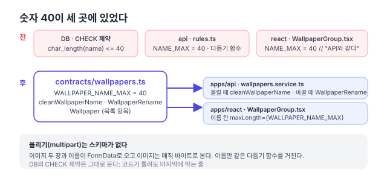

리팩터링 계획([#150](https://github.com/hyeoniverse/MacFolio/issues/150)) 1단계의 다섯째 PR([#204](https://github.com/hyeoniverse/MacFolio/pull/204))이다. [댓글](/memo/contracts-comments)·[글](/memo/contracts-posts)·[메시지](/memo/contracts-messages)·[연락 메일](/memo/contracts-contact)에 이어 배경화면 도메인을 옮겼다. 여덟 도메인 중 변경량이 가장 작았지만, 이 도메인에서 "모든 요청을 스키마로 바꿀 필요는 없다"는 기준을 처음 정했다.

## 배경: 관리자가 추가하는 배경화면

시스템 설정 › 배경화면에는 macOS 기본 배경화면 묶음이 있다. 관리자로 로그인하면 그 아래에 직접 업로드한 사진 묶음이 하나 더 표시된다. 사진을 선택하면 브라우저가 썸네일을 생성하고, 원본·썸네일 이미지 두 장과 이름을 서버로 전송한다. 업로드한 뒤에는 이름을 변경하거나 삭제할 수 있다. 이 글은 [직접 올리는 배경화면](/memo/custom-wallpapers) 기능을 만든 뒤, 그 요청·응답 규칙을 contracts로 통합한 기록이다.


## 한도 40이 세 곳에 정의되어 있었다

관리자가 추가한 배경화면의 이름은 40자까지다. 이 값이 세 곳에 정의되어 있었다.

- DB: `CHECK (char_length(name) <= 40)`
- 서버 `wallpapers/rules.ts`: `NAME_MAX = 40`과 `cleanWallpaperName` (확장자·제어 문자를 제거하고 40자까지)
- 화면 `WallpaperGroup.tsx`: `const NAME_MAX = 40` 위에 주석 "이름 칸과 같은 한도 (API의 NAME_MAX)"

주석으로 "같은 값"이라고 적었을 뿐, 두 값의 일치를 검사하는 코드나 시험은 없었다. 한쪽만 바꾸면 다음 결과가 생긴다.

| 수정한 곳     | 결과                                                                        |
| ------------- | --------------------------------------------------------------------------- |
| 서버만 50으로 | 서버는 50자를 허용하지만, 화면 이름 칸은 40자 이후 입력을 막는다            |
| 화면만 50으로 | 화면은 50자까지 입력받지만, 서버가 40자로 잘라 저장하고 사용자는 알 수 없다 |



## 선택한 방법

| 방법                                          | 좋은 점                                       | 나쁜 점                                                                                    |
| --------------------------------------------- | --------------------------------------------- | ------------------------------------------------------------------------------------------ |
| 주석을 더 자세히 작성                         | 변경할 코드가 없다                            | 일치를 검사하는 코드가 없다는 문제가 그대로 남는다                                         |
| 화면이 서버 `GET /wallpapers`에서 한도를 수신 | 서버 한 곳이 정한다                           | 이름 칸 하나를 렌더링하려고 요청이 하나 늘어난다. 서버가 응답하지 않으면 한도를 알 수 없다 |
| contracts에 한도·정리 함수·타입을 정의        | 빌드 시각에 같은 값이 들어간다. 시험으로 고정 | 패키지를 하나 거친다 (앞 네 도메인에서 이미 쓰는 구조)                                     |

셋째를 선택했다. 한도는 실행 중에 바뀌지 않는 상수라 런타임에 조회할 이유가 없다.

## 옮긴 것

```ts
// packages/contracts/src/wallpapers.ts
export const WALLPAPER_NAME_MAX = 40;
export function cleanWallpaperName(name: unknown): string | null {
	/* 확장자·제어 문자 제거, 40자 */
}

export const WallpaperRename = requestBody({
	name: z.preprocess(cleanWallpaperName, z.string({ error: '이름을 입력해 주세요.' })),
});
export const Wallpaper = z.object({ id, name, image, thumbnail, createdAt });
```

이름 정리 함수는 서버에 있던 코드를 그대로 옮겼다. 처리 순서가 결과에 영향을 준다.

```ts
export function cleanWallpaperName(name: unknown): string | null {
	if (typeof name !== 'string') return null;
	const cleaned = name
		.replace(/[\u0000-\u001f\u007f]/g, '') // 제어 문자
		.trim()
		.replace(/\.(jpe?g|png|gif|webp|heic)$/i, '') // "제주 바다.JPG" → "제주 바다"
		.trim();
	return cleaned ? Array.from(cleaned).slice(0, WALLPAPER_NAME_MAX).join('') : null;
}
```

확장자를 제거한 뒤 다시 `trim`하는 이유는 "사진 .jpg"처럼 확장자 앞에 공백이 있는 이름 때문이다. 40자로 자를 때 문자열의 `slice` 대신 [`Array.from`](https://developer.mozilla.org/en-US/docs/Web/JavaScript/Reference/Global_Objects/Array/from)을 사용하는 이유는 이모지 같은 문자를 중간에서 자르지 않기 위해서다. 문자열의 `slice`와 `length`는 [UTF-16 코드 단위](https://developer.mozilla.org/en-US/docs/Web/JavaScript/Reference/Global_Objects/String#utf-16_characters_unicode_code_points_and_grapheme_clusters)로 동작해서, 40번째 위치에 이모지가 걸리면 서로게이트 쌍[^surrogate]의 절반만 남는다.

| 식                        | 결과                   |
| ------------------------- | ---------------------- |
| `'🌊'.length`             | `2` (UTF-16 코드 단위) |
| `Array.from('🌊').length` | `1` (코드 포인트)      |
| `'🌊'.slice(0, 1)`        | `'\uD83C'` (깨진 문자) |

PostgreSQL의 [`char_length`](https://www.postgresql.org/docs/current/functions-string.html)도 문자(코드 포인트) 단위로 집계하므로 `Array.from` 방식과 기준이 같다.

`WallpaperRename`은 [`z.preprocess`](https://zod.dev/api#preprocess)에서 이름을 정리하고, 정리한 결과가 `null`(빈 이름)이면 `z.string()`이 거절한다. 거절 문구는 서버가 기존에 반환하던 "이름을 입력해 주세요."다. 서버 `rules.ts`와 그 시험은 삭제하고 contracts로 옮겼다. 화면은 `const NAME_MAX = 40` 대신 `WALLPAPER_NAME_MAX`를 import한다.

## 구현

서버는 세 곳을 수정했다.

```ts
// apps/api/src/wallpapers/wallpapers.service.ts
-	async rename(id: string, name: unknown): Promise<WallpaperView> {
-		const cleaned = cleanWallpaperName(name);
-		if (!cleaned) throw new BadRequestException('이름을 입력해 주세요.');
+	async rename(id: string, input: unknown): Promise<WallpaperView> {
+		const parsed = parse(WallpaperRename, input);
+		if ('errors' in parsed) throw new BadRequestException(parsed.errors);
+		const cleaned = parsed.value.name;
```

컨트롤러는 `@Body() body: { name?: unknown }`에서 `body?.name`을 꺼내 전달하던 코드를, 요청 본문 전체(`unknown`)를 전달하도록 바꿨다. 본문이 객체가 아닐 때의 처리는 `requestBody`가 담당한다. `WallpaperView` 인터페이스는 contracts `Wallpaper`의 별칭으로 바뀌었다.

화면은 두 파일을 수정했다. `WallpaperGroup.tsx`의 이름 칸은 `maxLength={WALLPAPER_NAME_MAX}`로 바뀌었고, `shared/settings/customWallpapers.ts`의 `ServerWallpaper` 인터페이스(5줄)는 contracts `Wallpaper`를 사용한다. 옮기는 과정에서 화면 쪽 인터페이스에 `createdAt`이 빠져 있던 것을 발견했다. 서버는 항상 응답에 포함했고 화면이 사용하지 않았을 뿐이라 동작에는 영향이 없었다.

## 업로드 요청에는 스키마가 없다

배경화면 업로드 요청은 JSON이 아니다. 이미지 두 장(원본·썸네일)과 이름이 [`FormData`](https://developer.mozilla.org/en-US/docs/Web/API/FormData)로 전송되고, 이미지 형식은 확장자가 아니라 매직 바이트로 판별한다([파일 도메인 글](/memo/contracts-files) 참고). zod 스키마로 정의할 JSON 본문이 없으므로 이름만 같은 `cleanWallpaperName`을 거친다.

> 목표는 "모든 요청을 스키마로"가 아니라 "같은 규칙은 한 곳에"다.

그래서 업로드 요청은 함수 하나를 공유하는 것으로 충분하다고 판단했다.

DB의 CHECK 제약은 유지했다. 코드에 오류가 있어도 마지막에 거절하는 방어선이고, 그 값은 마이그레이션 SQL에 고정되어 있어 contracts 값을 참조할 수 없다. 대신 contracts 시험이 "50자를 넣으면 40자"를 고정하고, API e2e가 그 값으로 저장되는지 검사한다.

## 확인

- `packages/contracts/src/wallpapers.test.ts`에 시험 세 개를 작성했다. "확장자·제어 문자를 빼고 40자까지, 비면 null"(서버 시험을 그대로 옮김: `'  제주 바다.JPG '` → `'제주 바다'`, `'가'.repeat(50)` → 40자, 숫자 `3` → null), "이름 바꾸기 몸통: 다듬은 이름이 비면 이유를 알린다", "목록 항목의 모양".
- 서버 `apps/api/src/wallpapers/rules.ts`(15줄)와 `rules.test.ts`(12줄)는 삭제했다.
- E2E `apps/react/e2e/wallpapers.spec.ts`의 시험 6개가 수정 없이 통과했다.
- 커밋은 파일 11개, +179/−51이다. 글·그림을 제외하면 +82/−51로, 여덟 도메인 가운데 가장 작다.

## 결과

| 항목                                        | 전            | 후                    |
| ------------------------------------------- | ------------- | --------------------- |
| 코드에 적힌 40                              | 2 (서버·화면) | 1                     |
| 서버 `wallpapers/rules.ts`                  | 함수 + 시험   | 없음 (contracts로)    |
| 서버 `WallpaperView`·화면 `ServerWallpaper` | 각각 정의     | contracts `Wallpaper` |
| 동작 변화                                   |               | 없음 (e2e 6개 그대로) |

## 남긴 것과 정리

아직 남은 차이가 하나 있다. 화면 이름 칸의 [`maxlength`](https://developer.mozilla.org/en-US/docs/Web/HTML/Reference/Attributes/maxlength)는 브라우저가 UTF-16 코드 단위로 집계하고, 서버와 DB는 코드 포인트로 집계한다. 예를 들어 이모지 40개로 된 이름은 서버와 DB 기준으로 40자라 허용되지만, 화면에서는 80 코드 단위라 이모지 20개까지만 입력된다. 화면이 더 엄격한 방향이라 저장 오류는 생기지 않지만, 같은 값 40이 화면과 서버에서 다른 단위라는 점은 기록해 둔다.

[업로드 파일 도메인](/memo/contracts-files)에서 적용한 "업로드는 multipart라 스키마가 없다"는 판단을 이 도메인에서 먼저 내렸다. 모든 요청을 zod로 바꾸는 것보다 "같은 규칙이 한 곳에 있는가"를 기준으로 삼는 편이 작업 범위를 정하기 쉬웠다. 변경량이 작은 도메인을 먼저 처리하면 이런 판단 기준을 적은 비용으로 정할 수 있다.

이 PR 이후 [배경화면 동영상](/memo/video-wallpaper) 기능이 추가되면서 `Wallpaper`에 `video` 필드가 추가되었고, `cleanWallpaperName`은 `.mp4` 확장자도 제거한다. 시험 "동영상 배경화면은 video: true, 이름에서 .mp4를 뺀다"도 그 시각에 같은 파일에 추가되었다.

다음 도메인은 [파일](/memo/contracts-files)·[분석](/memo/contracts-analytics) 순서로 같은 방식을 적용했다.

## 직접 확인하는 방법

계약(요청·응답 스키마)을 바꿀 때는 `packages/contracts`를 먼저 수정하고, 서버와 화면이 모두 새 형태를 따르는지 확인한다.

```bash
pnpm --filter @macfolio/contracts test          # 스키마 시험
pnpm --filter @macfolio/contracts build         # 서버는 빌드된 JS를 읽는다
pnpm typecheck                                  # 화면·서버가 새 모양을 따르는지
cd apps/react && npx playwright test e2e/wallpapers.spec.ts --project=desktop-chromium
```

필드 이름 하나를 바꾸면 `pnpm typecheck`가 서버와 화면에서 동시에 실패한다. 이 작업의 목적이 바로 이 검사다. 확인한 뒤에는 변경을 되돌린다. 스키마는 [Zod](https://zod.dev/)로 작성하고, 패키지를 나눈 이유는 [댓글 계약 글](/memo/contracts-comments)에 정리했다.

## 관련 글

- [createImageBitmap과 canvas toBlob으로 브라우저에서 이미지 축소해 업로드하기](/memo/custom-wallpapers)
- [움직이는 배경화면 - MP4와 GIF를 바탕화면에 깔기](/memo/video-wallpaper)
- [화면이 알아야 하는가를 기준으로 파일 검사 규칙을 contracts와 서버로 나누기](/memo/contracts-files)
- [zod 스키마 패키지 @macfolio/contracts로 서버 검증과 화면 타입 공유하기](/memo/contracts-comments)
- [parseProfile의 if문 검증을 zod 스키마로 옮기기](/memo/contracts-site)

[^surrogate]: U+FFFF를 넘는 문자(대부분의 이모지)를 UTF-16으로 표현할 때 사용하는 16비트 값 두 개의 쌍. 하나만 남으면 유효한 문자가 아니어서 깨진 문자(�)로 표시된다.

#MacFolio #리팩터링 #zod #TypeScript
