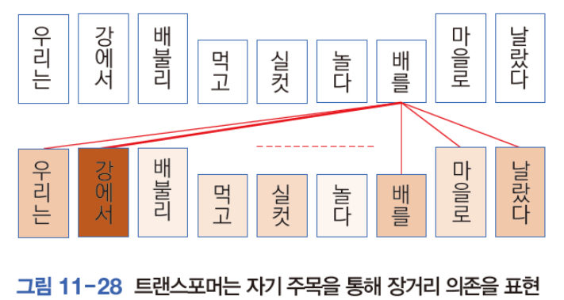

## 들어가기 전에

컨볼루션은 3×3 같은 작은 창 안의 이웃 화소만 본다. 영상 왼쪽 위의 새 부리와 오른쪽 아래의 꼬리를 함께 고려하려면 층을 여러 번 쌓아 수용장을 넓혀야 하고, 두 위치의 관계는 중간 층을 거치며 간접적으로만 반영된다. 트랜스포머의 셀프 어텐션은 한 층에서 모든 위치 쌍의 관계를 직접 계산하고, 자연어 처리에서는 모델과 데이터를 키울수록 성능이 계속 오른다는 결과가 나왔다. 이 구조를 영상 분류에도 쓸 수 있는지가 출발점이다.

영상을 트랜스포머에 그대로 넣기는 어렵다. 224×224 영상의 화소 50,176개를 각각 토큰으로 쓰면 주목 행렬의 원소가 약 25억 개가 된다. 비전 트랜스포머(Vision Transformer, ViT)는 영상을 16×16 패치로 잘라 196개 토큰으로 만들고, 패치 하나를 문장의 단어 하나처럼 다뤄 이 문제를 피한다.

이 글이 답하려는 질문은 두 가지다. 패치로 자른 영상은 어떤 과정을 거쳐 트랜스포머 인코더의 입력이 되고 부류 하나로 출력되는가. 그리고 지역성 같은 가정을 구조에 담지 않은 ViT는 CNN과 비교해 데이터 양에 따라 어떤 성능을 보이는가. 마지막에는 CIFAR-10처럼 작은 데이터셋에서 ViT를 직접 학습해 그 차이를 확인한다.

| 순서 | 내용                                                                    |
| ---- | ----------------------------------------------------------------------- |
| 1    | 컴퓨터 비전이 CNN에서 트랜스포머로 옮겨 간 흐름과 과업별 모델           |
| 2    | ViT의 구조: 패치 임베딩, class 토큰, 위치 임베딩, 인코더 블록, MLP head |
| 3    | 사전 학습 데이터 양에 따른 ViT와 CNN 비교                               |
| 4    | 트랜스포머의 특성: 장거리 의존, 확장성, 설명 가능성                     |
| 5    | Keras로 CIFAR-10 분류, 영상 확대와 데이터 증강                          |

셀프 어텐션, 멀티 헤드 어텐션, 층 정규화, 위치별 FF 층은 [트랜스포머의 셀프 어텐션과 멀티 헤드 어텐션](/memo/dl-transformer)에서 다뤘고, ViT는 그 인코더를 거의 그대로 쓴다. 비교 대상인 CNN의 수용장과 데이터 증강은 [컨볼루션 신경망의 구조와 전이 학습](/memo/dl-cnn-transfer-learning)에서 다뤘다.

## 컨볼루션 신경망에서 트랜스포머로

컴퓨터 비전은 컨볼루션 신경망에서 트랜스포머로 빠르게 옮겨 갔다. 흐름은 두 단계로 나뉜다.

| 시기            | 방식                                                                 | 예                                                              |
| --------------- | -------------------------------------------------------------------- | --------------------------------------------------------------- |
| 초기(2018~2019) | 컨볼루션 신경망이 백본이고 트랜스포머가 보조                         | 어텐션 증강 컨볼루션 신경망                                     |
| 2020년 이후     | 트랜스포머가 백본이고 컨볼루션 신경망이 보조, 또는 어텐션만으로 구성 | ViT, DETR, SETR, MOTR, TransTrack, TrackFormer, Swin 트랜스포머 |

어텐션 증강 컨볼루션 신경망(attention augmented convolutional network)[^bello]은 컨볼루션 연산으로 특징 맵을 만들고, 컨볼루션이 만든 특징 맵과 트랜스포머의 MHA로 만든 특징 맵을 이어 붙여 다음 층으로 넘긴다. 이 방식은 기존 ResNet이나 SENet(Squeeze-and-Excitation Network)보다 우수한 성능을 보였다.


2020년 이후에는 이렇게 어정쩡하게 결합하는 형태에서 벗어나려는 시도가 이어졌다. 대표적인 성공 사례는 다음과 같다.

| 과업 | 모델                                                                                                                                      | 하는 일                                            |
| ---- | ----------------------------------------------------------------------------------------------------------------------------------------- | -------------------------------------------------- |
| 분류 | ViT[^vit]                                                                                                                                 | 영상 전체를 대표하는 부류 하나를 고른다            |
| 검출 | DETR ([Carion 2020](https://arxiv.org/abs/2005.12872))                                                                                    | 물체마다 바운딩 박스와 부류를 출력한다             |
| 분할 | SETR ([Zheng 2021](https://arxiv.org/abs/2012.15840))                                                                                     | 화소 단위로 부류를 출력한다                        |
| 추적 | [MOTR](https://arxiv.org/abs/2105.03247), [TransTrack](https://arxiv.org/abs/2012.15460), [TrackFormer](https://arxiv.org/abs/2101.02702) | 프레임 사이에서 같은 물체를 이어 간다              |
| 백본 | [Swin 트랜스포머](https://arxiv.org/abs/2103.14030)                                                                                       | 분류, 검출, 분할 등 여러 과업에 공통 백본으로 쓴다 |

검출과 분할은 [물체 검출의 성능 평가와 RCNN·YOLO](/memo/dl-object-detection)와 [의미 분할의 성능 평가와 FCN·DeconvNet·U-Net](/memo/dl-segmentation)에서 컨볼루션 신경망 기반 모델로 다뤘다.

## 분류를 위한 트랜스포머

### 영상 분류와 ViT

영상 분류는 컴퓨터 비전의 가장 기본적인 문제다. 2012년 AlexNet 이후 컨볼루션 신경망이 성능을 획기적으로 끌어올렸다([컨볼루션 신경망의 구조와 전이 학습](/memo/dl-cnn-transfer-learning)). 영상 분류에 트랜스포머를 적용해서도 성능 향상을 얻을 수 있는지에 대해, ==ViT는 트랜스포머만으로도 컨볼루션 신경망에 견줄 만한 분류 성능을 낼 수 있다는 긍정적인 답을 주었다.==


ViT는 논문 「An Image is Worth 16x16 Words: Transformers for Image Recognition at Scale」에서 제안됐고, 2021년 ICLR(International Conference on Learning Representations)에서 발표됐다.


ViT는 트랜스포머가 분류 문제를 얼마나 잘 푸는지 확인할 목적으로 기존 트랜스포머 구조를 최대한 그대로 재현했다. 다만 영상은 문장과 특성이 크게 다르므로 그 차이를 고려해 입력 부분을 설계했다.

| 문장의 특성                     | 영상의 특성                                                                    |
| ------------------------------- | ------------------------------------------------------------------------------ |
| 단어가 순서대로 놓인 1차원 배열 | 화소로 구성된 2차원 배열                                                       |
| 이산적                          | 연속적                                                                         |
| 단어가 수십 개                  | 화소가 수만~수백만 개                                                          |
| 단어 각각이 분할되어 있음       | 물체와 배경이 복잡하게 섞여 있음 (크기, 회전, 이동에 심한 변화가 생길 수 있음) |

화소 하나를 토큰으로 쓰면 토큰이 수만 개가 되어 `T \times T{:math}` 크기의 주목 행렬을 감당할 수 없다. ==ViT는 영상을 `P \times P{:math}` 패치로 잘라 패치 하나를 단어 하나처럼 다룬다.== 논문 제목의 "16x16 words"는 16×16 크기 패치를 단어로 본다는 뜻이다.

### ViT의 구조


ViT는 [트랜스포머의 셀프 어텐션과 멀티 헤드 어텐션](/memo/dl-transformer)에서 다룬 트랜스포머의 인코더만 가져온다. 출력이 문장이 아니라 부류 하나이므로 디코더가 필요 없다.

### 패치 임베딩

1. `(C, H, W){:math}` 크기의 영상을 `(P, P){:math}` 크기의 패치 `N{:math}`개로 자른다. `C{:math}`는 채널 수, `H{:math}`는 높이, `W{:math}`는 너비이고 `N = HW/P^2{:math}`이다.
2. `(P, P){:math}` 패치의 화소를 일렬로 이어 붙여(flatten) `P^2 \cdot C{:math}` 차원 벡터 `\mathbf{x}_p^i{:math}`로 만든다.
3. 펼친 벡터를 선형 투영(linear projection) `\mathbf{E}{:math}`로 `D{:math}` 차원 벡터로 바꾼다.
4. 맨 앞에 학습 가능한 class 토큰 `\mathbf{x}_{class}{:math}`를 붙이고, 같은 차원의 위치 임베딩 `\mathbf{E}_{pos}{:math}`를 더한다.

```math
\mathbf{z}_0 = [\mathbf{x}_{class};\ \mathbf{x}_p^1\mathbf{E};\ \mathbf{x}_p^2\mathbf{E};\ \cdots;\ \mathbf{x}_p^N\mathbf{E}] + \mathbf{E}_{pos},
\qquad \mathbf{E} \in \mathbb{R}^{(P^2 \cdot C) \times D},\ \mathbf{E}_{pos} \in \mathbb{R}^{(N+1) \times D}
```


| 구성 요소                   | 역할                                                                                    |
| --------------------------- | --------------------------------------------------------------------------------------- |
| `\mathbf{x}_{class}{:math}` | BERT의 [class] 토큰처럼 학습 가능한 임베딩 패치. 영상 전체의 표현을 모은다              |
| 위치 임베딩                 | 임베딩된 벡터에 순서를 부여한다. 1차원으로 만든 벡터에 같은 차원의 위치 임베딩을 더한다 |

<details>
<summary>논문 설정으로 크기 계산하기</summary>

224×224 컬러 영상(`C = 3{:math}`, `H = W = 224{:math}`)을 `P = 16{:math}`으로 자르고 ViT-Base(`D = 768{:math}`)에 넣는 경우다.

1. 패치 수는 영상의 화소 수를 패치 하나의 화소 수로 나눈 값이다.

   ```math
   N = \frac{HW}{P^2} = \frac{224 \cdot 224}{16^2} = \frac{50{,}176}{256} = 196
   ```

2. 패치 하나를 펼친 벡터의 차원은 패치의 화소 수에 채널 수를 곱한 값이다.

   ```math
   P^2 \cdot C = 16^2 \cdot 3 = 768
   ```

3. 선형 투영과 위치 임베딩의 크기가 정해진다. 위치 임베딩은 class 토큰 하나를 더해 `N + 1{:math}`행이다.

| 행렬                      | 크기                            | 값                      |
| ------------------------- | ------------------------------- | ----------------------- |
| `\mathbf{E}{:math}`       | `(P^2 \cdot C) \times D{:math}` | `768 \times 768{:math}` |
| `\mathbf{E}_{pos}{:math}` | `(N + 1) \times D{:math}`       | `197 \times 768{:math}` |
| `\mathbf{z}_0{:math}`     | `(N + 1) \times D{:math}`       | `197 \times 768{:math}` |

</details>

논문은 크기가 다른 세 모델을 비교한다. 이름 뒤의 숫자는 패치 크기로, ViT-L/16은 ViT-Large에 `16 \times 16{:math}` 패치를 쓴 모델이다. 패치가 작을수록 토큰 수가 늘어 계산량이 커진다.

| 모델      | 층 수 `L{:math}` | 은닉 차원 `D{:math}` | MLP 차원 | 헤드 수 | 매개변수 수 |
| --------- | ---------------- | -------------------- | -------- | ------- | ----------- |
| ViT-Base  | 12               | 768                  | 3072     | 12      | 86M         |
| ViT-Large | 24               | 1024                 | 4096     | 16      | 307M        |
| ViT-Huge  | 32               | 1280                 | 5120     | 16      | 632M        |

> [!NOTE]
> 원래 트랜스포머는 위치 인코딩을 사인·코사인 식으로 고정했지만, ViT의 위치 임베딩 `\mathbf{E}_{pos}{:math}`는 학습으로 정하는 파라미터다.

### 인코더 블록

ViT의 인코더 블록은 층 정규화(LN), 멀티 헤드 셀프 어텐션(MSA), MLP를 잔차 연결로 묶어 `L{:math}`번 반복한다.

```math
\begin{aligned}
\mathbf{z}'_\ell &= \mathrm{MSA}(\mathrm{LN}(\mathbf{z}_{\ell-1})) + \mathbf{z}_{\ell-1}, & \ell &= 1, \ldots, L \\
\mathbf{z}_\ell &= \mathrm{MLP}(\mathrm{LN}(\mathbf{z}'_\ell)) + \mathbf{z}'_\ell, & \ell &= 1, \ldots, L
\end{aligned}
```


> [!TIP] 정규화 위치
> 원래 트랜스포머는 `\mathrm{Norm}(\mathbf{X} + \mathrm{MHA}(\mathbf{X})){:math}`처럼 잔차를 더한 뒤 정규화(post-norm)하지만, ViT는 MSA와 MLP에 넣기 전에 정규화(pre-norm)한다. 식에서 LN이 괄호 안쪽에 있는 차이다.

#### 층 정규화

층 정규화(layer normalization)는 모든 영상 임베딩을 채널(특징 차원) 기준으로 정규화한다. 토큰 하나의 `D{:math}`개 값으로 평균과 표준편차를 구하므로 배치 크기와 무관하다.


| 정규화      | 통계를 구하는 방향                | 그림에서                        |
| ----------- | --------------------------------- | ------------------------------- |
| 배치 정규화 | 특징 하나를 배치 안 샘플들에 걸쳐 | 가로 방향(행)마다 평균·표준편차 |
| 층 정규화   | 샘플 하나를 모든 특징에 걸쳐      | 세로 방향(열)마다 평균·표준편차 |

#### 멀티 헤드 셀프 어텐션

MSA(Multi-Head Self Attention)는 패치 임베딩과 위치 임베딩을 더한 토큰으로 셀프 어텐션을 수행한다. 계산은 원래 트랜스포머와 같다.

```math
\mathrm{Attention}(\mathbf{Q}, \mathbf{K}, \mathbf{V}) = \mathrm{softmax}\left(\frac{\mathbf{Q}\mathbf{K}^\mathsf{T}}{\sqrt{d_k}}\right)\mathbf{V}
```


MSA의 출력에는 잔차 연결(residual connection)로 입력을 더한다(add 연산).

#### MLP

MLP는 두 개의 선형 층으로 구성되며, 첫 번째 층에서 임베딩 크기를 확장하고 두 번째 층에서 원래 임베딩 크기로 되돌린다. 원래 트랜스포머의 위치별 FF 층과 같은 형태이고, 비선형 함수로 ReLU 대신 GELU를 쓴다.

```math
\mathrm{MLP}(\mathbf{X}) = \mathrm{GELU}(\mathbf{X}\mathbf{W}_1 + \mathbf{b}_1)\,\mathbf{W}_2 + \mathbf{b}_2
```


GELU(Gaussian Error Linear Unit)는 입력에 표준 정규분포의 누적 분포 함수 값을 곱한 `\mathrm{GELU}(x) = x\,\Phi(x){:math}`로, 0 근처에서 ReLU보다 매끄럽게 변한다. 뒤의 실습 코드도 `tf.nn.gelu`를 쓴다.

### MLP head와 class 토큰

마지막에는 class 토큰의 출력만 사용해 MLP를 수행한다. ==class 토큰은 인코더를 지나는 동안 셀프 어텐션으로 모든 패치의 정보를 모으므로, 영상 전체를 나타내는 표현 벡터(representation vector) 역할을 한다.==

```math
\mathbf{y} = \mathrm{LN}(\mathbf{z}_L^0)
```

의 출력만 MLP head에 넣어 1000개 부류를 분류한다')

### 결론: 데이터가 많을수록 유리하다

가 앞서고, JFT-300M처럼 커지면 큰 ViT가 앞선다')

| 사전 학습 데이터                  | 더 나은 모델                                  |
| --------------------------------- | --------------------------------------------- |
| ImageNet처럼 데이터셋이 작은 경우 | BiT(ResNet) 같은 CNN 구조                     |
| JFT처럼 데이터셋이 큰 경우        | 트랜스포머. 데이터가 커질수록 성능이 좋아진다 |

> [!IMPORTANT] 귀납 편향과 데이터 양
> 컨볼루션 신경망은 지역성과 이동 불변성을 구조에 미리 담고 있어 적은 데이터로도 잘 학습한다. ViT는 이런 가정이 거의 없어 데이터가 적으면 불리하지만, 데이터가 충분하면 그 가정에 묶이지 않고 더 좋은 표현을 배운다.

## 트랜스포머의 특성

### 장거리 의존

장거리 의존(long-range dependency)은 멀리 떨어진 요소 사이의 관계다.

| 모델       | 장거리 의존을 처리하는 방식                                   |
| ---------- | ------------------------------------------------------------- |
| RNN        | 시간 의존성을 순서대로 전달하며 처리                          |
| CNN        | 깊은 층을 거치며 수용장을 넓혀 공간 의존성 처리               |
| 트랜스포머 | 자기 주목으로 모든 위치 쌍의 관계를 한 층에서 명시적으로 계산 |

"우리는 \_\_에서 배불리 먹고 실컷 놀다 배를 마을로 날랐다"라는 문장에서 빈칸이 '강'이면 '배'는 타는 배이고, '농장'이면 먹는 배다. '배'의 뜻을 정하려면 멀리 떨어진 빈칸의 단어를 참고해야 한다.




트랜스포머는 지역 정보와 전역 정보를 모두 능숙하게 처리한다는 연구 결과도 있다[^cordonnier]. 아래 그림은 층마다 각 헤드가 주목하는 영역이다. 앞쪽 층에는 가운데 화소 근처에 주목하는 헤드가 많고, 뒤쪽 층으로 갈수록 넓은 범위에 주목하는 헤드가 늘어난다.


### 확장성

| 분야        | 확장성 실험 결과                                                                                                                                 |
| ----------- | ------------------------------------------------------------------------------------------------------------------------------------------------ |
| 자연어 처리 | 모델 크기, 데이터 크기, 계산 자원 사이의 관계를 체계적으로 실험한 결과 큰 스케일이 유리하다는 결론. 확장성 경쟁 중                               |
| 컴퓨터 비전 | 5백만~20억 개 매개변수의 트랜스포머를 1백만~30억 장 데이터셋으로 실험한 결과, 모델 크기·데이터 크기·계산 자원을 함께 늘리면 성능이 오른다[^zhai] |

==모델이 작으면 모델 크기가 병목이 되어 데이터셋을 키워도 성능이 오르지 않는다.== 세 요소를 함께 키워야 한다.

### 설명 가능성

자기 주목 행렬을 활용하면 모델이 어디를 보고 판단했는지 더 쉽고 정확하게 설명할 수 있다. [컨볼루션 신경망의 구조와 전이 학습](/memo/dl-cnn-transfer-learning)에서 다룬 Grad-CAM처럼 따로 기울기를 계산하지 않아도 주목 값 자체가 근거가 된다. 예를 들어 미세 분류(fine-grained classification)를 하는 TransFG[^transfg]는 새의 부리나 개의 코끝처럼 부류를 가르는 특정한 곳에 집중한다.


## 분류를 위한 트랜스포머 실습

CIFAR-10(32×32 컬러 영상, 10부류)을 ViT 방식으로 분류하는 Keras 코드다.

### 하이퍼파라미터

```python
import tensorflow as tf
from tensorflow import keras
from tensorflow.keras import layers
from tensorflow.keras.losses import SparseCategoricalCrossentropy
from tensorflow.keras.optimizers import Adam

(x_train, y_train), (x_test, y_test) = keras.datasets.cifar10.load_data()

n_class = 10                           # 부류 수
img_siz = (32, 32, 3)                  # 영상의 크기

patch_siz = 4                          # 패치 크기
p2 = (img_siz[0] // patch_siz) ** 2    # 패치 개수
d_model = 64                           # 임베딩 벡터 차원
h = 8                                  # 헤드 개수
N = 6                                  # 인코더 블록의 개수
```

패치 크기가 4이므로 `p2 = (32 // 4) ** 2 = 64{:python}`개 패치가 나온다. 각 헤드의 key 차원은 `d_model // h = 8{:python}`이다.


### 패치 생성과 패치 인코딩

```python
class Patches(layers.Layer):
    def __init__(self, patch_size):
        super(Patches, self).__init__()
        self.p_siz = patch_size

    def call(self, img):
        batch_size = tf.shape(img)[0]
        patches = tf.image.extract_patches(images=img, sizes=[1, self.p_siz, self.p_siz, 1], strides=[1, self.p_siz, self.p_siz, 1], rates=[1, 1, 1, 1], padding="VALID")
        patch_dims = patches.shape[-1]
        patches = tf.reshape(patches, [batch_size, -1, patch_dims])
        return patches

class PatchEncoder(layers.Layer):
    def __init__(self, p2, d_model):  # p2: 패치 개수
        super(PatchEncoder, self).__init__()
        self.p2 = p2
        self.projection = layers.Dense(units=d_model)
        self.position_embedding = layers.Embedding(input_dim=p2, output_dim=d_model)

    def call(self, patch):
        positions = tf.range(start=0, limit=self.p2, delta=1)
        encoded = self.projection(patch) + self.position_embedding(positions)
        return encoded
```

| 코드                                                         | 역할                                                                                             |
| ------------------------------------------------------------ | ------------------------------------------------------------------------------------------------ |
| `tf.image.extract_patches(...){:python}`                     | `sizes`와 `strides`를 패치 크기로 같게 두어 겹치지 않는 패치를 자른다. 결과는 `(배치, 8, 8, 48)` |
| `tf.reshape(patches, [batch_size, -1, patch_dims]){:python}` | `(배치, 64, 48)`로 펼쳐 패치 64개의 48차원 벡터로 만든다                                         |
| `layers.Dense(units=d_model){:python}`                       | 선형 투영 `\mathbf{E}{:math}`. 48차원을 64차원으로 바꾼다                                        |
| `layers.Embedding(input_dim=p2, ...){:python}`               | 위치 0~63마다 학습 가능한 64차원 위치 임베딩                                                     |


### 모델 구성

```python
def create_vit_classifier():
    input = layers.Input(shape=(img_siz))
    nor = layers.Normalization()(input)

    patches = Patches(patch_siz)(nor)  # 패치 생성
    x = PatchEncoder(p2, d_model)(patches)  # 패치 인코딩

    for _ in range(N):  # 다중 인코더 블록
        x1 = layers.LayerNormalization(epsilon=1e-6)(x)  # 층 정규화
        x2 = layers.MultiHeadAttention(num_heads=h, key_dim=d_model // h, dropout=0.1)(x1, x1)  # MHA
        x3 = layers.Add()([x2, x])  # 지름길 연결
        x4 = layers.LayerNormalization(epsilon=1e-6)(x3)  # 층 정규화
        x5 = layers.Dense(d_model * 2, activation=tf.nn.gelu)(x4)
        x6 = layers.Dropout(0.1)(x5)
        x7 = layers.Dense(d_model, activation=tf.nn.gelu)(x6)
        x8 = layers.Dropout(0.1)(x7)
        x = layers.Add()([x8, x3])  # 지름길 연결

    x = layers.LayerNormalization(epsilon=1e-6)(x)
    x = layers.Flatten()(x)
    x = layers.Dropout(0.5)(x)
    x = layers.Dense(2048, activation=tf.nn.gelu)(x)
    x = layers.Dropout(0.5)(x)
    x = layers.Dense(1024, activation=tf.nn.gelu)(x)
    x = layers.Dropout(0.5)(x)
    output = layers.Dense(n_class, activation='softmax')(x)

    model = keras.Model(inputs=input, outputs=output)
    return model
```

| 줄                                                | 대응하는 ViT 구성                                                                                |
| ------------------------------------------------- | ------------------------------------------------------------------------------------------------ |
| `layers.Normalization()(input){:python}`          | 화소 값을 평균 0, 분산 1로 맞추는 입력 전처리                                                    |
| `x1 = layers.LayerNormalization(...)(x){:python}` | MSA 앞의 LN (pre-norm)                                                                           |
| `layers.MultiHeadAttention(...)(x1, x1){:python}` | query와 value에 같은 `x1`을 넣는 셀프 어텐션. 헤드 8개, 헤드마다 8차원                           |
| `x3 = layers.Add()([x2, x]){:python}`             | `\mathbf{z}'_\ell = \mathrm{MSA}(\mathrm{LN}(\mathbf{z}_{\ell-1})) + \mathbf{z}_{\ell-1}{:math}` |
| `Dense(d_model * 2)`, `Dense(d_model)`            | MLP. 64차원을 128차원으로 넓혔다가 64차원으로 되돌린다                                           |
| `x = layers.Add()([x8, x3]){:python}`             | `\mathbf{z}_\ell = \mathrm{MLP}(\mathrm{LN}(\mathbf{z}'_\ell)) + \mathbf{z}'_\ell{:math}`        |
| `Flatten` 이후                                    | 64개 토큰 출력을 모두 펼쳐 완전 연결층 두 개와 softmax로 분류                                    |

> [!NOTE]
> 이 실습 코드는 class 토큰을 쓰지 않는다. ViT 논문은 class 토큰의 출력만 MLP head에 넣지만, 여기서는 패치 64개의 출력을 모두 이어 붙여(`64 \times 64 = 4096{:math}`차원) 분류한다. 그래서 첫 `Dense(2048)` 층에만 `4096 \cdot 2048 + 2048 = 8{,}390{,}656{:math}`개 가중치가 있다.

### 학습과 결과

```python
model = create_vit_classifier()
model.layers[1].adapt(x_train)

model.compile(optimizer=Adam(), loss=SparseCategoricalCrossentropy(), metrics=['accuracy'])
hist = model.fit(x_train, y_train, batch_size=128, epochs=100, validation_data=(x_test, y_test), verbose=1)

res = model.evaluate(x_test, y_test, verbose=0)
print('정확률=', res[1] * 100)

import matplotlib.pyplot as plt

plt.plot(hist.history['accuracy'])
plt.plot(hist.history['val_accuracy'])
plt.title('Accuracy graph')
plt.ylabel('Accuracy')
plt.xlabel('Epoch')
plt.legend(['Train', 'Validation'])
plt.grid()
plt.show()

plt.plot(hist.history['loss'])
plt.plot(hist.history['val_loss'])
plt.title('Loss graph')
plt.ylabel('Loss')
plt.xlabel('Epoch')
plt.legend(['Train', 'Validation'])
plt.grid()
plt.show()
```

`model.layers[1]{:python}`은 `Input` 다음의 `Normalization` 층이고, `adapt(x_train){:python}`으로 학습 데이터의 평균과 분산을 미리 계산해 둔다. 출력층이 `activation='softmax'`로 확률을 내므로 손실 함수는 기본값(`from_logits=False`)인 `SparseCategoricalCrossentropy()`를 쓴다. 배치 크기 128로 100세대 학습한다.


테스트 정확률은 75.15%로 컨볼루션 신경망보다 열등한 성능이다. 학습 정확도는 0.96까지 오르지만 검증 정확도는 0.75에서 멈추고, 검증 손실은 20세대 무렵부터 다시 오른다. CIFAR-10은 5만 장뿐이라 앞 절의 결론처럼 데이터가 적을 때 ViT가 불리하다.

### 영상 확대와 데이터 증강

32×32 영상을 72×72로 확대하고 데이터 증강을 추가해 성능 향상을 시도한다. 바뀐 부분만 적는다.

```python
n_class = 10        # 부류 수
img_siz = (32, 32, 3)
img_expanded_siz = (72, 72, 3)

patch_siz = 6       # 패치 크기
p2 = (img_expanded_siz[0] // patch_siz) ** 2  # 패치 개수
d_model = 64        # 임베딩 벡터 차원
h = 8               # 헤드 개수
N = 6               # 인코더 블록의 개수

def create_vit_classifier():
    input = layers.Input(shape=(img_siz))
    nor = layers.Normalization()(input)
    exp = layers.Resizing(img_expanded_siz[0], img_expanded_siz[1])(nor)

    x = layers.RandomFlip('horizontal')(exp)
    x = layers.RandomRotation(factor=0.02)(x)
    x = layers.RandomZoom(height_factor=0.2, width_factor=0.2)(x)

    patches = Patches(patch_siz)(x)  # 패치 생성
    x = PatchEncoder(p2, d_model)(patches)  # 패치 인코딩
    # 이후 인코더 블록과 분류층은 앞과 같다
```

| 변경                                                | 효과                                                            |
| --------------------------------------------------- | --------------------------------------------------------------- |
| `layers.Resizing(72, 72){:python}`, `patch_siz = 6` | 패치 수가 `(72 // 6)^2 = 144{:math}`개로 늘어 토큰이 촘촘해진다 |
| `RandomFlip('horizontal'){:python}`                 | 좌우 반전                                                       |
| `RandomRotation(factor=0.02){:python}`              | 한 바퀴의 ±2%, 약 ±7.2도 회전                                   |
| `RandomZoom(0.2, 0.2){:python}`                     | 가로·세로 ±20% 확대·축소                                        |

증강 층은 학습할 때만 무작위 변환을 적용하고 평가할 때는 입력을 그대로 통과시킨다.


정확률이 75.15%에서 81.86%로 크게 올랐다. ==데이터 증강은 데이터가 적어 불리한 ViT의 약점을 보완한다.== 검증 정확도가 40세대 무렵까지 학습 정확도보다 높게 함께 오르고, 검증 손실도 다시 커지지 않는다.

다음 글 [KcELECTRA 미세 조정으로 만든 악성 댓글 분류 모델](/memo/dl-toxic-comment-kcelectra)에서는 트랜스포머 인코더 기반 언어 모델 KcELECTRA로 악성 댓글 분류 모델을 만든 과정을 다룬다.

[^bello]: I. Bello et al., ["Attention Augmented Convolutional Networks"](https://arxiv.org/abs/1904.09925), ICCV 2019.

[^vit]: A. Dosovitskiy et al., ["An Image is Worth 16x16 Words: Transformers for Image Recognition at Scale"](https://arxiv.org/abs/2010.11929), ICLR 2021.

[^cordonnier]: J.-B. Cordonnier et al., ["On the Relationship between Self-Attention and Convolutional Layers"](https://arxiv.org/abs/1911.03584), ICLR 2020.

[^zhai]: X. Zhai et al., ["Scaling Vision Transformers"](https://arxiv.org/abs/2106.04560), CVPR 2022.

[^transfg]: J. He et al., ["TransFG: A Transformer Architecture for Fine-grained Recognition"](https://arxiv.org/abs/2103.07976), AAAI 2022.
