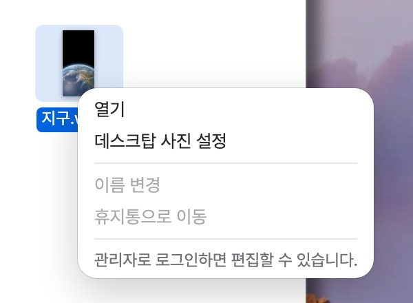

## 배경

macOS의 Finder에서 그림 파일을 오른쪽 클릭하면 '데스크탑 사진 설정' 메뉴가 나온다. 누르면 시스템 설정을 거치지 않고 그 그림이 바로 바탕화면이 된다. MacFolio의 Finder에도 같은 메뉴가 있다. 아래 그림처럼 Finder에 넣은 그림 `지구.webp`를 오른쪽 클릭해 '데스크탑 사진 설정'을 누르면 바탕화면이 그 그림으로 바뀐다.



선택한 배경화면은 서버가 아니라 방문자의 브라우저에 저장된다. 저장 위치는 `localStorage`다. `localStorage`는 웹 페이지가 문자열 키와 값을 브라우저에 저장하는 저장소로, 탭이나 브라우저를 닫았다 열어도 값이 남는다[^localstorage]. MacFolio는 화면 모드, 배경화면, 클릭 소리 같은 설정을 `macfolio:settings` 키 하나에 JSON으로 저장하고, 앱을 열 때마다 이 값을 읽어 화면을 복원한다.

이 지구 사진으로 바뀌었다")

그런데 이렇게 바꾼 배경화면이 새로고침하면 기본 배경화면으로 돌아왔다. 재현 절차는 다음과 같다.

1. 관리자로 로그인해 Finder에 그림을 업로드한다.
2. 그림을 오른쪽 클릭 › '데스크탑 사진 설정'.
3. 바탕화면이 바뀐 것을 보고 새로고침한다.
4. 배경화면이 기본값(Sierra)으로 돌아가 있다.

이 문제는 10월 19일 새벽 배포 사이트에서 발견했다. 전날 밤 "그림을 오른쪽 클릭해 바탕화면으로 설정" 기능([#263](https://github.com/hyeoniverse/MacFolio/pull/263))을 배포한 뒤 확인하자, 그림은 설정되지만 새로고침하면 원래 배경화면으로 돌아왔고, MP4는 메뉴가 없어 설정할 수 없었다. 같은 시각에 관리자로 메일 앱을 열었는데, 관리자에게는 보낸 편지함에 표시되어야 할 환영 메일이 없었다. 함께 수정한 문제는 다음 세 가지다.

| 문제                              | 증상                                                          |
| --------------------------------- | ------------------------------------------------------------- |
| MP4 배경화면                      | '데스크탑 사진 설정'이 그림에만 표시되어 MP4는 설정할 수 없음 |
| QuickTime Player를 파일 없이 실행 | macOS와 다른 단순 목록을 표시                                 |
| 관리자로 메일 앱 실행             | 환영 메일이 어느 편지함에도 없음                              |

네 가지를 한 PR([#268](https://github.com/hyeoniverse/MacFolio/pull/268))로 묶었다.

## 원인: 서버 배경화면 검사에 함께 포함됨

설정은 브라우저에 정상적으로 저장되어 있었다. 개발자 도구의 Application › Local Storage에서 `macfolio:settings`를 확인하면 새로고침 직후에도 다음처럼 Finder 배경화면의 id가 들어 있었다.

```json
{ "wallpaper": "custom:finder-9auzvy", "wallpaperImage": "https://…/files/…", "wallpaperVideo": null }
```

==설정을 기본값으로 바꾼 것은 앱 시작 시각에 실행되는 검사==였다.

### 배경화면 id는 접두어로 종류를 구분한다

설정의 `wallpaper` 값에는 배경화면의 id 문자열 하나만 들어간다. 배경화면은 출처가 세 가지라, id의 앞부분(접두어)으로 종류를 구분한다.

| 종류                   | id 예                  | 그림 주소의 출처                                 |
| ---------------------- | ---------------------- | ------------------------------------------------ |
| 내장 배경화면          | `sierra`               | 사이트에 포함된 `/imgs/wallpapers/` 파일         |
| 관리자가 업로드한 그림 | `custom:<서버 id>`     | API 서버의 `/wallpapers` 목록                    |
| Finder에서 선택한 파일 | `custom:finder-<해시>` | Finder 파일 주소(`/files/…`), 서버 목록에는 없다 |

관리자가 시스템 설정에서 업로드한 배경화면([관리자가 추가한 배경화면](/memo/custom-wallpapers))은 방문자가 선택한 뒤에 관리자가 삭제할 수 있다. 그러면 방문자의 `localStorage`에는 더 이상 존재하지 않는 배경화면의 id가 남는다. 그래서 `shared/settings/customWallpapers.ts`의 `checkChosenWallpapers()`는 선택한 id가 `custom:`으로 시작하면 서버 목록을 내려받아 대조하고(`reconcile()`), 목록에 없으면 기본값으로 되돌린다.

```ts
// 수정 전
function reconcile(list: CustomWallpaper[]) {
	for (const kind of ['mac', 'ios'] as const) {
		const selected = settings[FIELDS[kind].id];
		if (!isCustomWallpaperId(selected)) continue;
		const found = list.find((wallpaper) => wallpaper.id === selected);
		if (!found) chooseWallpaper(kind, DEFAULT_SETTINGS[FIELDS[kind].id]);
	}
}
```

### Finder 배경화면도 같은 접두어를 썼다

Finder의 `setDesktopWallpaper()`는 id를 `custom:finder-<해시>`로 생성했다. 해시는 파일 키 문자열에서 계산한 짧은 값이라 같은 파일이면 항상 같은 id가 된다. 문제는 이 id도 `custom:`으로 시작한다는 점이다. `isCustomWallpaperId()`는 앞부분 `custom:`만 확인하므로 Finder 배경화면도 서버 목록 대조 대상이 되었다. Finder 파일은 서버 배경화면 목록에 없으므로 매번 "삭제된 배경화면"으로 판정됐다.


새로고침 직후 일어나는 순서를 시간 순으로 나열하면 다음과 같다. ②에서 Finder 배경화면이 잠시 표시되고, ⑤의 검사가 끝나는 시각에 기본값으로 바뀐다.


==두 기능을 다른 날 만들면서 같은 id 접두어를 사용한 것==이 원인이었다. 관리자 배경화면 기능을 만들 시각에는 `custom:`이 "서버 목록에 있는 배경화면"이라는 뜻이었고, Finder 기능은 "사용자가 고른 그림 주소를 직접 쓰는 배경화면"이라는 뜻으로 같은 접두어를 재사용했다.


## 선택한 방법과 제외한 방법

| 방법                                                        | 장점                        | 단점                                                                                     |
| ----------------------------------------------------------- | --------------------------- | ---------------------------------------------------------------------------------------- |
| Finder 배경화면 id를 `finder:…`로 변경                      | 검사 코드를 수정하지 않는다 | 이미 저장된 설정을 마이그레이션해야 하고, `custom:`을 검사하는 다른 코드도 수정해야 한다 |
| 검사 시 서버 배경화면 목록과 함께 파일 목록도 조회          | 삭제된 파일까지 검출한다    | 앱을 열 때마다 요청이 하나 늘고, 방문자 파일(blob:)은 서버에 없다                        |
| **접두어 `custom:finder-`를 상수로 정의하고 검사에서 제외** | 두 줄 수정, 저장된 값 유지  | Finder 파일이 삭제되어도 검사하지 않는다                                                 |

첫 번째 방법의 마이그레이션은 이미 방문자 브라우저에 저장된 `custom:finder-…` 값을 앱 시작 시각에 `finder:…`로 바꾸는 코드를 뜻한다. 서버는 방문자의 `localStorage`를 수정할 수 없으므로 이 변환 코드를 계속 유지해야 한다. 세 번째를 선택했다. Finder 파일이 삭제되는 경우는 관리자가 직접 삭제할 때뿐이라, 앱을 열 때마다 요청을 하나 더 보낼 필요는 없다고 판단했다.

## 구현

### 1. 접두어를 상수로 정의

```ts
/** Finder에서 '데스크탑 사진 설정'으로 고른 배경화면의 id 앞부분. 서버 목록에 없으니 맞춰 보지 않는다 */
export const FINDER_WALLPAPER_PREFIX = 'custom:finder-';

// reconcile 안
if (!isCustomWallpaperId(selected) || selected.startsWith(FINDER_WALLPAPER_PREFIX)) continue;

// checkChosenWallpapers: Finder 것만 골랐으면 서버 목록을 받지도 않는다
const fromServer = (id: string) => isCustomWallpaperId(id) && !id.startsWith(FINDER_WALLPAPER_PREFIX);
```

`apps/finder/setWallpaper.ts`도 문자열 리터럴 대신 이 상수로 id를 생성한다(`` `${FINDER_WALLPAPER_PREFIX}${hash(item.key)}` ``). ==두 곳이 같은 상수를 참조하므로 한쪽만 바뀌는 일이 없다.== 접두어 문자열을 바꾸고 싶으면 상수 한 줄만 수정하면 되고, 편집기의 "참조 찾기"로 이 접두어를 쓰는 코드를 모두 확인할 수 있다.

수정 후 같은 설정으로 앱을 열면 다음처럼 동작한다.

| 저장된 `wallpaper`     | `fromServer()` | 서버 요청         | 결과                                      |
| ---------------------- | -------------- | ----------------- | ----------------------------------------- |
| `sierra`               | `false`        | 없음              | 내장 배경화면                             |
| `custom:<서버 id>`     | `true`         | `GET /wallpapers` | 목록에 있으면 유지, 없으면 `sierra`       |
| `custom:finder-9auzvy` | `false`        | 없음              | 저장된 주소(`wallpaperImage`) 그대로 표시 |

### 2. MP4도 배경화면으로

동영상 배경화면은 [MP4·GIF 배경화면](/memo/video-wallpaper)([#264](https://github.com/hyeoniverse/MacFolio/pull/264))에서 이미 구현했다. 설정의 `wallpaperVideo`에 주소가 있으면 바탕화면 위에 `<video>`를 렌더링한다. 그래서 `canSetWallpaper()`가 동영상 파일에도 `true`를 반환하게 하고, 동영상이면 `wallpaperVideo`에 주소를 저장하기만 하면 됐다.


동영상에는 별도의 포스터 이미지가 없다. 포스터는 `<video>` 요소의 `poster` 속성에 지정하는 그림으로, 동영상의 첫 프레임을 불러오기 전에 대신 표시된다[^poster]. 배경 이미지 필드(`wallpaperImage`)를 비우면 동영상이 로드되기 전에 이전 배경화면이 표시된다. 그래서 그 필드에도 같은 MP4 주소를 넣었다. CSS `background-image`로는 MP4가 렌더링되지 않으므로 빈 배경이 되고, 곧 동영상이 그 위를 덮는다. 대신 `WallpaperVideo.tsx`에서 동영상 자신을 [`poster`](https://developer.mozilla.org/ko/docs/Web/HTML/Element/video#poster)로 지정하지 않도록 한 줄을 추가했다.

```tsx
poster={poster && poster !== src ? poster : undefined}
```

### 3. QuickTime Player의 열기 창

파일 없이 QuickTime Player를 실행하면 "재생할 파일을 고르세요"라는 제목 아래 동영상·소리 파일 이름을 한 줄씩 나열했다. 실제 macOS에서는 미리보기와 같은 열기 창(파일 선택 대화상자)이 표시되고, 그 앱이 열 수 없는 파일은 흐리게 비활성으로 표시된다. 예를 들어 QuickTime의 열기 창에서 PDF는 목록에 보이지만 선택할 수 없다. 미리보기에는 이미 그 열기 창(`apps/preview/OpenPanel.tsx`)이 있었다.

')

`OpenPanel`이 호출한 앱 정보를 `app` prop으로 받게 했다. 이름·아이콘과 "열 수 있는 파일인가"를 판단하는 함수 하나다. 기본값은 미리보기라서 미리보기 쪽 코드는 변경하지 않았다.

```ts
export interface OpenPanelApp {
	name: string;
	icon: string;
	/** 열 수 있는 파일인지 (그 밖의 파일은 흐리게, 고를 수 없다) */
	canOpen: (item: FileItem) => boolean;
}
```


맨 위 항목은 미리보기에서는 업로드한 PDF·그림이고, QuickTime에서는 업로드한 파일 전체를 폴더를 재귀 순회하며 수집한 뒤 동영상·소리만 남긴다. 같은 파일이 두 폴더에 있으면 한 번만 넣는다. 동영상 썸네일은 Finder처럼 주소 끝에 `#t=0.5`를 붙여 0.5초 시점의 프레임을 표시한다. `#t=`는 미디어 조각 식별자(Media Fragments)로, 동영상을 그 시각부터 재생하도록 지정한다[^fragment]. 첫 프레임이 검은 화면인 영상이 많기 때문이다. QuickTime 쪽에서는 자체 목록 코드와 CSS 60줄을 삭제했다.

### 4. 관리자에게 환영 메일은 보낸 편지함에

메일 앱의 받은 편지함은 방문자에게는 환영 메일("방문해 주셔서 감사합니다!")을, 관리자에게는 방문자가 보낸 실제 메일을 표시한다. 그래서 관리자로 로그인하면 환영 메일이 어디에도 없었다. 환영 메일은 사이트 주인이 방문자에게 보낸 메일이므로 관리자에게는 보낸 편지함 맨 아래(가장 오래된 메일)에 배치했다. 관리자 본인이 보낸 메일이라 답장 입력 칸은 표시하지 않는다.

```ts
const outbox = admin ? [...(sent ?? []), ...welcome] : (sent ?? []);
```

| 사용자 | 환영 메일 위치      | 답장 입력 칸 |
| ------ | ------------------- | ------------ |
| 방문자 | 받은 편지함         | 없음         |
| 관리자 | 보낸 편지함 맨 아래 | 없음         |

## 확인

- 단위 시험 `shared/settings/customWallpapers.test.ts`를 새로 작성했다. "Finder에서 고른 배경화면은 서버 목록에 없어도 그대로 둔다"와 "서버에서 지워진 배경화면은 기본값으로 돌린다" 두 가지다. 빈 서버 목록을 반환하는 가짜 `fetch`로 실행한다.
- E2E `e2e/finder-upload.spec.ts`에 "QuickTime Player를 파일 없이 열면 열기 창이 뜨고, 동영상·소리가 아닌 파일은 고를 수 없다"를 추가했다. PDF와 MP4를 업로드하고 열기 창에서 PDF는 `aria-disabled`, MP4는 선택해 열리는지 확인한다. 같은 파일의 방문자 시험에는 동영상을 '데스크탑 사진 설정'하면 설정의 `wallpaperVideo`가 `blob:` 주소가 되는지를 추가했다. 시험은 움직임 줄이기 설정으로 실행되어 동영상을 렌더링하지 않으므로 설정 값을 확인한다.
- E2E `e2e/mail.spec.ts`에 "관리자: 환영 메일은 자기가 보낸 메일이라 보낸 편지함에 보인다"를 추가했다.
- 변경 파일 12개, +209/−138이다.

## 남은 것·배운 것

- Finder에서 선택한 파일을 나중에 삭제하면 설정에는 주소가 남는다. 삭제 시각에 그 파일을 참조하는 설정을 함께 비우는 것이 바람직하다. 다만 다른 방문자의 브라우저 설정은 서버가 수정할 수 없으므로, 결국 그림을 불러오지 못하면 기본값으로 되돌리는 처리가 필요하다.
- 방문자가 끌어다 놓은 파일은 서버에 업로드하지 않고 `blob:` 주소로만 표시한다. `blob:` 주소는 `URL.createObjectURL()`이 브라우저 메모리의 파일에 붙이는 임시 주소로, 그 문서가 닫히면 무효가 된다[^blob]. 그래서 새로고침하면 사라지며, 이것은 의도한 동작이다.
- 문자열 접두어로 종류를 구분하는 id는 다른 기능이 같은 접두어를 사용하는 시점부터 의미가 섞인다. 접두어를 상수로 정의하고 한 곳에서 참조하면 중복 사용을 검색 한 번으로 찾을 수 있다.

> [!TIP] 접두어를 새로 정할 때
> 새 기능이 기존 접두어를 재사용하기 전에 그 접두어를 검사하는 코드(`startsWith`, 정규식, 타입 가드)를 먼저 검색한다. 이 사례에서는 `isCustomWallpaperId()`를 호출하는 곳이 검사 대상이었다.

## 관련 글

- [createImageBitmap과 canvas toBlob으로 브라우저에서 이미지 축소해 업로드하기](/memo/custom-wallpapers)
- [움직이는 배경화면 - MP4와 GIF를 바탕화면에 깔기](/memo/video-wallpaper)
- [Cloudflare R2 파일을 Worker가 같은 출처 /files/로 제공하기](/memo/finder-files)
- [방문자 쿠키의 HMAC으로 서버가 메일 조회 범위를 필터링하기](/memo/mail-mailboxes)
- [표시 위치 JSON과 가상본 종류로 구성한 Finder 단일 루트 파일 시스템](/memo/finder-filesystem): '데스크탑 사진 설정' 메뉴를 추가한 작업

<details>
<summary>참고 문헌</summary>

- MDN, [Window: localStorage property](https://developer.mozilla.org/en-US/docs/Web/API/Window/localStorage)
- MDN, [`<video>`: The Video Embed element (poster)](https://developer.mozilla.org/en-US/docs/Web/HTML/Element/video#poster)
- MDN, [URL: createObjectURL() static method](https://developer.mozilla.org/en-US/docs/Web/API/URL/createObjectURL_static)
- W3C, [Media Fragments URI 1.0 (basic)](https://www.w3.org/TR/media-frags/)
- MDN, [String.prototype.startsWith()](https://developer.mozilla.org/en-US/docs/Web/JavaScript/Reference/Global_Objects/String/startsWith)

</details>

[^localstorage]: MDN에 따르면 `localStorage`에 저장한 값은 만료 시각이 없고, 같은 출처(프로토콜·도메인·포트)의 페이지끼리 공유된다. 값은 항상 문자열이므로 객체는 `JSON.stringify()`로 바꿔 저장한다.

[^poster]: `poster` 속성을 지정하지 않으면 브라우저는 첫 프레임을 불러올 때까지 아무것도 표시하지 않고, 첫 프레임을 불러온 뒤에는 그 프레임을 포스터로 표시한다.

[^fragment]: `video.mp4#t=0.5`처럼 쓰면 0.5초 시점부터 재생한다. 썸네일용 `<video>`는 재생하지 않으므로 그 시점의 프레임이 정지 화면으로 표시된다.

[^blob]: `URL.createObjectURL()`로 만든 주소는 그 주소를 만든 문서가 언로드되거나 `URL.revokeObjectURL()`을 호출하면 해제된다.

#MacFolio #프론트엔드 #Finder #배경화면 #QuickTime
