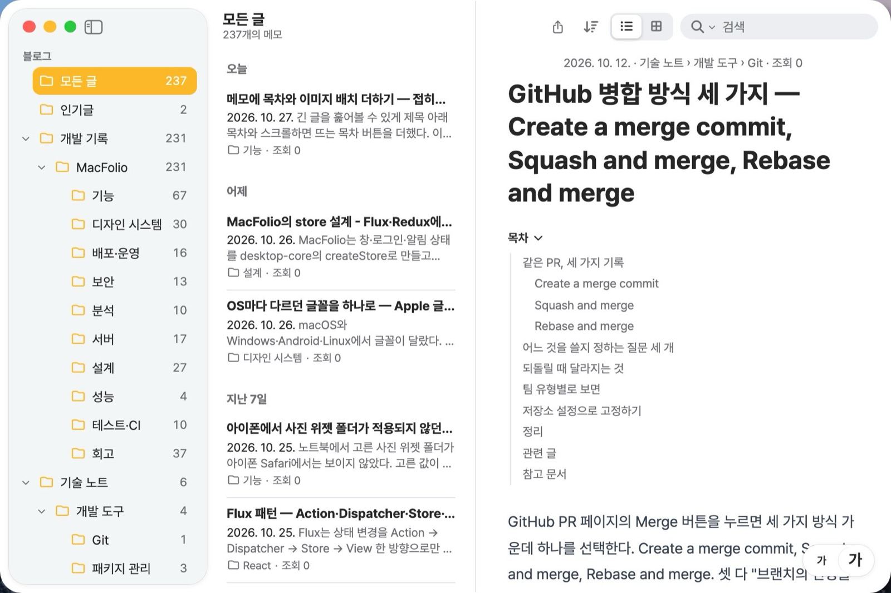

메모 글은 갈수록 길어졌다. 2026-10-27 기준 저장소 글 238편의 맨 위 단계 `##`·`###` 제목 수는 중앙값 9개, 최대 32개이고, 10개 이상인 글이 99편이다. 그런데 읽기 화면에는 목차가 없어서 원하는 절을 찾으려면 끝까지 스크롤해야 했다. 이미지도 본문 가운데에 한 줄씩만 놓을 수 있어, 세로로 긴 캡처 옆에 설명을 둘 방법이 없었다. 이 글은 두 기능을 더한 과정이다([#391](https://github.com/hyeoniverse/MacFolio/pull/391)). 10월 27일 목차를 여는 방식과 모양을 바꾸고 편집 화면에도 목차를 더했다. 바뀐 내용은 아래 '여는 방식과 편집 화면' 절에 정리했다.

| 기능          | 표기·동작                                                        | 쓰는 곳                               |
| ------------- | ---------------------------------------------------------------- | ------------------------------------- |
| 목차          | 본문의 `##`·`###` 제목으로 자동 생성, 제목 3개 이상일 때만       | 읽기 화면                             |
| 이미지 정렬   | ``, `#right` (가운데는 표기 없음)              | 읽기·편집 화면                        |
| 이미지 띄우기 | `#float-left`, `#float-right`: 본문의 40% 폭, 문단이 옆으로 흐름 | 읽기·편집 화면 (휴대폰은 띄우지 않음) |

## 목차


### 두 곳에 둔 이유

목차는 글 제목 바로 아래에 둔다. 처음 글을 열었을 때 어떤 절이 있는지 보이고, 접기 단추(▸ 목차)로 감출 수 있다. 다만 이 목차는 본문과 함께 위로 지나가므로, 글 중간에서는 다시 볼 수 없다. 그래서 목차가 화면 위로 지나가면 읽기 칸 오른쪽 위에 목차 버튼(≡)을 띄운다. 누르면 같은 목록을 메뉴로 연다.

에 체크 표시가 있다')

| 위치              | 언제 보이나                                       | 지금 읽는 절 표시                                      |
| ----------------- | ------------------------------------------------- | ------------------------------------------------------ |
| 제목 아래 목차    | 늘 (휴대폰은 접힌 채 시작)                        | 왼쪽 노란 막대와 굵은 글자 (`aria-current="location"`) |
| 떠 있는 목차 버튼 | 제목 아래 목차가 화면 위로 지나간 뒤, 넓은 화면만 | 메뉴 항목의 체크 표시                                  |

- **본문 폭을 바꾸지 않는다:** 넓은 창에서 본문 옆에 목차 칸을 따로 두는 방법도 있었다. 하지만 그러면 본문 폭이 좁아져 편집 화면과 줄이 다르게 나뉜다. 편집 화면과 읽기 화면의 블록이 같은 자리에 놓이는지 확인하는 시험([메모 편집기 손보기](/memo/memo-editor-toggle-footnote))이 있을 만큼 두 화면을 맞춰 왔기 때문에, 본문 폭은 그대로 두었다. 떠 있는 버튼은 높이 0인 줄에 `position: sticky`로 붙여 본문을 밀지 않는다.
- **휴대폰:** 휴대폰 읽기 화면은 오른쪽 위에 공유·••• 버튼이 떠 있다. 목차 버튼이 그 위에 겹치므로 휴대폰에서는 떠 있는 버튼을 쓰지 않고, 제목 아래 목차를 접은 채 시작한다.
- **기준 3개:** 제목이 두 개 이하인 글은 한 화면 안에서 훑어볼 수 있어 목차가 본문보다 길어 보인다. 저장소 글은 모두 4개 이상이라, 이 기준은 관리자가 사이트에서 쓴 짧은 글에 쓰인다. 글마다 목차를 끄는 머리말 옵션은 아직 필요한 글이 없어 만들지 않았다.
- **접기 블록 안의 제목은 뺀다:** 본문의 맨 위 단계 제목(`:scope > h2, :scope > h3`)만 읽는다. 접힌 블록 안의 제목으로 스크롤하면 보이지 않는 곳으로 가기 때문이다.

### 누르면 그 제목으로, 주소는 그대로

항목을 누르면 그 제목을 읽기 칸 안에서 `scrollIntoView({ block: 'start' })`로 맨 위에 둔다. 주소의 `#`는 바꾸지 않는다. 글 주소가 `/memo/<글>`이고 주소 막대가 맨 앞 창을 따르는 구조라, 각주 이동과 같은 원칙을 따랐다([앱 안의 화면에 주소 붙이기](/memo/app-links)). 움직임 줄이기 설정(`prefers-reduced-motion`)이 켜져 있으면 부드러운 스크롤 없이 바로 이동한다. 이동한 뒤에는 그 제목에 초점을 옮겨, 키보드 사용자가 그 절부터 이어서 `Tab`으로 읽게 했다.

지금 읽는 절은 읽기 칸의 `scroll` 이벤트에서 계산한다. 칸 위에서 96px 내려온 선을 지난 마지막 제목이 지금 절이다(`activeHeading`, `toc.ts`). 스크롤마다 제목 위치를 재면 비용이 커서, `requestAnimationFrame`으로 한 프레임에 한 번만 잰다.

<details>
<summary>지금 읽는 절을 고르는 함수</summary>

```ts
/** tops: 제목마다 스크롤 영역 위에서 잰 거리 (본문 순서), offset: 기준선 */
export function activeHeading(tops: readonly number[], offset: number): number {
	let active = -1;
	for (let index = 0; index < tops.length; index++) {
		if (tops[index] <= offset) active = index;
		else break;
	}
	return active;
}
```

</details>

### 목차가 비어 있던 이유: ref가 붙는 순서

처음에는 목차 컴포넌트(`MemoToc`) 안의 `useLayoutEffect`에서 본문 ref로 제목을 읽었다. 그런데 화면에 목차가 나오지 않았다. 확인해 보니 본문에는 `h2`가 8개 있는데 목차가 읽은 제목은 0개였다.

원인은 React가 커밋하는 순서였다. layout 단계는 트리를 자식부터 거슬러 올라가며 진행하고, 형제는 앞에서부터 처리한다. 목차는 본문보다 앞에 그리는 형제라, 목차의 layout effect가 실행되는 시각에는 아직 본문 `div`의 ref가 연결되지 않았다(`body.current === null`). 부모(`ReaderBody`)의 layout effect는 자식이 모두 끝난 뒤에 실행되므로, 제목 읽기를 부모로 옮겨(`useTocHeadings`) 해결했다.


`useEffect`로 바꾸는 방법도 있었지만, 그러면 첫 화면을 그린 뒤에 목차가 끼어들어 본문이 한 번 아래로 밀린다. layout effect 안의 `setState`는 브라우저가 그리기 전에 처리되므로, 첫 화면부터 목차가 있는 상태로 그려진다.

## 이미지 정렬과 띄우기


### 표기: 이미지 주소의 # 조각

배치를 Markdown 어디에 적을지가 가장 큰 결정이었다. 조건은 세 가지였다.

1. 저장소 글은 GitHub에서도 읽힌다. 다른 뷰어에서 이미지가 깨지거나 표기가 글자로 드러나면 안 된다.
2. 편집기(Milkdown)로 고쳐 저장해도 그대로 남아야 한다.
3. 기존 캡션 표기(``)와 겹치면 안 된다.

| 후보                       | 예                                    | 결과                                                                                                                                                    |
| -------------------------- | ------------------------------------- | ------------------------------------------------------------------------------------------------------------------------------------------------------- |
| HTML `` | ``         | 제외. 메모는 안전을 위해 본문의 HTML을 그리지 않는다([글과 README가 스크립트가 되지 않는다는 것을 시험으로 고정하기](/memo/markdown-xss-tests))         |
| 속성 문법                  | `{.float-right}`         | 제외. CommonMark에 없는 문법이라 GitHub와 편집기에서 `{.float-right}`가 글자로 보인다                                                                   |
| 캡션 뒤에 덧붙이기         | `"캡션 \| float-right"`               | 제외. 캡션은 사람이 읽는 글이고, 캡션이 없는 이미지는 표기할 자리가 없다                                                                                |
| **주소의 # 조각**          | `` | **채택.** # 조각은 HTTP 요청에 포함되지 않아 GitHub·다른 뷰어에서도 이미지는 그대로 나오고 배치만 무시된다. 주소의 일부라 편집기는 손대지 않고 보관한다 |


표기를 읽고 쓰는 함수는 화면과 서버가 함께 쓰는 `desktop-core`에 두었다(`imageLayout.ts`). 배치가 아닌 # 조각(예: SVG 스프라이트의 `#star`)은 주소에 그대로 남긴다. 주소를 빌드된 파일 주소로 바꾸는 `resolveImageSrc`는 표기를 떼고 바꾸므로, 목록 미리 보기와 검색 로봇용 본문(`og:image`)에도 영향이 없다. 서버 글의 업로드 이미지(`/files/<id>#float-right`)도 업로드 id를 찾는 정규식(`/files/([\w-]{16})(?![\w-])`)이 `#` 앞에서 끝나 그대로 동작한다.

### 그리기: 40% 폭과 clear

| 배치                                       | 규칙                                                                                                                                                                                              |
| ------------------------------------------ | ------------------------------------------------------------------------------------------------------------------------------------------------------------------------------------------------- |
| `#left`·`#right`                           | 그림을 왼쪽·오른쪽 끝에 붙인다. 그림 틀(`.memo-figure-frame`)을 그림 폭(`fit-content`)으로 줄여 내려받기 버튼이 그림 모서리에 붙는다. 본문 폭보다 넓은 그림은 본문 폭에 맞추므로 정렬 차이가 없다 |
| `#float-left`·`#float-right`               | `float`, 폭은 본문의 40%. 반대쪽에 1.4em 여백                                                                                                                                                     |
| 제목·표·코드·접기·구분선, 띄우지 않은 그림 | `clear: both`. 띄운 이미지 아래에서 시작한다                                                                                                                                                      |
| 목록·인용                                  | `display: flow-root`. 띄운 이미지 옆의 남은 폭 안에 그려 글머리 기호가 이미지에 겹치지 않는다                                                                                                     |
| 본문 끝                                    | `::after`에서 `clear: both`. 짧은 글에서 띄운 이미지가 글 아래(좋아요·댓글)로 넘치지 않는다                                                                                                       |

규칙은 읽기 화면(`.memo-markdown`)과 편집 화면(`.memo-inline-editor .ProseMirror`)에 함께 건다. 두 화면이 같은 자리에 같은 모양으로 놓여야 한다는 원칙([Markdown 본문 스타일을 prose.css 하나로](/memo/markdown-prose-css))을 따랐다.

. 목차는 접힌 채 시작하고, 띄운 이미지는 띄우지 않고 본문 폭으로 보인다')

휴대폰과 좁은 창(메모 칸 700px 이하, 한 칸 보기)에서는 띄우지 않는다. 390px 폭의 40%는 약 140px이라, 그림도 옆 문단도 읽기 어렵다. 한 칸 보기 규칙이 이미 쓰는 `:where(.memo-shell[data-compact])` 아래에서 `float: none`, 폭은 본문 폭으로 되돌린다.

### 편집기: 배치 버튼 다섯 개

가 나타나고, 지금 배치가 눌린 상태로 보인다')

편집기에서 이미지를 고르거나 그림 위에 마우스를 올리면, 왼쪽 아래에 배치 버튼 다섯 개가 나온다. 오른쪽 위의 크게 보기·내려받기 버튼과 같은 반투명 모양이고, 띄운 좁은 이미지에서도 위쪽 버튼과 겹치지 않게 아래에 둔다. 누르면 이미지 노드의 `src`에서 # 조각만 바꾸고(`withImageLayout`), 가운데를 고르면 표기를 지운다. 이미지 노드가 주소를 그대로 보관하므로, 편집기 안에서 상대 경로를 빌드된 주소로 바꿨다 되돌리는 처리(`markdownImages.ts`)만 # 조각을 함께 옮기도록 고쳤다.

```md
<!-- 저장된 줄 -->


```

## 여는 방식과 편집 화면

처음 목차는 넓은 화면에서 펼친 채 시작했다. 제목이 32개인 글은 본문보다 목차가 먼저 한 화면을 차지했다. 또 관리자로 로그인해 글을 열면 편집 화면이라 목차와 글자 크기 버튼이 없었다. 여는 방식, 모양, 편집 화면 세 가지를 바꿨다([#394](https://github.com/hyeoniverse/MacFolio/pull/394)).

### 누르면 펼치고, 다시 누르면 접는다

목차는 `목차 ›` 한 줄로 접힌 채 시작한다. 상태는 펼침과 접힘 두 가지뿐이다.

| 입력                             | 데스크톱    | 휴대폰      |
| -------------------------------- | ----------- | ----------- |
| 클릭·탭, 키보드 Enter·Space      | 펼침 ↔ 접힘 | 펼침 ↔ 접힘 |
| Esc (목차 안에 초점이 있는 시각) | 접힘        | 접힘        |
| 마우스 올림                      | 동작 없음   | 해당 없음   |
| 떠 있는 목차 창(≡)에서 항목 고름 | 창을 닫음   | 창 없음     |

- **마우스 올림으로 열지 않는다:** 한 차례 마우스를 올리면 목록이 뜨는 방식을 만들었다가 뺐다. 본문을 읽으며 지나가는 마우스에도 목록이 떠서 글을 가렸고, 마우스·손가락에 따라 규칙이 달라져 휴대폰에서는 길게 누르기라는 별도 입력이 필요했다. 지금은 모든 입력에서 누르기 한 가지로 연다. 떠 있는 목차 버튼(≡)도 같다.
- **펼침 상태는 기억한다:** 제목 아래 목차를 펼쳐 두면 `macfolio:memo:toc-open`에 남겨 다음 글과 다음 방문에도 펼친 채 연다. 접으면 키를 지운다. 휴지통 앱의 '내 브라우저 데이터'에서 지울 수 있다. 떠 있는 목차 창은 글 중간에서 잠깐 여는 메뉴라 기억하지 않는다.
- **펼치면 본문을 민다:** 목록이 본문 위에 뜨지 않고 제목 아래에 자리를 차지한다. 열고 닫는 것은 사용자가 누른 결과라, 본문이 움직여도 읽던 자리가 예고 없이 흔들리지 않는다.



### 펼치고 접는 움직임

펼치면 높이가 0에서 목록 높이까지 늘고, 목록이 서서히 나타나며, 화살표가 ›에서 ⌄로 돈다. 높이는 `height: auto`로 전환할 수 없어서 `display: grid`의 `grid-template-rows`를 `0fr`에서 `1fr`로 바꾼다. 행 높이 `1fr`는 내용 높이로 정해지므로 목록 높이를 스크립트로 재지 않아도 된다. 안쪽 칸은 `min-height: 0`과 `overflow: hidden`이라 줄어드는 동안 넘치는 부분이 잘린다.


- **시간:** 높이는 `--duration`(280ms), 화살표와 접기의 불투명도는 `--duration-fast`(160ms)다. 곡선은 `--ease-out`이다. 모두 디자인 토큰이라 다른 창 움직임과 속도가 같다.
- **접힌 목록은 `visibility: hidden`:** 높이가 0이어도 안의 단추는 `Tab`으로 초점을 받는다. 그래서 접힌 뒤에는 `visibility: hidden`으로 감춘다. 다만 바로 감추면 줄어드는 동안 목록이 보이지 않으므로, `visibility` 전환에 `--duration`만큼 지연을 줘 높이가 다 줄어든 시각에 감춘다. 펼치기에서는 지연 없이 바로 보인다.
- **움직임 줄이기:** `prefers-reduced-motion: reduce`에서는 높이·불투명도·화살표 전환을 모두 끈다. 펼침과 접힘이 바로 바뀐다. 휴대폰 탭도 같은 CSS를 쓰므로 움직임이 같다.

### Apple 문서식 목록

처음에는 macOS 사이드바처럼 판·테두리·항목 수·핀 표시를 둔 상자로 그렸다. 본문 바로 위에 놓이는 목록치고 장식이 많아, Apple 개발자 문서의 'On This Page' 목록처럼 상자 없는 글자 목록으로 바꿨다.

| 부분         | 모양                                                                              |
| ------------ | --------------------------------------------------------------------------------- |
| '목차' 제목  | 작은 회색 굵은 글자(`--text-caption`, `--memo-muted`)와 ⌄ 화살표                  |
| 목록         | 상자·배경 없음. 왼쪽에 1px 세로선(`--memo-border`) 하나                           |
| 항목         | 작은 보조 글자색. `###` 제목은 한 단계 들여 쓴다. 마우스를 올리면 글자만 진해진다 |
| 지금 읽는 절 | 강조색(`--memo-accent`) 굵은 글자와, 세로선 위에 겹친 3px 강조색 막대             |
| 떠 있는 창   | 같은 목록에 바탕만 메뉴 재질(반투명 판과 `backdrop-filter`, 메뉴 그림자)          |
| 휴대폰       | 같은 모양에 줄 간격만 넓힌다(손가락으로 고르기 쉽게)                              |

색은 모두 메모 앱 변수(`--memo-*`)라 다크 모드에서 따로 규칙을 두지 않았다. 떠 있는 목차 창과 제목 아래 목차는 같은 목록 컴포넌트(`TocList`)를 써서 지금 읽는 절 표시가 같다.

이 강조색 글자와 왼쪽 막대로 표시된다')

. 탭해 펼친 목차. 데스크톱과 같은 목록에 줄 간격만 넓다')

### 편집 화면의 목차와 글자 크기

#391에서 편집 화면에 목차를 두지 않은 이유는 본문 폭이었다. 편집·읽기 화면이 블록을 같은 자리에 놓는지 확인하는 시험이 있어, 목차가 본문 옆 칸을 차지하면 줄바꿈이 달라진다. 목차를 본문 위에 두는 지금 방식은 본문 폭을 바꾸지 않으므로, 편집 화면에도 같은 자리(제목 아래)에 둘 수 있다. 그 시험은 본문 맨 위에서의 거리를 비교하므로 본문 위에 목차가 있어도 그대로 통과한다.

- **제목 읽기:** 편집 화면은 `.ProseMirror`의 맨 위 단계 제목을 읽는다. 편집기는 늦게 불러오고 입력할 때마다 제목이 바뀌므로, 편집기를 감싼 칸의 DOM 변화를 `MutationObserver`로 지켜보고 다시 읽는다. 제목을 새로 쓰면 목차에 바로 나온다.
- **이동:** 읽기 화면은 제목에 초점을 옮기지만, 편집기 안의 제목에 `tabindex`를 붙이면 편집기 문서가 바뀐다. 그래서 편집 화면에서는 제목으로 스크롤한 뒤 편집기에 초점을 주고 제목 맨 앞에 커서를 둔다.
- **글자 크기:** 읽기 화면은 판 전체에 CSS `zoom`을 준다. 편집 화면에서 같은 방식을 쓰면 표 손잡이·서식 막대처럼 화면 좌표로 자리를 잡는 편집 도구가 배율만큼 한 번 더 밀린다. 그래서 날짜 줄·제목·목차·`.ProseMirror`에만 `zoom`을 준다. 시험은 115%로 키운 편집기에서 첫 줄 왼쪽을 눌러 쓴 글자가 첫 단어 안에 들어가는지 확인한다.


## 시험

| 시험                                               | 확인하는 것                                                                                                                                                                                                                                                                                                                                                                                        |
| -------------------------------------------------- | -------------------------------------------------------------------------------------------------------------------------------------------------------------------------------------------------------------------------------------------------------------------------------------------------------------------------------------------------------------------------------------------------- |
| `imageLayout.test.ts` (단위)                       | 표기 읽기·쓰기, 가운데면 지우기, 배치가 아닌 # 조각 보존, 주소를 바꿀 때 표기 떼기                                                                                                                                                                                                                                                                                                                 |
| `toc.test.ts` (단위)                               | 제목 3개 기준, 지금 읽는 절 고르기                                                                                                                                                                                                                                                                                                                                                                 |
| `writer.test.ts` (단위)                            | 편집기 주소 변환에서 # 조각이 남는다                                                                                                                                                                                                                                                                                                                                                               |
| `memo-toc-image-layout.spec.ts` (E2E, 데스크톱)    | 목차 항목 = 본문 제목, 누르면 제목이 화면에 들어오고 초점을 받으며 주소는 그대로, 떠 있는 버튼 메뉴의 체크 = 지금 절, 제목 둘인 글은 목차 없음, 정렬 위치, 띄운 이미지 폭(본문의 40%)과 다음 문단 첫 줄 위치, 다음 제목이 이미지 아래, 편집기 버튼으로 바꾼 표기가 저장된 Markdown에 남음                                                                                                          |
| `mobile-memo-toc.spec.ts` (E2E, 아이폰·안드로이드) | 목차가 접힌 채 시작, 펼쳐 누르면 이동, 떠 있는 버튼 없음, 띄운 이미지가 본문 폭                                                                                                                                                                                                                                                                                                                    |
| 10월 27일 추가 (E2E)                               | 데스크톱: 접힌 채 시작, 마우스를 올려도 열리지 않음, 클릭으로 펼치고 접기, 다음 방문에도 펼침 유지, Enter·Esc, 떠 있는 목차 창도 클릭으로만 열고 Esc·항목 고름으로 닫기. 움직임: 높이가 0에서 시작해 중간 높이를 거쳐 늘고, 접으면 0과 hidden. 편집 화면: 목차 = 편집기 제목, 누르면 제목 맨 앞 커서, 새 제목 반영, 키운 글자에서 누른 자리에 입력. 휴대폰: 탭으로 펼치고 접기, 항목을 누르면 이동 |

띄운 이미지 옆으로 문단이 흐르는지는 다음 문단의 첫 줄 위치로 확인한다. `Range.getClientRects()`의 첫 사각형이 줄 하나라, 그 왼쪽 끝이 이미지의 오른쪽 끝보다 오른쪽에 있으면 옆으로 흐른 것이다.

## 관련 글

- [메모 편집기 손보기 — 토글 목록·각주, ~ 하나짜리 취소선, 사라지는 빈 폴더](/memo/memo-editor-toggle-footnote): 편집·읽기 화면이 같은 자리에 블록을 놓는지 확인하는 시험
- [Markdown 본문 스타일을 prose.css 하나로 — 텍스트 편집기에서 빠졌던 코드 색](/memo/markdown-prose-css): 읽기·편집 화면이 함께 쓰는 본문 스타일
- [휴대폰 메모 화면 개선 - iOS 메모처럼 플로팅 버튼과 좁은 표](/memo/memo-mobile): 한 칸 보기(`data-compact`) 규칙
- [앱 안의 화면에 주소 붙이기 - 글과 프로젝트 공유 링크](/memo/app-links): 주소의 #를 바꾸지 않는 이유

#MacFolio #메모앱 #React #CSS
