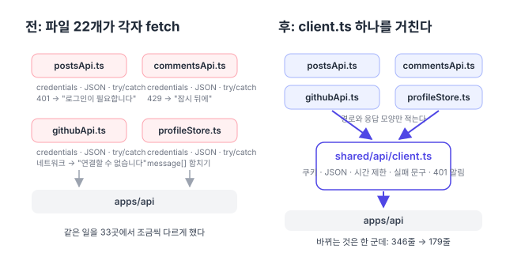
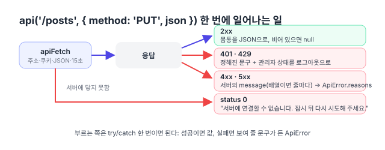

이 글은 리팩터링 계획([#150](https://github.com/hyeoniverse/MacFolio/issues/150)) 3단계 "공통 기반 코드"([리팩터링 3단계 - api() 요청 함수와 저장소·미디어 쿼리 공통 함수로 기반 코드 통합하기](/memo/refactor-step3-foundation))의 첫 항목을 처리한 기록이다.

## 분산되어 있던 코드

서버(apps/api)를 호출하는 파일을 집계하니 22개, `credentials: 'include'`가 33곳이었다. 각 호출은 짧지만, 같은 처리를 파일마다 조금씩 다르게 구현했다.

| 항목                | 파일마다 달랐던 구현                                                                                                         |
| ------------------- | ---------------------------------------------------------------------------------------------------------------------------- |
| 네트워크 실패 문구  | 4종: "서버에 연결할 수 없습니다.", "서버에 연결하지 못했습니다.", 각각 "…잠시 뒤 다시 시도해 주세요."가 붙은 것과 안 붙은 것 |
| 401 문구            | 2종: "관리자 로그인이 필요합니다.", "관리자 로그인이 끝났습니다. 다시 로그인해 주세요."                                      |
| 서버 `message` 처리 | 문자열과 배열을 파일마다 다르게 처리 (`join(' ')`, `[0]`, 배열 그대로)                                                       |
| 시간 제한           | 5초·10초·15초·20초, 시간 제한이 없는 호출도 다수                                                                             |
| 세션 만료 처리      | 글 저장이 401을 받아도 화면은 로그인 상태로 유지. 상태를 바꾸는 코드는 만료 시각 타이머뿐                                    |



## 검토한 방법

| 방법                                                                    | 장점                                 | 단점                                                                   |
| ----------------------------------------------------------------------- | ------------------------------------ | ---------------------------------------------------------------------- |
| axios·ky 같은 HTTP 라이브러리                                           | 인터셉터·시간 제한 기능 내장         | 의존성이 늘고, 실패 문구·오류 사유 배열 규칙은 결국 직접 작성해야 한다 |
| [TanStack Query](https://tanstack.com/query/latest) 같은 서버 상태 도구 | 캐시·재시도까지 처리                 | 22개 파일의 호출 방식이 모두 바뀐다. 이번 작업 범위를 크게 넘는다      |
| `fetch` 위에 얇은 함수 2개 (**채택**)                                   | 의존성 추가 없음, 이전 작업이 기계적 | 캐시 같은 기능은 없다(현재 필요 없음)                                  |

이번 목표는 "같은 처리를 같은 방식으로" 통일하는 것이었다. 호출 방식을 크게 바꾸는 도구 도입은 별도로 판단할 사항이라, `fetch` 위에 얇은 함수를 두는 방법을 채택했다.

## client.ts의 역할

`shared/api/client.ts`에 함수 두 개를 정의했다.

| 함수                      | 용도                                              | 실패 시                                       |
| ------------------------- | ------------------------------------------------- | --------------------------------------------- |
| `api<T>(path, options)`   | JSON 응답을 받는 호출 (대부분)                    | `ApiError` (status, reasons, 첫 줄이 message) |
| `apiFetch(path, options)` | 상태 코드로 분기하는 호출 (403은 "내 것 아님" 등) | 서버에 연결하지 못한 경우만 `ApiError(0)`     |

| 옵션       | 의미                                                  |
| ---------- | ----------------------------------------------------- |
| `method`   | HTTP 메서드                                           |
| `json`     | 본문을 JSON으로 직렬화하고 `Content-Type` 헤더를 추가 |
| `body`     | FormData를 그대로 전송                                |
| `timeout`  | 기본 15초, 0이면 시간 제한 없음                       |
| `fallback` | 서버가 오류 사유를 주지 않은 경우의 문구              |

주소는 `env.apiUrl`을 사용하고, 쿠키는 항상 함께 전송한다.



실패 문구는 상수 세 개로 정했다. `UNREACHABLE`(연결 실패), `SIGNED_OUT`(401), `TOO_MANY`(429). 서버가 검증 오류를 배열로 반환하면 `ApiError.reasons`에 항목별로 저장되고, 화면은 `reasonsFrom(error)`로 그대로 표시한다.

<details>
<summary>전후 코드 비교 (postsApi.ts)</summary>

```ts
// 전 (postsApi.ts)
async function reasons(response: Response): Promise<string[]> {
	if (response.status === 401) return ['관리자 로그인이 끝났습니다. 다시 로그인해 주세요.'];
	const body = (await response.json().catch(() => ({}))) as { message?: string | string[] };
	return Array.isArray(body.message) ? body.message : [body.message ?? '저장하지 못했습니다.'];
}
async function send(fetchImpl, url, method, body) {
	try {
		const response = await fetchImpl(url, { method, credentials: 'include', ...(body !== undefined && { headers: …, body: JSON.stringify(body) }) });
		if (!response.ok) return { ok: false, errors: await reasons(response) };
		const text = await response.text();
		return { ok: true, body: text ? JSON.parse(text) : null };
	} catch {
		return { ok: false, errors: ['서버에 연결할 수 없습니다.'] };
	}
}

// 후
async function send(fetchImpl, apiUrl, path, method, json) {
	try {
		return { ok: true, body: await api(path, { method, json, apiUrl, fetchImpl, fallback: '저장하지 못했습니다.' }) };
	} catch (error) {
		return { ok: false, errors: reasonsFrom(error) };
	}
}
```

</details>

## 401을 한 곳에서 처리

`onUnauthorized(handler)` 함수를 두고 `adminStore`가 핸들러를 등록한다. 어떤 요청이든 401을 받으면 `refreshAdmin()`을 호출해 `/auth/me`로 로그인 상태를 다시 조회하고, 화면이 로그아웃 상태로 전환된다. 이전에는 만료 시각 타이머만 있어서, 서버에서 세션을 삭제했거나 쿠키가 사라진 경우에는 저장이 실패한 뒤에도 관리자 메뉴가 그대로 표시됐다.

의존 방향은 `adminStore → client` 한 방향이다. client가 adminStore를 import하면 순환 의존이 생기므로, client는 등록된 핸들러 집합만 보관한다.


## 통합하지 않은 호출

| 호출                                              | 통합하지 않은 이유                                                                                                                                                               |
| ------------------------------------------------- | -------------------------------------------------------------------------------------------------------------------------------------------------------------------------------- |
| 날씨(Open-Meteo), 효과음 파일, 글 이미지 내려받기 | 자체 서버가 아니라 쿠키·실패 문구 규칙이 다르다                                                                                                                                  |
| `/health` 확인(`serverStatus.ts`)                 | CORS 차단과 서버 중지를 구분하려고 `no-cors`로 한 번 더 요청하는 별도 흐름 ([메뉴 막대 5 - no-cors 요청으로 CORS 차단과 서버 중지 구분하기](/memo/server-status-blocked-origin)) |
| 분석 이벤트 전송                                  | [`sendBeacon`](https://developer.mozilla.org/en-US/docs/Web/API/Navigator/sendBeacon)이 우선이고 fetch는 `keepalive` 대안이라, 클라이언트에 넣으면 오히려 복잡해진다             |

시험이 주입하던 `fetchImpl` 인자는 모듈 시그니처를 유지하고 옵션으로 전달한다. 이제 `signal`·`headers`가 항상 붙으므로, 시험 쪽은 요청 형태를 `objectContaining`으로 부분 일치 검사하도록 바꿨다.

## 수치

| 항목                         | 전  | 후  |
| ---------------------------- | --- | --- |
| `credentials: 'include'`     | 33  | 3   |
| 서버를 직접 `fetch`하는 파일 | 22  | 3   |
| 바뀐 파일의 줄 수            | 346 | 179 |
| 네트워크 실패 문구 종류      | 4   | 1   |

변경된 파일은 34개(583줄 추가, 346줄 삭제)였다. 추가된 줄의 대부분은 새 `client.ts`(111줄)와 그 시험이다. 위 표의 "346 → 179"는 이전한 `*Api.ts` 파일들의 줄 수만 집계한 값이다.

## 확인

`apps/react/src/shared/api/client.test.ts`에 시험 10개를 작성했다. 가짜 `fetch`를 주입해 요청 형태와 응답 처리를 확인한다.

<details>
<summary>시험 10개 목록</summary>

- 요청: "기본 주소 뒤에 경로를 붙이고 쿠키를 함께 보낸다", "json을 주면 JSON 머리말과 함께 보낸다", "body(FormData)는 그대로, timeout 0이면 signal 없이 보낸다"
- 실패: "주소가 없거나 서버에 닿지 못하면 ApiError(0)", "401을 받으면 등록한 핸들러를 부른다", "실패하면 서버가 준 이유를 담은 ApiError", "이유가 없으면 fallback", "서버가 적은 이유가 먼저, 없으면 401·429는 정해진 문구"
- 응답: "JSON을 돌려주고, 몸통이 비어 있으면 null"
- 화면용: `reasonsFrom` — "Error의 message, 아니면 fallback"

</details>

이전한 앱들의 기존 시험과 E2E는 요청 형태 검사를 부분 일치로 바꾼 것 외에는 수정 없이 통과했다.

## 정리

- 실패 문구가 4종이었던 것은 호출마다 문구를 새로 작성했기 때문이다. 같은 처리를 하는 코드가 22곳에 분산되면 구현 차이는 자연히 생긴다. 한 곳으로 통합하면 차이가 사라진다.
- 세션 만료를 타이머 하나로만 판단한 것은 실제 버그였다. "401 응답 수신"이 가장 확실한 만료 신호다.
- 순환 의존을 피하려고 핸들러 등록 방식을 사용했다. 하위 모듈이 상위 모듈의 동작을 호출해야 할 때는 상위 모듈에서 함수를 전달받는다.
- 자체 서버가 아닌 호출(Open-Meteo 등)은 통합하지 않았다. 규칙이 다른 호출을 한 함수에 넣으면 옵션만 늘어난다.

같은 단계의 다음 작업은 `localStorage` 접근 통일([공통 모듈 2 - readJson·writeJson으로 브라우저 저장소 예외 처리를 한 곳에 모으기](/memo/shared-storage))과 화면 크기 판단(`useIsMobile`·`useViewport`) 통일([공통 모듈 3 - matchMedia·innerWidth 직접 조회를 media.ts와 getViewport()로 모으기](/memo/shared-media))이다.

## 사용 방법

서버를 새로 호출할 때는 `fetch`를 직접 쓰지 않고 [apps/react/src/shared/api/client.ts](https://github.com/hyeoniverse/MacFolio/blob/main/apps/react/src/shared/api/client.ts)를 사용한다. 쿠키, JSON 헤더, 오류 형태, 401 처리가 한 곳에 있다. 시험은 [apps/react/src/shared/api/client.test.ts](https://github.com/hyeoniverse/MacFolio/blob/main/apps/react/src/shared/api/client.test.ts).

```bash
cd apps/react && npx vitest run src/shared/api
grep -rn "fetch(" src --include=*.ts --include=*.tsx | grep -v shared/api   # 새로 생긴 직접 호출이 없는지
```

참고 문서: [MDN Fetch API](https://developer.mozilla.org/en-US/docs/Web/API/Fetch_API), [credentials 옵션](https://developer.mozilla.org/en-US/docs/Web/API/RequestInit#credentials).

## 관련 글

- [공통 모듈 2 - readJson·writeJson으로 브라우저 저장소 예외 처리를 한 곳에 모으기](/memo/shared-storage): 이어서 localStorage 접근을 통합한 작업
- [공통 모듈 3 - matchMedia·innerWidth 직접 조회를 media.ts와 getViewport()로 모으기](/memo/shared-media)
- [리팩터링 3단계 - api() 요청 함수와 저장소·미디어 쿼리 공통 함수로 기반 코드 통합하기](/memo/refactor-step3-foundation)
- [contracts 스키마 2 - ZodType<PostContent>로 기존 타입과 zod 스키마의 일치를 tsc로 검사하기](/memo/contracts-posts)
- [메뉴 막대 5 - no-cors 요청으로 CORS 차단과 서버 중지 구분하기](/memo/server-status-blocked-origin)

PR: [#196](https://github.com/hyeoniverse/MacFolio/pull/196)

#MacFolio #리팩터링 #React #fetch
