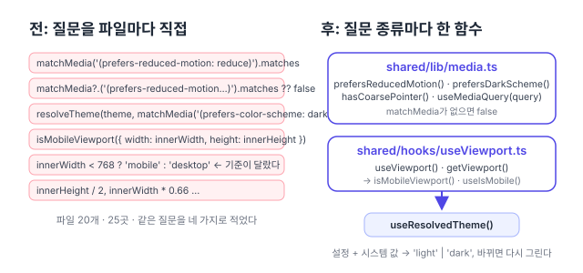

이 글은 리팩터링 계획([#150](https://github.com/hyeoniverse/MacFolio/issues/150)) 3단계의 마지막 항목을 처리한 기록이다. 앞의 두 항목은 [공통 API 클라이언트](/memo/shared-api-client)와 [브라우저 저장소](/memo/shared-storage)였다.

## 분산되어 있던 코드

`useIsMobile`·`useViewport` 훅이 이미 있었지만 [`window.matchMedia`](https://developer.mozilla.org/en-US/docs/Web/API/Window/matchMedia)·`innerWidth`를 직접 사용하는 곳이 25곳이었다. 집계해 보니 조회 종류는 네 가지뿐이다.

| 조회 대상        | 위치 수 | 작성 형태                                                                                        |
| ---------------- | ------- | ------------------------------------------------------------------------------------------------ |
| 움직임 줄이기    | 9       | `matchMedia('…').matches`, `matchMedia?.('…').matches ?? false`, 파일마다 다른 상수 이름         |
| 어두운 화면 모드 | 5       | `resolveTheme(theme, matchMedia('(prefers-color-scheme: dark)').matches)`를 세 컴포넌트가 똑같이 |
| 모바일 화면인가  | 4       | `isMobileViewport({ width: innerWidth, height: innerHeight })` 셋, `innerWidth < 768` 하나       |
| 창 크기 숫자     | 7       | 팝오버 위치, 스크롤 연출의 기준선, 앱 전환 카드 간격                                             |

문제는 두 가지였다.

1. **`matchMedia` 부재 처리 불일치**: 움직임 줄이기 조회에 `?.`를 쓴 곳과 쓰지 않은 곳이 섞여 있었다. `matchMedia`가 없는 환경(시험, 구형 브라우저)에서 한쪽은 false를 반환하고 다른 쪽은 예외가 발생한다.
2. **모바일 기준 불일치**: 분석 이벤트의 `device`가 `innerWidth < 768`로 별도 판정되어, 가로 방향 휴대폰(너비는 넓고 높이는 낮은 화면)이 셸에서는 모바일인데 통계에서는 데스크톱으로 집계됐다.




## 검토한 방법

| 방법                                       | 장점                                   | 단점                                                            |
| ------------------------------------------ | -------------------------------------- | --------------------------------------------------------------- |
| 현재 코드를 유지하고 `?.`만 통일           | 변경 범위가 작다                       | 쿼리 문자열이 여전히 20곳에 분산된다                            |
| 모든 조회를 훅 하나(`useMedia`)로          | React 관례에 맞는 형태                 | 이벤트 처리기·스토어 초기화처럼 훅을 쓸 수 없는 위치가 절반이다 |
| 이름 붙인 함수 + 훅 + 구독 함수 (**채택**) | 어느 위치에서나 같은 이름으로 조회한다 | 함수 수가 조금 늘어난다                                         |

훅을 쓸 수 없는 위치가 많아서 세 번째 방법을 채택했다. 세 함수가 같은 쿼리 상수를 사용한다.

| 함수                       | 사용 위치                    | 동작                        |
| -------------------------- | ---------------------------- | --------------------------- |
| `mediaMatches(query)`      | 이벤트 처리기 등 일회성 조회 | 현재 일치 여부를 한 번 반환 |
| `useMediaQuery(query)`     | 컴포넌트 렌더링              | 값이 바뀌면 다시 렌더링     |
| `onMediaChange(query, cb)` | 스토어                       | 값이 바뀌면 콜백 호출       |

## 두 모듈

**`shared/lib/media.ts`**: `matchMedia` 조회를 이름 붙인 함수로 제공한다. `prefersReducedMotion()`, `prefersDarkScheme()`, `hasCoarsePointer()`. 값의 변경을 추적해야 하면 `useMediaQuery(query)`(렌더링)나 `onMediaChange(query, cb)`(스토어)를 사용한다. `matchMedia`가 없으면 모두 false를 반환하므로 호출하는 쪽에 `?.`가 필요 없다.

```ts
const queryOf = (query: string): MediaQueryList | null =>
	typeof window !== 'undefined' && typeof window.matchMedia === 'function' ? window.matchMedia(query) : null;

/** 지금 맞는지 한 번 묻는다 */
export const mediaMatches = (query: string): boolean => queryOf(query)?.matches ?? false;

/** 맞는지를 상태로. 바뀌면 다시 렌더링한다 */
export function useMediaQuery(query: string): boolean {
	return useSyncExternalStore(
		(onChange) => onMediaChange(query, onChange),
		() => mediaMatches(query),
		() => false
	);
}
```

[`useSyncExternalStore`](https://react.dev/reference/react/useSyncExternalStore)를 사용하면 구독과 값 읽기의 동기화를 React가 처리한다. `useEffect` 안에서 `addEventListener`를 호출하고 `useState`에 저장하는 방식보다 코드가 짧고, 첫 렌더링부터 올바른 값을 사용한다.

**`shared/hooks/useViewport.ts`**: 훅만 있던 모듈에 `getViewport()`를 추가했다. 이벤트 처리나 스토어 초기화처럼 훅을 쓸 수 없는 위치에서 사용한다. 모바일 여부는 이전과 같이 `isMobileViewport(getViewport())` 한 줄이고, 분석 이벤트도 이 기준을 사용한다.

```ts
// 전 (Finder.tsx, Github.tsx, MobileShell.tsx가 똑같이)
const { theme } = useSettings();
const dark = resolveTheme(theme, window.matchMedia('(prefers-color-scheme: dark)').matches) === 'dark';

// 후
const dark = useResolvedTheme() === 'dark';
```

`useResolvedTheme()`는 `settingsStore`에 정의했다. 설정의 테마와 시스템의 어두운 모드를 조합해 `'light' | 'dark'`를 반환하고, 둘 중 하나가 바뀌면 다시 렌더링한다. 이전에는 시스템 모드가 바뀌어도 `<html data-theme>`만 갱신되고, 이 세 컴포넌트는 다음 렌더링까지 이전 값을 유지했다.

## 이전하지 않은 위치

`WebFrame`이 iframe 내부 문서의 `view.innerWidth`를 읽는 한 곳은 그대로 두었다. 사이트의 창이 아니라 iframe의 창이라 `getViewport()`로 조회할 수 없다.

## 수치

| 항목                                       | 전  | 후                                     |
| ------------------------------------------ | --- | -------------------------------------- |
| `matchMedia`·`innerWidth`를 직접 쓰는 파일 | 20  | 3 (media.ts, useViewport.ts, WebFrame) |
| 움직임 줄이기 질문의 표기                  | 4   | 1                                      |
| 모바일 판단 기준                           | 2   | 1                                      |

변경된 파일은 27개(242줄 추가, 53줄 삭제)다. `media.test.ts`에 시험 3개를 작성했다: "matchMedia가 없으면 모두 false", "질문마다 지금 값을 돌려준다", "바뀌면 알리고, 돌려준 함수로 그만둔다".

## 남은 과제와 정리

- **새 코드가 다시 직접 조회한다.** 이 글을 작성하며 다시 검색하니, 이후 추가된 파일 4개가 다시 직접 조회하고 있었다. 메모의 링크·목차 이동 두 곳이 `matchMedia('(prefers-reduced-motion: reduce)')`를, 슬라이드 보기와 바탕화면 아이콘이 `innerWidth`를 사용한다. 공통 모듈을 만들어도 새 코드가 그 모듈을 쓰도록 강제하는 장치(린트 규칙 등)가 없으면 다시 분산된다. ESLint [`no-restricted-properties`](https://eslint.org/docs/latest/rules/no-restricted-properties)로 `window.matchMedia`를 금지하는 규칙이 다음 후보다.
- **같은 조회의 표기가 여러 개면 그중 하나는 잘못되어 있다.** 이번에는 `?.`가 없는 위치와 모바일 기준이 다른 분석 코드가 해당했다.
- **훅만 있는 모듈은 불완전하다.** 이벤트 처리기와 스토어에서도 같은 조회를 하므로, 훅과 함께 일반 함수를 제공한다.

<details>
<summary>2026-10-23 기준 main에서 직접 조회하는 파일</summary>

`grep -rln "matchMedia\|innerWidth" apps/react/src`(시험·글 제외)의 결과다. 공통 모듈 2개와 `WebFrame` 외에 7개 파일이 직접 조회한다. 린트 규칙은 아직 추가하지 않았다.

| 파일                                    | 구분             |
| --------------------------------------- | ---------------- |
| `shared/lib/media.ts`                   | 공통 모듈        |
| `shared/hooks/useViewport.ts`           | 공통 모듈        |
| `shared/ui/web-frame/WebFrame.tsx`      | iframe 창 (예외) |
| `apps/memo/components/MarkdownLink.tsx` | 직접 조회        |
| `apps/memo/writer/anchors.ts`           | 직접 조회        |
| `apps/preview/Slideshow.tsx`            | 직접 조회        |
| `desktop/icons/DesktopIcons.tsx`        | 직접 조회        |
| `desktop/widgets/DesktopWidgets.tsx`    | 직접 조회        |
| `desktop/tour/Tour.tsx`                 | 직접 조회        |
| `desktop/tour/firstVisit.ts`            | 직접 조회        |

</details>

이로써 3단계(공통 기반 코드)를 마쳤다. 다음 작업은 1단계, API 요청·응답 타입을 zod 스키마로 통합하는 일이다.

## 사용 방법

화면 조건 조회는 [apps/react/src/shared/lib/media.ts](https://github.com/hyeoniverse/MacFolio/blob/main/apps/react/src/shared/lib/media.ts)(일회성 조회)와 [apps/react/src/shared/hooks/useViewport.ts](https://github.com/hyeoniverse/MacFolio/blob/main/apps/react/src/shared/hooks/useViewport.ts)(변경 시 다시 렌더링)를 사용한다. `matchMedia`를 직접 호출하는 새 코드가 없는지는 다음 명령으로 확인한다.

```bash
cd apps/react
grep -rn "matchMedia" src | grep -v "shared/lib/media\|shared/hooks/useViewport\|\.test\."
npx vitest run src/shared/lib/media.test.ts
```

브라우저에서는 개발자 도구의 Rendering 탭에서 `prefers-reduced-motion`, `prefers-color-scheme` 값을 바꿔 확인한다.

참고 문서: [MDN matchMedia](https://developer.mozilla.org/en-US/docs/Web/API/Window/matchMedia), [Chrome DevTools 미디어 기능 에뮬레이션](https://developer.chrome.com/docs/devtools/rendering/emulate-css), [React useSyncExternalStore](https://react.dev/reference/react/useSyncExternalStore).

## 관련 글

- [fetch 33곳을 client.ts 하나로 — 공통 API 클라이언트](/memo/shared-api-client): 3단계 첫 항목
- [try/catch 열두 개를 하나로 — 브라우저 저장소 모듈](/memo/shared-storage): 3단계 두 번째 항목
- [리팩터링 3단계 — 공통 기반 코드](/memo/refactor-step3-foundation)

PR: [#199](https://github.com/hyeoniverse/MacFolio/pull/199)

#MacFolio #리팩터링 #React #matchMedia
