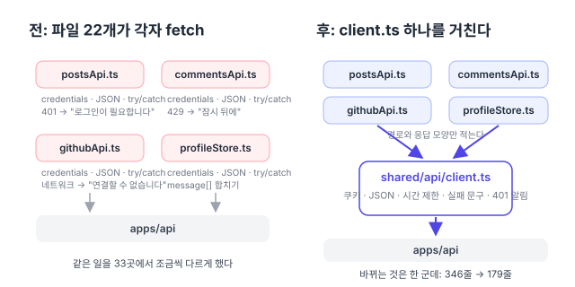
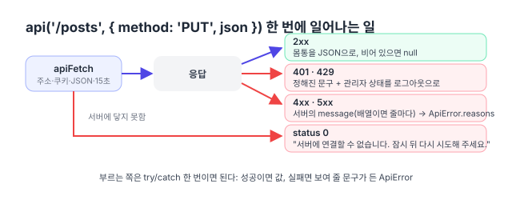
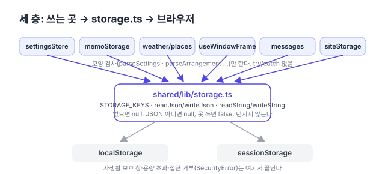
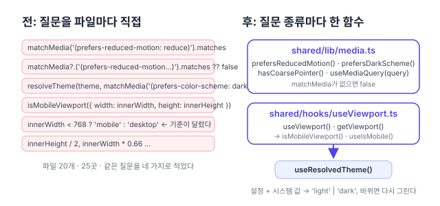

이 글은 리팩터링 계획([#150](https://github.com/hyeoniverse/MacFolio/issues/150)) 3단계 "공통 기반 코드"([api() 요청 함수와 저장소·미디어 쿼리 공통 함수로 기반 코드 통합하기](/memo/refactor-retrospective#3단계-공통-기반-코드))의 세 항목을 처리한 기록이다. 세 항목은 대상이 다르지만 구조가 같다.

| 항목            | 분산되어 있던 코드                                  | 통합한 모듈                             | PR                                                       |
| --------------- | --------------------------------------------------- | --------------------------------------- | -------------------------------------------------------- |
| 서버 호출       | `fetch`를 직접 호출하는 파일 22개                   | `shared/api/client.ts`                  | [#196](https://github.com/hyeoniverse/MacFolio/pull/196) |
| 브라우저 저장소 | `localStorage`를 직접 다루는 파일 7개               | `shared/lib/storage.ts`                 | [#198](https://github.com/hyeoniverse/MacFolio/pull/198) |
| 화면 조건 조회  | `matchMedia`·`innerWidth`를 직접 조회하는 위치 25곳 | `shared/lib/media.ts`, `useViewport.ts` | [#199](https://github.com/hyeoniverse/MacFolio/pull/199) |

세 경우 모두 같은 처리를 파일마다 조금씩 다르게 구현해 차이가 생겼고, 그 차이 중 일부는 실제 버그였다. 세 경우 모두 외부 라이브러리 대신 기존 API 위에 얇은 함수를 두는 방법을 채택했다.

## 서버 호출: api()·apiFetch()

### 파일마다 달랐던 fetch 처리

서버(apps/api)를 호출하는 파일을 집계하니 22개, `credentials: 'include'`가 33곳이었다. 각 호출은 짧지만, 같은 처리를 파일마다 조금씩 다르게 구현했다.

| 항목                | 파일마다 달랐던 구현                                                                                                         |
| ------------------- | ---------------------------------------------------------------------------------------------------------------------------- |
| 네트워크 실패 문구  | 4종: "서버에 연결할 수 없습니다.", "서버에 연결하지 못했습니다.", 각각 "…잠시 뒤 다시 시도해 주세요."가 붙은 것과 안 붙은 것 |
| 401 문구            | 2종: "관리자 로그인이 필요합니다.", "관리자 로그인이 끝났습니다. 다시 로그인해 주세요."                                      |
| 서버 `message` 처리 | 문자열과 배열을 파일마다 다르게 처리 (`join(' ')`, `[0]`, 배열 그대로)                                                       |
| 시간 제한           | 5초·10초·15초·20초, 시간 제한이 없는 호출도 다수                                                                             |
| 세션 만료 처리      | 글 저장이 401을 받아도 화면은 로그인 상태로 유지. 상태를 바꾸는 코드는 만료 시각 타이머뿐                                    |



### HTTP 라이브러리 대신 fetch 위의 얇은 함수

| 방법                                                                    | 장점                                 | 단점                                                                   |
| ----------------------------------------------------------------------- | ------------------------------------ | ---------------------------------------------------------------------- |
| axios·ky 같은 HTTP 라이브러리                                           | 인터셉터·시간 제한 기능 내장         | 의존성이 늘고, 실패 문구·오류 사유 배열 규칙은 결국 직접 작성해야 한다 |
| [TanStack Query](https://tanstack.com/query/latest) 같은 서버 상태 도구 | 캐시·재시도까지 처리                 | 22개 파일의 호출 방식이 모두 바뀐다. 이번 작업 범위를 크게 넘는다      |
| `fetch` 위에 얇은 함수 2개 (**채택**)                                   | 의존성 추가 없음, 이전 작업이 기계적 | 캐시 같은 기능은 없다(현재 필요 없음)                                  |

이번 목표는 "같은 처리를 같은 방식으로" 통일하는 것이었다. 호출 방식을 크게 바꾸는 도구 도입은 별도로 판단할 사항이라, `fetch` 위에 얇은 함수를 두는 방법을 채택했다.

### client.ts의 함수와 옵션

`shared/api/client.ts`에 함수 두 개를 정의했다.

| 함수                      | 용도                                              | 실패 시                                       |
| ------------------------- | ------------------------------------------------- | --------------------------------------------- |
| `api<T>(path, options)`   | JSON 응답을 받는 호출 (대부분)                    | `ApiError` (status, reasons, 첫 줄이 message) |
| `apiFetch(path, options)` | 상태 코드로 분기하는 호출 (403은 "내 것 아님" 등) | 서버에 연결하지 못한 경우만 `ApiError(0)`     |

| 옵션       | 의미                                                  |
| ---------- | ----------------------------------------------------- |
| `method`   | HTTP 메서드                                           |
| `json`     | 본문을 JSON으로 직렬화하고 `Content-Type` 헤더를 추가 |
| `body`     | FormData를 그대로 전송                                |
| `timeout`  | 기본 15초, 0이면 시간 제한 없음                       |
| `fallback` | 서버가 오류 사유를 주지 않은 경우의 문구              |

주소는 `env.apiUrl`을 사용하고, 쿠키는 항상 함께 전송한다.



실패 문구는 상수 세 개로 정했다. `UNREACHABLE`(연결 실패), `SIGNED_OUT`(401), `TOO_MANY`(429). 서버가 검증 오류를 배열로 반환하면 `ApiError.reasons`에 항목별로 저장되고, 화면은 `reasonsFrom(error)`로 그대로 표시한다.

<details>
<summary>전후 코드 비교 (postsApi.ts)</summary>

```ts
// 전 (postsApi.ts)
async function reasons(response: Response): Promise<string[]> {
	if (response.status === 401) return ['관리자 로그인이 끝났습니다. 다시 로그인해 주세요.'];
	const body = (await response.json().catch(() => ({}))) as { message?: string | string[] };
	return Array.isArray(body.message) ? body.message : [body.message ?? '저장하지 못했습니다.'];
}
async function send(fetchImpl, url, method, body) {
	try {
		const response = await fetchImpl(url, { method, credentials: 'include', ...(body !== undefined && { headers: …, body: JSON.stringify(body) }) });
		if (!response.ok) return { ok: false, errors: await reasons(response) };
		const text = await response.text();
		return { ok: true, body: text ? JSON.parse(text) : null };
	} catch {
		return { ok: false, errors: ['서버에 연결할 수 없습니다.'] };
	}
}

// 후
async function send(fetchImpl, apiUrl, path, method, json) {
	try {
		return { ok: true, body: await api(path, { method, json, apiUrl, fetchImpl, fallback: '저장하지 못했습니다.' }) };
	} catch (error) {
		return { ok: false, errors: reasonsFrom(error) };
	}
}
```

</details>

### 401 응답을 받으면 로그아웃 상태로 전환

`onUnauthorized(handler)` 함수를 두고 `adminStore`가 핸들러를 등록한다. 어떤 요청이든 401을 받으면 `refreshAdmin()`을 호출해 `/auth/me`로 로그인 상태를 다시 조회하고, 화면이 로그아웃 상태로 전환된다. 이전에는 만료 시각 타이머만 있어서, 서버에서 세션을 삭제했거나 쿠키가 사라진 경우에는 저장이 실패한 뒤에도 관리자 메뉴가 그대로 표시됐다. 세션 만료를 타이머 하나로만 판단한 것은 실제 버그였고, =="401 응답 수신"이 가장 확실한 만료 신호==다.

의존 방향은 `adminStore → client` 한 방향이다. client가 adminStore를 import하면 순환 의존이 생기므로, client는 등록된 핸들러 집합만 보관한다. 하위 모듈이 상위 모듈의 동작을 호출해야 하는 경우 상위 모듈에서 함수를 전달받는 방식이다.


### client.ts로 통합하지 않은 호출

| 호출                                              | 통합하지 않은 이유                                                                                                                                                                                   |
| ------------------------------------------------- | ---------------------------------------------------------------------------------------------------------------------------------------------------------------------------------------------------- |
| 날씨(Open-Meteo), 효과음 파일, 글 이미지 내려받기 | 자체 서버가 아니라 쿠키·실패 문구 규칙이 다르다                                                                                                                                                      |
| `/health` 확인(`serverStatus.ts`)                 | CORS 차단과 서버 중지를 구분하려고 `no-cors`로 한 번 더 요청하는 별도 흐름 ([no-cors 요청으로 CORS 차단과 서버 중지 구분하기](/memo/server-status-wifi#no-cors-요청으로-cors-차단과-서버-중지-구분)) |
| 분석 이벤트 전송                                  | [`sendBeacon`](https://developer.mozilla.org/en-US/docs/Web/API/Navigator/sendBeacon)이 우선이고 fetch는 `keepalive` 대안이라, 클라이언트에 넣으면 오히려 복잡해진다                                 |

규칙이 다른 호출을 한 함수에 넣으면 옵션만 늘어난다. 시험이 주입하던 `fetchImpl` 인자는 모듈 시그니처를 유지하고 옵션으로 전달한다. 이제 `signal`·`headers`가 항상 붙으므로, 시험 쪽은 요청 형태를 `objectContaining`으로 부분 일치 검사하도록 바꿨다.

### client.ts 시험과 수치

`apps/react/src/shared/api/client.test.ts`에 시험 10개를 작성했다. 가짜 `fetch`를 주입해 요청 형태와 응답 처리를 확인한다.

<details>
<summary>시험 10개 목록</summary>

- 요청: "기본 주소 뒤에 경로를 붙이고 쿠키를 함께 보낸다", "json을 주면 JSON 머리말과 함께 보낸다", "body(FormData)는 그대로, timeout 0이면 signal 없이 보낸다"
- 실패: "주소가 없거나 서버에 닿지 못하면 ApiError(0)", "401을 받으면 등록한 핸들러를 부른다", "실패하면 서버가 준 이유를 담은 ApiError", "이유가 없으면 fallback", "서버가 적은 이유가 먼저, 없으면 401·429는 정해진 문구"
- 응답: "JSON을 돌려주고, 몸통이 비어 있으면 null"
- 화면용: `reasonsFrom`: "Error의 message, 아니면 fallback"

</details>

이전한 앱들의 기존 시험과 E2E는 요청 형태 검사를 부분 일치로 바꾼 것 외에는 수정 없이 통과했다.

| 항목                         | 전  | 후  |
| ---------------------------- | --- | --- |
| `credentials: 'include'`     | 33  | 3   |
| 서버를 직접 `fetch`하는 파일 | 22  | 3   |
| 바뀐 파일의 줄 수            | 346 | 179 |
| 네트워크 실패 문구 종류      | 4   | 1   |

변경된 파일은 34개(583줄 추가, 346줄 삭제)였다. 추가된 줄의 대부분은 새 `client.ts`(111줄)와 그 시험이다. 위 표의 "346 → 179"는 이전한 `*Api.ts` 파일들의 줄 수만 집계한 값이다.

## 브라우저 저장소: readJson·writeJson

### 파일마다 반복되던 try/catch

브라우저에 저장하는 값은 일곱 가지다.

1. 설정
2. 메모 보기 설정
3. 메모 최근 검색어
4. 날씨 장소와 단위
5. 창 위치
6. 서버 없이 작성한 메시지
7. 로그인 페이지로 이동하는 시각에 열려 있던 앱

이 값을 다루는 파일 7개가 모두 같은 다섯 줄을 포함하고 있었다.

```ts
try {
	return JSON.parse(localStorage.getItem(KEY) ?? 'null');
} catch {
	return null;
}
```

쓰기 쪽도 마찬가지로 `try { localStorage.setItem(…) } catch { /* 저장하지 못해도 … */ }`가 파일마다 있었다. try/catch는 모두 12개였다. 주석도 "저장하지 못해도 이번에는 그대로 보인다"는 같은 내용이 여섯 가지 표현으로 작성되어 있었다.

> [!WARNING] 브라우저 저장소가 던지는 예외
> try/catch가 필요한 이유는 브라우저 저장소가 예외를 던질 수 있기 때문이다. Safari의 개인정보 보호 창은 `localStorage.setItem`에서 `QuotaExceededError`를 던지고, 일부 설정에서는 `localStorage`에 접근하는 즉시 `SecurityError`가 발생한다([MDN `Window.localStorage` 예외](https://developer.mozilla.org/en-US/docs/Web/API/Window/localStorage#exceptions)). 그래서 저장은 항상 "성공하면 반영하고, 실패해도 화면은 그대로 동작"해야 한다. 이 규칙이 한 곳에 없어서, 새 키를 추가할 때마다 다섯 줄을 다시 복사했다. 12곳에 분산된 try/catch는 어느 것도 시험되지 않았다.




### persist 미들웨어·IndexedDB 대신 동기 localStorage

| 방법                                             | 장점                                 | 단점                                                                  |
| ------------------------------------------------ | ------------------------------------ | --------------------------------------------------------------------- |
| 상태 관리 도구의 저장 기능(예: persist 미들웨어) | 상태와 저장이 함께 관리된다          | 이 사이트는 자체 `createStore`를 쓴다. 상태 관리 도구 교체가 필요하다 |
| IndexedDB 래퍼(idb-keyval 등)                    | 큰 값 저장, 비동기 처리              | 현재 값은 모두 작다. 첫 화면 렌더링 전에 동기로 읽어야 한다           |
| 동기 `localStorage` 위에 얇은 함수 (**채택**)    | 의존성 추가 없음, 이전 작업이 기계적 | 큰 값에는 적합하지 않다(현재 해당 값 없음)                            |

설정은 첫 화면을 렌더링하기 전에 읽어야 화면 깜빡임이 없다. 동기로 읽는 `localStorage`가 적합하고, 필요한 것은 예외를 한 곳에서 처리하는 얇은 함수뿐이었다.

### STORAGE_KEYS와 읽기·쓰기 함수

`shared/lib/storage.ts`에 두 가지를 정의했다.

**키 목록** `STORAGE_KEYS`. 파일 6개에 분산되어 있던 문자열 9개를 한 객체로 통합했다. 창 위치처럼 앱 이름이 붙는 키는 함수다. 키를 한 객체로 통합하면 "이 사이트가 브라우저에 무엇을 저장하는가"라는 질문에 파일 하나로 답할 수 있다.

```ts
export const STORAGE_KEYS = {
	settings: 'macfolio:settings',
	memoArrangement: 'macfolio:memo:arrangement',
	weatherPlaces: 'macfolio:weather:places',
	appsBeforeLeaving: 'macfolio:apps-before-leaving', // sessionStorage
	window: (appName: string) => `macfolio:window:${appName}`,
	// …
} as const;
```

**읽기·쓰기 함수**

| 함수                       | 반환값                           | 용도                             |
| -------------------------- | -------------------------------- | -------------------------------- |
| `readJson(key)`            | 값이 없거나 JSON이 아니면 `null` | 객체 값 읽기                     |
| `writeJson(key, value)`    | 저장하지 못하면 `false`          | 객체 값 쓰기                     |
| `readString`·`writeString` | 문자열 그대로                    | 기온 단위 `'c'`·`'f'`, 방문자 id |
| `takeJson(key)`            | 읽은 값 (읽은 즉시 삭제)         | 한 번만 사용하는 값              |

두 번째 인자로 `'session'`을 전달하면 `sessionStorage`를 사용한다.

호출하는 쪽에는 **형태 검사**만 남는다. 저장된 JSON이 현재 코드가 기대하는 형태인지는 저장소 모듈이 판단할 수 없으므로, 기존대로 `parseSettings`·`parseArrangement` 같은 순수 함수가 검사한다([서버 if 문 검사와 화면 상한을 zod 스키마 하나로 합치기](/memo/contracts-validation#관리자-설정과-ai-데모의-if-문-일곱-개-235236)).

```ts
// 전 (settingsStore.ts)
function load(): Settings {
	try {
		return parseSettings(JSON.parse(localStorage.getItem(SETTINGS_STORAGE_KEY) ?? 'null'));
	} catch {
		return parseSettings(null);
	}
}
export const settingsStore = createStore<Settings>(load());

// 후
export const settingsStore = createStore<Settings>(parseSettings(readJson(STORAGE_KEYS.settings)));
```

### 휴지통 '내 브라우저 데이터'와 theme-boot.js

휴지통 앱에는 이 사이트가 브라우저에 저장한 값을 표시하고 삭제하는 화면이 있다(`bin/siteStorage.ts`, [localStorage 키 목록과 2초 주기 확인으로 구현한 휴지통 앱](/memo/bin-app)). 그 목록 `BROWSER_DATA`도 키 문자열을 별도로 작성하고 있었는데, 이제 `STORAGE_KEYS`를 참조한다. 코드에 `'macfolio:…'` 키가 새로 추가되면 `BROWSER_DATA`에 누락됐다고 알리는 시험은 유지한다. 키가 한 파일로 통합되어 시험이 검사할 위치도 사실상 하나다.

> [!NOTE] theme-boot.js만 예외인 이유
> `public/theme-boot.js`만 예외다. React가 로드되기 전에 테마를 읽어 깜빡임을 방지하는 다섯 줄짜리 스크립트라 모듈을 import할 수 없어, 키를 문자열 그대로 작성한다. `STORAGE_KEYS.settings` 옆에 이 사실을 주석으로 남겼다. 무리하게 통합해 첫 화면 렌더링이 늦어지면 손해다.

### storage.ts 시험과 수치

`apps/react/src/shared/lib/storage.test.ts`에 시험 6개를 작성했다. 가짜 저장소를 주입해 실패 상황을 재현한다.

- "JSON으로 쓰고 읽는다. 없으면 null"
- "JSON이 아니면 null"
- "local과 session을 가른다"
- "takeJson은 읽고 지운다"
- "저장소가 던지면 조용히 실패한다"
- "저장소 접근 자체가 막히면 null"

==마지막 두 시험이 이 모듈의 존재 이유==다. 이전에는 파일마다 이 경우를 처리했지만 시험한 곳은 없었다.

| 항목                              | 전  | 후                 |
| --------------------------------- | --- | ------------------ |
| `localStorage`를 직접 만지는 파일 | 7   | 1                  |
| try/catch                         | 12  | 4 (storage.ts 안)  |
| 키 문자열이 적힌 파일             | 6   | 1 (+theme-boot.js) |
| 바뀐 파일의 줄 수                 | 134 | 53                 |

PR 전체로는 14개 파일, 322줄 추가와 134줄 삭제였다. 추가된 줄은 새 `storage.ts`와 시험이다.

이 글을 작성하며 다시 검색하니 현재도 `localStorage`에 실제로 접근하는 파일은 `storage.ts` 하나다. 다른 파일의 `localStorage`는 모두 주석이다. 키 목록은 그사이 12개로 늘었고(바탕화면 아이콘 위치, 메모 사이드바·목록 폭 등), 새 키도 모두 이 객체에 추가됐다.

## 화면 조건 조회: media.ts와 getViewport()

### 네 가지 조회와 두 가지 불일치

`useIsMobile`·`useViewport` 훅이 이미 있었지만 [`window.matchMedia`](https://developer.mozilla.org/en-US/docs/Web/API/Window/matchMedia)·`innerWidth`를 직접 사용하는 곳이 25곳이었다. 집계해 보니 조회 종류는 네 가지뿐이다.

| 조회 대상        | 위치 수 | 작성 형태                                                                                        |
| ---------------- | ------- | ------------------------------------------------------------------------------------------------ |
| 움직임 줄이기    | 9       | `matchMedia('…').matches`, `matchMedia?.('…').matches ?? false`, 파일마다 다른 상수 이름         |
| 어두운 화면 모드 | 5       | `resolveTheme(theme, matchMedia('(prefers-color-scheme: dark)').matches)`를 세 컴포넌트가 똑같이 |
| 모바일 화면인가  | 4       | `isMobileViewport({ width: innerWidth, height: innerHeight })` 셋, `innerWidth < 768` 하나       |
| 창 크기 숫자     | 7       | 팝오버 위치, 스크롤 연출의 기준선, 앱 전환 카드 간격                                             |

==같은 조회의 표기가 여러 개면 그중 하나는 잘못되어 있다.== 이번에는 두 가지였다.

1. **`matchMedia` 부재 처리 불일치**: 움직임 줄이기 조회에 `?.`를 쓴 곳과 쓰지 않은 곳이 섞여 있었다. `matchMedia`가 없는 환경(시험, 구형 브라우저)에서 한쪽은 false를 반환하고 다른 쪽은 예외가 발생한다.
2. **모바일 기준 불일치**: 분석 이벤트의 `device`가 `innerWidth < 768`로 별도 판정되어, 가로 방향 휴대폰(너비는 넓고 높이는 낮은 화면)이 셸에서는 모바일인데 통계에서는 데스크톱으로 집계됐다.




### 훅 하나 대신 함수·훅·구독 함수

| 방법                                       | 장점                                   | 단점                                                            |
| ------------------------------------------ | -------------------------------------- | --------------------------------------------------------------- |
| 현재 코드를 유지하고 `?.`만 통일           | 변경 범위가 작다                       | 쿼리 문자열이 여전히 20곳에 분산된다                            |
| 모든 조회를 훅 하나(`useMedia`)로          | React 관례에 맞는 형태                 | 이벤트 처리기·스토어 초기화처럼 훅을 쓸 수 없는 위치가 절반이다 |
| 이름 붙인 함수 + 훅 + 구독 함수 (**채택**) | 어느 위치에서나 같은 이름으로 조회한다 | 함수 수가 조금 늘어난다                                         |

훅을 쓸 수 없는 위치가 많아서 세 번째 방법을 채택했다. 훅만 있는 모듈은 이벤트 처리기와 스토어의 조회를 처리하지 못하므로, 훅과 함께 일반 함수를 제공한다. 세 함수가 같은 쿼리 상수를 사용한다.

| 함수                       | 사용 위치                    | 동작                        |
| -------------------------- | ---------------------------- | --------------------------- |
| `mediaMatches(query)`      | 이벤트 처리기 등 일회성 조회 | 현재 일치 여부를 한 번 반환 |
| `useMediaQuery(query)`     | 컴포넌트 렌더링              | 값이 바뀌면 다시 렌더링     |
| `onMediaChange(query, cb)` | 스토어                       | 값이 바뀌면 콜백 호출       |

### media.ts와 useViewport.ts

**`shared/lib/media.ts`**: `matchMedia` 조회를 이름 붙인 함수로 제공한다. `prefersReducedMotion()`, `prefersDarkScheme()`, `hasCoarsePointer()`. 값의 변경을 추적해야 하면 `useMediaQuery(query)`(렌더링)나 `onMediaChange(query, cb)`(스토어)를 사용한다. `matchMedia`가 없으면 모두 false를 반환하므로 호출하는 쪽에 `?.`가 필요 없다.

```ts
const queryOf = (query: string): MediaQueryList | null =>
	typeof window !== 'undefined' && typeof window.matchMedia === 'function' ? window.matchMedia(query) : null;

/** 지금 맞는지 한 번 묻는다 */
export const mediaMatches = (query: string): boolean => queryOf(query)?.matches ?? false;

/** 맞는지를 상태로. 바뀌면 다시 렌더링한다 */
export function useMediaQuery(query: string): boolean {
	return useSyncExternalStore(
		(onChange) => onMediaChange(query, onChange),
		() => mediaMatches(query),
		() => false
	);
}
```

[`useSyncExternalStore`](https://react.dev/reference/react/useSyncExternalStore)를 사용하면 구독과 값 읽기의 동기화를 React가 처리한다. `useEffect` 안에서 `addEventListener`를 호출하고 `useState`에 저장하는 방식보다 코드가 짧고, 첫 렌더링부터 올바른 값을 사용한다.

**`shared/hooks/useViewport.ts`**: 훅만 있던 모듈에 `getViewport()`를 추가했다. 이벤트 처리나 스토어 초기화처럼 훅을 쓸 수 없는 위치에서 사용한다. 모바일 여부는 이전과 같이 `isMobileViewport(getViewport())` 한 줄이고, 분석 이벤트도 이 기준을 사용한다.

```ts
// 전 (Finder.tsx, Github.tsx, MobileShell.tsx가 똑같이)
const { theme } = useSettings();
const dark = resolveTheme(theme, window.matchMedia('(prefers-color-scheme: dark)').matches) === 'dark';

// 후
const dark = useResolvedTheme() === 'dark';
```

`useResolvedTheme()`는 `settingsStore`에 정의했다. 설정의 테마와 시스템의 어두운 모드를 조합해 `'light' | 'dark'`를 반환하고, 둘 중 하나가 바뀌면 다시 렌더링한다. 이전에는 시스템 모드가 바뀌어도 `<html data-theme>`만 갱신되고, 이 세 컴포넌트는 다음 렌더링까지 이전 값을 유지했다.

`WebFrame`이 iframe 내부 문서의 `view.innerWidth`를 읽는 한 곳은 그대로 두었다. 사이트의 창이 아니라 iframe의 창이라 `getViewport()`로 조회할 수 없다.

### media.ts 시험과 수치

| 항목                                       | 전  | 후                                     |
| ------------------------------------------ | --- | -------------------------------------- |
| `matchMedia`·`innerWidth`를 직접 쓰는 파일 | 20  | 3 (media.ts, useViewport.ts, WebFrame) |
| 움직임 줄이기 질문의 표기                  | 4   | 1                                      |
| 모바일 판단 기준                           | 2   | 1                                      |

변경된 파일은 27개(242줄 추가, 53줄 삭제)다. `media.test.ts`에 시험 3개를 작성했다: "matchMedia가 없으면 모두 false", "질문마다 지금 값을 돌려준다", "바뀌면 알리고, 돌려준 함수로 그만둔다".

### 다시 늘어난 직접 조회

이 글을 작성하며 다시 검색하니, 이후 추가된 파일 4개가 다시 직접 조회하고 있었다. 메모의 링크·목차 이동 두 곳이 `matchMedia('(prefers-reduced-motion: reduce)')`를, 슬라이드 보기와 바탕화면 아이콘이 `innerWidth`를 사용한다. ==공통 모듈을 만들어도 새 코드가 그 모듈을 쓰도록 강제하는 장치(린트 규칙 등)가 없으면 다시 분산==된다. ESLint [`no-restricted-properties`](https://eslint.org/docs/latest/rules/no-restricted-properties)로 `window.matchMedia`를 금지하는 규칙이 다음 후보다.

<details>
<summary>2026-10-23 기준 main에서 직접 조회하는 파일</summary>

`grep -rln "matchMedia\|innerWidth" apps/react/src`(시험·글 제외)의 결과다. 공통 모듈 2개와 `WebFrame` 외에 7개 파일이 직접 조회한다. 린트 규칙은 아직 추가하지 않았다.

| 파일                                    | 구분             |
| --------------------------------------- | ---------------- |
| `shared/lib/media.ts`                   | 공통 모듈        |
| `shared/hooks/useViewport.ts`           | 공통 모듈        |
| `shared/ui/web-frame/WebFrame.tsx`      | iframe 창 (예외) |
| `apps/memo/components/MarkdownLink.tsx` | 직접 조회        |
| `apps/memo/writer/anchors.ts`           | 직접 조회        |
| `apps/preview/Slideshow.tsx`            | 직접 조회        |
| `desktop/icons/DesktopIcons.tsx`        | 직접 조회        |
| `desktop/widgets/DesktopWidgets.tsx`    | 직접 조회        |
| `desktop/tour/Tour.tsx`                 | 직접 조회        |
| `desktop/tour/firstVisit.ts`            | 직접 조회        |

</details>

이로써 3단계(공통 기반 코드)를 마쳤다. 다음 작업은 1단계, API 요청·응답 타입을 zod 스키마로 통합하는 일이다.

## 정리

- 실패 문구가 4종, 움직임 줄이기 표기가 4종이었던 것은 호출마다 코드를 새로 작성했기 때문이다. 같은 처리를 하는 코드가 여러 곳에 분산되면 구현 차이는 자연히 생기고, 한 곳으로 통합하면 차이가 사라진다.
- 예외를 처리하는 코드는 한 곳에 있어야 시험할 수 있다. 12곳에 분산된 저장소 try/catch와 위치마다 다른 `matchMedia` 부재 처리는 어느 것도 시험되지 않았다.
- 규칙이 다른 대상(Open-Meteo 호출, `theme-boot.js`, iframe의 `innerWidth`)은 억지로 통합하지 않고 예외로 남겼다.
- 공통 모듈만으로는 재분산을 막지 못한다. 저장소는 `BROWSER_DATA` 시험이 있어 유지됐고, 미디어 쿼리는 강제 장치가 없어 직접 조회가 다시 늘었다.

## 사용 방법

| 대상            | 모듈                                                                                                                                                                                                                                                                                                     | 시험                         |
| --------------- | -------------------------------------------------------------------------------------------------------------------------------------------------------------------------------------------------------------------------------------------------------------------------------------------------------- | ---------------------------- |
| 서버 호출       | [apps/react/src/shared/api/client.ts](https://github.com/hyeoniverse/MacFolio/blob/main/apps/react/src/shared/api/client.ts)                                                                                                                                                                             | `shared/api/client.test.ts`  |
| 브라우저 저장소 | [apps/react/src/shared/lib/storage.ts](https://github.com/hyeoniverse/MacFolio/blob/main/apps/react/src/shared/lib/storage.ts)                                                                                                                                                                           | `shared/lib/storage.test.ts` |
| 화면 조건       | [apps/react/src/shared/lib/media.ts](https://github.com/hyeoniverse/MacFolio/blob/main/apps/react/src/shared/lib/media.ts)(일회성 조회), [apps/react/src/shared/hooks/useViewport.ts](https://github.com/hyeoniverse/MacFolio/blob/main/apps/react/src/shared/hooks/useViewport.ts)(변경 시 다시 렌더링) | `shared/lib/media.test.ts`   |

새로 생긴 직접 사용이 없는지는 다음 명령으로 확인한다.

```bash
cd apps/react
npx vitest run src/shared/api src/shared/lib/storage.test.ts src/shared/lib/media.test.ts
grep -rn "fetch(" src --include=*.ts --include=*.tsx | grep -v shared/api
grep -rn "localStorage\|sessionStorage" src | grep -v "shared/lib/storage\|\.test\."
grep -rn "matchMedia" src | grep -v "shared/lib/media\|shared/hooks/useViewport\|\.test\."
```

수동 확인 방법은 다음과 같다.

- 저장소: 개발자 도구 Application → Local Storage에서 값을 삭제하거나 잘못된 JSON으로 바꾼 뒤 새로 고침해, 앱이 기본값으로 실행되는지 확인한다. 새 키를 추가하면 `STORAGE_KEYS`와 함께 `apps/bin/siteStorage.ts`의 `BROWSER_DATA`에도 추가해야 시험이 통과한다.
- 화면 조건: 개발자 도구의 Rendering 탭에서 `prefers-reduced-motion`, `prefers-color-scheme` 값을 바꿔 확인한다.

참고 문서: [MDN Fetch API](https://developer.mozilla.org/en-US/docs/Web/API/Fetch_API), [credentials 옵션](https://developer.mozilla.org/en-US/docs/Web/API/RequestInit#credentials), [MDN Web Storage API](https://developer.mozilla.org/en-US/docs/Web/API/Web_Storage_API), [MDN matchMedia](https://developer.mozilla.org/en-US/docs/Web/API/Window/matchMedia), [Chrome DevTools 미디어 기능 에뮬레이션](https://developer.chrome.com/docs/devtools/rendering/emulate-css), [React useSyncExternalStore](https://react.dev/reference/react/useSyncExternalStore).

## 관련 글

- [api() 요청 함수와 저장소·미디어 쿼리 공통 함수로 기반 코드 통합하기](/memo/refactor-retrospective#3단계-공통-기반-코드): 3단계 전체
- [서버 if 문 검사와 화면 상한을 zod 스키마 하나로 합치기](/memo/contracts-validation#관리자-설정과-ai-데모의-if-문-일곱-개-235236): 설정 값의 형태 검사
- [localStorage 키 목록과 2초 주기 확인으로 구현한 휴지통 앱](/memo/bin-app)
- [ZodType<PostContent>로 기존 타입과 zod 스키마의 일치를 tsc로 검사하기](/memo/contracts-package#블로그-글-스키마를-desktop-core-타입에-고정하기-201)
- [no-cors 요청으로 CORS 차단과 서버 중지 구분하기](/memo/server-status-wifi#no-cors-요청으로-cors-차단과-서버-중지-구분)

PR: [#196](https://github.com/hyeoniverse/MacFolio/pull/196), [#198](https://github.com/hyeoniverse/MacFolio/pull/198), [#199](https://github.com/hyeoniverse/MacFolio/pull/199)

#MacFolio #리팩터링 #React #fetch #localStorage #matchMedia
