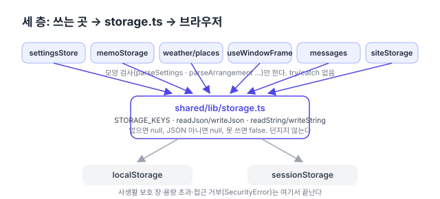

이 글은 리팩터링 계획([#150](https://github.com/hyeoniverse/MacFolio/issues/150)) 3단계의 두 번째 항목을 처리한 기록이다. 첫 번째 항목은 [공통 API 클라이언트 api()·apiFetch()로 fetch 호출과 401 처리 통합하기](/memo/shared-api-client)였다.

## 분산되어 있던 코드

브라우저에 저장하는 값은 일곱 가지다.

1. 설정
2. 메모 보기 설정
3. 메모 최근 검색어
4. 날씨 장소와 단위
5. 창 위치
6. 서버 없이 작성한 메시지
7. 로그인 페이지로 이동하는 시각에 열려 있던 앱

이 값을 다루는 파일 7개가 모두 같은 다섯 줄을 포함하고 있었다.

```ts
try {
	return JSON.parse(localStorage.getItem(KEY) ?? 'null');
} catch {
	return null;
}
```

쓰기 쪽도 마찬가지로 `try { localStorage.setItem(…) } catch { /* 저장하지 못해도 … */ }`가 파일마다 있었다. try/catch는 모두 12개였다. 주석도 "저장하지 못해도 이번에는 그대로 보인다"는 같은 내용이 여섯 가지 표현으로 작성되어 있었다.

try/catch가 필요한 이유는 브라우저 저장소가 예외를 던질 수 있기 때문이다. Safari의 개인정보 보호 창은 `localStorage.setItem`에서 `QuotaExceededError`를 던지고, 일부 설정에서는 `localStorage`에 접근하는 즉시 `SecurityError`가 발생한다([MDN `Window.localStorage` 예외](https://developer.mozilla.org/en-US/docs/Web/API/Window/localStorage#exceptions)). 그래서 저장은 항상 "성공하면 반영하고, 실패해도 화면은 그대로 동작"해야 한다. 이 규칙이 한 곳에 없어서, 새 키를 추가할 때마다 다섯 줄을 다시 복사했다.




## 검토한 방법

| 방법                                             | 장점                                 | 단점                                                                  |
| ------------------------------------------------ | ------------------------------------ | --------------------------------------------------------------------- |
| 상태 관리 도구의 저장 기능(예: persist 미들웨어) | 상태와 저장이 함께 관리된다          | 이 사이트는 자체 `createStore`를 쓴다. 상태 관리 도구 교체가 필요하다 |
| IndexedDB 래퍼(idb-keyval 등)                    | 큰 값 저장, 비동기 처리              | 현재 값은 모두 작다. 첫 화면 렌더링 전에 동기로 읽어야 한다           |
| 동기 `localStorage` 위에 얇은 함수 (**채택**)    | 의존성 추가 없음, 이전 작업이 기계적 | 큰 값에는 적합하지 않다(현재 해당 값 없음)                            |

설정은 첫 화면을 렌더링하기 전에 읽어야 화면 깜빡임이 없다. 동기로 읽는 `localStorage`가 적합하고, 필요한 것은 예외를 한 곳에서 처리하는 얇은 함수뿐이었다.

## storage.ts

`shared/lib/storage.ts`에 두 가지를 정의했다.

**키 목록** `STORAGE_KEYS`. 파일 6개에 분산되어 있던 문자열 9개를 한 객체로 통합했다. 창 위치처럼 앱 이름이 붙는 키는 함수다.

```ts
export const STORAGE_KEYS = {
	settings: 'macfolio:settings',
	memoArrangement: 'macfolio:memo:arrangement',
	weatherPlaces: 'macfolio:weather:places',
	appsBeforeLeaving: 'macfolio:apps-before-leaving', // sessionStorage
	window: (appName: string) => `macfolio:window:${appName}`,
	// …
} as const;
```

**읽기·쓰기 함수**

| 함수                       | 반환값                           | 용도                             |
| -------------------------- | -------------------------------- | -------------------------------- |
| `readJson(key)`            | 값이 없거나 JSON이 아니면 `null` | 객체 값 읽기                     |
| `writeJson(key, value)`    | 저장하지 못하면 `false`          | 객체 값 쓰기                     |
| `readString`·`writeString` | 문자열 그대로                    | 기온 단위 `'c'`·`'f'`, 방문자 id |
| `takeJson(key)`            | 읽은 값 (읽은 즉시 삭제)         | 한 번만 사용하는 값              |

두 번째 인자로 `'session'`을 전달하면 `sessionStorage`를 사용한다.

호출하는 쪽에는 **형태 검사**만 남는다. 저장된 JSON이 현재 코드가 기대하는 형태인지는 저장소 모듈이 판단할 수 없으므로, 기존대로 `parseSettings`·`parseArrangement` 같은 순수 함수가 검사한다([서버 if 문 검사와 화면 상한을 zod 스키마 하나로 합치기](/memo/settings-schemas)).

```ts
// 전 (settingsStore.ts)
function load(): Settings {
	try {
		return parseSettings(JSON.parse(localStorage.getItem(SETTINGS_STORAGE_KEY) ?? 'null'));
	} catch {
		return parseSettings(null);
	}
}
export const settingsStore = createStore<Settings>(load());

// 후
export const settingsStore = createStore<Settings>(parseSettings(readJson(STORAGE_KEYS.settings)));
```

## 휴지통의 '내 브라우저 데이터'와 연동

휴지통 앱에는 이 사이트가 브라우저에 저장한 값을 표시하고 삭제하는 화면이 있다(`bin/siteStorage.ts`, [사이트가 쓰는 localStorage·sessionStorage 키를 목록으로 표시하고 삭제하기](/memo/bin-app)). 그 목록 `BROWSER_DATA`도 키 문자열을 별도로 작성하고 있었는데, 이제 `STORAGE_KEYS`를 참조한다. 코드에 `'macfolio:…'` 키가 새로 추가되면 `BROWSER_DATA`에 누락됐다고 알리는 시험은 유지한다. 키가 한 파일로 통합되어 시험이 검사할 위치도 사실상 하나다.

`public/theme-boot.js`만 예외다. React가 로드되기 전에 테마를 읽어 깜빡임을 방지하는 다섯 줄짜리 스크립트라 모듈을 import할 수 없어, 키를 문자열 그대로 작성한다. `STORAGE_KEYS.settings` 옆에 이 사실을 주석으로 남겼다.

## 확인

`apps/react/src/shared/lib/storage.test.ts`에 시험 6개를 작성했다. 가짜 저장소를 주입해 실패 상황을 재현한다.

- "JSON으로 쓰고 읽는다. 없으면 null"
- "JSON이 아니면 null"
- "local과 session을 가른다"
- "takeJson은 읽고 지운다"
- "저장소가 던지면 조용히 실패한다"
- "저장소 접근 자체가 막히면 null"

마지막 두 시험이 이 모듈의 존재 이유다. 이전에는 파일마다 이 경우를 처리했지만 시험한 곳은 없었다.

## 수치

| 항목                              | 전  | 후                 |
| --------------------------------- | --- | ------------------ |
| `localStorage`를 직접 만지는 파일 | 7   | 1                  |
| try/catch                         | 12  | 4 (storage.ts 안)  |
| 키 문자열이 적힌 파일             | 6   | 1 (+theme-boot.js) |
| 바뀐 파일의 줄 수                 | 134 | 53                 |

PR 전체로는 14개 파일, 322줄 추가와 134줄 삭제였다. 추가된 줄은 새 `storage.ts`와 시험이다.

## 정리

- 이 글을 작성하며 다시 검색하니 현재도 `localStorage`에 실제로 접근하는 파일은 `storage.ts` 하나다. 다른 파일의 `localStorage`는 모두 주석이다. 키 목록은 그사이 12개로 늘었고(바탕화면 아이콘 위치, 메모 사이드바·목록 폭 등), 새 키도 모두 이 객체에 추가됐다.
- 예외를 처리하는 코드는 한 곳에 있어야 시험할 수 있다. 12곳에 분산된 try/catch는 어느 것도 시험되지 않았다.
- 키 문자열을 한 객체로 통합하면 "이 사이트가 브라우저에 무엇을 저장하는가"라는 질문에 파일 하나로 답할 수 있다. 개인정보 안내(휴지통의 '내 브라우저 데이터')와도 연동된다.
- 모듈을 import할 수 없는 위치(`theme-boot.js`)는 예외로 두고 양쪽에 주석을 남긴다. 무리하게 통합해 첫 화면 렌더링이 늦어지면 손해다.

같은 단계의 마지막 작업은 화면 크기 판단(`matchMedia`·`innerWidth` 25곳)을 `useIsMobile`·`useViewport`로 통일하는 일이다([matchMedia·innerWidth 직접 조회를 media.ts와 getViewport()로 모으기](/memo/shared-media)).

## 사용 방법

브라우저 저장소는 [apps/react/src/shared/lib/storage.ts](https://github.com/hyeoniverse/MacFolio/blob/main/apps/react/src/shared/lib/storage.ts)로만 읽고 쓴다. 개인정보 보호 창처럼 저장소 접근이 차단된 브라우저에서도 앱이 중단되지 않도록 try/catch가 이 파일에 한 번 있다.

```bash
cd apps/react
npx vitest run src/shared/lib/storage.test.ts
grep -rn "localStorage\|sessionStorage" src | grep -v "shared/lib/storage\|\.test\."   # 새 직접 사용이 없는지
```

수동으로 확인할 때는 개발자 도구 Application → Local Storage에서 값을 삭제하거나 잘못된 JSON으로 바꾼 뒤 새로 고침해, 앱이 기본값으로 실행되는지 확인한다. 새 키를 추가하면 `STORAGE_KEYS`와 함께 `apps/bin/siteStorage.ts`의 `BROWSER_DATA`에도 추가해야 시험이 통과한다.

참고 문서: [MDN Web Storage API](https://developer.mozilla.org/en-US/docs/Web/API/Web_Storage_API).

## 관련 글

- [공통 API 클라이언트 api()·apiFetch()로 fetch 호출과 401 처리 통합하기](/memo/shared-api-client): 3단계 첫 항목
- [matchMedia·innerWidth 직접 조회를 media.ts와 getViewport()로 모으기](/memo/shared-media): 3단계 마지막 항목
- [서버 if 문 검사와 화면 상한을 zod 스키마 하나로 합치기](/memo/settings-schemas): 설정 값의 형태 검사
- [사이트가 쓰는 localStorage·sessionStorage 키를 목록으로 표시하고 삭제하기](/memo/bin-app)

PR: [#198](https://github.com/hyeoniverse/MacFolio/pull/198)

#MacFolio #리팩터링 #React #localStorage
