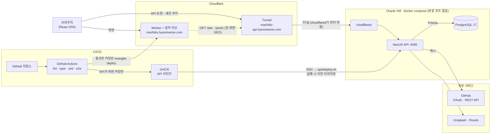
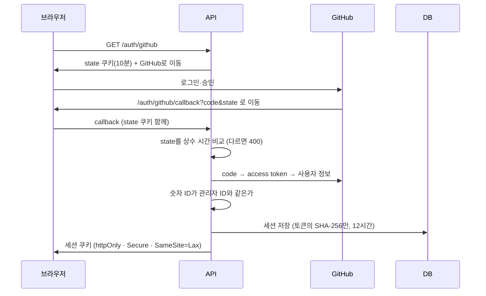
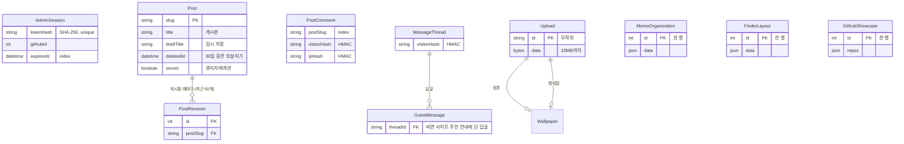
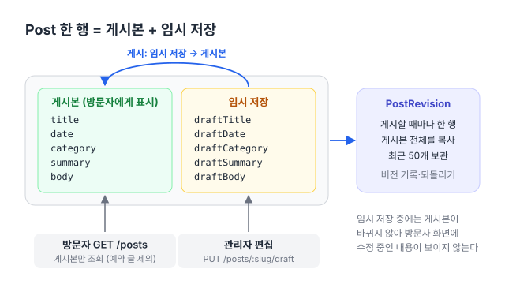

**한국어** | [English](en/backend-design.md)

# 백엔드 설계

MacFolio API 서버(`apps/api`)의 구성과 설계 결정을 정리한 문서입니다. 배포 순서는 [deployment.md](deployment.md)에, 기술을 고른 이유는 [README](../README.md#기술-스택)에 있습니다. 같은 내용을 그림 위주로 정리한 글은 [MacFolio 백엔드 한 장으로 보기](https://macfolio.hyeoniverse.com/memo/backend-design)입니다.

| 항목        | 값                                                                                                 |
| ----------- | -------------------------------------------------------------------------------------------------- |
| 런타임      | Node 22, [NestJS](https://docs.nestjs.com/), [Prisma](https://www.prisma.io/docs) 7, PostgreSQL 17 |
| 기능 모듈   | 24개 (`apps/api/src/<기능>/`). 아래 [모듈과 권한](#모듈과-권한) 표                                 |
| 데이터 모델 | 25개, 마이그레이션 32개 (`apps/api/prisma`, 2026-10-23 기준)                                       |
| 시험        | 단위·e2e 시험 약 370개 (`it` 기준). e2e 24개 파일은 실제 PostgreSQL에 연결해 실행                  |
| 운영        | Oracle Cloud VM 한 대, Docker Compose, Cloudflare Tunnel (외부에 개방한 포트 없음)                 |

## 구성도

- **같은 사이트, 다른 하위 도메인**: 프론트엔드와 API를 `hyeoniverse.com` 아래에 배치해 [`SameSite=Lax`](https://developer.mozilla.org/en-US/docs/Web/HTTP/Reference/Headers/Set-Cookie#samesitesamesite-value) 세션 쿠키가 함께 전송됩니다. API를 `*.workers.dev`나 IP 주소에 배치하면 브라우저가 쿠키를 전송하지 않아 로그인할 수 없습니다.
- **인바운드 포트가 없는 서버**: `cloudflared`가 Cloudflare로 아웃바운드 연결을 열고, 요청은 그 연결로만 들어옵니다([Cloudflare Tunnel](https://developers.cloudflare.com/cloudflare-one/connections/connect-networks/)). 방화벽에 80·443을 개방하지 않고, 인증서도 Cloudflare가 관리합니다. compose에는 `ports`가 하나도 없어서 DB는 컨테이너 네트워크 밖에서 접근할 수 없습니다.
- **검사 뒤에 배포**: 프론트엔드는 main에서 `check`(실제 PostgreSQL로 실행하는 API e2e와 브라우저 E2E 포함)를 통과한 커밋만 Workers에 배포됩니다. API는 변경된 커밋만 Actions가 이미지로 빌드해 GHCR에 업로드하고, SSH로 서버의 `ops/deploy.sh`를 호출해 교체합니다([#100](https://github.com/hyeoniverse/MacFolio/issues/100)). 새 컨테이너가 헬스 체크를 통과하지 못하면 이전 이미지로 되돌립니다. 시작할 때 [`prisma migrate deploy`](https://www.prisma.io/docs/orm/prisma-client/deployment/deploy-database-changes-with-prisma-migrate)로 마이그레이션을 적용합니다(DB는 되돌리지 않으므로 마이그레이션은 이전 코드와도 호환되어야 합니다).

## 요청이 지나가는 길

모든 요청은 아래 순서로 같은 처리 단계를 지납니다 (`app.setup.ts`). 가드·파이프·예외 필터의 실행 순서는 NestJS 문서의 [Request lifecycle](https://docs.nestjs.com/faq/request-lifecycle)과 같습니다.

| 단계             | 하는 일                                                                                                                 |
| ---------------- | ----------------------------------------------------------------------------------------------------------------------- |
| `trust proxy`    | 터널 뒤에서 실제 방문자 IP를 읽습니다 (요청 제한과 IP 기록에 사용합니다)                                                |
| helmet           | 보안 헤더                                                                                                               |
| CORS             | 사이트 주소만 허용. 쿠키는 그대로 적은 주소에만, PR 미리보기(`*`)는 읽기 전용이고 관리자 API는 그 Origin을 403으로 거절 |
| `ValidationPipe` | DTO로 모든 입력을 검사하고, 정해 두지 않은 필드가 있으면 거절합니다 (`forbidNonWhitelisted`)                            |
| `AdminGuard`     | 관리자 전용 경로에서 요청마다 세션 쿠키를 DB에서 확인합니다                                                             |
| `ThrottlerGuard` | 쓰기 경로마다 붙인 `@RateLimit` 이름별로 IP·경로당 1분 요청 수를 제한합니다                                             |
| 전역 예외 필터   | 에러 응답 형식을 통일하고, 너무 큰 본문·잘못된 JSON은 413·400으로, 예상하지 못한 에러는 내용을 숨긴 500으로 응답합니다  |
| `SafeLogger`     | 모든 로그에서 DB 비밀번호·API 키·쿠키·메일 주소를 마스킹합니다 (`common/redact.ts`)                                     |

## 모듈과 권한

기본 규칙은 읽기는 누구나, 쓰기는 관리자만입니다. 쓰기 경로에는 모두 요청 제한(`@RateLimit`, IP·경로마다 1분 횟수)을 적용하고, 방문자가 작성하는 곳(댓글, 좋아요, 메시지, 메일)은 방문자 쿠키로 작성자를 식별합니다. 경로 목록과 권한·제한은 `test/routes.e2e.test.ts`의 표가 고정합니다([#160](https://github.com/hyeoniverse/MacFolio/pull/160), [#162](https://github.com/hyeoniverse/MacFolio/pull/162)). 새 경로를 추가하고 표를 수정하지 않으면 시험이 실패합니다.

| 모듈                                 | 경로                                                                               | 권한                                                 |
| ------------------------------------ | ---------------------------------------------------------------------------------- | ---------------------------------------------------- |
| auth                                 | `GET /auth/github`, `/auth/github/callback`, `/auth/me`, `POST /auth/logout`       | 로그인은 요청 제한, `me`는 관리자                    |
| posts                                | `GET /posts`, `/posts/:slug/og.png` / 임시 저장·게시·버전·되살리기·삭제·비밀 글    | 읽기는 누구나, 나머지는 관리자                       |
| likes                                | `GET /posts/stats`, `/posts/:slug/likes`, `PUT·DELETE /posts/:slug/like` 등        | 조회는 누구나, 좋아요는 방문자                       |
| comments                             | `GET·POST /posts/:slug/comments`, `DELETE /comments/:id`                           | 방문자 (요청 제한, 자기 댓글만 삭제)                 |
| messages                             | `GET·POST /messages/threads`, `DELETE /messages/:id`                               | 방문자 (요청 제한, 자기 글만 삭제)                   |
| visitors                             | `GET /visitor`                                                                     | 방문자 쿠키를 발급하고 이름을 응답                   |
| contact                              | `GET·POST /contact`, `/contact/mine`, `/contact/inbox`, `POST /contact/:id/reply`  | 보내기·내 메일은 방문자, 받은 편지함·답장은 관리자   |
| memo                                 | `GET·PUT /memo/organization`                                                       | 읽기는 누구나, 수정은 관리자                         |
| finder                               | `GET·PUT /finder/layout`                                                           | 읽기는 누구나, 수정은 관리자                         |
| files                                | `GET·POST /files`, `GET·DELETE /files/:id`                                         | 내려받기(`GET /files/:id`)는 누구나, 나머지는 관리자 |
| documents                            | `GET /documents`, `POST /documents/uploads` 등                                     | 목록은 누구나, 업로드·수정·삭제는 관리자 (R2)        |
| wallpapers                           | `GET·POST·PATCH·DELETE /wallpapers`                                                | 읽기는 누구나, 나머지는 관리자                       |
| photos                               | `GET·PUT /photos/captions`                                                         | 읽기는 누구나, 수정은 관리자                         |
| images                               | `GET /images/search` 등                                                            | 관리자 (Unsplash·Pexels 검색)                        |
| github                               | `GET /github/profile`, `/github/activity`, 후보·조회·`PUT /github/showcase`        | 프로필·활동은 누구나, 나머지는 관리자                |
| site                                 | `GET /site`, `PUT·DELETE /site/profile`·`/projects`·`/resume`, `PUT /site/widgets` | 읽기는 누구나, 수정은 관리자                         |
| analytics                            | `POST /analytics/events`, `GET /analytics/summary` 등                              | 수집·합계는 누구나, 실시간·검색어는 관리자           |
| resources                            | `GET /resources`                                                                   | 관리자 (서버 사용률, 유휴 회수 위험, 요금)           |
| security                             | `GET·PUT /security`                                                                | 읽기는 누구나, 사람 확인 적용 위치 수정은 관리자     |
| summary · translate · speech · cover | `GET·POST /summary` 등                                                             | 누구나 (프로젝트 데모, IP·사이트 전체 하루 상한)     |
| health                               | `GET /health`                                                                      | 누구나                                               |

API 문서는 [Swagger](https://docs.nestjs.com/openapi/introduction)로 컨트롤러에서 자동 생성합니다: <https://macfolio-api.hyeoniverse.com/docs>

사이트의 'API 문서' 앱은 같은 문서를 `openapi.json`으로 추출해 사이트 안에서 렌더링합니다 (Scalar, 서버가 꺼져 있어도 표시됩니다, [#95](https://github.com/hyeoniverse/MacFolio/pull/95)). 컨트롤러나 DTO를 변경하면 `pnpm --filter @macfolio/api openapi`로 이 파일을 다시 생성해 함께 커밋합니다. 누락하면 `apps/api/src/openapi.test.ts`가 실패합니다.

## 관리자 로그인

[GitHub OAuth App](https://docs.github.com/en/apps/oauth-apps/building-oauth-apps/authorizing-oauth-apps)의 웹 애플리케이션 흐름을 라이브러리 없이 구현했습니다([#38](https://github.com/hyeoniverse/MacFolio/pull/38)).

- 서버는 비밀번호를 저장하지 않습니다. 관리자는 한 명이고, 이미 사용하는 GitHub 계정으로 인증합니다.
- 관리자는 변경 가능한 계정 이름이 아니라 변경되지 않는 숫자 ID로 판별합니다.
- 세션을 DB에 저장하므로 로그아웃하면 즉시 무효가 됩니다. 화면은 만료 시각이 지나면 세션을 다시 조회해 로그아웃 상태로 전환합니다.

## 데이터 모델

그림은 25개 모델 중 블로그·방문자·파일·설정 모델만 표시합니다. 분석(`AnalyticsEvent`·`DailyStat` 등), 연락 메일, 서버 자원 감시 모델의 필드 설명은 `apps/api/prisma/schema.prisma`의 주석에 있습니다.

- **블로그 글의 원본은 두 곳입니다.** 저장소의 Markdown 파일이 기본이고, 관리자가 작성하거나 수정한 글은 `Post`에 저장합니다. 주소(slug)가 같으면 `Post`가 파일 글을 대체합니다. 파일 글을 삭제하면 `deleted` 표시만 저장해 목록에서 제외합니다.
- **한 행에 게시본과 임시 저장을 함께 저장합니다.** 수정하는 동안에는 `draft*` 열만 변경되어 방문자에게 보이지 않고, 게시하면 임시 저장을 게시본 열로 복사하고 `PostRevision`을 한 행 추가합니다. 날짜가 오늘보다 뒤면 그날까지 방문자에게 보이지 않습니다(예약 발행). 과정은 [임시 저장과 버전 기록 글](https://macfolio.hyeoniverse.com/memo/drafts-and-versions)에 있습니다.

- **비밀 글은 관리자에게만 보입니다.** `Post.secret`이 켜진 글은 방문자용 목록(`GET /posts`)과 공유 카드에서 제외되고, 댓글·좋아요·인기글·조회수·트래픽 요약·메모 정리 내용도 관리자 세션이 아니면 그 글을 없는 글과 같게 응답합니다(빈 목록, 0, 404). Worker가 생성하는 첫 화면 본문·sitemap·RSS는 `GET /posts`를 쿠키 없이 조회해 만들므로 비밀 글이 포함되지 않습니다. 서버에만 있는 글에만 지정합니다: 저장소의 Markdown 글은 공개 저장소에 원문이 있어 숨길 수 없습니다.

- **설정성 값은 한 행 JSON입니다.** 메모 폴더 정리(`MemoOrganization`), Finder 폴더 구조(`FinderLayout`: 생성한 폴더, 이동한 파일의 표시 위치, 바탕화면의 가상본)와 GitHub 앱에 표시할 저장소(`GithubShowcase`)는 전체를 한 번에 읽고 쓰는 값이라 행 하나에 저장합니다.

## 설계 결정

| 주제                   | 선택한 방식                                                                                                                                                                | 대안                               | 이유 · 막는 위험                                                                                                                                                |
| ---------------------- | -------------------------------------------------------------------------------------------------------------------------------------------------------------------------- | ---------------------------------- | --------------------------------------------------------------------------------------------------------------------------------------------------------------- |
| **인증 · 세션**        |                                                                                                                                                                            |                                    |                                                                                                                                                                 |
| 관리자 로그인          | GitHub OAuth를 직접 구현. `state`를 쿠키에 기억했다가 상수 시간 비교                                                                                                       | 아이디·비밀번호, 인증 라이브러리   | 비밀번호를 저장하지 않습니다. 남이 시작한 로그인으로 들어오는 요청 위조와 타이밍 공격을 막습니다                                                                |
| 세션 저장              | 무작위 토큰은 쿠키에만, DB에는 SHA-256 해시만. 만료 시각에 인덱스                                                                                                          | JWT, 토큰 원문 저장                | 로그아웃·만료 즉시 서버에서 세션을 무효화합니다. DB가 유출되어도 해시로는 세션을 복원할 수 없습니다                                                             |
| 관리자 확인            | 바뀌지 않는 GitHub 숫자 ID                                                                                                                                                 | 계정 이름                          | 계정 이름을 변경하거나 다른 사람이 그 이름을 등록해도 권한이 이전되지 않습니다                                                                                  |
| 쿠키                   | `httpOnly` · `SameSite=Lax` · `Secure`                                                                                                                                     | localStorage에 토큰                | 스크립트가 토큰을 읽을 수 없고, 다른 사이트에서 보낸 요청에는 쿠키가 붙지 않습니다                                                                              |
| **방문자 · 남용 방지** |                                                                                                                                                                            |                                    |                                                                                                                                                                 |
| 방문자 식별            | 1년짜리 쿠키 토큰을 비밀 키로 HMAC해 저장. 화면에는 내 글인지(`mine`)나 그 값을 한 번 더 해시한 짧은 ID만 응답                                                             | 회원가입, 이름·비밀번호            | 가입 없이 같은 브라우저에서 작성한 글만 삭제할 수 있습니다. 토큰 원문은 서버에 저장되지 않고, 화면에 응답한 값으로는 다른 사람의 글을 삭제할 수 없습니다        |
| 이전 댓글              | 이름·비밀번호(scrypt) 방식 댓글은 그대로 유지하고 새 댓글부터 방문자 쿠키로                                                                                                | 한꺼번에 옮기기                    | 기존 데이터를 변환하지 않고 방식을 변경합니다                                                                                                                   |
| IP 기록                | 화면용 앞 두 자리와 HMAC만                                                                                                                                                 | IP 원문 저장                       | 개인정보를 최소한으로 보관하면서 같은 사람이 작성한 글을 묶어 조회할 수 있습니다                                                                                |
| 요청 제한              | IP·경로마다 1분, 이름 일곱 개(login·comment·like·write·upload·demo·events) 중 하나를 쓰기 경로마다 `@RateLimit`으로 지정 (`common/rate-limit.ts`)                          | 전역 제한 하나                     | 무차별 로그인 시도, 스팸, 관리자 경로 반복 요청을 막으면서 읽기 요청은 제한하지 않습니다. 제한이 누락된 쓰기 경로는 경로 표 시험이 검출합니다                   |
| **데이터**             |                                                                                                                                                                            |                                    |                                                                                                                                                                 |
| 필수 항목              | 화면·API 검증에 더해 DB `CHECK` 제약 (마이그레이션 SQL)                                                                                                                    | 애플리케이션 검증만                | API를 거치지 않은 쓰기(스크립트, 버그)도 빈 제목이나 잘못된 날짜를 넣지 못합니다                                                                                |
| 글 편집                | 게시본과 임시 저장을 나눔, 게시할 때마다 버전(최근 50개), 예약 발행                                                                                                        | 한 칸에 덮어쓰기                   | 수정 중인 내용이 방문자에게 보이지 않고, 잘못 게시해도 되돌릴 수 있습니다                                                                                       |
| 글 삭제                | `deletedAt`을 남기는 soft delete, 30일 동안 되살리기                                                                                                                       | 즉시 삭제                          | 실수로 삭제한 글을 복구할 수 있습니다                                                                                                                           |
| 비밀 글                | `Post.secret` 열 하나. 글 주소를 받는 공개 경로마다 서버에서 필터링(`posts/secret-posts.service.ts`)하고, 방문자에게는 없는 글과 같은 응답                                 | 화면에서만 숨기기, 별도 표         | 응답을 직접 조회해도 보이지 않고, 응답의 차이로 비밀 글이 있는지 알아낼 수 없습니다. 배포를 되돌리면 이전 코드는 이 열을 읽지 않아 그동안 공개됩니다            |
| 파일 업로드            | DB(`bytea`)에 저장, 10MB 제한, 파일 앞부분으로 이미지 형식 확인, 사진의 EXIF·XMP(촬영 위치·기기)는 제거하고 방향만 남김, 짐작할 수 없는 무작위 ID                          | 서버 디스크, 오브젝트 스토리지     | 백업 한 번(`pg_dump`)에 글과 파일이 함께 남습니다. 확장자만 변경한 파일과 주소 추측을 차단하고, 사진의 위치 정보가 공개되지 않게 합니다                         |
| **외부 연동**          |                                                                                                                                                                            |                                    |                                                                                                                                                                 |
| GitHub 데이터          | 서버 캐시(토큰 있으면 10분, 없으면 30분). 동시에 온 요청은 하나로, 실패하면 마지막 값, 저장하면 바로 무효화. 기여 달력과 활동은 따로 캐시해 한쪽이 실패해도 다른 쪽은 표시 | 브라우저에서 직접 호출             | 방문자 수와 상관없이 GitHub 호출 수가 일정합니다(토큰 없이 시간당 60회 제한). GitHub 장애 중에도 마지막 값을 표시합니다                                         |
| 외부 API 시험          | 외부 호출을 클라이언트 클래스 하나로 통합하고, e2e에서는 가짜 클래스로 교체                                                                                                | 실제 API로 시험                    | 네트워크 상태나 외부 요청 제한과 상관없이 시험 결과가 항상 같습니다                                                                                             |
| **인프라 · 배포**      |                                                                                                                                                                            |                                    |                                                                                                                                                                 |
| 서버 노출              | Cloudflare Tunnel, compose에 바깥 포트 없음                                                                                                                                | 80·443 개방, nginx + Let's Encrypt | 공격 표면이 줄고, 서버 IP가 노출되지 않고, 인증서 갱신을 직접 관리하지 않습니다                                                                                 |
| 서버                   | Oracle Cloud Always Free VM + Docker Compose                                                                                                                               | Render 같은 무료 호스팅            | 요청이 없어도 유휴 상태로 전환되지 않습니다(Render 무료 플랜은 15분 동안 요청이 없으면 중지되고, 다시 시작하는 데 약 1분). 리눅스 VM과 Docker를 직접 운영합니다 |
| 프론트엔드 배포        | GitHub Actions에서 `check`를 통과한 커밋만 `wrangler deploy`, PR마다 미리보기 주소                                                                                         | Cloudflare Workers Builds          | 시험을 건너뛴 배포가 없습니다. 플랫폼 빌드 환경 장애로 배포가 중단되는 문제를 겪고 이전했습니다([#82](https://github.com/hyeoniverse/MacFolio/pull/82))         |

## 시험

- **단위 ([Vitest](https://vitest.dev/))**: 입력 규칙, 세션·해시, 방문자 이름, GitHub 응답 가공처럼 DB와 무관한 순수 함수를 확인합니다. 규칙은 모듈마다 `rules.ts`에 모으고 컨트롤러는 그 결과만 사용합니다.
- **e2e ([supertest](https://github.com/ladjs/supertest))**: CI에서 [PostgreSQL 서비스 컨테이너](https://docs.github.com/en/actions/use-cases-and-examples/using-containerized-services/creating-postgresql-service-containers)를 실행해 실제 DB로 수행합니다. 권한(관리자가 아니면 401, 규칙 위반은 400), 해시만 저장하는지, 요청 제한(429)까지 확인합니다. GitHub와 사진 서비스는 가짜 클래스로 교체합니다.
- **브라우저 E2E ([Playwright](https://playwright.dev/))**: 프론트엔드 시험은 [`page.route`](https://playwright.dev/docs/network#modify-responses)로 만든 가짜 API(`apps/react/e2e/fakeApi.ts`)로 실행합니다. 응답 형식은 `@macfolio/contracts`의 타입을 공유하므로, API 형식을 변경하면 양쪽 시험을 함께 수정합니다.

## 운영

| 할 일          | 명령 (서버)                                                                       |
| -------------- | --------------------------------------------------------------------------------- |
| 특정 버전 배포 | `~/macfolio/ops/deploy.sh sha-<커밋 7자리>` (평소에는 GitHub Actions가 자동 실행) |
| 상태와 로그    | `cd ~/deploy && docker compose ps`, `docker compose logs --tail=40 api`           |
| 백업           | `~/macfolio/ops/backup.sh` (cron이 매일 실행, 서버 7일·R2 30일 보관)              |
| 복원           | `~/macfolio/ops/restore.sh <백업 파일 또는 r2: 경로>`                             |
| 보안 설정 점검 | `~/macfolio/ops/audit.sh` (SSH·열린 포트·컨테이너 사용자·자동 업데이트)           |

자세한 절차와 문제 해결은 [deployment.md](deployment.md)에 있습니다.

## 관련 글

- [MacFolio 백엔드 한 장으로 보기 - 구성도와 설계 결정](https://macfolio.hyeoniverse.com/memo/backend-design)
- [정적 사이트에 관리자 로그인 붙이기](https://macfolio.hyeoniverse.com/memo/admin-login-github-oauth)
- [바로 고치는 블로그에 임시 저장과 버전 기록 붙이기](https://macfolio.hyeoniverse.com/memo/drafts-and-versions)
- [이름·비밀번호 없이 쓰는 메시지와 댓글 - 방문자 쿠키로 정하는 이름](https://macfolio.hyeoniverse.com/memo/visitor-identity)
- [쓰기 경로 33개에 같은 방식으로 요청 제한 걸기](https://macfolio.hyeoniverse.com/memo/rate-limit-all-writes)
- [API 경로 64개를 표 하나로 고정하기](https://macfolio.hyeoniverse.com/memo/api-route-table-test)
- [오류 응답은 감추고, 로그는 가리고](https://macfolio.hyeoniverse.com/memo/error-log-masking)
- [올린 사진의 EXIF를 지우되 방향은 남기기](https://macfolio.hyeoniverse.com/memo/upload-strip-exif)
- [응답 타입을 두 번 적지 않기 — @macfolio/contracts와 zod](https://macfolio.hyeoniverse.com/memo/contracts-comments)
- [API 서버를 무료로 띄우기 - Oracle VM과 Cloudflare Tunnel](https://macfolio.hyeoniverse.com/memo/deploy-api-oracle-tunnel)
