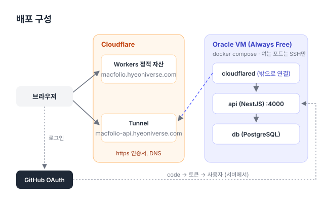
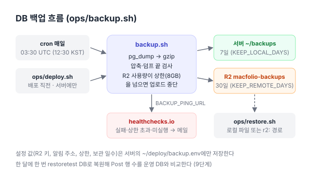

**한국어** | [English](en/deployment.md)

# 배포

프론트엔드는 Cloudflare Workers에, API는 Oracle Cloud Always Free VM에 배포한다. 서버는 인바운드 포트를 개방하지 않고 Cloudflare Tunnel로만 외부와 연결한다.



| 무엇       | 주소                                        | 어디에                       | 배포                                                                                                                 |
| ---------- | ------------------------------------------- | ---------------------------- | -------------------------------------------------------------------------------------------------------------------- |
| 프론트엔드 | `https://macfolio.hyeoniverse.com`          | Cloudflare Workers 정적 자산 | main에 머지하면 GitHub Actions가                                                                                     |
| API        | `https://macfolio-api.hyeoniverse.com`      | Oracle VM, docker compose    | main에 머지하면 GitHub Actions가 이미지를 만들어 서버에 ([#100](https://github.com/hyeoniverse/MacFolio/issues/100)) |
| API 문서   | `https://macfolio-api.hyeoniverse.com/docs` | Swagger                      |                                                                                                                      |

프론트엔드와 API는 주소가 다르지만 같은 사이트(`hyeoniverse.com`)다. 그래서 `SameSite=Lax` 세션 쿠키가 함께 전송된다. **API는 반드시 `hyeoniverse.com`의 하위 도메인에 https로 배치한다.** `*.workers.dev`나 IP 주소에 두면 로그인이 되지 않는다.

- [1. 프론트엔드 (Cloudflare Workers)](#1-프론트엔드-cloudflare-workers)
- [2. GitHub OAuth App](#2-github-oauth-app)
- [3. Oracle VM 만들기](#3-oracle-vm-만들기)
- [4. 서버 준비](#4-서버-준비)
- [5. Cloudflare Tunnel](#5-cloudflare-tunnel)
- [6. 설정 파일](#6-설정-파일)
- [7. 실행과 확인](#7-실행과-확인)
- [운영](#운영)
- [문제 해결](#문제-해결)

## 1. 프론트엔드 (Cloudflare Workers)

설정은 루트의 `wrangler.jsonc`에 있다. `apps/react/dist`의 파일은 [정적 자산](https://developers.cloudflare.com/workers/static-assets/)으로 Worker를 거치지 않고 응답하고, 첫 화면(`/`, `/index.html`), `sitemap.xml`·`rss.xml`, 파일이 없는 주소만 Worker(`apps/react/worker/index.ts`)가 처리한다.

- 첫 화면과 앱 주소(`/memo/<글>`, `/safari/<프로젝트>`): `index.html`에 사이트 콘텐츠·검색용 본문을 넣고 CSP를 붙인다. 없는 글·프로젝트 주소는 404(`noindex`)
- `sitemap.xml`·`rss.xml`: 저장소 글과 서버에 쓴 글을 합쳐 생성한다
- `/files/<키>`: R2 버킷의 문서 파일 (아래 [문서 파일(R2)](#문서-파일r2))
- 없는 `/assets/*`: 404 (예전 빌드의 코드 파일 요청에 `index.html`을 응답하지 않게, [#103](https://github.com/hyeoniverse/MacFolio/pull/103))

빌드와 배포는 GitHub Actions(`.github/workflows/ci.yml`)가 실행한다([#82](https://github.com/hyeoniverse/MacFolio/pull/82)). Cloudflare의 빌드 서버(Workers Builds)는 사용하지 않는다. 워크플로가 쓰는 액션은 태그(`@v7`)가 아니라 커밋 SHA로 고정하고(태그는 나중에 다른 코드를 가리킬 수 있다), 새 버전은 Dependabot(`.github/dependabot.yml`)이 PR로 올린다.

- **main**: 시험(`check`)이 통과하면 `deploy` 작업이 `wrangler deploy`로 실제 사이트에 올린다. 시험이 실패한 커밋은 배포되지 않는다.
- **PR**: `preview` 작업이 `wrangler versions upload --preview-alias <브랜치>`로 [미리보기 버전](https://developers.cloudflare.com/workers/configuration/previews/)을 업로드하고, 주소를 PR 댓글 하나에 적는다(새 커밋을 올리면 같은 댓글을 수정한다). 실제 사이트는 변경되지 않는다. 미리보기는 실제 API를 읽기만 한다: 주소가 `*.workers.dev`라 `SameSite=Lax` 세션 쿠키가 전송되지 않고, API도 `*`로 맞은 주소에는 쿠키를 허용하지 않으며 관리자 API는 그런 Origin을 403으로 거절한다. 관리자 기능은 미리보기 대신 로컬(`pnpm dev`)에서 확인한다. Dependabot PR과 프론트엔드 파일(`apps/react`, `packages`, lockfile 등)이 바뀌지 않은 PR에서는 건너뛴다. 업로드 자체는 무료(요청 수로만 과금)이고 버전은 최근 100개까지만 보관되지만, CI 실행 시간과 댓글 수를 줄이기 위해 건너뛴다.

### 처음 한 번: 토큰과 Git 연결

1. Cloudflare 대시보드 → 오른쪽 위 프로필 → **My Profile → API Tokens → Create Token**
   - **Edit Cloudflare Workers** 템플릿을 고른다
   - Account Resources: 내 계정, Zone Resources: All zones from an account (또는 hyeoniverse.com)
   - 만든 토큰은 한 번만 보이니 바로 복사한다
2. 계정 ID: Workers & Pages 화면 오른쪽의 **Account ID**를 복사한다
3. GitHub 저장소 → Settings → Secrets and variables → **Actions → New repository secret**
   - `CLOUDFLARE_API_TOKEN` = 1의 토큰
   - `CLOUDFLARE_ACCOUNT_ID` = 2의 계정 ID
4. GitHub Actions 배포가 한 번 성공한 것을 확인한 뒤, Cloudflare의 Git 연결을 해제한다. 두 곳에서 동시에 배포하지 않게 하기 위해서다.
   - Workers & Pages → `macfolio` → Settings → **Build** → Git repository → **Disconnect**

### 문서 파일(R2)

이력서·포트폴리오·자격증 파일과 프로젝트마다의 파일(발표 자료 등. PDF, PNG, JPG, WebP, 20MB까지)은 저장소에 넣지 않고 Cloudflare R2 버킷 `macfolio-files`에 저장한다. 사이트 Worker(`apps/react/worker/files.ts`)가 같은 출처의 `/files/<키>`로 응답하고([#255](https://github.com/hyeoniverse/MacFolio/pull/255)), Finder에서 열면 미리보기 앱(`apps/react/src/apps/preview`)이 pdf.js로 페이지를 렌더링하거나 그림을 보여 준다(휴대폰은 파일 앱 안에서). 어느 폴더에 무엇이 있는지(목록)는 API의 DB(`Document` 표, `GET /documents`)에 있다.

- 응답: 확장자에 맞는 `Content-Type`, `ETag`(`If-None-Match`가 맞으면 304), `Cache-Control: public, max-age=300`, `X-Content-Type-Options: nosniff`, `Content-Disposition: inline`(`?download=1`이면 `attachment`), 이 사이트 안의 iframe에만 들어가는 CSP(`frame-ancestors 'self'`)
- 없는 파일, `..` 같은 경로, pdf·png·jpg·jpeg·webp가 아닌 키는 404. GET·HEAD가 아니면 405. 바인딩이 없는 곳(로컬 `pnpm dev`)도 404

**올리기(관리자)**: 관리자로 로그인하고 Finder의 문서 › 이력서·포트폴리오·자격증 폴더 안, 또는 문서 › 포트폴리오 › <프로젝트> 폴더 안(또는 그 폴더 아이콘 위)에 파일을 끌어다 놓는다. 프로젝트 폴더의 파일은 폴더 값 `project:<프로젝트 id>`로 올라간다. 파일은 API 서버를 거치지 않고 R2에 직접 업로드된다.

1. 브라우저 → API `POST /documents/uploads` (폴더·이름·크기): API가 관리자인지, 종류·크기가 맞는지 보고 R2에 직접 업로드할 [**서명 주소**](https://developers.cloudflare.com/r2/api/s3/presigned-urls/)(5분, `Content-Length`가 그 크기여야 수락한다)를 발급한다. 키는 `resume|portfolio|certificates|desktop|pictures/<무작위>.<확장자>`(바탕화면은 `desktop`, 홈 › 그림은 `pictures`), 프로젝트 폴더는 `projects/<프로젝트 id>/<무작위>.<확장자>`
2. 브라우저 → R2 `PUT <서명 주소>` (진행률이 Finder 아래에 보인다)
3. 브라우저 → API `POST /documents`: API가 R2에 HEAD 요청으로 파일 존재와 크기를 확인하고 목록에 추가한다

이름 변경과 삭제는 파일을 선택하고 메뉴 막대의 **파일 → 이름 변경… / 휴지통으로 이동(⌘⌫)**. 삭제하면 R2에서도 삭제한다.

#### 소유자가 할 일

1. **버킷**: Cloudflare 대시보드 → **R2 → Create bucket** → 이름 `macfolio-files`. 또는 `npx wrangler r2 bucket create macfolio-files`. 바인딩은 이미 `wrangler.jsonc`에 있다(`FILES` → `macfolio-files`). **버킷을 만들기 전에는 배포(`wrangler deploy`)가 "버킷이 없다"며 실패하므로, 이 변경을 머지하기 전에 먼저 한다**
2. **API 토큰(S3 키)**: R2 → **Manage R2 API Tokens → Create API Token**
   - Permissions: **Object Read & Write**
   - Specify bucket(s): **Apply to specific buckets only** → `macfolio-files`
   - TTL: Forever (또는 원하는 기간)
   - 만들면 **Access Key ID**와 **Secret Access Key**가 한 번만 보인다. 계정 ID는 R2 첫 화면 오른쪽(또는 S3 주소 `https://<계정 ID>.r2.cloudflarestorage.com`)에 있다
3. **서버에 넣기**: 서버의 `~/deploy/api.env`에 네 줄을 추가하고 API를 다시 실행한다(`docker compose up -d api`)

   ```bash
   R2_ACCOUNT_ID=<계정 ID>
   R2_ACCESS_KEY_ID=<Access Key ID>
   R2_SECRET_ACCESS_KEY=<Secret Access Key>
   R2_BUCKET=macfolio-files
   ```

   값이 없으면 목록은 그대로 표시되고, 업로드·삭제만 "서버에 파일 저장소(R2)가 설정되지 않았습니다"(503)로 막힌다

4. **버킷 [CORS](https://developers.cloudflare.com/r2/buckets/cors/)**: 브라우저가 R2에 직접 PUT하므로, 버킷 → **Settings → CORS Policy → Add CORS policy**에 아래를 넣는다(사이트 주소에서 PUT만)

   ```json
   [
   	{
   		"AllowedOrigins": ["https://macfolio.hyeoniverse.com"],
   		"AllowedMethods": ["PUT"],
   		"AllowedHeaders": ["content-type"],
   		"MaxAgeSeconds": 3600
   	}
   ]
   ```

   PR 미리보기 주소에서 업로드를 시험하려면 `AllowedOrigins`에 그 주소를 추가한다. 이 설정이 없으면 Finder가 "저장소에 연결하지 못했습니다. 버킷의 CORS 설정을 확인해 주세요."를 보인다

5. 올리기 전에 **전화번호, 집 주소, 생년월일, 주민등록번호 같은 신분 번호를 삭제한다**(자격증 사본의 자격증 번호도 마스킹한다)

#### 로컬에서 올려 보기

로컬 개발 서버에서도 실제 R2에 업로드할 수 있다. 목록은 로컬 DB에만 남으니 배포한 사이트에는 보이지 않는다(R2에 남은 시험 파일은 Finder에서 삭제하면 R2에서도 삭제된다).

1. `apps/api/.env`에 위 3의 네 줄(`R2_ACCOUNT_ID` 등)을 넣는다. 배포와 같은 키를 써도 된다
2. 버킷 CORS의 `AllowedOrigins`에 `http://localhost:5173`을 더한다
3. 관리자 로그인이 되게 개발용 GitHub OAuth App을 쓴다('2. GitHub OAuth App'의 개발용). 그다음

   ```bash
   echo 'VITE_API_URL=http://localhost:4000' > apps/react/.env.local
   pnpm dev:all     # 프론트엔드 5173 + API 4000
   ```

4. http://localhost:5173 에서 관리자로 로그인하고 Finder의 이력서 폴더에 파일을 끌어다 놓는다

로컬 개발 서버에는 사이트 Worker가 없어서 `/files/*`(파일 내려받기)는 배포한 사이트로 프록시한다(`vite.config.ts`의 `server.proxy`). 배포한 사이트가 같은 버킷을 읽으므로 로컬에서 올린 파일도 미리보기 앱에서 열린다. 다른 주소로 프록시하려면 `apps/react/.env.local`에 `FILES_ORIGIN=https://<PR 미리보기 주소>`를 적거나 명령 앞에 붙인다(`turbo.json`의 `passThroughEnv`로 `pnpm dev:all`에도 넘어간다). PR [#255](https://github.com/hyeoniverse/MacFolio/pull/255)처럼 머지 전이라 배포한 사이트에 `/files`가 아직 없을 때 사용한다.

키 없이 화면만 확인하려면 E2E가 사용하는 가짜 목록을 쓴다: 개발자 도구 콘솔에서 `window.__MACFOLIO_DOCUMENTS__ = [{ folder: '이력서', name: '시험.pdf', key: 'resume/test.pdf', kind: 'pdf' }]`를 넣고 Finder를 연다(파일 자체는 없어서 미리보기는 "열 수 없습니다"). 업로드 흐름 전체는 `e2e/finder-upload.spec.ts`가 가짜 API·가짜 R2로 시험한다(`pnpm --filter @macfolio/react test:e2e finder-upload`).

사이트 CSP의 `connect-src`에는 `https://*.r2.cloudflarestorage.com`이 있다(서명 주소로 올리기). 서명이 없는 요청은 R2가 받지 않는다.

비용: [R2 무료 사용량](https://developers.cloudflare.com/r2/pricing/)(저장 10GB, Class A 작업 월 100만 회, Class B 작업 월 1,000만 회, 내보내기 무료) 안에서 운영된다. 저장하는 파일이 문서 몇 개이고 대부분 읽기 요청이다.

CI: 배포(`ci.yml`의 `deploy`, `preview`)는 `CLOUDFLARE_API_TOKEN`으로 `wrangler deploy`·`wrangler versions upload`를 한다. R2 바인딩이 있는 Worker를 올리려면 토큰에 **Account → Workers R2 Storage → Edit** 권한이 있어야 한다. 위 "처음 한 번"의 **Edit Cloudflare Workers** 템플릿에는 이 권한이 들어 있으므로 그 템플릿으로 만든 토큰이면 변경할 것이 없다. 직접 고른 권한으로 만든 토큰이면 Cloudflare 대시보드 → My Profile → API Tokens에서 그 토큰을 수정해 이 권한을 추가한다. 파일 업로드는 CI가 하지 않는다(관리자가 Finder에서 업로드한다).

### API 주소 넣기

`VITE_API_URL`은 **빌드할 때** 코드에 들어간다. 런타임 변수가 아니다. 값은 `ci.yml` 맨 위의 `env`에 있다(`https://macfolio-api.hyeoniverse.com`, 끝에 `/` 없이). 변경하려면 그 줄을 수정해 main에 머지한다.

Cloudflare 대시보드의 Variables and Secrets는 Worker가 **실행될 때** 읽는 값이라, 여기에 넣어도 빌드에 들어가지 않는다. 값이 비어 있으면 로그인 버튼이 비활성화되고 "관리자 서버가 아직 연결되지 않았습니다"가 표시된다.

`VITE_MESSAGES_STORE`는 배포에 넣지 않는다(빈 값으로 둔다). 비어 있으면 메시지 앱이 서버에 저장하고, 서버에 닿지 못하면 "메시지를 열 수 없습니다" 경고창을 표시한 뒤 앱을 종료한다. `local`은 서버 없이 화면을 확인하는 개발용 값이라, 배포에 넣으면 방문자마다 자기 브라우저에만 글이 남는다.

반영 여부는 배포된 JS에서 주소를 검색해 확인한다.

```bash
for f in $(curl -s https://macfolio.hyeoniverse.com/ | grep -o '/assets/[^"]*\.js'); do
  curl -s "https://macfolio.hyeoniverse.com$f" | grep -o 'https://macfolio-api.hyeoniverse.com' | head -1
done
```

## 2. GitHub OAuth App

GitHub → Settings → Developer settings → OAuth Apps → New OAuth App ([GitHub 문서](https://docs.github.com/en/apps/oauth-apps/building-oauth-apps/creating-an-oauth-app))

| 항목                       | 배포용                                                      | 개발용                                       |
| -------------------------- | ----------------------------------------------------------- | -------------------------------------------- |
| Homepage URL               | `https://macfolio.hyeoniverse.com`                          | `http://localhost:5173`                      |
| Authorization callback URL | `https://macfolio-api.hyeoniverse.com/auth/github/callback` | `http://localhost:4000/auth/github/callback` |

OAuth App 하나에는 콜백 주소를 하나만 넣을 수 있어서, 배포용과 개발용을 따로 만든다. 만든 뒤 Client ID와 Client secret을 기록한다. secret은 만들 때 한 번만 보인다.

관리자는 계정 이름이 아니라 숫자 ID로 식별한다(`ADMIN_GITHUB_ID`, 기본 `68999618` = hyeoniverse). 계정 이름은 변경할 수 있고, 변경하면 옛 이름을 다른 사람이 등록할 수 있기 때문이다.

## 3. Oracle VM 만들기

[Always Free](https://www.oracle.com/cloud/free/) 한도 안에서는 기간 제한 없이 무료다. 가입할 때 카드 등록이 필요하지만 Free Tier 계정에는 청구되지 않는다. 홈 리전은 가입한 뒤에 바꿀 수 없다.

Compute → Instances → Create instance

| 항목       | 고를 것                                                                                                     |
| ---------- | ----------------------------------------------------------------------------------------------------------- |
| Image      | Canonical Ubuntu 24.04                                                                                      |
| Shape      | `VM.Standard.A1.Flex`(ARM, 합계 4 OCPU·24GB까지 무료) 또는 `VM.Standard.E2.1.Micro`(AMD, 1GB, 2대까지 무료) |
| Security   | 기본값 그대로. Shielded instance, Confidential computing은 켜지 않는다                                      |
| Networking | public subnet + **Automatically assign public IPv4 address**                                                |
| SSH keys   | Generate a key pair → **Download private key** (다시 받을 수 없다)                                          |

- **"Always Free Eligible"** 표시가 있는 shape인지 확인한다. `E4/E5.Flex` 같은 다른 AMD shape는 유료다.
- A1은 사용자가 많은 리전에서 `Out of host capacity` 오류가 자주 발생한다. 현재 서버는 A1 용량이 없어서 **E2.1.Micro**(x86_64, 1GB)로 만들었다. `apps/api/Dockerfile`은 amd64와 arm64 모두 빌드된다.
- 공인 IP 체크박스가 "You must select a public subnet"으로 막히면, VCN을 먼저 만든다: Networking → Virtual cloud networks → **Start VCN Wizard** → Create VCN with Internet Connectivity. 그 뒤 인스턴스 화면에서 Select existing → `public subnet-…`을 고른다.
- VNIC name은 비워 둔다.

접속은 Mac에서 한다. 키는 저장소 밖(`~/.ssh`)에 보관한다.

```bash
mv ~/Downloads/ssh-key-*.key ~/.ssh/oracle-macfolio.key
chmod 600 ~/.ssh/oracle-macfolio.key
ssh -i ~/.ssh/oracle-macfolio.key ubuntu@<공인 IP>
```

프롬프트가 `ubuntu@…:~$`면 서버 안이다. 아래 명령은 모두 서버에서 실행한다.

## 4. 서버 준비

### swap (E2.1.Micro)

RAM이 1GB라 Docker 빌드(pnpm install, tsc)가 메모리 부족(OOM)으로 강제 종료된다. 평소에는 GitHub Actions가 빌드하지만, 긴급할 때 서버에서 빌드할 수 있게 swap을 설정한다.

```bash
sudo fallocate -l 4G /swapfile
sudo chmod 600 /swapfile
sudo mkswap /swapfile
sudo swapon /swapfile
echo '/swapfile none swap sw 0 0' | sudo tee -a /etc/fstab
free -h   # Swap: 4.0Gi
```

### Docker

```bash
sudo apt update && sudo apt upgrade -y
curl -fsSL https://get.docker.com | sudo sh   # Docker 공식 설치 스크립트
sudo usermod -aG docker ubuntu
exit   # 다시 접속해야 docker 그룹이 적용된다
```

다시 접속해서 `docker run --rm hello-world`로 확인한다. 설치 방법은 [Docker 문서](https://docs.docker.com/engine/install/ubuntu/#install-using-the-convenience-script)에 있다.

### 코드

```bash
git clone https://github.com/hyeoniverse/MacFolio.git ~/macfolio
mkdir -p ~/deploy
```

서버의 디렉터리 구성은 아래와 같다. 비밀 값은 저장소 밖(`~/deploy`)에 보관해 커밋되지 않고, `git pull`해도 유지된다.

```
/home/ubuntu/
├── macfolio/        코드 (git clone)
└── deploy/          배포 설정
    ├── .env         DB_PASSWORD, TUNNEL_TOKEN
    ├── api.env      API 환경 변수
    └── compose.yml
```

## 5. Cloudflare Tunnel

서버가 Cloudflare로 **아웃바운드** 연결을 만들고, 요청은 그 연결로 들어온다. 그래서 Oracle 방화벽에 80/443을 개방할 필요가 없고, https 인증서도 Cloudflare가 관리한다([원격 관리 터널 만들기](https://developers.cloudflare.com/cloudflare-one/connections/connect-networks/get-started/create-remote-tunnel/)).

Cloudflare Zero Trust → Networks → Tunnels → **Create a tunnel** → Cloudflared → 이름 `macfolio-api`

1. 운영체제는 **Docker**를 고른다. 나오는 `docker run … --token eyJ…` 명령은 실행하지 않고, `--token` 뒤의 값만 복사한다
2. Public Hostname 추가
   - Subdomain `macfolio-api`, Domain `hyeoniverse.com`
   - Service: `HTTP`, URL: `api:4000` (compose 안의 서비스 이름)

DNS에 `macfolio-api` 레코드가 이미 있으면 먼저 삭제해야 추가된다. 토큰은 터널 인증 정보이므로 `.env`에만 저장한다.

## 6. 설정 파일

모두 `~/deploy`에서 만든다. **YAML을 터미널에 그대로 붙여 넣지 말고** `cat > 파일 <<'EOF' … EOF`로 감싸서 한 번에 붙여 넣는다. 그대로 붙여 넣으면 셸이 한 줄씩 명령으로 실행해 `command not found`가 연속으로 출력된다.

### `.env` (compose가 읽는 비밀 값)

```bash
cd ~/deploy
cat > .env <<EOF
DB_PASSWORD=$(openssl rand -hex 24)
TUNNEL_TOKEN=<5단계에서 복사한 토큰>
EOF
```

### `api.env` (API 환경 변수)

서버의 API는 이 파일만 읽는다. 내 컴퓨터의 `apps/api/.env`는 로컬 개발용이라 배포와 상관없다. 배포용 값을 내 컴퓨터에 보관할 때는 `.env`가 아니라 `apps/api/.env.production`에 저장한다(커밋되지 않고, 로컬 API도 읽지 않는다). 로컬 `.env`의 `CORS_ORIGINS`를 배포 값으로 변경하면 로컬 사이트가 서버에 연결하지 못한다.

서버의 값을 내 컴퓨터로 내려받을 때는 내 컴퓨터에서 실행한다 (`>`가 먼저 빈 파일을 만들므로, 실패하면 0바이트 파일이 남는다).

```bash
scp -i ~/.ssh/oracle-macfolio.key ubuntu@<공인 IP>:deploy/api.env apps/api/.env.production
chmod 600 apps/api/.env.production
```

이 파일로 로컬 `.env`를 만들 때는 그대로 복사하지 않고 로컬에 맞지 않는 키만 변경한다: `DATABASE_URL`(배포는 compose가 넣어 `api.env`에 없다)을 추가하고, `CORS_ORIGINS`는 `http://localhost:5173`, `API_URL`·`TRUST_PROXY`·`RESOURCE_MONITOR`는 삭제하고, `GITHUB_CLIENT_*`는 [개발용 OAuth App](#2-github-oauth-app) 값으로 변경한다. 나머지 키를 그대로 유지하면 로컬에서도 실제 메일이 발송되고 실제 R2 버킷에 업로드된다.

```bash
cat > api.env <<EOF
CORS_ORIGINS=https://macfolio.hyeoniverse.com,https://*-macfolio.hyeoniverse.workers.dev
API_URL=https://macfolio-api.hyeoniverse.com
GITHUB_CLIENT_ID=<배포용 OAuth App Client ID>
GITHUB_CLIENT_SECRET=<배포용 OAuth App Client secret>
IP_HASH_SECRET=$(openssl rand -hex 32)
TRUST_PROXY=1
EOF
chmod 600 .env api.env
```

| 변수                                                  | 필수   | 설명                                                                                                                                                                                                                                                                   |
| ----------------------------------------------------- | ------ | ---------------------------------------------------------------------------------------------------------------------------------------------------------------------------------------------------------------------------------------------------------------------- |
| `DATABASE_URL`                                        | ✓      | compose.yml에서 `db` 서비스 주소로 넣는다                                                                                                                                                                                                                              |
| `CORS_ORIGINS`                                        | ✓      | 요청을 받을 프론트엔드 주소 (쉼표로 여러 개). 한 글자라도 다르면(끝의 `/`, `www`) CORS 에러. `*`는 점 없는 이름 한 칸에 맞아, `https://*-macfolio.hyeoniverse.workers.dev`로 PR 미리보기를 허용한다. `*`로 맞은 주소는 읽기만 되고 쿠키(관리자 세션)는 주고받지 않는다 |
| `API_URL`                                             | ✓      | 이 API의 바깥 주소. OAuth 콜백 주소를 여기서 만든다                                                                                                                                                                                                                    |
| `GITHUB_CLIENT_ID`                                    | 로그인 | 비우면 로그인만 503, 나머지 API는 동작한다                                                                                                                                                                                                                             |
| `GITHUB_CLIENT_SECRET`                                | 로그인 |                                                                                                                                                                                                                                                                        |
| `IP_HASH_SECRET`                                      | ✓      | 댓글 작성자 IP를 HMAC하는 키. production에서 없으면 서버가 시작되지 않는다                                                                                                                                                                                             |
| `TRUST_PROXY`                                         |        | 앞단의 프록시 수. Tunnel만 거치면 `1`. `X-Forwarded-For`에서 실제 IP를 읽어 요청 제한에 쓴다                                                                                                                                                                           |
| `FRONTEND_URL`                                        |        | 로그인 후 돌아갈 주소 (기본: `CORS_ORIGINS`의 첫 주소)                                                                                                                                                                                                                 |
| `ADMIN_GITHUB_ID`                                     |        | 관리자 GitHub 숫자 ID (기본 68999618)                                                                                                                                                                                                                                  |
| `UNSPLASH_ACCESS_KEY`, `PEXELS_API_KEY`               |        | 편집기의 사진 찾기. 없으면 그 서비스만 꺼진다                                                                                                                                                                                                                          |
| `GITHUB_TOKEN`                                        |        | GitHub 앱의 프로필·저장소를 조회할 토큰. 없으면 시간당 60번 제한이라 30분마다 새로 조회한다                                                                                                                                                                            |
| `FISH_AUDIO_API_KEY`, `GOOGLE_TTS_API_KEY`            |        | Safari HYEONIVERSE 페이지의 음성 만들기 (Fish → Google → Edge). 없으면 그 공급자만 건너뛴다 (Edge는 키 없이 된다)                                                                                                                                                      |
| `SPEECH_PER_IP_PER_DAY`, `SPEECH_TOTAL_PER_DAY`       |        | 음성 만들기 하루 상한. 기본 IP마다 3번, 사이트 전체 50번 (서버 메모리에서 집계한다)                                                                                                                                                                                    |
| `DEEPL_API_KEY`, `GOOGLE_TRANSLATE_API_KEY`           |        | 번역 데모 (DeepL → Google). HYEONIVERSE와 같은 키. 없으면 그 공급자만 건너뛴다                                                                                                                                                                                         |
| `GROQ_API_KEY`                                        |        | AI 요약 데모의 기본 공급자 (Groq, OpenAI 호환 API). 없거나 실패하면 Gemini로 넘어간다                                                                                                                                                                                  |
| `GROQ_MODEL`                                          |        | Groq 모델 (기본 `openai/gpt-oss-120b`). Groq는 모델을 자주 지원 중단하므로, 요약이 Gemini로만 생성되면 모델이 중단되었는지 확인한다                                                                                                                                    |
| `GEMINI_API_KEY`                                      |        | AI 요약 데모의 두 번째 공급자 (Groq가 실패할 때). 둘 다 없으면 요약이 502                                                                                                                                                                                              |
| `GEMINI_MODEL`                                        |        | 요약 모델 (기본 `gemini-flash-latest`, 늘 최신 Flash). 지원 중단된 모델이면 응답이 권장하는 모델로 한 번 다시 요청한다                                                                                                                                                 |
| `CLOUDFLARE_ACCOUNT_ID`, `CLOUDFLARE_AI_TOKEN`        |        | AI 커버 데모의 첫 공급자 (Cloudflare Workers AI FLUX, 매일 무료 할당). 토큰에는 Workers AI 권한만 준다                                                                                                                                                                 |
| `HUGGINGFACE_API_KEY`                                 |        | AI 커버 데모의 두 번째 공급자 (Hugging Face FLUX). 둘 다 없으면 커버가 502                                                                                                                                                                                             |
| `TRANSLATE_PER_IP_PER_DAY`, `TRANSLATE_TOTAL_PER_DAY` |        | 번역 하루 상한. 기본 IP마다 3번, 사이트 전체 50번                                                                                                                                                                                                                      |
| `SUMMARY_PER_IP_PER_DAY`, `SUMMARY_TOTAL_PER_DAY`     |        | 요약 하루 상한. 기본 IP마다 3번, 사이트 전체 50번                                                                                                                                                                                                                      |
| `COVER_PER_IP_PER_DAY`, `COVER_TOTAL_PER_DAY`         |        | 커버 하루 상한. 기본 IP마다 1번, 사이트 전체 5번 (무료 한도가 작다)                                                                                                                                                                                                    |
| `RESEND_API_KEY`, `CONTACT_TO`, `CONTACT_FROM`        | 메일   | 메일 앱의 연락 메일 ([#25](https://github.com/hyeoniverse/MacFolio/issues/25)). 셋이 다 있어야 서버가 보낸다. 없으면 사이트가 방문자의 메일 앱을 연다. 설정은 [연락 메일](#연락-메일-resend-turnstile)                                                                 |
| `TURNSTILE_SITE_KEY`, `TURNSTILE_SECRET_KEY`          |        | 메일·댓글·메시지의 사람 확인 (Cloudflare Turnstile). 비우면 확인하지 않는다. 어디에 걸지는 시스템 설정의 개인정보 보호 및 보안에서 켜고 끈다                                                                                                                           |
| `CONTACT_PER_IP_PER_DAY`, `CONTACT_TOTAL_PER_DAY`     |        | 연락 메일 하루 상한. 기본 IP마다 5통, 사이트 전체 50통                                                                                                                                                                                                                 |

데모 상한은 데모마다 따로 서버 메모리에서 집계한다 (서버를 다시 시작하면 0부터). 공급자가 모두 실패하면 사용 횟수를 차감하지 않는다. 커버는 두 공급자를 연속으로 시도해도 Cloudflare Tunnel의 응답 제한 100초 안에 끝나게 각각 45초에서 요청을 중단한다.

`NODE_ENV=production`은 Dockerfile에 들어 있다. 그래서 쿠키에 `Secure`가 붙고, http로는 로그인이 되지 않는다. 전체 목록은 `apps/api/.env.example`에 있다.

### `compose.yml`

`'EOF'`에 따옴표를 붙여야 `${DB_PASSWORD}`가 셸에서 치환되지 않고 문자 그대로 저장된다. 실행할 때 compose가 `.env`에서 값을 채운다.

```bash
cat > compose.yml <<'EOF'
name: macfolio

# 로그가 디스크를 채우지 않게: 컨테이너마다 10MB짜리 3개까지만 남긴다
x-logging: &logging
  driver: json-file
  options:
    max-size: 10m
    max-file: '3'

services:
  db:
    image: postgres:17-alpine
    restart: unless-stopped
    logging: *logging
    environment:
      POSTGRES_USER: macfolio
      POSTGRES_PASSWORD: ${DB_PASSWORD}
      POSTGRES_DB: macfolio
    volumes:
      - db-data:/var/lib/postgresql/data
    healthcheck:
      test: ['CMD-SHELL', 'pg_isready -U macfolio']
      interval: 5s
      retries: 20

  api:
    # GitHub Actions가 만든 이미지 (서버에서 빌드하지 않는다). 태그는 .env의 API_TAG, ops/deploy.sh가 바꾼다
    image: ghcr.io/hyeoniverse/macfolio-api:${API_TAG:?API_TAG가 없다. ~/macfolio/ops/deploy.sh <태그>로 배포한다}
    restart: unless-stopped
    logging: *logging
    env_file: api.env
    environment:
      DATABASE_URL: postgresql://macfolio:${DB_PASSWORD}@db:5432/macfolio
    depends_on:
      db:
        condition: service_healthy

  tunnel:
    image: cloudflare/cloudflared:latest
    restart: unless-stopped
    logging: *logging
    command: tunnel --no-autoupdate run
    environment:
      TUNNEL_TOKEN: ${TUNNEL_TOKEN}
    depends_on: [api]

volumes:
  db-data:
EOF
docker compose config --quiet && echo OK
```

`ports`가 하나도 없다. 외부 요청은 터널로만 api에 도달하고, DB는 compose 네트워크 밖에서 접근할 수 없다.

## 7. 실행과 확인

API 이미지는 GitHub Actions가 빌드해 [GHCR](https://docs.github.com/en/packages/working-with-a-github-packages-registry/working-with-the-container-registry)(`ghcr.io/hyeoniverse/macfolio-api`)에 업로드한다. 서버는 내려받기만 한다. 태그는 `sha-` + 커밋 7자리(예: `sha-a38ac7e`)이고, GitHub 저장소 오른쪽의 **Packages → macfolio-api**에서 최근 태그를 확인한다. 아래 명령의 `sha-a38ac7e`는 예시이니 그 태그로 바꿔 넣는다 (`<…>` 같은 자리표시를 그대로 붙여 넣으면 bash가 `<`·`>`를 기호로 읽어 아무것도 하지 않는다).

```bash
cd ~/deploy
~/macfolio/ops/deploy.sh sha-a38ac7e        # .env에 API_TAG를 쓰고 api(+db)를 띄워 healthy까지 기다린다
docker compose up -d                        # tunnel까지
docker compose logs -f api                  # 마이그레이션이 끝나고 "Nest application successfully started"
```

시작할 때 `prisma migrate deploy`가 먼저 실행된다. Cloudflare Tunnels 화면에서 상태가 **HEALTHY**가 되면 연결된 것이다.

1. `https://macfolio-api.hyeoniverse.com/health`가 응답한다
2. `https://macfolio-api.hyeoniverse.com/docs`에 Swagger가 표시된다
3. `https://macfolio-api.hyeoniverse.com/auth/github`가 GitHub 로그인으로 넘어간다 (503이면 OAuth 값이 없다)
4. 사이트의 Apple 메뉴 → 관리자 로그인 → `?admin=signed-in`으로 돌아오고, 시스템 설정 → 계정에 "GitHub로 로그인됨"이 표시된다

## 운영

### 업데이트 (자동 배포)

main에 들어온 커밋이 **서버에서 실행 중인 API**(`/health`의 version)와 비교해 `apps/api`(또는 의존성, `ops/deploy.sh`)가 다르면 GitHub Actions가 자동으로 배포한다 ([#100](https://github.com/hyeoniverse/MacFolio/issues/100), [#104](https://github.com/hyeoniverse/MacFolio/pull/104), [#118](https://github.com/hyeoniverse/MacFolio/pull/118)). 직전 push가 아니라 서버와 비교하므로, API를 변경한 머지의 CI가 실패해 배포가 빠져도 다음 머지 때 함께 배포된다. 서버에 연결되지 않으면 버전이 다르다고 판단해 배포한다.

```
check(시험) ─▶ api-image: 이미지 빌드(amd64) → GHCR (sha-<커밋>, main)
              └▶ api-deploy: SSH로 서버의 ops/deploy.sh sha-<커밋>
                   배포 직전 백업(서버에만) → 이미지 받기 → 교체 → healthy·/health의 version 확인
                   안 되면 이전 태그로 되돌리고 실패
              └▶ 바깥 https://macfolio-api.hyeoniverse.com/health의 version이 이번 커밋인지
         └▶ deploy(프론트엔드): API 배포가 끝난 뒤에. API 배포가 실패하면 하지 않는다
```

- API를 사용하는 프론트엔드 변경도 같은 PR로 머지한다. API가 먼저 배포된다
- 마이그레이션은 컨테이너가 시작할 때 적용된다. 되돌리기는 **이미지만** 되돌리므로, 마이그레이션은 이전 버전 코드로도 동작하게 작성한다 (CONTRIBUTING의 '마이그레이션')
- 서버의 배포 기록: `~/deploy/deploy.log`. 배포 직전 백업: `~/backups`

**되돌리기 훈련:** 헬스 체크가 실패하는 버전을 서버에 일부러 배포해 되돌리기를 확인하는 절차는 [rollback-drill.md](rollback-drill.md)에 있다.

**수동 배포·되돌리기:** GitHub → Actions → **API 배포** → Run workflow → 태그(`sha-…`). 이전 태그를 입력하면 되돌리기가 된다. 서버에서 직접 실행하려면 `~/macfolio/ops/deploy.sh sha-…`.

**긴급 시 서버에서 빌드:** GitHub Actions를 사용할 수 없을 때만 한다. RAM 1GB라 10분 넘게 걸리고 swap이 필요하다.

```bash
cd ~/macfolio && git pull
tag=sha-$(git rev-parse --short=7 HEAD)
docker build -f apps/api/Dockerfile --build-arg APP_VERSION=$tag -t ghcr.io/hyeoniverse/macfolio-api:$tag .
~/macfolio/ops/deploy.sh $tag   # 서버에 그 태그의 이미지가 있으면 받지 않고 그대로 쓴다
```

**환경 변수는 자동으로 변경되지 않는다.** 자동 배포는 이미지(코드)만 교체한다. 비밀 값은 서버에만 보관한다 (GitHub와 서버 두 곳에 중복 저장하지 않고, 배포 전용 키에 파일 쓰기 권한을 주지 않기 위해서다).

| 항목                                            | 위치                              | 변경 반영                                         |
| ----------------------------------------------- | --------------------------------- | ------------------------------------------------- |
| API 환경 변수 (OAuth, `CORS_ORIGINS`, AI 키 등) | 서버 `~/deploy/api.env`           | 아래 명령으로 직접 반영                           |
| DB 비밀번호, 터널 토큰                          | 서버 `~/deploy/.env`              | 직접 반영. `API_TAG`는 `ops/deploy.sh`가 변경한다 |
| 백업 설정                                       | 서버 `~/deploy/backup.env`        | 다음 백업부터                                     |
| 프론트엔드 `VITE_API_URL`                       | 저장소 `.github/workflows/ci.yml` | 머지하면 (빌드할 때 들어간다)                     |
| `apps/api/.env`                                 | 내 컴퓨터                         | 로컬 개발용. 서버로 가지 않는다                   |

```bash
cd ~/deploy
nano api.env                 # 값 수정
docker compose up -d api     # 바뀐 설정으로 컨테이너만 다시 생성한다 (이미지는 그대로)
docker compose ps api        # healthy인지
```

수정하고 재시작하지 않으면 다음 자동 배포 시점에 함께 반영된다. 다음 배포 시점을 알 수 없으므로 수정 직후 재시작한다.

### 자동 배포 설정 (한 번)

명령마다 **어디서** 입력하는지 먼저 확인한다. 프롬프트 맨 앞이 `ubuntu@macfolio-vnic`이면 서버, `…@…MacBook…`이면 내 컴퓨터다. 이 설정은 3·4(GitHub 화면)를 제외하면 모두 **서버**에서 한다.

#### 1. 이미지와 첫 배포

main에 API 변경이 머지되면 `api-image`가 이미지를 GHCR에 올린다. 이 저장소처럼 공개 저장소에 연결된 패키지는 처음부터 공개라 서버에서 로그인 없이 내려받을 수 있다. 공개 여부는 아래 명령으로 확인한다 (200이면 공개).

```bash
tok=$(curl -s "https://ghcr.io/token?scope=repository:hyeoniverse/macfolio-api:pull" | sed -E 's/.*"token":"([^"]+)".*/\1/')
curl -s -o /dev/null -w "%{http_code}\n" -H "Authorization: Bearer $tok" \
  -H "Accept: application/vnd.oci.image.index.v1+json" https://ghcr.io/v2/hyeoniverse/macfolio-api/manifests/sha-a38ac7e
```

401·403이면 GitHub 프로필 → **Packages → macfolio-api → Package settings → Change visibility → Public**.

그다음 서버 `compose.yml`의 api를 `image:`로 변경하고 첫 배포를 수동으로 한 번 실행한다 (6·7단계). 이때부터 `.env`에 `API_TAG`가 생긴다.

#### 2. 배포 전용 키 (서버에서 한 번에)

GitHub Actions가 서버에 접속할 SSH 키를 하나 만들되, 그 키로는 **배포 스크립트 하나만** 실행되도록 제한한다. 키는 서버에서 생성해 GitHub Secrets에 저장하고 서버에서는 삭제한다 (내 컴퓨터와 서버 사이에 옮길 파일이 없다).

서버에서 아래를 한 번에 붙여 넣는다. 수정할 곳은 없다. 여러 번 실행해도 된다: 매번 이전 배포 키를 삭제하고 새로 만든다.

```bash
sed -i '/github-actions-deploy/d' ~/.ssh/authorized_keys
rm -f ~/macfolio-deploy ~/macfolio-deploy.pub
ssh-keygen -q -t ed25519 -N "" -C github-actions-deploy -f ~/macfolio-deploy
echo "restrict,command=\"/home/ubuntu/macfolio/ops/deploy.sh\" $(cat ~/macfolio-deploy.pub)" >> ~/.ssh/authorized_keys
echo "등록된 배포 열쇠 수: $(grep -c github-actions-deploy ~/.ssh/authorized_keys)"
echo "===== DEPLOY_HOST ====="; curl -s ifconfig.me; echo
echo "===== DEPLOY_KNOWN_HOSTS ====="; ssh-keyscan -t ed25519 localhost 2>/dev/null | sed "s/^localhost/$(curl -s ifconfig.me)/"
echo "===== DEPLOY_SSH_KEY ====="; cat ~/macfolio-deploy
```

- 첫 줄은 배포 키 줄(끝이 `github-actions-deploy`)만 삭제한다. 평소 접속하는 키는 다른 줄이라 유지된다
- `restrict`: 포트 포워딩, 터미널(pty) 등을 모두 차단한다 ([sshd: AUTHORIZED_KEYS FILE FORMAT](https://man.openbsd.org/sshd#AUTHORIZED_KEYS_FILE_FORMAT))
- `command=`: 이 키로 접속하면 어떤 명령을 보내도 `ops/deploy.sh`만 실행된다. 보낸 글자는 `SSH_ORIGINAL_COMMAND`로 넘어가고, 스크립트가 `sha-[0-9a-f]{7,40}` 형식만 허용한다
- `DEPLOY_KNOWN_HOSTS`: 서버의 호스트 키를 서버에서 읽어 공인 IP를 붙인다. Actions가 다른 서버에 접속하지 않도록 고정하는 값이다

`등록된 배포 열쇠 수: 1`이 출력되어야 한다.

#### 3. GitHub Secrets

저장소 → Settings → Secrets and variables → Actions → New repository secret (이미 있으면 연필 → Update)

| 이름                 | 값                                                                       |
| -------------------- | ------------------------------------------------------------------------ |
| `DEPLOY_HOST`        | 2의 `DEPLOY_HOST` 아래 IP                                                |
| `DEPLOY_KNOWN_HOSTS` | 2의 `DEPLOY_KNOWN_HOSTS` 아래 한 줄                                      |
| `DEPLOY_SSH_KEY`     | 2의 `DEPLOY_SSH_KEY` 아래 전체 (`-----BEGIN`부터 `-----END … -----`까지) |
| `DEPLOY_USER`        | (선택) 기본 `ubuntu`                                                     |

저장했으면 서버의 키 파일을 삭제한다: `rm ~/macfolio-deploy ~/macfolio-deploy.pub`. 키를 새로 만들었으면 **`DEPLOY_SSH_KEY`도 새 값으로** 변경해야 한다 (변경하지 않으면 `Permission denied (publickey)`).

`DEPLOY_HOST`가 없으면 `api-deploy`는 건너뛴다(이미지는 빌드한다). Oracle 보안 목록에서 22번이 내 IP에만 열려 있으면 Actions가 접속하지 못한다. 키 인증만 허용하므로 22번은 모든 IP에 개방한다 (나중에 Cloudflare Tunnel SSH로 옮기면 닫는다, [#100](https://github.com/hyeoniverse/MacFolio/issues/100)).

#### 4. 확인

[Actions → API 배포](https://github.com/hyeoniverse/MacFolio/actions/workflows/deploy-api.yml) → 오른쪽 위 **Run workflow** → tag에 지금 태그 (예: `sha-a38ac7e`) → Run. Actions 첫 화면(All workflows)에는 이 버튼이 없다. 왼쪽 목록에서 **API 배포**를 눌러야 표시된다.

로그에 아래와 같이 출력되면 연결이 완료된 것이다.

```text
서버에서 배포:      배포 시작: sha-a38ac7e → sha-a38ac7e
                    이미 이 버전이 떠 있다: sha-a38ac7e
바깥에서 버전 확인: 확인: {"status":"ok","database":"up","version":"sha-a38ac7e"}
```

키는 GitHub(Secrets)과 서버에만 있으므로 연결 확인은 Actions로 한다. 이 키로 배포 명령 외의 명령(`ls` 등)을 보내면 스크립트가 "태그 모양이 아니다"로 거부한다 (태그 형식 검사, 로컬에서 시험함).

#### Secrets를 넣기 전에 머지한 API 변경

Secrets가 없을 때 머지된 API 변경은 이미지만 만들고 서버 배포는 건너뛴다(Actions에 "DEPLOY_HOST가 없어 API 배포를 건너뜁니다"). 서버는 이전 버전으로 유지된다. 그 커밋의 태그로 Run workflow를 한 번 실행한다. 태그는 `sha-` + 머지 커밋 7자리이고, main의 최근 커밋은 `git log --oneline -1 origin/main`, 업로드된 태그는 저장소 오른쪽 **Packages → macfolio-api**에서 확인한다.

### 로그와 상태

```bash
docker compose ps
docker compose logs --tail=100 api
docker compose logs --tail=100 tunnel
```

#### 로그 로테이션

Docker는 기본 설정으로 컨테이너 로그를 삭제하지 않아서, 장기간 운영하면 디스크를 채운다. 위 `compose.yml`의 `x-logging`이 컨테이너마다 10MB 파일 3개(30MB)까지만 보관한다([json-file 로깅 드라이버](https://docs.docker.com/engine/logging/drivers/json-file/)). 이 설정이 없던 서버라면 `compose.yml`의 `name: macfolio` 아래에 `x-logging` 덩어리를, 서비스 셋(db, api, tunnel)의 `restart:` 아래에 `logging: *logging`을 넣고 컨테이너를 다시 생성한다.

```bash
cd ~/deploy
docker compose config --quiet && echo OK     # 들여쓰기 확인
docker compose up -d                         # 설정이 바뀐 컨테이너를 다시 생성한다 (몇 초 중단, DB 데이터는 볼륨에 유지)
docker inspect --format '{{.Name}} {{.HostConfig.LogConfig.Config}}' $(docker compose ps -q)   # 셋 다 max-size:10m
```

#### 업타임 감시

GitHub Actions의 `uptime` 워크플로(`.github/workflows/uptime.yml`)가 10분마다 바깥에서 `https://macfolio-api.hyeoniverse.com/health`(서버와 DB)와 사이트를 호출해 확인한다. 배포 중 짧은 중단으로 알림이 발송되지 않도록 30초 간격으로 세 번 더 시도하고, 그래도 실패하면 실행이 실패하고 GitHub이 메일로 알린다.

- 알림은 예약 실행의 cron을 마지막으로 변경한 사용자(현재 저장소 소유자)에게 발송된다. GitHub **Settings → Notifications → Actions**에서 실패 알림이 켜져 있는지 확인한다
- 기록은 저장소의 **Actions → uptime**에서 확인한다. **Run workflow**로 즉시 실행할 수도 있다
- 예약 실행은 GitHub 부하에 따라 몇 분씩 지연될 수 있다. 공개 저장소라 실행 시간은 무료다
- 저장소에 60일 동안 활동이 없으면 GitHub이 예약 실행을 비활성화한다. 그때는 Actions에서 다시 활성화한다([GitHub 문서](https://docs.github.com/en/actions/managing-workflow-runs-and-deployments/managing-workflow-runs/disabling-and-enabling-a-workflow))

### 서버 하드닝 점검

서버가 외부에 개방한 포트는 SSH(22) 하나다. API는 Cloudflare Tunnel로만 요청을 받고(`compose.yml`에 `ports`가 없다), DB는 compose 네트워크 안에서만 접근할 수 있다. 그래서 점검 항목은 네 가지다: **SSH는 키 인증만**, **열린 포트는 22뿐**, **컨테이너는 root가 아닌 사용자로**, **보안 업데이트는 자동으로**. `ops/audit.sh`가 네 항목을 읽기만 하고 항목마다 `OK`/`확인`을 출력한다([#183](https://github.com/hyeoniverse/MacFolio/pull/183)). 설정은 변경하지 않는다.

```bash
~/macfolio/ops/audit.sh      # 확인 항목이 있으면 1로 끝난다
```

| 항목     | 정상 상태                                                                                                                                        | 다르면                                                                                                                                                                                                                                                                                                                        |
| -------- | ------------------------------------------------------------------------------------------------------------------------------------------------ | ----------------------------------------------------------------------------------------------------------------------------------------------------------------------------------------------------------------------------------------------------------------------------------------------------------------------------- |
| SSH      | `PasswordAuthentication no`, `KbdInteractiveAuthentication no`, `PermitRootLogin prohibit-password`, 비밀번호 있는 계정 0                        | `/etc/ssh/sshd_config.d/99-macfolio.conf`에 세 줄을 적고 `sudo systemctl reload ssh`. Oracle Ubuntu 이미지는 처음부터 이렇게 되어 있다                                                                                                                                                                                        |
| 포트     | 바깥에서 듣는 것은 22뿐. 호스트 포트를 연 컨테이너 없음. iptables에 22 허용 규칙(Oracle 기본)                                                    | `compose.yml`에 `ports:`를 넣지 않는다. 111(rpcbind)은 Oracle 이미지가 NFS용으로 기본 활성화한 서비스라 `sudo systemctl disable --now rpcbind.socket rpcbind.service`로 비활성화한다. 클라우드 쪽 **Security List**(VCN → Subnet → Security List)의 Ingress도 `22/tcp` 하나만 허용한다 (80·443은 터널을 사용하므로 필요 없다) |
| 컨테이너 | `api → node`(Dockerfile의 `USER node`), `tunnel → nonroot`(cloudflared 이미지 기본), `db → postgres`. privileged 없음, `docker.sock` 마운트 없음 | 이미지나 compose를 수정했다면 되돌린다. `db`가 `root`로 표시되는 것은 postgres 이미지가 시작할 때만 root로 실행되고 postgres 사용자로 전환하기 때문이라 OK로 판정한다                                                                                                                                                         |
| 업데이트 | `unattended-upgrades` 켜짐, 재부팅 대기 없음                                                                                                     | `sudo apt install unattended-upgrades && sudo dpkg-reconfigure -plow unattended-upgrades`. `/var/run/reboot-required`가 있으면 방문이 적은 시간대에 `sudo reboot` ([Ubuntu 자동 업데이트](https://ubuntu.com/server/docs/how-to/software/automatic-updates/))                                                                 |

- 배포용 SSH 키(`macfolio-deploy`)는 `authorized_keys`의 `restrict,command=`로 `ops/deploy.sh`만 실행할 수 있다 ([자동 배포 설정](#자동-배포-설정-한-번)). `audit.sh`는 이 키를 검사하지 않는다
- `ubuntu` 계정이 `docker` 그룹이라 그 계정으로 접속하면 호스트 root 권한과 같다. 그래서 SSH 키 관리가 곧 서버 전체의 접근 관리다. 비밀 키(`~/.ssh/oracle-macfolio.key`)와 그 암호는 비밀번호 관리자처럼 컴퓨터 밖에도 보관한다. 컴퓨터를 초기화하기 전에는 `~/.ssh`부터 백업한다. 잃어버리면 [SSH 키를 잃어버렸을 때](#ssh-키를-잃어버렸을-때)
- 점검은 분기마다 한 번, 그리고 서버 설정을 변경한 뒤에 실행한다

#### 처음 한 번 (스크립트를 넣은 뒤)

1. 서버에서 코드를 내려받고 실행한다: `cd ~/macfolio && git pull && ops/audit.sh`. `확인`이 출력되면 위 표대로 수정하고 다시 실행해 `모두 OK`를 확인한다
2. 스크립트가 검사하지 못하는 클라우드 쪽 방화벽을 콘솔에서 확인한다: Oracle Cloud → Networking → Virtual cloud networks → VCN → Subnets → public subnet → **Security Lists** → Default Security List → **Ingress Rules**. `0.0.0.0/0`에서 열린 TCP 포트가 **22** 하나면 된다 (ICMP 규칙 둘은 Oracle 기본이라 그대로 유지한다). 80·443이 있으면 삭제한다 (터널이라 필요 없다)
3. 결과를 외부에 게시하지 않는다. 출력에 계정 이름과 수신 대기 주소가 포함되어 있다

### SSH 키를 잃어버렸을 때

비밀 키는 다시 내려받을 수 없다 (Oracle도 사본이 없다). 새 키를 만들어 서버의 `authorized_keys`에 추가하는 것이 복구 방법이다. **시리얼 콘솔(Console connection)로는 복구할 수 없다**: 로그인 화면이 OS 비밀번호를 묻는데, 이 서버는 비밀번호 있는 계정이 없다(위 하드닝 표). Oracle 문서의 유지보수 모드로 키를 교체하는 절차는 Oracle Linux 이미지에만 해당한다. Oracle의 공식 안내는 "인스턴스를 삭제하고 새 키로 다시 만든다"이며, 서버를 다시 구축하지 않으려면 아래 절차를 따른다. 배포 키(`DEPLOY_SSH_KEY`)는 `deploy.sh`만 실행되므로 대신 사용할 수 없다. 부트 볼륨을 다른 VM에 연결해 수정한다. 그동안 API가 중단된다 (2026-10-20에 실제로 한 순서, [개발기](https://macfolio.hyeoniverse.com/memo/oracle-ssh-key-recovery)).

1. **새 키** (내 컴퓨터): `ssh-keygen -t ed25519 -f ~/.ssh/oracle-macfolio.key -C macfolio-admin`. 암호(passphrase)를 넣었다면 그것도 함께 보관한다
2. **임시 VM**: 원래 서버와 같은 가용 도메인에 Ubuntu, `VM.Standard.E2.1.Micro`(무료 2대 중 하나)로 만든다. SSH keys는 **Paste public keys**에 `~/.ssh/oracle-macfolio.key.pub` 내용을 넣는다. 원래 서버를 중지하기 전에 만들고 접속까지 확인하면 중단 시간이 줄어든다
3. **원래 서버 중지, 부트 볼륨 분리**: 콘솔에서 원래 서버 → Stop → Boot volume → Detach. 분리하기 전에 Boot volume backup을 하나 만들면 되돌릴 수 있다
4. **임시 VM에 연결**: 임시 VM 화면의 Attach block volume 버튼이 비활성화(disabled)되어 있으면 콘솔 맨 위 막대 오른쪽의 **Cloud Shell/Code Editor 아이콘** → **Cloud Shell**(화면 아래에 터미널이 열린다. 열기 전에 맨 위 막대의 리전이 서버 리전인지 확인한다)에서 CLI로 연결한다 (처음 열면 안내 투어가 실행되어 다른 명령을 `Invalid command`로 거부한다. Ctrl+C로 종료한다)

   ```bash
   AD=$(oci iam availability-domain list --query 'data[0].name' --raw-output)
   oci compute instance list -c $OCI_TENANCY --query 'data[].{name:"display-name",state:"lifecycle-state",id:id}' --output table
   RESCUE=ocid1.instance…        # 임시 VM (괄호 < > 없이)
   ORIG=ocid1.instance…          # 원래 서버
   RESCUEVOL=$(oci compute boot-volume-attachment list -c $OCI_TENANCY --availability-domain "$AD" --instance-id "$RESCUE" --query 'data[0]."boot-volume-id"' --raw-output)
   OLDVOL=$(oci bv boot-volume list -c $OCI_TENANCY --availability-domain "$AD" --query "data[?id!='$RESCUEVOL'].id | [0]" --raw-output)
   echo "[$RESCUE] [$OLDVOL]"    # 둘 다 비어 있지 않은지
   oci compute volume-attachment attach --type paravirtualized --instance-id "$RESCUE" --volume-id "$OLDVOL"
   ```

   - 연결한 뒤에는 임시 VM을 재부팅하지 않는다 (5의 `/dev/sdb1` 경우가 된다)
   - 부트 볼륨 목록의 `AVAILABLE`은 "정상"이라는 뜻이지 "연결되지 않음"이 아니다. 연결 여부는 `boot-volume-attachment list --boot-volume-id "$OLDVOL"`로 확인한다
   - `Conflict … currently attached`면 이미 연결되어 있다: `oci compute volume-attachment list -c $OCI_TENANCY --instance-id "$RESCUE"`

5. **키 추가** (임시 VM 안): 먼저 `findmnt -n -o SOURCE /`로 **현재 루트가 어느 디스크인지** 확인한다
   - `/dev/sda1`이면 정상이다. `lsblk`로 원래 서버 디스크(보통 `sdb1`)를 찾아 마운트하고 키를 추가한다

     ```bash
     sudo mkdir -p /mnt/old && sudo mount /dev/sdb1 /mnt/old
     echo '<새 공개 키 한 줄>' | sudo tee -a /mnt/old/home/ubuntu/.ssh/authorized_keys
     sudo ls -ln /mnt/old/home/ubuntu/.ssh/authorized_keys   # 1000 1000, -rw-------
     sudo umount /mnt/old
     ```

   - `/dev/sdb1`이면 임시 VM이 **원래 서버 디스크로 부팅된** 것이다. 두 디스크가 같은 이미지라 루트 파일 시스템 레이블(`cloudimg-rootfs`)이 같아서, 연결한 상태로 재부팅하면 이렇게 된다. 이때는 cloud-init이 새 VM의 첫 부팅으로 판단해 **임시 VM에 넣은 공개 키를 이미 `authorized_keys`에 넣었고, 호스트 키를 새로 만들었다**. DB·API·터널도 이 VM에서 실행 중이다. 키를 따로 추가할 필요는 없다 (`grep macfolio-admin ~/.ssh/authorized_keys`로 확인)
   - 어느 경우든 원래 서버 디스크가 연결된 동안 임시 VM을 재부팅하지 않는다

6. **원래 서버로 복귀** (Cloud Shell): 임시 VM을 정상 종료(`SOFTSTOP`. `STOP`은 전원을 즉시 차단한다. `SOFTSTOP`도 OS 종료를 15분까지만 기다린다)하고, 볼륨을 분리해 원래 서버에 연결한 뒤 시작한다

   ```bash
   oci compute instance action --instance-id "$RESCUE" --action SOFTSTOP
   oci compute instance get --instance-id "$RESCUE" --query 'data."lifecycle-state"' --raw-output   # STOPPED까지
   ATT=$(oci compute volume-attachment list -c $OCI_TENANCY --instance-id "$RESCUE" --query "data[?\"lifecycle-state\"=='ATTACHED'].id | [0]" --raw-output)
   oci compute volume-attachment detach --volume-attachment-id "$ATT" --force
   oci compute volume-attachment get --volume-attachment-id "$ATT" --query 'data."lifecycle-state"' --raw-output   # DETACHED까지
   oci compute boot-volume-attachment attach --instance-id "$ORIG" --boot-volume-id "$OLDVOL"
   oci compute instance action --instance-id "$ORIG" --action START
   ```

   `/health`가 530(터널 끊김) → 502(API 준비 중) → 200 순서로 복구된다. 2026-10-20에는 시작 후 약 2분 걸렸다

7. **후속 작업**
   - 호스트 키가 바뀌었으면(내 컴퓨터에서 `REMOTE HOST IDENTIFICATION HAS CHANGED`) **`DEPLOY_KNOWN_HOSTS`를 새 값으로** 변경한다. 변경하지 않으면 다음 API 배포가 `Host key verification failed`로 실패한다. 원래 서버로 되돌려도 cloud-init은 원래 instance-id를 이미 처리했으므로 다시 변경하지 않는다

     ```bash
     gh secret set DEPLOY_KNOWN_HOSTS --body "$(ssh-keyscan -t ed25519 <공인 IP> 2>/dev/null | grep -v '^#')"
     ```

   - 잃어버린 옛 키 줄을 삭제한다 (서버에서). 배포 키(`restrict,command=…`)와 새 키는 유지한다. 삭제한 뒤 현재 창을 닫기 전에 새 탭에서 접속되는지 확인한다

     ```bash
     cut -c1-60 ~/.ssh/authorized_keys                 # 삭제할 줄을 먼저 확인한다
     cp ~/.ssh/authorized_keys ~/.ssh/authorized_keys.bak
     sed -i '1{/^ssh-rsa /d}' ~/.ssh/authorized_keys   # 옛 키가 1번 줄 ssh-rsa일 때
     ```

   - 임시 VM은 Terminate하면서 "Permanently delete the attached boot volume"을 체크한다 (임시 VM 자체의 디스크다)

<details>
<summary>근거 문서 (Oracle·cloud-init)</summary>

- [Connecting to a Linux Instance](https://docs.oracle.com/en-us/iaas/Content/Compute/Tasks/connect-to-linux-instance.htm): 키를 잃어버리면 인스턴스를 종료하고 새 키로 새로 만들라는 공식 안내
- [Instance Console Connections](https://docs.oracle.com/en-us/iaas/Content/Compute/References/serialconsole.htm): 콘솔 로그인에는 비밀번호 있는 계정이 필요하다. 유지보수 모드 키 교체는 Oracle Linux 전용
- [Attaching a Boot Volume](https://docs.oracle.com/en-us/iaas/Content/Block/Tasks/attachingabootvolume.htm): 떼어 낸 부트 볼륨은 다른 인스턴스에 데이터 볼륨으로 붙일 수 있다 (2~4, 6)
- [Attaching a Block Volume to an Instance](https://docs.oracle.com/en-us/iaas/Content/Block/Tasks/attach-compute-volume-attachment.htm): Paravirtualized는 Attached가 되면 바로 보이고, iSCSI는 안에서 연결 명령을 더 쳐야 한다 (4)
- [First boot determination](https://docs.cloud-init.io/en/latest/explanation/first_boot.html), [Module reference: SSH](https://docs.cloud-init.io/en/latest/reference/modules.html): instance ID가 바뀌면 첫 부팅으로 보고, SSH 모듈이 호스트 키를 새로 만들고(`ssh_deletekeys`) 메타데이터의 공개 키를 넣는다(`allow_public_ssh_keys`). 둘 다 기본값 `true` (5, 7)

</details>

### 백업

블로그 글·임시 저장·버전 기록·업로드한 이미지가 **모두 DB에만** 있다. `ops/backup.sh`를 cron으로 매일 실행해 서버와 서버 밖(Cloudflare R2)에 보관한다([#94](https://github.com/hyeoniverse/MacFolio/pull/94), [#98](https://github.com/hyeoniverse/MacFolio/pull/98)).



- 서버: `~/backups`에 7일 (`KEEP_LOCAL_DAYS`)
- 자동 배포 직전에도 한 번 (`ops/deploy.sh`가 `BACKUP_LOCAL_ONLY=1`로 호출한다. 서버에만 보관하고 알림을 보내지 않는다. 서버 밖으로는 매일 cron 실행분만 업로드한다)
- 서버 밖: R2 버킷에 30일 (`KEEP_REMOTE_DAYS`)
- 서버 밖 저장소 상한: 8GB (`MAX_REMOTE_GB`). 오늘 백업을 추가하면 상한을 넘을 때는 업로드하지 않고 실패로 알린다 (서버에는 보관된다). R2는 매달 10GB까지 무료이고, 초과 시 청구 전에 중단하는 설정이 없어서 스크립트가 먼저 중단한다. 알림을 받으면 `KEEP_REMOTE_DAYS`를 줄이거나 상한을 올린다 (넘은 만큼 1GB당 월 $0.015)
- 압축 파일이 손상되지 않았는지, 덤프가 끝까지 기록되었는지 검사한 뒤에만 보관한다. 실패하면 1로 끝나고 알림 주소(`BACKUP_PING_URL`)에 알린다

설정은 한 번만 한다. 키 같은 비밀 값은 서버의 `~/deploy/backup.env`에만 저장한다 (저장소·채팅에 남기지 않는다). 대시보드 메뉴 이름은 변경될 수 있으므로 비슷한 이름을 찾는다.

#### 1. R2 버킷 (Cloudflare 대시보드)

1. **R2 Object Storage**로 이동한다. 처음이면 무료 플랜으로 사용을 신청한다 (결제 수단 등록을 요구할 수 있다. 한도 안이면 청구되지 않는다)
2. **Create bucket**
   - 이름: `macfolio-backups`
   - 위치: Automatic
   - 저장 클래스: **Standard** (Infrequent Access에는 무료 한도가 없다)
3. 버킷 Settings에서 **Public access가 꺼져 있는지**(Disallowed, 기본값) 확인한다. 비공개여야 다른 사람이 파일을 읽어 작업 수(과금 단위)를 늘릴 수 없다

#### 2. R2 API 토큰

1. R2 첫 화면의 **Manage R2 API Tokens → Create API token**
   - 이름: `macfolio-backup`
   - 권한: **Object Read & Write**
   - 버킷: **Apply to specific buckets only** → `macfolio-backups` (키가 새어도 이 버킷만)
   - TTL: Forever
2. 생성 시 표시되는 값 세 개를 기록한다. **비밀 키는 이 화면에서만 보인다**
   - Access Key ID
   - Secret Access Key
   - S3 엔드포인트: `https://<계정 ID>.r2.cloudflarestorage.com`
   - 함께 나오는 Token value는 쓰지 않는다

#### 3. 알림 주소 (선택, 추천)

cron은 실패해도 알림을 보내지 않는다. 알림 주소를 설정하면 백업이 실패하거나, 상한을 넘거나, 실행되지 않았을 때 메일이 발송된다.

1. [healthchecks.io](https://healthchecks.io/docs/)에 가입하고 **Add Check**
   - 이름: `macfolio-backup`
   - Schedule: Period **1 day**, Grace **1 hour**
2. **Ping URL**(`https://hc-ping.com/<uuid>`)을 기록한다. 알림은 가입한 메일로 발송된다

#### 4. 서버: 코드와 rclone

```bash
cd ~/macfolio && git pull           # ops/backup.sh, ops/restore.sh
ls -l ops/backup.sh                 # 실행 권한(x)이 있는지

# R2(provider=Cloudflare)는 rclone 1.59부터 지원한다. apt의 rclone은 Ubuntu 22.04에서 1.53이라 공식 설치 스크립트로 설치한다
curl -fsSL https://rclone.org/install.sh | sudo bash
rclone version                      # v1.59 이상인지
```

#### 5. 서버: 설정 파일

```bash
cd ~/deploy
ls                                  # compose.yml이 있는지 (없거나 이름이 다르면 아래에 COMPOSE_FILE=<경로>)
cat > backup.env <<'EOF'
BACKUP_REMOTE=r2:macfolio-backups
RCLONE_CONFIG_R2_TYPE=s3
RCLONE_CONFIG_R2_PROVIDER=Cloudflare
RCLONE_CONFIG_R2_ACCESS_KEY_ID=<Access Key ID>
RCLONE_CONFIG_R2_SECRET_ACCESS_KEY=<Secret Access Key>
RCLONE_CONFIG_R2_ENDPOINT=https://<계정 ID>.r2.cloudflarestorage.com
RCLONE_CONFIG_R2_NO_CHECK_BUCKET=true
# 3에서 만든 알림 주소
BACKUP_PING_URL=https://hc-ping.com/<uuid>
# 선택: 서버 밖 저장소 상한 (기본 8), 남길 날 수 (기본 서버 7, R2 30)
# MAX_REMOTE_GB=8
# KEEP_LOCAL_DAYS=7
# KEEP_REMOTE_DAYS=30
EOF
chmod 600 backup.env
```

`<…>`는 2·3에서 기록한 값으로 바꿔 넣는다 (`nano backup.env`). rclone 설정은 `RCLONE_CONFIG_R2_*` 환경 변수로 지정하므로 `rclone config` 파일이 따로 없다([rclone: Cloudflare R2](https://rclone.org/s3/#cloudflare-r2)). `backup.env`는 `ops/backup.sh`가 읽는다.

#### 6. R2 연결 확인

```bash
set -a; source ~/deploy/backup.env; set +a
rclone size r2:macfolio-backups     # 처음에는 Total objects: 0
# 쓰기 권한 확인: 시험 파일을 업로드하고, 목록에서 확인하고, 삭제한다
echo test | rclone rcat r2:macfolio-backups/connection-test.txt
rclone ls r2:macfolio-backups       # connection-test.txt
rclone deletefile r2:macfolio-backups/connection-test.txt
```

- `rclone lsd r2:`(버킷 목록)는 사용하지 않는다. 토큰 권한이 버킷 하나로 제한되어 계정의 버킷 목록은 항상 `403 AccessDenied`다 (권한 범위가 의도대로 적용되었다는 뜻)
- `Config file … not found` 안내는 설정을 환경 변수로 지정해서 출력되는 것이라 무시한다
- 버킷을 볼 때 `AccessDenied`: 토큰의 권한(Object Read & Write)·버킷 범위를 확인한다
- `no such host`: 엔드포인트 주소를 확인한다

#### 7. 수동 실행

```bash
~/macfolio/ops/backup.sh
# … 백업 완료: /home/ubuntu/backups/macfolio-…sql.gz (…)
# … 올림: r2:macfolio-backups/macfolio-…sql.gz (저장소 …MB / 상한 8GB)
```

- `ls -lh ~/backups`: 파일 크기 × 30이 상한(8GB)보다 충분히 작은지
- R2 대시보드의 버킷에 파일이 생성되었는지
- healthchecks.io의 Check가 up(초록)인지

#### 8. 매일 실행 (cron)

```bash
date                                # 서버 시간대 (보통 UTC)
crontab -e                          # 아래 한 줄 (03:30 UTC = 12:30 KST)
30 3 * * * /home/ubuntu/macfolio/ops/backup.sh >> /home/ubuntu/deploy/backup.log 2>&1
crontab -l                          # 들어갔는지
```

다음 날 `tail ~/deploy/backup.log`로 결과를 확인한다.

#### 9. 복원 시험

```bash
cd ~/deploy
# 가장 최근 백업 (파일 이름을 손으로 적지 않는다. <…>를 그대로 넣으면 bash가 기호로 읽어 아무것도 하지 않는다)
latest=$(ls -t ~/backups/macfolio-*.sql.gz | head -1); echo "$latest"
# 운영 DB를 변경하지 않고 다른 DB에 복원한다
DB_NAME=restoretest ~/macfolio/ops/restore.sh "$latest"
# 글 수가 운영 DB와 같은지
docker compose exec -T db psql -U macfolio -d restoretest -c 'select count(*) from "Post"'
docker compose exec -T db psql -U macfolio -d macfolio -c 'select count(*) from "Post"'
docker compose exec -T db psql -U macfolio -d postgres -c 'drop database restoretest'
```

한 달에 한 번 이렇게 복원하고 글 수를 비교한다. 복원을 시험하지 않은 백업은 실제로 복원된다는 보장이 없다.

#### 10. 사용량 알림 (선택)

R2에는 청구 전에 중단하는 설정이 없다 (스크립트의 `MAX_REMOTE_GB`가 대신 중단한다). Cloudflare 대시보드 **Notifications → Add**에서 사용량 기반 청구 알림(Usage Based Billing)을 설정하면 한 단계 더 대비할 수 있다.

#### 복원 (실제 장애 시)

```bash
# 운영 DB를 백업 내용으로 교체한다 (확인을 받고, 그동안 api를 중지했다가 다시 시작한다)
~/macfolio/ops/restore.sh ~/backups/macfolio-2026-10-05T033000Z.sql.gz
# R2에 있는 백업도 지정할 수 있다 (내려받아 복원한다)
~/macfolio/ops/restore.sh r2:macfolio-backups/macfolio-2026-10-05T033000Z.sql.gz
```

### 연락 메일 (Resend, Turnstile)

메일 앱에서 방문자가 작성한 메일을 서버가 발송한다 ([#25](https://github.com/hyeoniverse/MacFolio/issues/25), [#125](https://github.com/hyeoniverse/MacFolio/pull/125)). 수신자는 항상 사이트 소유자이고, 보낸 사람의 주소는 Reply-To에 들어가 수신한 메일에서 바로 답장할 수 있다. 설정이 없으면 사이트는 이전처럼 방문자의 메일 앱(`mailto:`)을 연다. 그래서 아래 설정 전에 배포해도 된다.

**1. Resend (보내기)** — 무료 요금제: 월 3,000통, 하루 100통

1. [resend.com](https://resend.com)에 가입하고 **Domains → Add Domain**에서 `hyeoniverse.com`을 추가한다 ([Resend: Domains](https://resend.com/docs/dashboard/domains/introduction))
2. 화면에 표시되는 DNS 레코드(MX·TXT)를 Cloudflare의 `hyeoniverse.com` DNS에 그대로 추가한다. 프록시는 끈다(DNS only, 회색 구름)
3. Resend에서 **Verify**를 눌러 Verified가 되면, **API Keys → Create API Key**(Sending access, 도메인 `hyeoniverse.com`)로 키를 만든다

**2. Turnstile (사람 확인, 선택)** — 무료

1. Cloudflare 대시보드 → **Turnstile → Add widget** ([Turnstile 시작하기](https://developers.cloudflare.com/turnstile/get-started/))
2. Hostnames에 `macfolio.hyeoniverse.com`을 추가한다. PR 미리보기에서도 사용하려면 `hyeoniverse.workers.dev`도, 로컬에서 사용하려면 `localhost`도 추가한다
3. Widget mode는 **Managed**. 생성하면 사이트 키와 비밀 키가 표시된다

**3. 서버의 `~/deploy/api.env`에 넣고 재시작하기**

```bash
nano ~/deploy/api.env
```

```
RESEND_API_KEY=re_로 시작하는 키
CONTACT_TO=<받을 메일 주소>
CONTACT_FROM=MacFolio <contact@hyeoniverse.com>
TURNSTILE_SITE_KEY=사이트 키
TURNSTILE_SECRET_KEY=비밀 키
```

```bash
cd ~/deploy && docker compose up -d api
curl -s https://macfolio-api.hyeoniverse.com/contact; echo   # {"enabled":true,"turnstileSiteKey":"…"}
```

사이트의 메일 앱에서 시험 메일을 보내고, `CONTACT_TO`로 수신되는지, 답장하면 보낸 사람 주소로 전달되는지 확인한다.

**4. 사람 확인 적용 위치 (댓글·메시지에도)**

키를 설정하면 처음에는 **메일만** 사람을 확인한다. 댓글과 메시지에도 적용하려면 관리자로 로그인해 사이트의 **시스템 설정 → 개인정보 보호 및 보안**에서 켠다. 서버(DB의 `SecuritySetting`)에 저장되어 모든 방문자에게 바로 적용되고, 다시 배포할 필요는 없다. 관리자가 쓰는 글은 확인하지 않는다.

```bash
curl -s https://macfolio-api.hyeoniverse.com/security; echo   # {"contact":true,"comment":false,"message":false,"available":true,…}
```

`available`이 `false`면 서버에 키(사이트·비밀) 중 하나 이상이 없는 것이다. 이때는 설정이 켜져 있어도 확인하지 않는다.

### 검색어 (Google Search Console)

활동 상태 보기의 **검색어** 탭(관리자)은 구글 검색어를 Search Console에서 가져온다. 구글은 검색어를 사이트에 전달하지 않아서 이 방법만 가능하다([#327](https://github.com/hyeoniverse/MacFolio/pull/327)). 서버가 서비스 계정으로 6시간마다 가져오고, 설정이 없으면 탭에 설정 방법이 표시된다. 그래서 아래 설정 전에 배포해도 된다. 비용은 없다.

**1. Search Console에 사이트가 있는지**

[search.google.com/search-console](https://search.google.com/search-console)에서 사이트 속성을 확인한다. 없으면 **속성 추가**:

- **도메인 속성** (`hyeoniverse.com`, 하위 도메인까지 모두): Cloudflare DNS에 화면의 TXT 레코드를 더해 확인한다. `GSC_SITE_URL=sc-domain:hyeoniverse.com`
- **URL 접두어 속성** (`https://macfolio.hyeoniverse.com/`만): HTML 태그·파일 등으로 확인한다. `GSC_SITE_URL=https://macfolio.hyeoniverse.com/` (끝의 `/`까지)

새로 추가한 속성은 그날부터 데이터가 수집된다 (2~3일 지연되어 표시된다).

**2. 서비스 계정과 키** — [console.cloud.google.com](https://console.cloud.google.com)

1. 프로젝트를 하나 고르거나 만든다 (예: `macfolio`)
2. **APIs & Services → Library**에서 **Google Search Console API**를 찾아 **Enable** ([Search Console API](https://developers.google.com/webmaster-tools))
3. **IAM & Admin → Service Accounts → Create service account** (예: `macfolio-search`). 역할(권한)은 부여하지 않는다
4. 만든 계정 → **Keys → Add key → Create new key → JSON**. 내려받은 파일은 다시 내려받을 수 없다

**3. Search Console에 서비스 계정 추가**

Search Console → 그 속성 → **설정 → 사용자 및 권한 → 사용자 추가**에서 서비스 계정의 이메일(`…@….iam.gserviceaccount.com`)을 입력하고 권한은 **제한됨**으로 지정한다. 읽기 권한만 필요하다.

**4. 서버에 넣기**

키가 셸 기록이나 저장소에 남지 않게 파일로 복사한 뒤 필요한 두 값만 추출한다. Mac에서:

```bash
scp ~/Downloads/<내려받은키>.json <서버>:~/deploy/gsc.json
```

서버에서:

```bash
cd ~/deploy
# client_email과 private_key(줄바꿈을 \n으로 바꾼 한 줄)를 api.env에 더한다
python3 -c 'import json; k = json.load(open("gsc.json")); print("GSC_CLIENT_EMAIL=" + k["client_email"]); print("GSC_PRIVATE_KEY=\"" + k["private_key"].replace("\n", "\\n") + "\"")' >> api.env
rm gsc.json
echo 'GSC_SITE_URL=sc-domain:hyeoniverse.com' >> api.env   # 1에서 정한 속성
chmod 600 api.env
docker compose up -d api
```

**5. 확인**

사이트에서 관리자로 로그인 → **활동 상태 보기 → 검색어** 탭에서 **지금 가져오기**를 누른다. 처음에는 16개월치를 가져온다 (서버도 시작 1분 후 자동으로 가져온다). "N월 N일까지의 자료"가 표시되면 완료다.

**6. 실패할 때** (탭의 상태 줄 아래에 Google이 응답한 오류 내용이 그대로 표시된다)

| 메시지                                              | 원인과 해결                                                                                                   |
| --------------------------------------------------- | ------------------------------------------------------------------------------------------------------------- |
| `403` `PERMISSION_DENIED` … `sufficient permission` | 3을 하지 않았거나 `GSC_SITE_URL`이 속성과 다르다 (도메인 속성은 `sc-domain:`, URL 접두어 속성은 끝의 `/`까지) |
| `403` … `has not been used` / `SERVICE_DISABLED`    | 2-2의 API를 활성화하지 않았다. 활성화 후 몇 분 기다린다                                                       |
| `400` `invalid_grant`                               | 키가 틀렸거나(다른 계정의 키, 줄바꿈이 깨짐) 서버 시각이 틀렸다 (`date -u`로 확인)                            |

### 비밀 값 바꾸기

비밀 값이 채팅·스크린샷·로그에 노출되었으면 새로 발급한다.

- **GitHub Client secret**: OAuth App → Generate a new client secret → 옛 secret 삭제 → `api.env` 수정
- **Tunnel 토큰**: Tunnels → `macfolio-api` → 토큰 교체 → `.env` 수정
- 적용: `docker compose up -d` (설정이 바뀐 컨테이너만 다시 생성된다)

`IP_HASH_SECRET`을 변경하면 이전 댓글과 새 댓글의 작성자 해시가 일치하지 않는다. 유출되지 않았다면 유지한다.

### 유휴 회수

Oracle은 7일 동안 CPU·네트워크·메모리 사용률이 모두 낮은 Always Free 인스턴스를 회수할 수 있다([Always Free Resources](https://docs.oracle.com/en-us/iaas/Content/FreeTier/freetier_topic-Always_Free_Resources.htm)). 계정을 **Pay As You Go로 업그레이드**하면 회수 대상에서 빠지고, Always Free 한도 안에서는 그대로 0원이다. 업그레이드했다면 Budget 알림(예: 월 $1)을 설정한다. 회수되어도 다시 구축할 수 있도록 이 문서와 서버 밖 백업을 유지한다.

**서버 자원 감시**로 회수 위험을 미리 확인한다([#151](https://github.com/hyeoniverse/MacFolio/pull/151)). **운영 서버**에서 `~/deploy/api.env`에 넣고 그 폴더에서 `docker compose up -d api` (로컬 Mac에는 이 `compose.yml`이 없어서 `no configuration file provided` 오류가 발생한다. 로컬의 `apps/api/.env`는 개발용이라 운영에 적용되지 않는다):

```bash
RESOURCE_MONITOR=free          # off(기본) / free(Always Free) / payg(종량제)
OCI_SHAPE=VM.Standard.E2.1.Micro
RESOURCE_NETWORK_MBPS=50       # 네트워크 사용률의 기준 (shape의 대역폭)
# RESOURCE_ALERT_TO=           # 알림 받을 주소 (없으면 CONTACT_TO). 보내는 데는 RESEND_API_KEY·CONTACT_FROM
```

- 1분마다 CPU·메모리(VM 전체, 컨테이너 안의 `/proc`으로 읽는다)와 네트워크(API 컨테이너의 송수신량)를 DB에 저장하고, 14일 뒤 삭제한다. compose를 변경할 필요는 없다
- `free`: 최근 7일 CPU 95퍼센타일·네트워크 평균(A1이면 메모리 평균도)이 모두 20% 미만이면 '회수 위험'. 한 시간마다 확인해 위험하면 메일로 알린다 (3일에 한 번까지)
- `payg`: 회수 대상이 아니라서 사용률을 남기고 보여 준다. OCI API 키가 있으면 **이번 달 요금과 예산 한도**도 보이고, 예산의 80%·100%를 넘으면 메일로 알린다 (달마다 한 번씩). 예산은 콘솔 → Billing & Cost Management → Budgets에서 만든다
- 사이트의 **활동 상태 보기 → 서버** 탭(관리자만)에서 확인한다. 활성화 후 1~2분 뒤부터 값이 표시된다
- 알림 메일은 연락 메일 설정(`RESEND_API_KEY`·`CONTACT_FROM`·`CONTACT_TO`)을 그대로 쓴다. 셋이 다 있는지는 `curl https://macfolio-api.hyeoniverse.com/contact`의 `"enabled":true`로 확인한다 (비밀 값은 보이지 않는다). 수신 주소를 따로 지정하려면 `RESOURCE_ALERT_TO`를 설정한다
- 로컬(macOS)에서는 동작하지 않는다. 사용률을 Linux의 `/proc`에서 읽기 때문이다

순서:

```bash
ssh <서버>
cd ~/deploy
echo 'RESOURCE_MONITOR=free' >> api.env
docker compose up -d api
```

- 네트워크는 Oracle이 측정하는 VM 전체 값이 아니라 API 컨테이너의 송수신량이다 (tunnel이 Cloudflare와 주고받는 양, 이미지 다운로드 등은 집계하지 않는다). 방문 트래픽은 모두 tunnel을 거쳐 API로 전달되므로 추이는 비슷하다

#### 종량제 요금·예산 보기 (OCI API 키)

`RESOURCE_MONITOR=payg`일 때 서버 탭에 **이번 달 요금과 예산 한도**를 보이고, 예산의 80%·100%를 넘으면 메일로 알린다(달마다 한 번씩). Oracle의 요금·예산 API를 호출하려면 [OCI API 서명 키](https://docs.oracle.com/en-us/iaas/Content/API/Concepts/apisigningkey.htm)가 필요하다([#153](https://github.com/hyeoniverse/MacFolio/pull/153)). 키가 없으면 사용률만 표시되고, 서버 탭의 요금 칸에 설정 방법이 표시된다.

**0. 예산 만들기** (한도와 경고의 기준)

1. 콘솔 왼쪽 위 메뉴 → **Billing & Cost Management → Budgets → Create Budget**
2. 이름(예: `월 1달러`), 대상은 **루트 compartment**(테넌시), 금액 `1`(USD), 기간 **Monthly**
3. 알림 규칙(Alert Rule)은 비워 둔다. 이 서버가 80%·100%에서 메일을 보낸다. Oracle 자체 알림 메일도 받으려면 여기서 추가한다

예산은 항상 루트 compartment에 생성된다. 예산이 없어도 이번 달 요금은 표시되지만, 한도 막대와 경고 메일은 없다.

**1. API 키를 쓸 사용자 정하기**

- **간단한 방법:** 현재 관리자 계정에 키를 만든다. 권한을 따로 부여할 필요가 없다. 대신 이 키는 계정의 모든 권한을 갖는다
- **권장:** 읽기 전용 사용자를 따로 만든다
  1. **Identity & Security → Domains → (기본 도메인) → Users → Create user** (예: `macfolio-billing`, 이메일 없이 만들어도 된다)
  2. **Groups → Create group** (예: `macfolio-billing`)에 그 사용자를 넣는다
  3. **Identity & Security → Policies →** 루트 compartment에서 **Create Policy**, 두 줄:

     ```
     Allow group macfolio-billing to read usage-budgets in tenancy
     Allow group macfolio-billing to read usage-report in tenancy
     ```

     (`usage-report`는 단수형이다.) 다른 도메인의 그룹이면 `group <도메인>/macfolio-billing`

**2. API 키 만들기**

1. (관리자 계정이면) 오른쪽 위 프로필 → **My profile**, (따로 만든 사용자면) 그 사용자 화면
2. **Resources → API keys → Add API key → Generate API key pair**
3. **Download private key** (`.pem`). 이 파일은 다시 내려받을 수 없다. 공개 키는 내려받지 않아도 된다
4. **Add**를 누르면 **Configuration file preview**가 표시된다. 아래 값을 기록한다:

   ```
   user=ocid1.user.oc1..aaaa...       → OCI_USER_OCID
   fingerprint=12:34:...:ef           → OCI_FINGERPRINT
   tenancy=ocid1.tenancy.oc1..aaaa... → OCI_TENANCY_OCID
   region=ap-chuncheon-1              → OCI_REGION
   ```

   `region`은 **홈 리전**이어야 한다 (요금·예산 API는 홈 리전에만 있다). 콘솔 위쪽 리전 메뉴에서 "Home region"으로 표시된 리전이다

**3. 서버에 넣기**

개인 키가 셸 기록이나 저장소에 남지 않게 파일로 복사한 뒤 한 줄로 변환한다. Mac에서:

```bash
scp ~/Downloads/<내려받은키>.pem <서버>:~/deploy/oci.pem
```

서버에서:

```bash
cd ~/deploy
# 개인 키를 줄바꿈을 \n으로 바꾼 한 줄로 api.env에 더한다
printf 'OCI_PRIVATE_KEY="%s"\n' "$(awk 'NF {sub(/\r/, ""); printf "%s\\n", $0}' oci.pem)" >> api.env
rm oci.pem
# 나머지 값 (2에서 옮겨 적은 것)
cat >> api.env <<'ENV'
RESOURCE_MONITOR=payg
OCI_TENANCY_OCID=ocid1.tenancy.oc1..
OCI_USER_OCID=ocid1.user.oc1..
OCI_FINGERPRINT=12:34:...:ef
OCI_REGION=ap-chuncheon-1
ENV
chmod 600 api.env
docker compose up -d api
```

이미 `RESOURCE_MONITOR=free`가 있으면 그 줄을 `payg`로 변경한다 (같은 키가 두 번 있으면 뒤의 값이 적용된다).

**4. 확인**

- 사이트에서 관리자로 로그인 → **활동 상태 보기 → 서버** 탭의 **요금** 칸에 이번 달 요금과 예산 막대가 표시되면 완료다
- 요금은 한 시간마다 다시 읽는다. Oracle의 요금 자료는 몇 시간 늦게 반영된다
- Always Free 한도 안에서만 쓰면 요금은 `US$0.00`이 정상이다

**5. 실패할 때** (요금 칸에 Oracle이 응답한 오류 내용이 그대로 표시된다)

| 요금 칸의 메시지                         | 원인과 해결                                                                                                                                                   |
| ---------------------------------------- | ------------------------------------------------------------------------------------------------------------------------------------------------------------- |
| `401 NotAuthenticated`                   | 개인 키·지문·사용자 OCID가 서로 짝이 아니다(다른 키의 지문 등). 또는 서버 시각이 5분 넘게 틀렸다 (`date -u`로 확인)                                           |
| `404 NotAuthorizedOrNotFound`            | 권한이 없다(1의 정책). 또는 `OCI_REGION`이 홈 리전이 아니다                                                                                                   |
| `Oracle Cloud API에 연결할 수 없습니다.` | 리전 이름 오타(`ap-chuncheon-1`처럼), 서버의 아웃바운드 HTTPS가 차단되었다                                                                                    |
| 요금 칸에 "OCI API 키를 넣습니다"        | 다섯 값 중 하나가 비었다. `docker compose exec api printenv`에서 `OCI_`로 시작하는 이름이 다섯 개인지 확인한다 (출력된 값이 다른 사람에게 노출되지 않게 주의) |
| 예산 막대가 없다                         | 예산이 없다 (0)                                                                                                                                               |

**키 관리**

- 키는 서버의 `~/deploy/api.env`에만 저장한다. 저장소, 로컬 `apps/api/.env`, 채팅에 붙이지 않는다
- 교체할 때: 콘솔에서 새 키를 추가하고 → `api.env`의 네 값(키·지문)을 변경하고 `docker compose up -d api` → 확인한 뒤 옛 키를 삭제한다
- 키가 유출되면 콘솔의 API keys에서 그 키를 즉시 삭제한다 (삭제 즉시 무효화된다)

## 문제 해결

| 증상                                                                 | 원인과 해결                                                                                                                                                                                                              |
| -------------------------------------------------------------------- | ------------------------------------------------------------------------------------------------------------------------------------------------------------------------------------------------------------------------ |
| "관리자 서버가 아직 연결되지 않았습니다", 로그인 버튼이 꺼짐         | 프론트 빌드에 `VITE_API_URL`이 없다. `ci.yml` 맨 위 `env`의 값을 확인하고 main에 머지해 다시 빌드한다 ([API 주소 넣기](#api-주소-넣기))                                                                                  |
| 메시지를 열면 "메시지를 열 수 없습니다"                              | 메시지 API에 연결하지 못했다. `docker compose ps`, `logs api` 확인. 서버 없이 화면만 볼 때는 `VITE_MESSAGES_STORE=local`                                                                                                 |
| "관리자 서버에 연결할 수 없습니다"                                   | API가 중단되었거나 CORS가 차단했다. `docker compose ps`, `logs api`, `CORS_ORIGINS` 확인                                                                                                                                 |
| 서버 상태가 "이 주소에서는 쓸 수 없음"                               | 서버는 실행 중이지만 현재 사이트 주소가 `CORS_ORIGINS`에 없다. PR 미리보기라면 `https://*-macfolio.hyeoniverse.workers.dev`를 추가하고 `docker compose up -d api`                                                        |
| `/auth/github`가 503                                                 | `GITHUB_CLIENT_ID`/`SECRET`이 비어 있다                                                                                                                                                                                  |
| GitHub에서 `redirect_uri` 오류                                       | OAuth App 콜백 주소와 `API_URL` + `/auth/github/callback`이 다르다                                                                                                                                                       |
| 돌아왔는데 "로그인할 수 없음"                                        | 관리자 계정(ID 68999618)이 아닌 GitHub 계정으로 로그인했다                                                                                                                                                               |
| 돌아왔는데 로그인되지 않은 상태                                      | 쿠키가 저장되지 않았다. https인지, API가 `hyeoniverse.com` 하위 도메인인지 확인                                                                                                                                          |
| api가 시작 직후 종료됨                                               | `IP_HASH_SECRET` 없음, DB 연결 실패 등. `docker compose logs api`의 첫 에러를 확인한다                                                                                                                                   |
| 빌드 중 멈추거나 `Killed`                                            | 메모리 부족. swap이 설정되었는지 `free -h`로 확인                                                                                                                                                                        |
| Actions '서버에서 배포'가 `Permission denied (publickey)` (exit 255) | `DEPLOY_SSH_KEY`가 서버에 등록된 배포 키와 짝이 맞지 않는다. 키를 두 번 생성해 GitHub과 서버에 서로 다른 키가 저장된 경우가 많다. '자동 배포 설정' 2를 다시 하고 `DEPLOY_SSH_KEY`를 새 값으로 변경한다                   |
| API 변경을 머지했는데 `/health`의 version이 그대로                   | Secrets를 넣기 전에 머지했거나 배포가 실패했다. 다음 머지 시 서버 버전과 비교해 함께 배포된다. 즉시 배포하려면 이미지가 있는 커밋 태그로 Run workflow ('자동 배포 설정'의 마지막)                                        |
| 명령이 `No such file`·`Could not resolve hostname :`                 | 서버에서 입력할 명령을 내 컴퓨터에서 입력했다. 프롬프트 맨 앞이 `ubuntu@…`인지 확인한다                                                                                                                                  |
| Actions가 `Host key verification failed`                             | `DEPLOY_KNOWN_HOSTS`가 서버 호스트 키와 다르다. 서버를 새로 만들었거나 부트 볼륨을 다른 VM에서 부팅했으면(cloud-init이 호스트 키를 새로 만든다) 다시 `ssh-keyscan` ([SSH 키를 잃어버렸을 때](#ssh-키를-잃어버렸을-때) 7) |
| Actions가 `Connection timed out`                                     | Oracle 보안 목록에서 22번이 특정 IP에만 개방되어 있다                                                                                                                                                                    |
| `deploy.sh`가 `pull` 중 `denied`·`unauthorized`                      | GHCR 패키지가 비공개다. Package settings에서 Public으로                                                                                                                                                                  |
| "배포 실패, 되돌림"                                                  | 새 이미지가 120초 안에 healthy가 되지 않았다. Actions 로그나 `~/deploy/deploy.log`의 api 로그 끝을 확인한다. 서버는 이전 버전으로 되돌려진 상태다                                                                        |
| `API_TAG가 없다`                                                     | `compose.yml`을 이미지 방식으로 변경한 뒤 아직 배포하지 않았다. `~/macfolio/ops/deploy.sh sha-a38ac7e`(태그는 Packages에서)                                                                                              |
| `name:: command not found` 등이 연속 출력                            | YAML을 파일이 아니라 터미널에 붙여 넣었다. `cat > compose.yml <<'EOF'`로 감싼다                                                                                                                                          |
| `--env-file: no such file or directory`                              | 파일이 그 경로에 없다. 서버의 `~/deploy`에서 실행했는지 확인                                                                                                                                                             |
| Tunnel이 HEALTHY가 되지 않음                                         | `TUNNEL_TOKEN`이 틀렸거나 tunnel 컨테이너가 실행되지 않았다. `docker compose logs tunnel`                                                                                                                                |
| 접속 메시지가 `x86_64`인데 A1을 만들려 했음                          | AMD shape로 생성되었다. E2.1.Micro면 무료이므로 그대로 사용하고, 다른 shape면 과금되므로 삭제하고 다시 만든다                                                                                                            |

## 남은 일

[#10](https://github.com/hyeoniverse/MacFolio/issues/10)에서 이어서 진행한다.

- 계정을 Pay As You Go로 업그레이드해 유휴 회수 대상에서 제외하고 Budget 알림 설정 ([유휴 회수](#유휴-회수))
- 실제 사용률을 1~2주 관찰
- fail2ban 또는 SSH 포트 변경: 키 인증만 허용하므로 무차별 대입은 실패 로그만 남겨 현재는 적용하지 않는다. 로그 양이 문제가 되면 적용한다

## 관련 글

- [API 서버를 무료로 띄우기 - Oracle VM과 Cloudflare Tunnel](https://macfolio.hyeoniverse.com/memo/deploy-api-oracle-tunnel)
- [프론트엔드 배포를 GitHub Actions로 - 시험을 통과한 커밋만](https://macfolio.hyeoniverse.com/memo/deploy-github-actions)
- [API 자동 배포 - 이미지는 Actions에서, 서버는 바꿔 끼우기만](https://macfolio.hyeoniverse.com/memo/api-auto-deploy)
- [자동 배포를 실제 서버에 걸기 - 막힌 곳 다섯](https://macfolio.hyeoniverse.com/memo/api-auto-deploy-setup)
- [글이 DB에만 있게 되어서 백업을 붙였다](https://macfolio.hyeoniverse.com/memo/db-backup)
- [R2에 DB 백업 걸기 - 대시보드부터 cron까지](https://macfolio.hyeoniverse.com/memo/r2-backup-setup)
- [서버가 죽으면 알려 주기, 로그가 디스크를 채우지 않게](https://macfolio.hyeoniverse.com/memo/server-uptime-and-logs)
- [서버 하드닝은 문서가 아니라 스크립트로 남긴다](https://macfolio.hyeoniverse.com/memo/server-hardening-audit)
- [SSH 키를 잃어버린 Oracle 서버 되살리기 — 임시 VM이 원래 서버 디스크로 부팅됐다](https://macfolio.hyeoniverse.com/memo/oracle-ssh-key-recovery)
- [무료 서버가 회수되기 전에 - 사용률을 재고 위험하면 메일로](https://macfolio.hyeoniverse.com/memo/resource-monitor)
- [종량제 요금과 예산 한도 - Oracle API 요청 서명을 SDK 없이](https://macfolio.hyeoniverse.com/memo/oci-billing)
- [메일 앱에서 진짜로 메일 보내기 - Resend와 Turnstile](https://macfolio.hyeoniverse.com/memo/contact-mail)
- [PR 미리보기 주소에는 CORS로 읽기만 열고 관리자 쿠키는 주지 않기](https://macfolio.hyeoniverse.com/memo/preview-cors-read-only)
- [없는 코드 파일에 index.html을 주던 문제](https://macfolio.hyeoniverse.com/memo/asset-404)
