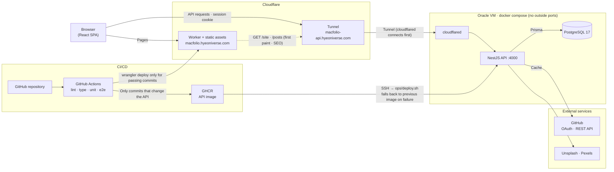
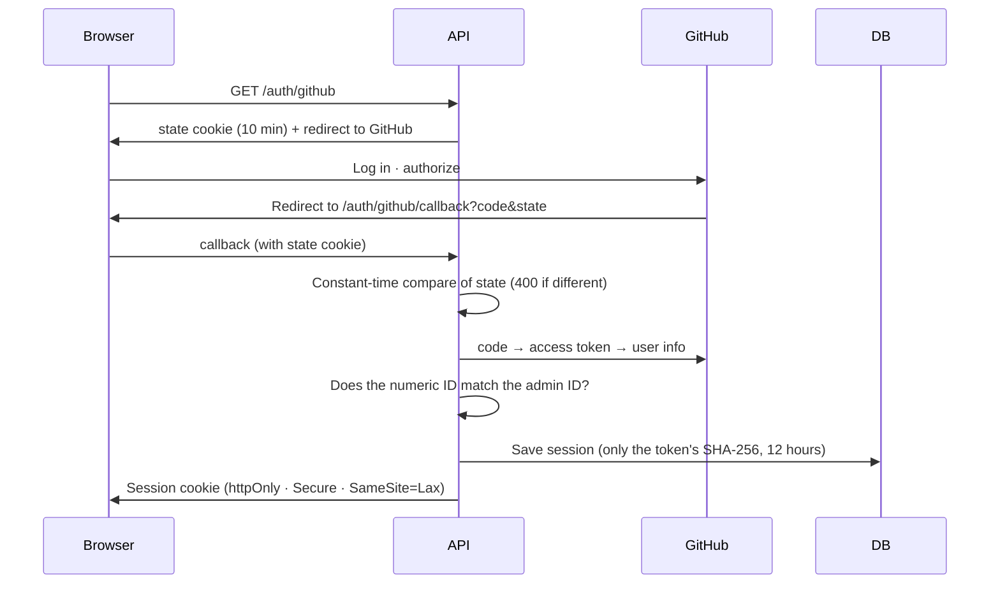
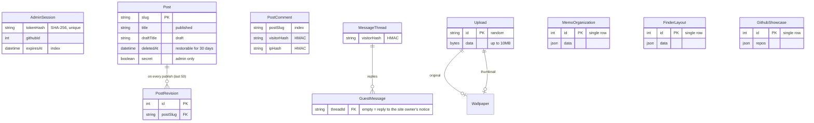

[한국어](../backend-design.md) | **English**

# Backend design

This document describes the structure and design decisions of the MacFolio API server (`apps/api`). The deployment steps are in [deployment.md](deployment.md), and the reasons for the technology choices are in the [README](../../README.en.md#tech-stack). A diagram-centred write-up of the same content is the blog post [MacFolio 백엔드 한 장으로 보기](https://macfolio.hyeoniverse.com/memo/backend-design) (Korean).

| Item            | Value                                                                                              |
| --------------- | -------------------------------------------------------------------------------------------------- |
| Runtime         | Node 22, [NestJS](https://docs.nestjs.com/), [Prisma](https://www.prisma.io/docs) 7, PostgreSQL 17 |
| Feature modules | 24 (`apps/api/src/<feature>/`); see [Modules and permissions](#modules-and-permissions)            |
| Data models     | 25, with 32 migrations (`apps/api/prisma`, as of 2026-10-23)                                       |
| Tests           | About 370 unit and e2e tests (counted by `it`). The 24 e2e files run against a real PostgreSQL     |
| Operations      | One Oracle Cloud VM, Docker Compose, Cloudflare Tunnel (no ports open to the outside)              |

## Architecture diagram

- **Same site, different subdomains**: the frontend and API both live under `hyeoniverse.com`, so the [`SameSite=Lax`](https://developer.mozilla.org/en-US/docs/Web/HTTP/Reference/Headers/Set-Cookie#samesitesamesite-value) session cookie is sent along. If the API were on `*.workers.dev` or an IP address, the browser would not send the cookie and login would fail.
- **A server with no inbound ports**: `cloudflared` opens an outbound connection to Cloudflare, and requests come in only through that connection ([Cloudflare Tunnel](https://developers.cloudflare.com/cloudflare-one/connections/connect-networks/)). Ports 80 and 443 aren't opened in the firewall, and Cloudflare handles certificates. The compose file has no `ports` at all, so the DB isn't visible outside the container network.
- **Deploy after checks**: for the frontend, only commits on main that pass `check` (including API e2e against real PostgreSQL and browser E2E) are deployed to Workers. For the API, Actions builds an image only for commits that change it, pushes it to GHCR, and calls `ops/deploy.sh` on the server over SSH to swap it in ([#100](https://github.com/hyeoniverse/MacFolio/issues/100)). If the new container fails its health check, the previous image is restored. Migrations are applied at startup with [`prisma migrate deploy`](https://www.prisma.io/docs/orm/prisma-client/deployment/deploy-database-changes-with-prisma-migrate) (the DB isn't rolled back, so migrations must also be compatible with the previous code).

## The path of a request

Every request passes through the same steps in order (`app.setup.ts`). The order of guards, pipes and exception filters follows NestJS's [Request lifecycle](https://docs.nestjs.com/faq/request-lifecycle).

| Layer                   | What it does                                                                                                                                           |
| ----------------------- | ------------------------------------------------------------------------------------------------------------------------------------------------------ |
| `trust proxy`           | Reads the real visitor IP behind the tunnel (used for rate limiting and IP records)                                                                    |
| helmet                  | Security headers                                                                                                                                       |
| CORS                    | Allows only the site's origins. Cookies only for the exact listed origins; PR previews (`*`) are read-only, and admin APIs reject that Origin with 403 |
| `ValidationPipe`        | Validates every input with DTOs and rejects any field not declared (`forbidNonWhitelisted`)                                                            |
| `AdminGuard`            | On admin-only routes, checks the session cookie against the DB on every request                                                                        |
| `ThrottlerGuard`        | Limits requests per IP and route per minute, by the `@RateLimit` name attached to each write route                                                     |
| Global exception filter | Normalizes the error shape, answers oversized bodies and malformed JSON with 413 and 400, and unexpected errors with a 500 that hides the details      |
| `SafeLogger`            | Masks DB passwords, API keys, cookies and email addresses in all logs (`common/redact.ts`)                                                             |

## Modules and permissions

The default is: anyone can read, only the admin can write. Every write route has a rate limit (`@RateLimit`, a per-minute count per IP and route), and places where visitors write (comments, likes, messages, mail) identify the author by the visitor cookie. The table in `test/routes.e2e.test.ts` pins down the list of routes along with their permissions and limits ([#160](https://github.com/hyeoniverse/MacFolio/pull/160), [#162](https://github.com/hyeoniverse/MacFolio/pull/162)). Adding a route without updating the table makes the test fail.

| Module                               | Routes                                                                                  | Who                                                                    |
| ------------------------------------ | --------------------------------------------------------------------------------------- | ---------------------------------------------------------------------- |
| auth                                 | `GET /auth/github`, `/auth/github/callback`, `/auth/me`, `POST /auth/logout`            | Login is rate-limited, `me` is admin                                   |
| posts                                | `GET /posts`, `/posts/:slug/og.png` / draft, publish, versions, restore, delete, secret | Reading is anyone, the rest is admin                                   |
| likes                                | `GET /posts/stats`, `/posts/:slug/likes`, `PUT·DELETE /posts/:slug/like` etc.           | Reading is anyone, liking is visitors                                  |
| comments                             | `GET·POST /posts/:slug/comments`, `DELETE /comments/:id`                                | Visitors (rate-limited, can delete only their own comments)            |
| messages                             | `GET·POST /messages/threads`, `DELETE /messages/:id`                                    | Visitors (rate-limited, can delete only their own messages)            |
| visitors                             | `GET /visitor`                                                                          | Issues the visitor cookie and returns the name                         |
| contact                              | `GET·POST /contact`, `/contact/mine`, `/contact/inbox`, `POST /contact/:id/reply`       | Sending and own mail is visitors, inbox and replies are admin          |
| memo                                 | `GET·PUT /memo/organization`                                                            | Reading is anyone, changing is admin                                   |
| finder                               | `GET·PUT /finder/layout`                                                                | Reading is anyone, changing is admin                                   |
| files                                | `GET·POST /files`, `GET·DELETE /files/:id`                                              | Downloading (`GET /files/:id`) is anyone, the rest is admin            |
| documents                            | `GET /documents`, `POST /documents/uploads` etc.                                        | Listing is anyone, upload/edit/delete is admin (R2)                    |
| wallpapers                           | `GET·POST·PATCH·DELETE /wallpapers`                                                     | Reading is anyone, the rest is admin                                   |
| photos                               | `GET·PUT /photos/captions`                                                              | Reading is anyone, changing is admin                                   |
| images                               | `GET /images/search` etc.                                                               | Admin (Unsplash and Pexels search)                                     |
| github                               | `GET /github/profile`, `/github/activity`, candidates, lookup, `PUT /github/showcase`   | Profile and activity are anyone, the rest is admin                     |
| site                                 | `GET /site`, `PUT·DELETE /site/profile`·`/projects`·`/resume`                           | Reading is anyone, changing is admin                                   |
| analytics                            | `POST /analytics/events`, `GET /analytics/summary` etc.                                 | Collection and totals are anyone, live view and search terms are admin |
| resources                            | `GET /resources`                                                                        | Admin (server usage, idle-reclaim risk, billing)                       |
| security                             | `GET·PUT /security`                                                                     | Reading is anyone, changing where human verification applies is admin  |
| summary · translate · speech · cover | `GET·POST /summary` etc.                                                                | Anyone (project demos, daily caps per IP and site-wide)                |
| health                               | `GET /health`                                                                           | Anyone                                                                 |

The API docs are generated automatically from the controllers with [Swagger](https://docs.nestjs.com/openapi/introduction): <https://macfolio-api.hyeoniverse.com/docs>

The site's API Docs (API 문서) app exports the same docs as `openapi.json` and renders them inside the site (Scalar; visible even when the server is down, [#95](https://github.com/hyeoniverse/MacFolio/pull/95)). When you change a controller or DTO, regenerate this file with `pnpm --filter @macfolio/api openapi` and commit it alongside. If you forget, `apps/api/src/openapi.test.ts` fails.

## Admin login

The web application flow of a [GitHub OAuth App](https://docs.github.com/en/apps/oauth-apps/building-oauth-apps/authorizing-oauth-apps) is implemented without a library ([#38](https://github.com/hyeoniverse/MacFolio/pull/38)).

- The server stores no passwords. There is one admin, verified with the GitHub account they already use.
- The admin is identified by the immutable numeric ID, not by the account name, which can change.
- Sessions live in the DB, so logging out cuts them off immediately. Once the expiry time passes, the UI re-checks on its own and switches to the logged-out state.

## Data model

The diagram shows only the blog, visitor, file and settings models out of 25. Field descriptions for analytics (`AnalyticsEvent`, `DailyStat`, …), contact mail and server resource monitoring are in the comments of `apps/api/prisma/schema.prisma`.

- **Blog posts live in two places.** Markdown files in the repository are the baseline, and posts the admin writes or edits go in `Post`. When the address (slug) matches, `Post` replaces the file. Deleting a file-based post leaves only a `deleted` marker so it no longer appears.
- **Published content and draft share one row.** While editing, only `draft*` changes, so visitors don't see it; publishing moves it into the published fields and records a `PostRevision`. If the date is later than today, visitors don't see the post until that day (scheduled publishing). The process is described in the post [바로 고치는 블로그에 임시 저장과 버전 기록 붙이기](https://macfolio.hyeoniverse.com/memo/drafts-and-versions) (Korean).

- **Secret posts are visible only to the admin.** A post with `Post.secret` set is left out of the visitor list (`GET /posts`) and the share card, and without an admin session the comments, likes, popular posts, view counts, traffic summary and memo organization treat it like a post that doesn't exist (empty list, 0, 404). The Worker builds the first-screen body, sitemap and RSS from `GET /posts` without cookies, so secret posts never get in. Only server-only posts can be secret: repository Markdown posts already have their source in the public repository and can't be hidden.

- **Settings-like values are single-row JSON.** Memo folder organization (`MemoOrganization`), Finder folder structure (`FinderLayout`: created folders, the visible location of moved files, and desktop aliases) and the repositories shown in the GitHub app (`GithubShowcase`) are read and written as a whole, so each lives in one row.

## Design decisions

| Topic                           | Chosen approach                                                                                                                                                                                                                                                                 | Alternatives                              | Rationale · risk prevented                                                                                                                                                                                                    |
| ------------------------------- | ------------------------------------------------------------------------------------------------------------------------------------------------------------------------------------------------------------------------------------------------------------------------------- | ----------------------------------------- | ----------------------------------------------------------------------------------------------------------------------------------------------------------------------------------------------------------------------------- |
| **Auth · sessions**             |                                                                                                                                                                                                                                                                                 |                                           |                                                                                                                                                                                                                               |
| Admin login                     | GitHub OAuth implemented directly. `state` remembered in a cookie and compared in constant time                                                                                                                                                                                 | Username and password, an auth library    | No passwords are stored. Prevents request forgery via a login someone else started, and timing attacks                                                                                                                        |
| Session storage                 | Random token only in the cookie, only its SHA-256 hash in the DB. Index on expiry time                                                                                                                                                                                          | JWT, storing the raw token                | Logout and expiry cut sessions off immediately on the server. Even if the DB leaks, sessions can't be hijacked                                                                                                                |
| Admin check                     | Immutable GitHub numeric ID                                                                                                                                                                                                                                                     | Account name                              | Renaming the account, or someone else taking that name, doesn't transfer the permission                                                                                                                                       |
| Cookie                          | `httpOnly` · `SameSite=Lax` · `Secure`                                                                                                                                                                                                                                          | Token in localStorage                     | Scripts can't read the token, and the cookie isn't attached to requests sent from other sites                                                                                                                                 |
| **Visitors · abuse prevention** |                                                                                                                                                                                                                                                                                 |                                           |                                                                                                                                                                                                                               |
| Visitor identification          | A 1-year cookie token stored as an HMAC with a secret key. The UI receives only whether a post is mine (`mine`) or a short ID made by hashing that value again                                                                                                                  | Sign-up, name and password                | Without signing up, you can delete only what you wrote from the same browser. The raw token never stays on the server, and the values sent to the UI can't be used to delete other people's posts                             |
| Older comments                  | Name-and-password (scrypt) comments are left as they are, and new comments use the visitor cookie                                                                                                                                                                               | Migrating everything at once              | Changes the approach without breaking data that has already accumulated                                                                                                                                                       |
| IP records                      | Only the first two parts for display and an HMAC                                                                                                                                                                                                                                | Storing the raw IP                        | Keeps personal data to a minimum while still grouping posts written by the same person                                                                                                                                        |
| Rate limiting                   | Per IP and route, per minute; seven names (login, comment, like, write, upload, demo, events), one `@RateLimit` per write route (`common/rate-limit.ts`)                                                                                                                        | A single global limit                     | Blocks brute-force logins, spam and flooding of admin routes without limiting read requests. The route table test catches any route that's missing one                                                                        |
| **Data**                        |                                                                                                                                                                                                                                                                                 |                                           |                                                                                                                                                                                                                               |
| Required fields                 | DB `CHECK` constraints (migration SQL) on top of UI and API validation                                                                                                                                                                                                          | Application validation only               | Writes that bypass the API (scripts, bugs) still can't insert an empty title or an invalid date                                                                                                                               |
| Post editing                    | Separate published content and draft, a version on every publish (last 50), scheduled publishing                                                                                                                                                                                | Overwriting a single field                | Content being edited isn't visible to visitors, and a mistaken publish can be reverted                                                                                                                                        |
| Deleting posts                  | Soft delete that records `deletedAt`, restorable for 30 days                                                                                                                                                                                                                    | Deleting immediately                      | Accidentally deleted posts can be recovered                                                                                                                                                                                   |
| Secret posts                    | A single `Post.secret` column. Every public route that takes a post address filters on the server (`posts/secret-posts.service.ts`) and answers visitors as if the post didn't exist                                                                                            | Hiding only in the UI, a separate table   | Calling the API directly doesn't reveal it, and response differences can't tell whether a secret post exists. If a deploy is rolled back, the previous code doesn't read this column, so the posts are public in the meantime |
| File uploads                    | Stored in the DB (`bytea`), 10MB limit, image format checked from the file header, EXIF and XMP (location, device) stripped from photos keeping only orientation, unguessable random ID                                                                                         | Server disk, object storage               | A single backup (`pg_dump`) captures posts and files together. Blocks files with only a renamed extension and guessing of addresses, and keeps photo location data from being published                                       |
| **External integrations**       |                                                                                                                                                                                                                                                                                 |                                           |                                                                                                                                                                                                                               |
| GitHub data                     | Server cache (10 minutes with a token, 30 without). Concurrent requests are coalesced into one, the last value is served on failure, and saving invalidates it immediately. The contribution calendar and activity are cached separately, so if one fails the other still shows | Calling from the browser directly         | GitHub calls stay constant regardless of visitor count (60 per hour without a token). The UI isn't empty even during a GitHub outage                                                                                          |
| Testing external APIs           | External calls gathered into a single client class, replaced with a fake class in e2e                                                                                                                                                                                           | Testing against the real API              | Test results are always the same regardless of the network or rate limits                                                                                                                                                     |
| **Infrastructure · deployment** |                                                                                                                                                                                                                                                                                 |                                           |                                                                                                                                                                                                                               |
| Server exposure                 | Cloudflare Tunnel, no outside ports in compose                                                                                                                                                                                                                                  | Opening 80 and 443, nginx + Let's Encrypt | Fewer entry points to attack, the server IP isn't exposed, and certificate renewal isn't a concern                                                                                                                            |
| Server                          | Oracle Cloud Always Free VM + Docker Compose                                                                                                                                                                                                                                    | Free hosting such as Render               | Doesn't sleep when there are no requests (free hosting sleeps after 15 minutes and takes about a minute to wake). I run a Linux VM and Docker myself                                                                          |
| Frontend deployment             | `wrangler deploy` from GitHub Actions only for commits that pass `check`, a preview URL for each PR                                                                                                                                                                             | Cloudflare Workers Builds                 | No deploy skips the tests. I moved after running into deploys stalling because of outages in the platform's build environment                                                                                                 |

## Tests

- **Unit ([Vitest](https://vitest.dev/))**: checks pure functions kept apart from the DB, such as input rules, sessions and hashes, visitor names, and shaping GitHub responses. Rules are collected in `rules.ts`, and controllers only use their results.
- **e2e ([supertest](https://github.com/ladjs/supertest))**: in CI, a [PostgreSQL service container](https://docs.github.com/en/actions/use-cases-and-examples/using-containerized-services/creating-postgresql-service-containers) is started and the tests run against a real DB. They check permissions (401 if not admin, 400 for rule violations), that only hashes are stored, and rate limiting (429). GitHub and the photo services are swapped for fake classes.
- **Browser E2E ([Playwright](https://playwright.dev/))**: frontend tests run against a fake API (`apps/react/e2e/fakeApi.ts`) built with [`page.route`](https://playwright.dev/docs/network#modify-responses). Response shapes share the `@macfolio/contracts` types, so when the API shape changes, tests on both sides are updated together.

## Operations

| Task                      | Command (on the server)                                                                       |
| ------------------------- | --------------------------------------------------------------------------------------------- |
| Deploy a specific version | `~/macfolio/ops/deploy.sh sha-<7-char commit>` (normally run automatically by GitHub Actions) |
| Status and logs           | `cd ~/deploy && docker compose ps`, `docker compose logs --tail=40 api`                       |
| Backup                    | `~/macfolio/ops/backup.sh` (cron runs it daily; kept 7 days on the server, 30 days in R2)     |
| Restore                   | `~/macfolio/ops/restore.sh <backup file or r2: path>`                                         |
| Security check            | `~/macfolio/ops/audit.sh` (SSH, open ports, container users, automatic updates)               |

Detailed steps and troubleshooting are in [deployment.md](deployment.md).

## Related posts (Korean)

- [MacFolio 백엔드 한 장으로 보기 - 구성도와 설계 결정](https://macfolio.hyeoniverse.com/memo/backend-design)
- [정적 사이트에 관리자 로그인 붙이기](https://macfolio.hyeoniverse.com/memo/admin-login-github-oauth)
- [바로 고치는 블로그에 임시 저장과 버전 기록 붙이기](https://macfolio.hyeoniverse.com/memo/drafts-and-versions)
- [이름·비밀번호 없이 쓰는 메시지와 댓글 - 방문자 쿠키로 정하는 이름](https://macfolio.hyeoniverse.com/memo/visitor-identity)
- [쓰기 경로 33개에 같은 방식으로 요청 제한 걸기](https://macfolio.hyeoniverse.com/memo/rate-limit-all-writes)
- [API 경로 64개를 표 하나로 고정하기](https://macfolio.hyeoniverse.com/memo/api-route-table-test)
- [오류 응답은 감추고, 로그는 가리고](https://macfolio.hyeoniverse.com/memo/error-log-masking)
- [올린 사진의 EXIF를 지우되 방향은 남기기](https://macfolio.hyeoniverse.com/memo/upload-strip-exif)
- [응답 타입을 두 번 적지 않기 — @macfolio/contracts와 zod](https://macfolio.hyeoniverse.com/memo/contracts-comments)
- [API 서버를 무료로 띄우기 - Oracle VM과 Cloudflare Tunnel](https://macfolio.hyeoniverse.com/memo/deploy-api-oracle-tunnel)
