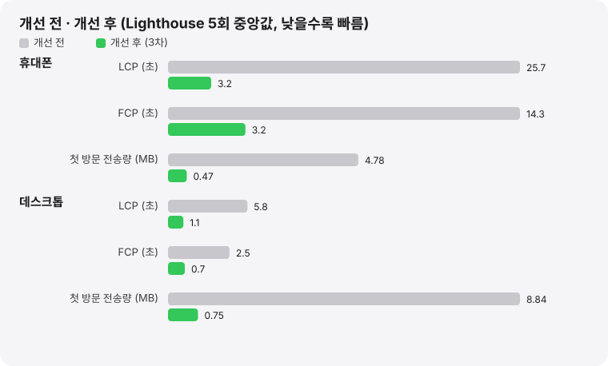
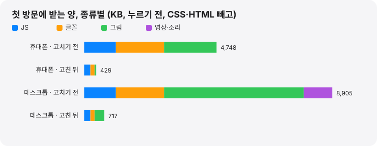

[한국어](../performance.md) | **English**

# Performance measurements

A record of measuring the first-visit performance of the site (macfolio.hyeoniverse.com), fixing the bottlenecks, and measuring again under the same conditions.

- Round 1: [#319](https://github.com/hyeoniverse/MacFolio/pull/319)
- Rounds 2 and 3: [#323](https://github.com/hyeoniverse/MacFolio/pull/323)
- Re-measurement and Round 4: October 23, 2026 ([#338](https://github.com/hyeoniverse/MacFolio/pull/338)). The first measurement of production with Rounds 1–3 deployed, and a fix for the initial bundle that had grown again in the meantime
- Round 5: October 23, 2026 ([#PRNUM](https://github.com/hyeoniverse/MacFolio/pull/PRNUM)). Found and fixed why phone LCP was sometimes counted again in the 4-second range, and added a [performance budget](#performance-budget) to CI

## Summary

Values measured locally under the same conditions. Median of 5 [Lighthouse](https://developer.chrome.com/docs/lighthouse/overview) runs; items that varied widely between runs are given as ranges.

**Phone**

| Item                                 | Before  | Round 1 | Round 2 | Round 3 | Round 4 (re-measured) | Round 5       |
| ------------------------------------ | ------- | ------- | ------- | ------- | --------------------- | ------------- |
| Lighthouse performance score         | 55      | 68      | 69\~72  | 78\~87  | 78\~97                | **85\~99**    |
| FCP (first contentful paint)[^fcp]   | 14.3s   | 4.0s    | 4.0s    | 3.2s    | 2.1\~3.2s             | **1.7\~3.3s** |
| LCP (largest contentful paint)[^lcp] | 25.7s   | 6.2s    | 5.8s    | 3.2s    | 2.1\~4.5s             | **1.7\~3.4s** |
| TBT (total blocking time)[^tbt]      | 115ms   | 0ms     | 0ms     | 0ms     | 0ms                   | **0ms**       |
| Transfer size on first visit         | 4,893KB | 1,011KB | 725KB   | 483KB   | 485KB                 | **278KB**     |
| Requests                             | 61      | 74      | 75      | 49      | 49                    | **51**        |
| Transfer size through entering       | 4,934KB | 1,053KB | 767KB   | 768KB   | 769KB                 | **772KB**     |

**Desktop**

| Item                           | Before  | Round 1 | Round 2 | Round 3 | Round 4 (re-measured) | Round 5       |
| ------------------------------ | ------- | ------- | ------- | ------- | --------------------- | ------------- |
| Lighthouse performance score   | 62      | 90      | 93      | 98      | 98\~100               | **100**       |
| FCP                            | 2.5s    | 0.8s    | 0.8s    | 0.7s    | 0.7s                  | **0.5\~0.7s** |
| LCP                            | 5.8s    | 1.9s    | 1.7s    | 1.1s    | 0.7\~1.1s             | **0.5\~0.7s** |
| TBT                            | 9ms     | 0ms     | 0ms     | 0ms     | 0ms                   | **0ms**       |
| Transfer size on first visit   | 9,050KB | 2,177KB | 1,848KB | 771KB   | 772KB                 | **278KB**     |
| Requests                       | 111     | 101     | 102     | 49      | 49                    | **51**        |
| Transfer size through entering | 9,065KB | 2,248KB | 1,895KB | 1,895KB | 1,897KB               | **1,900KB**   |

- [CLS](https://web.dev/articles/cls) (layout shift) was already 0 before.
- Transfer sizes are compressed transfer sizes.
- "Transfer size on first visit" is what Lighthouse counts, up to before the loading screen is tapped.
- "Transfer size through entering" is what Playwright received until 3 seconds after tapping the loading screen.

Round 3 didn't remove transfer, it **deferred it until after entering**. The transfer size through entering is the same as Round 2. The desktop (the home screen on phones), which used to be hidden behind the loading screen, is rendered during the 2.5 seconds the progress bar fills after the tap.

The phone score varied widely between runs in both Round 3 and Round 4, because in some runs the start prompt rendered by React was counted again as LCP (4.5s). Round 5 found and fixed the cause ([Round 5](#round-5-fixing-the-lcp-recount-and-a-performance-budget)). The remaining spread in Round 5 (1.7\~3.4s) comes from simulate's estimate depending on how many bundles finished before the first render ([Reading the numbers](#reading-the-numbers)).

The drop in first-visit transfer in Round 5 (phone 487 → 278KB, desktop 775 → 278KB) is **deferral until after the tap**. The body font (149KB) and wallpaper (phone 60KB, desktop 348KB) are received during the 2.5 seconds the progress bar fills after the loading screen is tapped. Transfer through entering is the same as Round 4.





### Production site

Values from running the same Lighthouse 5 times each against the production URL (Cloudflare). It's a real network, so the numbers vary more than locally.

| Item                         | Phone before | After Round 1 | After Round 3 (re-measured) | Desktop before | After Round 1 | After Round 3 (re-measured) |
| ---------------------------- | ------------ | ------------- | --------------------------- | -------------- | ------------- | --------------------------- |
| Lighthouse performance       | 53           | 73            | **98** (86\~98)             | 60             | 89            | **97** (96\~100)            |
| FCP                          | 15.0s        | 2.4s          | **1.9s** (1.8\~3.3)         | 2.9s           | 0.9s          | **1.0s** (0.6\~1.05)        |
| LCP                          | 31.5s        | 7.1s          | **1.9s** (1.8\~3.3)         | 5.8s           | 2.1s          | **1.0s** (0.6\~1.05)        |
| Transfer size on first visit | 6,342KB      | 1,239KB       | **602KB**                   | 7,134KB        | 3,229KB       | **889KB**                   |

- "Before" is main before [#319](https://github.com/hyeoniverse/MacFolio/pull/319) was deployed.
- "After Round 3" is production on October 23, 2026 (with the quote widget; Round 4's initial bundle fix not yet deployed).
- Production transfers about 100KB more on first visit than local. There are two reasons.
  - Cloudflare serves JS at a lower compression level than the local measurement server (maximum brotli). The same files are 10–15% larger.
  - The production Worker injects body content for search engines into the HTML. Local `index.html` 2KB → production 15KB.
- After entering, desktop transfers 1.9MB of images in production versus 1.0MB locally. The project content edited by the admin (on the server) goes into the Safari page that opens first.

### Phone with real throttling

Lighthouse's default ([simulated throttling](https://github.com/GoogleChrome/lighthouse/blob/main/docs/throttling.md)) computes a slow network from a fast recording. Measuring with the browser actually slowed down (`--throttling-method=devtools`, same slow 4G and 4x CPU) gives this.

| Item                         | Before  | Round 2 | Round 3   | Round 4 (re-measured)      |
| ---------------------------- | ------- | ------- | --------- | -------------------------- |
| Lighthouse performance       | 65      | 78      | 92        | **100** (one of 5 runs 92) |
| FCP                          | 9.2s    | 1.2s    | 1.2\~2.7s | **1.2s**                   |
| LCP                          | 12.1s   | 6.0s    | 1.2\~2.7s | **1.2s**                   |
| Transfer size on first visit | 5,932KB | 782KB   | 483KB     | **485KB**                  |

From Round 3 on, LCP equals FCP. The first render (the Apple logo and start prompt in the HTML) is the largest content.

## Round 4: what the re-measurement found

Transfer on first visit grew again as features were added after Round 3 (phone 483KB → 505KB, desktop 771KB → 793KB). Opening the builds of the Round 3 merge (`3e0c919ca`) and current main the same way and comparing per-file transfer sizes, the only file that changed was the `boot` bundle (46KB → 65KB compressed).

| Cause                                                                                                                                                          | Size                                 | Fix                                                                                                                                                                |
| -------------------------------------------------------------------------------------------------------------------------------------------------------------- | ------------------------------------ | ------------------------------------------------------------------------------------------------------------------------------------------------------------------ |
| The quote widget's ([#330](https://github.com/hyeoniverse/MacFolio/pull/330)) 365 quotes (`desktop/widgets/quotes.ts`) were included in `boot` with the widget | 66KB source, `boot` +19KB compressed | Split the quote widget with [`React.lazy`](https://react.dev/reference/react/lazy) (`Widget.tsx`). It's received as a separate chunk when the widget first renders |

The quote widget only appears with the desktop after the loading screen is tapped, so there's no need to receive it ahead on the first visit. After the fix, `boot` is 47KB compressed and the first visit transfers 485KB on phone and 772KB on desktop, back to Round 3 levels.

Growth like this doesn't show up unless you measure. So Round 5 added a CI [performance budget](#performance-budget).

## Round 5: fixing the LCP recount and a performance budget

### Why phone LCP was sometimes counted again in the 4-second range

In local simulate phone measurements, LCP split between 3.3s and 4.5\~4.7s. In the 4-second runs the LCP element was not the HTML start prompt (`#boot-splash p`) but the one React rendered (`p.loading-text`). Runs were classified using the `largestContentfulPaint::Candidate` and `PaintTimingVisualizer::LayoutObjectPainted` events in the Lighthouse trace.

| Runs               | HTML start prompt    | React removes `#boot-splash` and renders | LCP candidate                       | Simulate LCP |
| ------------------ | -------------------- | ---------------------------------------- | ----------------------------------- | ------------ |
| Normal (main, 30)  | rendered at 22\~79ms | **after** the HTML prompt's LCP record   | HTML start prompt (render +9\~28ms) | 2.6\~3.3s    |
| 4-second (main, 7) | rendered at 29\~55ms | **before** the HTML prompt's LCP record  | only the React start prompt         | 4.4\~4.7s    |

- The HTML start prompt was rendered in both cases. But its LCP candidate appeared 9\~28ms after rendering, and in runs where `App.tsx` removed `#boot-splash` before that, no candidate was recorded for it
- The React start prompt rendered next then becomes the first LCP candidate. Simulate counts the app scripts executed before that time and the web font (149KB) received in between as needed for LCP, giving 4.5s
- The earlier guess that the text box grows when the web font swaps in was not the cause. In the 4-second runs the React prompt was the same 3,078px² as the HTML prompt (web font) or smaller (2,754px², fallback font)
- How often the 4-second runs occurred depended on load on the measuring machine: about half in earlier measurements the same day, 3 of 28 in the alternating runs

| Change                                                                                                   | Effect                                                                                                            |
| -------------------------------------------------------------------------------------------------------- | ----------------------------------------------------------------------------------------------------------------- |
| Remove `#boot-splash` when the loading screen is **tapped**, not when React first renders (`App.tsx`)    | The HTML prompt's LCP record isn't lost. Tapping ends LCP recording, so removal after that has no effect          |
| Render the loading screen's start prompt in the same system font as `#boot-splash` (`LoadingScreen.css`) | Same text box, so the React prompt doesn't become a new LCP candidate. The web font isn't received before the tap |

React's loading screen renders at the same position and size as `#boot-splash`, later in DOM order, so it covers it. `e2e/mobile-loading.spec.ts` checks that the two boxes and text boxes match.

| Local phone simulate (28 alternating runs each) | Before (main) | After (Round 5)         |
| ----------------------------------------------- | ------------- | ----------------------- |
| LCP of 4s or more                               | 3 runs        | **0 runs**              |
| LCP range                                       | 2.6\~4.7s     | **1.7\~3.4s**           |
| LCP median                                      | 3.3s          | 3.3s                    |
| Score range                                     | 77\~93        | **85\~99**              |
| LCP element                                     | varies by run | always `#boot-splash p` |

Desktop had the same cause: LCP was 1.2s in 1 of 5 runs (the React prompt). In Round 5 all 5 runs are 0.5\~0.7s.

### The wallpaper showing outside the phone loading screen

On phones (especially iOS Safari), the loading screen didn't cover the whole screen and the home screen background showed at the bottom. It doesn't reproduce with Playwright's (Chromium) phone emulation, so both candidate causes were addressed.

- **Box size:** the loading screen was `width: 100vw; height: 100vh`, while the home screen (`.mobile-home`) is `inset: 0; height: 100dvh`. In iOS Safari `vh` is based on the toolbar-collapsed (largest) viewport and `dvh` on the currently visible area, so the two boxes differ as the toolbar appears and disappears ([MDN: viewport units](https://developer.mozilla.org/en-US/docs/Web/CSS/length#relative_length_units_based_on_viewport))
- **Background outside the box:** when area outside the box shows, such as behind the toolbar or when the page is pulled down, the html/body background is shown. The `booting` class was removed as soon as the loading screen appeared, so that background was the wallpaper

The loading screen and `#boot-splash` now use the same `inset: 0; height: 100dvh` as the home screen, and html/body stay black (`booting`) until the loading screen is tapped. Even if area outside the box shows, it's the same black as the loading screen. The test (`e2e/mobile-loading.spec.ts`) checks at 390×844, 430×932 and 375×667 that the loading screen covers the whole viewport, that the topmost element at the screen edges and bottom is the loading screen (including while the home screen renders after the tap), and that the html background is black. The real iPhone Safari toolbar behavior is to be checked on a device.

### Performance budget

Round 4's regression (quote widget, +19KB) was only found by re-measuring. To surface growth like that in the PR itself, CI's `check` job runs `apps/react/scripts/perf/budget.mjs` after the build to check the size of the first-visit bundles.

| Item                                                                                                               | Measured (October 23, 2026) | Limit     | Headroom          |
| ------------------------------------------------------------------------------------------------------------------ | --------------------------- | --------- | ----------------- |
| `boot` bundle (`assets/boot-*.js`)                                                                                 | 49.4KB                      | **55KB**  | 5.6KB (about 10%) |
| First-visit bundles total (`<script type="module">`, `modulepreload`, `preload`, `stylesheet` in `index.html`, 41) | 251.6KB                     | **265KB** | 13.4KB (about 5%) |

- Sizes are brotli level 9 (same as the measurement server `serve.mjs`), and KB is 1,024 bytes
- The limits were chosen so that Round 4's regression (+19KB) fails both items. The total has less headroom because small increases add up across many bundles
- Fonts and images are not included. From Round 5 they aren't received on the first visit (before the tap)

When a limit is exceeded, the CI log and failure summary (annotation) show which item went over, by how much, and the largest files. Below is an example made to fail by lowering the limits.

```text
$ BUDGET_BOOT_KB=45 BUDGET_INITIAL_KB=240 pnpm --filter @macfolio/react perf:budget
boot 번들(assets/boot-wshPrf4V.js)이 49.4KB로, 상한 45.0KB보다 4.4KB 큽니다.

첫 방문 번들(index.html이 처음부터 요청하는 41개)이 251.7KB로, 상한 240.0KB보다 11.7KB 큽니다.
크기 상위 8개:
    59.4KB  assets/jsx-runtime-C2l8KVV-.js
    49.4KB  assets/boot-wshPrf4V.js
    34.6KB  assets/boot-DhNtOT2g.css
    28.8KB  assets/preload-helper-qmxL7HwO.js
    ...
```

**What to do when it fails**

1. Reproduce locally with `pnpm build` and then `pnpm --filter @macfolio/react perf:budget`
2. Find the bundle that grew in the list of largest files and check which modules were newly included. Most often, as in Round 4, a component or data not needed for the first screen was imported statically
3. If it's only needed after the loading screen is tapped, split it with [`React.lazy`](https://react.dev/reference/react/lazy) or `import()`
4. If the growth is truly needed for the first screen, raise both the table in this document and `BUDGET` in `budget.mjs`, and note the reason and measurements in the PR. The `BUDGET_BOOT_KB` and `BUDGET_INITIAL_KB` environment variables change the limits for local experiments

## How it was measured

### Conditions

- **Tools:** Lighthouse 12.8.2 (performance only), Playwright 1.64 (Chromium 156)
- **Phone:** Lighthouse defaults. Simulates slow 4G (150ms round trip, 1.6Mbps) and 4x CPU slowdown (simulated throttling)
- **Desktop:** `--preset=desktop` (40ms round trip, 10Mbps, CPU unchanged)
- **Server:** the built `dist` is served by a local static server (`apps/react/scripts/perf/serve.mjs`).
  - Text files are compressed with brotli.
  - Screen paths respond with `index.html`, and missing `/assets/*` with 404.
  - Same approach as the production Cloudflare Worker, but without the Worker's first-screen content injection (SEO) and CSP
- **Runs:** 5 runs each on the same computer, using the median. One at a time so they don't overlap with builds or other measurements. Measurements that overlapped with other work were discarded and re-run
- **Builds:**
  - Before: `52f493bb2` ([#311](https://github.com/hyeoniverse/MacFolio/pull/311) merged)
  - Round 1: [#319](https://github.com/hyeoniverse/MacFolio/pull/319)
  - Rounds 2 and 3: builds applying Round 2 and then Round 3 on top of main after Round 1
  - Round 4: main on October 23, 2026 (`35ecb8006`) with the quote widget split applied

Production was measured by passing the production URL to the same `measure.mjs`.

### Reading the numbers

- **Phone FCP under simulate:**
  - Locally, before the first render (47ms), all 33 bundles listed for [modulepreload](https://developer.mozilla.org/en-US/docs/Web/HTML/Reference/Attributes/rel/modulepreload) (about 400KB) have already been received.
  - Simulate treats "what was received before the first render" as needed for the first render and computes the slow-network time from it. So phone FCP comes out in the 3-second range.
  - With real throttling, the HTML's first render is at 1.2s (table above). So look at both values for phone FCP.
- **Why phone LCP varied (up to Round 4):**
  - In runs where React removed `#boot-splash` too early, no LCP candidate was recorded for the HTML start prompt and React's start prompt became LCP (4.5s). Fixed in Round 5 ([Round 5](#round-5-fixing-the-lcp-recount-and-a-performance-budget)).
- **Remaining spread in Round 5 (1.7\~3.4s):**
  - The LCP element is always the HTML start prompt. Simulate counts requests finished before that render as needed for LCP, so the value depends on how many modulepreload bundles arrived locally before the first render.
- **The local server is HTTP/1.1:**
  - It allows 6 concurrent connections, so the 33 bundles queue up.
  - Production (Cloudflare) is HTTP/2 and receives them together over one connection. This is also why production phone FCP (1.9s) is faster than local simulate (3.2s).

### Measuring again

```bash
pnpm build
cd apps/react
node scripts/perf/serve.mjs dist 4810 &
node scripts/perf/measure.mjs http://localhost:4810 perf.json 5
```

`measure.mjs` measures the following and saves the medians and per-run values as JSON.

- Runs Lighthouse N times each for phone and desktop (`pnpm dlx lighthouse@12.8.2`, using the Chrome Playwright downloaded).
- Measures entering N times with Playwright. Without throttling, it looks at:
  - time until the loading screen appears
  - time from the tap until the desktop (the home screen on phones) appears
  - transfer size up to that point
  - the JS heap

Options:

- Prefix with `THROTTLING=devtools` to measure with the browser actually slowed down.
- Pass the production URL (`https://macfolio.hyeoniverse.com`) instead of the local address to measure production.
- If the port is already in use, `serve.mjs` doesn't start, and `measure.mjs` ends up measuring whatever other server is on that port. Use a free port.

## Bottleneck analysis (before)

Lighthouse's request list and the build output before the fixes pointed to five causes.

| Cause                                            | Size (compressed)                      | Impact                                                                                               |
| ------------------------------------------------ | -------------------------------------- | ---------------------------------------------------------------------------------------------------- |
| Body font `AppleSDGothicNeoR.ttf` (a full TTF)   | 3.8MB (1.7MB)                          | A third of the transfer. Text on the first screen waits for this font                                |
| Raw text of 199 blog posts in the initial bundle | 2.4MB (740KB)                          | `import.meta.glob(..., { eager: true })`, so it's loaded along even when the desktop icons import it |
| All app code in the initial bundle (`boot`)      | 890KB (250KB)                          | Only Notes, Finder and TextEdit were split out                                                       |
| Large images · videos                            | Icons 1.2MB, JPG wallpapers, video 1MB | 2560px icons, videos and poster images of the Safari page that opens first, all at once              |
| The loading screen rendered by JS                | -                                      | A black screen on phones for 14 seconds until the initial bundle was fully received                  |

In addition, the Music app received the first part of 7 MP3s on the first visit to find track lengths, and phones also received the desktop wallpaper (2048px) they never use.

## Fixes

### Round 1 (#319)

| Change                                                                                                                         | Reduction                                                              |
| ------------------------------------------------------------------------------------------------------------------------------ | ---------------------------------------------------------------------- |
| Every app is loaded when first opened (`lazy` in `apps/registry.ts`)                                                           | Initial bundle 250KB → 47KB (compressed)                               |
| Raw blog text is received when the list is first queried (`memo/repository/contentFiles.ts`)                                   | 740KB on first visit                                                   |
| Desktop icons and the Dock trash don't receive blog posts (`useLocations({ posts: false })`)                                   | 600KB on desktop first visit                                           |
| Repository docs: paths first, raw text when Finder opens them (`finder/docPaths.ts`)                                           | 75KB on first visit                                                    |
| Split the font into two woff2 pieces (`scripts/subset-font.py`, `unicode-range`)                                               | 1.7MB → 149KB (232KB more only when rare Hangul appears)               |
| Shrink app icons to 256px (`scripts/optimize-icons.py`)                                                                        | Icons 1,171KB → 428KB                                                  |
| Convert wallpapers to WebP (`scripts/optimize-wallpapers.py`)                                                                  | 7.9MB → 2.3MB (default desktop 563 → 348KB, phone 308 → 60KB)          |
| On phones, use the phone wallpaper for the background too (`index.css`)                                                        | 348KB on phone first visit                                             |
| Record track lengths ahead of time, and don't receive tracks before playback (`TRACK_SECONDS` in `music/library.ts`)           | MP3 heads (560KB in a production phone measurement)                    |
| Load project-page videos and poster images when they near the screen (`safari/project/useNearView.ts`)                         | 1MB of video and dozens of images on desktop first visit               |
| Loading-screen Apple logo as SVG instead of a font glyph, rendered by the HTML before scripts (`#boot-splash` in `index.html`) | Phone FCP 14.3s → 4.0s                                                 |
| List the `boot` bundle and its dependencies as modulepreload in `index.html` (`bootPreloadPlugin` in `vite.config.ts`)         | Bundles that were received only after `main` ran are received together |

The font puts the 2,350 KS X 1001 precomposed syllables plus Latin, punctuation and jamo in `core` (149KB), and the remaining 8,822 Hangul syllables in `ext` (232KB). Two `@font-face` rules with the same name and different [`unicode-range`](https://developer.mozilla.org/en-US/docs/Web/CSS/@font-face/unicode-range) values are defined, and the browser downloads `ext` only when the page has a character that isn't in `core`. The PDF résumé uses the TTF as is.

### Round 2 (#323)

| Change                                                                            | Reduction                                             |
| --------------------------------------------------------------------------------- | ----------------------------------------------------- |
| App icons as 192px WebP (`scripts/optimize-icons.py`), with the screen using WebP | Icons 428KB → 51KB                                    |
| Music album art as 512px WebP                                                     | 742KB → 146KB                                         |
| The menu bar Apple logo as an SVG component (`shared/ui/AppleLogo.tsx`)           | Font Awesome brands 113KB on the desktop first screen |

The icon PNGs weren't deleted. Project content the admin saved on the server may still contain the old PNG URLs.

I also tried merging small shared modules into one bundle with Rolldown's `codeSplitting.groups` to reduce the bundle count. Dependent modules came along and produced a 672KB bundle; excluding dependencies pulled in every blog post (small modules) for 596KB, so it wasn't applied. Production is HTTP/2, so the cost of the bundle count is smaller there than locally.

### Round 3 (#323)

Through Round 2, the phone LCP element was the "Files" icon on the home screen. But on the first visit the loading screen ("Tap to start loading") covers the home screen, so this icon isn't visible. Chrome counts hidden elements as LCP candidates too. Running app code to render an invisible screen and receiving icons, widget images and weather used up the first visit's network and CPU.

| Change                                                                                                                      | Effect                                                             |
| --------------------------------------------------------------------------------------------------------------------------- | ------------------------------------------------------------------ |
| Render the desktop (the home screen on phones) after the loading screen is tapped (`App.tsx`, `onStart` of `LoadingScreen`) | Transfer before entering: phone 725 → 483KB, desktop 1,848 → 771KB |
| Include the start prompt in the HTML's first render (`#boot-splash`) too. "Tap" on phones, "Click" on desktop (media query) | LCP becomes the prompt the HTML renders first                      |
| If tapped before the scripts arrive, `theme-boot.js` records it and the loading screen starts as soon as it appears         | No need to tap twice                                               |

The desktop renders during the 2.5 seconds the progress bar fills after the tap, so it's visible as soon as the loading screen lifts. The time from the tap until the desktop appears grew from 0.13s to 0.17s, but that time is behind the loading screen.

### Round 4 (re-measurement)

See [Round 4: what the re-measurement found](#round-4-what-the-re-measurement-found) above. Splitting the quote widget with `React.lazy` brought the `boot` bundle back from 65KB to 47KB compressed.

### Round 5 (#PRNUM)

See [Round 5: fixing the LCP recount and a performance budget](#round-5-fixing-the-lcp-recount-and-a-performance-budget) above.

| Change                                                                                                   | Effect                                                                                                           |
| -------------------------------------------------------------------------------------------------------- | ---------------------------------------------------------------------------------------------------------------- |
| Remove `#boot-splash` when the loading screen is tapped (`App.tsx`)                                      | Phone LCP 4-second runs 3/28 → 0/28                                                                              |
| Loading screen start prompt in the same system font as `#boot-splash` (`LoadingScreen.css`)              | Web font 149KB deferred until after the tap                                                                      |
| Keep the black html/body background (`booting`) until the loading screen is tapped (`LoadingScreen.tsx`) | No wallpaper shows outside the phone loading screen. Wallpaper 60KB (desktop 348KB) deferred until after the tap |
| Loading screen and `#boot-splash` use `inset: 0; height: 100dvh` (`LoadingScreen.css`, `index.html`)     | Same box as the home screen                                                                                      |
| CI performance budget (`scripts/perf/budget.mjs`, `check` in `ci.yml`)                                   | Fails above `boot` 55KB or first-visit bundles 265KB                                                             |

### Problems fixed along the way

Switching apps to load when first opened broke 16 E2E tests.

- **The shell relied on an app's CSS.** The home indicator and app switcher use styles in `desktop/window/Window.css`, which is imported by the window frame (`Window.tsx`), and the window frame was imported only by apps. While apps were in the initial bundle, it happened to always be loaded. The shell (`Desktop.tsx`) now loads it from the start
- **The status bar color updates briefly late.** Right after an app opens, the app screen isn't there yet, so it reads the home screen color underneath. It re-reads every 0.8 seconds and catches up quickly
- **Tests checked too early.** Tests that counted list items or pressed shortcuts as soon as the window appeared now wait until the app has rendered. Notes receives the raw post bundle together with the app, so the list is never briefly empty

## Remaining work

- **Font and wallpaper after entering:** from Round 5 the body font and wallpaper are received after the tap. On a slow network, if the desktop wallpaper (348KB) doesn't arrive within the 2.5 seconds the progress bar fills, a black background may show briefly right after the loading screen lifts. To be checked with real throttling
- **Device check:** whether the loading screen covers down to below the iPhone Safari toolbar is to be checked on a real device
- **Phone transfer after entering:** 769KB is unchanged. The 33 initial bundles and the Font Awesome solid font (117KB) remain. Since icon names can be picked in project content (on the server), it's hard to keep only the icons in use
- **Production measurement of Rounds 4 and 5:** measure the production URL again after deploying

## Related posts (Korean)

- [성능 측정 리포트 — 휴대폰 LCP 25.7초에서 3.2초로](https://macfolio.hyeoniverse.com/memo/site-performance-report)
- [첫 방문 전송량 9MB를 0.8MB로 — 글꼴, 글 원문, 앱 코드, 이미지 최적화 과정](https://macfolio.hyeoniverse.com/memo/site-performance-diet)
- [성능 재측정 — 운영 휴대폰 98점, 그리고 다시 커진 첫 번들](https://macfolio.hyeoniverse.com/memo/site-performance-remeasure)
- [성능 5차 — 휴대폰 LCP가 4초대로 다시 집계되던 원인과 CI 성능 예산](https://macfolio.hyeoniverse.com/memo/site-performance-lcp-budget)

[^fcp]: [First Contentful Paint](https://web.dev/articles/fcp): when the first content such as text or an image is rendered.

[^lcp]: [Largest Contentful Paint](https://web.dev/articles/lcp): when the largest text block or image in the viewport is rendered.

[^tbt]: [Total Blocking Time](https://web.dev/articles/tbt): the sum of the time beyond 50ms of every main-thread task after FCP; it reflects input delay.
