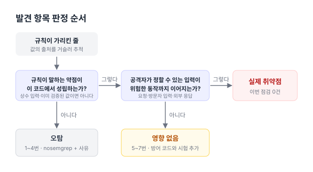

[한국어](../security-scan.md) | **English**

# Security scan (SAST, SCA)

I scanned the MacFolio code and dependencies with static analysis (SAST)[^sast] and software composition analysis (SCA)[^sca] tools, and recorded a verdict and the reasoning for each finding ([#213](https://github.com/hyeoniverse/MacFolio/issues/213), [#252](https://github.com/hyeoniverse/MacFolio/pull/252)). The scan date is 2026-10-18 and the base commit is `aa23e0a` (main).

Verdicts fall into three categories.

- **Real vulnerability**: input an attacker can reach leads all the way to a dangerous operation.
- **False positive**: the risk the rule points to does not hold in this code (the input is a constant or is already validated).
- **No impact**: the code does have the shape of the weakness the rule describes, but an attacker cannot choose the input, so no harm results.



## Tools and versions

| Tool                                                                      | Version          | Ran?                               | Command                            |
| ------------------------------------------------------------------------- | ---------------- | ---------------------------------- | ---------------------------------- |
| [Semgrep CE](https://semgrep.dev/docs/)                                   | 1.181.0          | Ran                                | 1–3 below                          |
| [pnpm audit](https://pnpm.io/cli/audit)                                   | pnpm 10.34.5     | Ran                                | `pnpm audit`, `pnpm audit --prod`  |
| [OWASP Dependency-Check](https://owasp.org/www-project-dependency-check/) | 13.0.0 (Java 21) | **Failed** (no NVD API key)        | 4 below                            |
| [osv-scanner](https://google.github.io/osv-scanner/)                      | 2.7.0            | Ran (in place of Dependency-Check) | 5 below                            |
| [pnpm licenses](https://pnpm.io/cli/licenses)                             | pnpm 10.34.5     | Ran                                | `pnpm licenses list --prod --json` |

```sh
# 1. Chosen rule packs (112 rules)
semgrep scan --config p/owasp-top-ten --config p/typescript --config p/nodejs --config p/javascript \
  --metrics=off $EXCLUDE --json --output semgrep.json --sarif-output semgrep.sarif apps/react apps/api packages

# 2. Auto-selected rules (266 rules. --config auto sends repository info, so --metrics=off can't be used)
semgrep scan --config auto $EXCLUDE --json --output semgrep-auto.json apps/react apps/api packages

# 3. Supplementary packs (58 rules)
semgrep scan --config p/react --config p/secrets --config p/xss --config p/jwt --metrics=off $EXCLUDE apps/react apps/api packages

# EXCLUDE
--exclude node_modules --exclude dist --exclude coverage --exclude e2e --exclude test \
--exclude '*.test.ts' --exclude '*.test.tsx' --exclude '*.spec.ts'

# 4. OWASP Dependency-Check (CLI zip from GitHub releases)
dependency-check.sh --project MacFolio --scan pnpm-lock.yaml --scan package.json \
  --exclude '**/node_modules/**' --data ./dc-data --format JSON --format HTML --out ./dc-out

# 5. osv-scanner (based on the lockfile)
osv-scanner scan source --lockfile pnpm-lock.yaml
```

### Why Dependency-Check couldn't run

I downloaded and ran the CLI, but on the first run it stopped with exit code 13 at the step that downloads NVD data.

<details>
<summary>Error output</summary>

```
[ERROR] Error updating the NVD Data
Caused by: io.github.jeremylong.openvulnerability.client.nvd.NvdApiException: Invalid API Key, length of 0 too short to provided a masked partial key
[ERROR] Unable to continue dependency-check analysis.
[ERROR] No documents exist
exit=13
```

</details>

13.0.0 uses NVD API 2.0 and won't download data without an API key. With a key (`--nvdApiKey`), the same command would run. However, Dependency-Check works by matching CPEs[^cpe] (product names), so it produces many false positives on npm packages, and it reads the pnpm lockfile through its `pnpm audit` analyzer. So I replaced it with osv-scanner, which does the same job by matching the exact versions in the lockfile against the OSV database (which includes GitHub Advisory and npm).

## Scope and exclusions

- Targets: `apps/react` (including the Cloudflare Worker in `apps/react/worker`), `apps/api`, `packages/*`. Only files tracked by git.
- Excluded: `node_modules`, `dist`, `coverage` (build and install output), `e2e`, `test`, `*.test.ts(x)`, `*.spec.ts` (test code: it doesn't ship on the production path, and fake values used in tests trip rules and add noise). 226 files were excluded.
- The 18 files Semgrep skipped for being over 1 MB are all fonts (`.ttf`), music (`.mp3`) or video (`.mp4`), not code.
- 1 file could not be fully parsed: line 81 of `apps/react/src/apps/activity/Server.tsx`. An `&` in JSX text made the Semgrep parser skip just that line. It is on-screen copy, not code under inspection.
- Existing security measures ([#150](https://github.com/hyeoniverse/MacFolio/issues/150) section 7, Security) serve as grounds for the verdicts in this scan: frontend CSP (`public/_headers`, [#156](https://github.com/hyeoniverse/MacFolio/pull/156)), `sandbox` on project iframes ([#157](https://github.com/hyeoniverse/MacFolio/pull/157)), pinned source for HTML injection ([#159](https://github.com/hyeoniverse/MacFolio/pull/159)), request limiting with `@RateLimit` ([#162](https://github.com/hyeoniverse/MacFolio/pull/162)), zod validation of request bodies (`@macfolio/contracts`, [#160](https://github.com/hyeoniverse/MacFolio/pull/160), [#235](https://github.com/hyeoniverse/MacFolio/pull/235), [#236](https://github.com/hyeoniverse/MacFolio/pull/236)), upload magic-byte checks and metadata stripping ([#163](https://github.com/hyeoniverse/MacFolio/pull/163)), masking in error responses and logs with `SafeLogger` ([#167](https://github.com/hyeoniverse/MacFolio/pull/167)), CORS wildcard scope ([#182](https://github.com/hyeoniverse/MacFolio/pull/182)).

## Summary by tool

| Tool                                   | Scope                      | Findings | Real vulnerability | False positive | No impact |
| -------------------------------------- | -------------------------- | -------- | ------------------ | -------------- | --------- |
| Semgrep chosen packs (112 rules)       | 962 files                  | 0        | 0                  | 0              | 0         |
| Semgrep `--config auto` (266 rules)    | 962 files                  | 7        | 0                  | 4              | 3         |
| Semgrep supplementary packs (58 rules) | 962 files                  | 0        | 0                  | 0              | 0         |
| pnpm audit (all)                       | Whole workspace            | 0        | 0                  | 0              | 0         |
| pnpm audit `--prod`                    | Production dependencies    | 0        | 0                  | 0              | 0         |
| OWASP Dependency-Check                 | Failed to run              | -        | -                  | -              | -         |
| osv-scanner                            | 1,268 packages in lockfile | 0        | 0                  | 0              | 0         |

`pnpm audit` reports 0 because [#152](https://github.com/hyeoniverse/MacFolio/pull/152) bumped 6 vulnerable production dependencies via `overrides`, and since [#169](https://github.com/hyeoniverse/MacFolio/pull/169) Dependabot bumps them weekly. osv-scanner, which looks at the same data (GitHub Advisory), also reports 0, so the two results agree.

## Findings

All of them came only from `--config auto`. Line numbers are as of the scan (`aa23e0a`). The rule ID prefix `javascript.lang.security.audit.` is omitted.

| #   | Rule ID                     | Location                                                        | Severity | Verdict        | Reasoning                                                                                                                                                                                                                                                                                                                                                                    | Action                                                                                                                                                                                |
| --- | --------------------------- | --------------------------------------------------------------- | -------- | -------------- | ---------------------------------------------------------------------------------------------------------------------------------------------------------------------------------------------------------------------------------------------------------------------------------------------------------------------------------------------------------------------------- | ------------------------------------------------------------------------------------------------------------------------------------------------------------------------------------- |
| 1   | `detect-non-literal-regexp` | `apps/api/src/common/cors.ts:18`                                | WARNING  | False positive | The regex is built not from the request but from the operator-set environment variable `CORS_ORIGINS` (`config.ts`). After `escape()` escapes every metacharacter, only `*` is replaced with `[a-z0-9-]+`, so there is no repetition that could cause ReDoS. The request's `Origin` is only the input to `test()` ([#182](https://github.com/hyeoniverse/MacFolio/pull/182)) | `nosemgrep` (`e2fad78`)                                                                                                                                                               |
| 2   | `detect-non-literal-regexp` | `apps/api/src/github/activity.ts:53`                            | WARNING  | False positive | The `name` in `attribute(tag, name)` is only one of the four written in code: `for`, `data-date`, `data-level`, `id`. External values (GitHub HTML) go in only as the text being searched, not as the regex                                                                                                                                                                  | `nosemgrep` (`e2fad78`)                                                                                                                                                               |
| 3   | `detect-non-literal-regexp` | `apps/api/src/resources/rules.ts:42`                            | WARNING  | False positive | The `key` in `value(key)` is the constant `MemTotal` or `MemAvailable`. The text being read is the server's own `/proc/meminfo`                                                                                                                                                                                                                                              | `nosemgrep` (`e2fad78`)                                                                                                                                                               |
| 4   | `unsafe-formatstring`       | `apps/react/src/desktop/window/AppErrorBoundary.tsx:29`         | INFO     | False positive | The `appName` put in the first argument of `console.error` is of the `AppName` union type (the app list constant), so it can't contain format characters like `%s`. The result is only browser console output anyway                                                                                                                                                         | `nosemgrep` (`e2fad78`)                                                                                                                                                               |
| 5   | `prototype-pollution-loop`  | `apps/react/src/apps/safari/project/templates/repo/repo.ts:198` | WARNING  | No impact      | `structureRepo()` uses names from the folder-structure text as object keys. If a name is `__proto__`, a value really does get written to `Object.prototype` (reproduced; test added). But the only input is the project description (`tech.structure`) written in `shared/profile/projects/*.ts` and baked into the build; neither the API nor visitors can set it           | Hardening: skip the names `__proto__`, `constructor`, `prototype` and everything under them, test added (`eaccdfd`). The rule only looks at shape, so `nosemgrep` after the hardening |
| 6   | `prototype-pollution-loop`  | `apps/react/src/apps/safari/project/templates/repo/repo.ts:206` | WARNING  | No impact      | Another line of the same function as 5                                                                                                                                                                                                                                                                                                                                       | Same as 5 (`eaccdfd`)                                                                                                                                                                 |
| 7   | `prototype-pollution-loop`  | `apps/react/src/apps/safari/project/terminalRepo.ts:55`         | WARNING  | No impact      | `nodeAt()`, which follows `cd`/`cat` paths in the project page's terminal. Visitors type the path, but it only reads, so there's no pollution. There was, however, a behavior bug where `cd __proto__` entered an empty folder                                                                                                                                               | Fixed to follow own keys only with `Object.hasOwn`, test added (`9708cd0`). `nosemgrep` after the fix                                                                                 |

There are 0 real vulnerabilities. For 5–7 the code does have the shape of the weakness the rule describes, so I fixed it, but the verdict stays "no impact" because there's no input an attacker can reach (5, 6) or no write (7).

### Places the rules didn't catch

Zero rule findings doesn't mean there are no risky spots. The two places that insert HTML directly weren't flagged by any pack, so I checked them by hand.

- `apps/react/src/apps/finder/DocView.tsx:37` `dangerouslySetInnerHTML`: it inserts only SVG rendered by Mermaid with `securityLevel: 'strict'`, and [#159](https://github.com/hyeoniverse/MacFolio/pull/159) pinned that source with a comment and a test. The frontend CSP ([#156](https://github.com/hyeoniverse/MacFolio/pull/156)) also blocks inline scripts.
- `apps/react/src/apps/memo/writer/blocks.ts:109` `innerHTML`: an icon tag constant written in code.

### How suppression is done

For false positives, I don't disable the whole rule or put the file in `.semgrepignore`; I write the rule ID and the reason right above the flagged line ([Semgrep: Ignore findings](https://semgrep.dev/docs/ignoring-files-folders-code)).

```ts
// nosemgrep: javascript.lang.security.audit.detect-non-literal-regexp.detect-non-literal-regexp -- key is only MemTotal or MemAvailable, written in code
const value = (key: string) => Number(meminfo.match(new RegExp(`^${key}:\\s+(\\d+)`, 'm'))?.[1]);
```

This way, any other new violation in the same file is still caught. Every suppression can be found with `grep -rn nosemgrep apps packages` (7 places in 6 files).

## Licenses

717 production dependencies according to `pnpm licenses list --prod`.

| License                                                                                                | Count |
| ------------------------------------------------------------------------------------------------------ | ----- |
| MIT                                                                                                    | 598   |
| ISC                                                                                                    | 50    |
| Apache-2.0                                                                                             | 43    |
| BSD-3-Clause                                                                                           | 13    |
| Other permissive (BSD-2-Clause, 0BSD, Unlicense, MIT OR CC0-1.0, AFL-2.1 OR BSD-3-Clause, MIT and ISC) | 8     |
| Needs checking                                                                                         | 5     |

There is no GPL, AGPL or LGPL among production dependencies. The five that needed checking are:

| Package                         | License                       | Assessment                                                                                                  |
| ------------------------------- | ----------------------------- | ----------------------------------------------------------------------------------------------------------- |
| `dompurify`                     | MPL-2.0 OR Apache-2.0         | Either can be chosen; used under Apache-2.0                                                                 |
| `elkjs` (Mermaid layout)        | EPL-2.0                       | Weak copyleft. It is bundled unmodified, so there is no obligation to publish source                        |
| `argparse`                      | Python-2.0                    | Permissive                                                                                                  |
| `@fortawesome/fontawesome-free` | CC-BY-4.0 AND OFL-1.1 AND MIT | Icons are CC-BY (attribution), fonts are OFL. The license text included in the package is kept as is        |
| `khroma`                        | Unknown                       | Shows as Unknown because `package.json` has no `license` field. The `license` file in its repository is MIT |

Widening to dev dependencies adds `@img/sharp-libvips-linux-x64` (LGPL-3.0-or-later) and `lightningcss` (MPL-2.0). Both are build tools (image conversion, CSS processing) and don't end up in the deployed output.

## CI

I added a `semgrep` job to `.github/workflows/sast.yml` (`5297ace`).

- When: on PRs, pushes to main, Mondays 09:20 KST, and manual runs. Same setup as the `secrets` workflow.
- What: the four chosen packs above (`p/owasp-top-ten`, `p/typescript`, `p/nodejs`, `p/javascript`). `--config auto` isn't used in CI because it has to send repository info to Semgrep (it can't be combined with `--metrics=off`) and its rule list can change from run to run.
- Failure threshold: **ERROR only**. The 7 WARNING/INFO findings this time were all pattern rules that don't know where a value comes from, and judging them required a person to trace the code path. Blocking on those too would build a habit of adding `nosemgrep` first on every PR, and suppression would lose its meaning. WARNING and below are left as counts in warning annotations in the run log and in the job summary.
- Pinning: actions are pinned to commit SHAs as before ([#169](https://github.com/hyeoniverse/MacFolio/pull/169)), and Semgrep's version is pinned with `pipx install semgrep==1.181.0`.
- Permissions: `contents: read` only. Uploading SARIF to [GitHub Code scanning](https://docs.github.com/en/code-security/code-scanning/integrating-with-code-scanning/uploading-a-sarif-file-to-github) would need `security-events: write` and a repository setting, so it is uploaded as an artifact (`semgrep-sarif`, 14 days).
- Names: workflow `sast`, job `semgrep`. They don't collide with `check`/`e2e` in `ci`, `conventions` in `conventions`, or `secrets` in `secrets`. There's no separate branch condition, so it doesn't conflict with the branch-name rule in `conventions`.

SCA isn't added, because `pnpm audit --prod --audit-level=high` in `ci.yml` already covers it. osv-scanner produced the same result from the same data, and Dependency-Check would need an NVD API key in Secrets and a full initial download of NVD data, which doesn't suit running on every PR.

## Running it again

```sh
pip install semgrep==1.181.0     # or pipx install semgrep==1.181.0

EXCLUDE="--exclude node_modules --exclude dist --exclude coverage --exclude e2e --exclude test --exclude *.test.ts --exclude *.test.tsx --exclude *.spec.ts"
semgrep scan --config p/owasp-top-ten --config p/typescript --config p/nodejs --config p/javascript \
  --metrics=off $EXCLUDE apps/react apps/api packages
semgrep scan --config auto $EXCLUDE apps/react apps/api packages

pnpm audit && pnpm audit --prod
pnpm licenses list --prod

# osv-scanner: download from https://github.com/google/osv-scanner/releases
osv-scanner scan source --lockfile pnpm-lock.yaml

# Dependency-Check: requires an NVD API key (https://nvd.nist.gov/developers/request-an-api-key)
dependency-check.sh --project MacFolio --scan pnpm-lock.yaml --nvdApiKey "$NVD_API_KEY" --format HTML --out ./dc-out
```

When a new finding shows up, add a row to the table in this document, with the verdict and the reasoning (where the value comes from and what blocks it). Raw results (JSON, SARIF) are not committed to the repository.

## Related posts (Korean)

- [Semgrep과 SCA 도구로 MacFolio 점검하기 - 7건 중 실제 취약점 0](https://macfolio.hyeoniverse.com/memo/security-scan)
- [하위 의존성 취약점 6건을 overrides로 고치기](https://macfolio.hyeoniverse.com/memo/dependency-vulnerabilities)
- [액션은 커밋으로 고정하고, 올리는 일은 Dependabot에게](https://macfolio.hyeoniverse.com/memo/pin-actions-dependabot)
- [커밋에 비밀 값이 섞이지 않았는지 기록 전체를 훑기](https://macfolio.hyeoniverse.com/memo/secret-scanning)
- [글과 README가 스크립트가 되지 않는다는 것을 시험으로 고정하기](https://macfolio.hyeoniverse.com/memo/markdown-xss-tests)
- [리팩터링 7단계 — 보안](https://macfolio.hyeoniverse.com/memo/refactor-step7-security)

[^sast]: SAST (Static Application Security Testing): analyzing source code patterns and data flow without running the code to find vulnerable code.

[^sca]: SCA (Software Composition Analysis): matching dependency names and versions from the lockfile against vulnerability databases, and checking licenses.

[^cpe]: CPE (Common Platform Enumeration): the naming scheme NVD uses to identify products (`cpe:2.3:a:<vendor>:<product>:<version>`). npm package names don't map exactly to CPE names, so packages are sometimes matched to the wrong product.
