[한국어](../ui.md) | **English**

# Shared UI primitives (`apps/react/src/shared/ui`)

This is where the components that several apps use with the same look and behavior live. As the first item of step 4 of the refactoring plan ([#150](https://github.com/hyeoniverse/MacFolio/issues/150), [#210](https://github.com/hyeoniverse/MacFolio/pull/210)), this doc records the props and call sites of what exists today, and re-measures the candidates for new extraction against the current code. Counts are as of `main` on 2026-10-11.

## Principles

- **Extract when there are three or more call sites with the same look and behavior.** With only one or two, or when they differ, options appear to absorb the differences and the component becomes heavier instead ('What I didn't build' in the [text button post](https://macfolio.hyeoniverse.com/memo/shared-text-button))
- **Look through variables, meaning through role.** A component's CSS sits in the `components` [cascade layer](https://developer.mozilla.org/en-US/docs/Web/CSS/@layer), so the app's unlayered CSS always takes precedence. Colors, corners and spacing are set by the app via `--ui-*` variables. Even if the look is the same, components whose meaning differs for a screen reader (two pressed buttons vs. a tab list) are not merged into one component
- **App variables don't reach windows drawn into body.** Things drawn into body with [`createPortal`](https://react.dev/reference/react-dom/createPortal), like `Menu` and popovers, sit outside the app root in the DOM and don't inherit the app's overrides, so they redefine `--ui-*` on their outer element
- A component's files are `shared/ui/<kind>/<Name>.tsx` and a `.css` with the same name. Pure computation (positioning, shortcut labels) goes in `.ts` with tests next to it



## What exists now

### Buttons

| Component       | props                                                                                                                                                   | Used in                                                                                                                                                                                                                                                                                       |
| --------------- | ------------------------------------------------------------------------------------------------------------------------------------------------------- | --------------------------------------------------------------------------------------------------------------------------------------------------------------------------------------------------------------------------------------------------------------------------------------------- |
| `Button`        | `tone` (`default`·`primary`·`danger`), `icon` (Font Awesome class), `ref`, plus any other `<button>` attributes. `type` defaults to `button`            | 21 files: Mail (compose·reply), Memo (comments·body·image panel·find·phone list·version history·writer), Messages (cancel new feedback), Settings (info·GitHub·projects·privacy·wallpaper), Trash (server files·browser data), Weather, About This Mac, Activity Monitor, login·admin account |
| `IconButton`    | `label` (aria-label, default title), `icon`, `on` (on state), `variant` (`tool` square · `float` floating circle · `circle` non-floating circle), `ref` | 32 files: Memo toolbar·sidebar·phone bar·formatting·find·comments, Mail, Messages, Music, Photos, Weather, Finder, Safari, Settings                                                                                                                                                           |
| `SidebarToggle` | `open`, `onToggle`, `className`. An `IconButton` with a sidebar-shaped SVG                                                                              | Memo toolbar, Photos, Weather                                                                                                                                                                                                                                                                 |

Variables (`Button.css`·`IconButton.css`): `--ui-accent`, `--ui-on-accent`, `--ui-danger`, `--ui-button-bg`, `--ui-button-color`, `--ui-button-padding`, `--ui-button-radius`, `--ui-tool-color`, `--ui-tool-hover`, `--ui-tool-on-bg`, `--ui-tool-on-color`, `--ui-float-bg`, `--ui-float-color`, `--ui-float-shadow`. Defaults live in the third-tier tokens (`styles/tokens/components.css`), and apps override the same names at their own root. Overrides are in Memo (`memo/styles/theme.css`), Mail (`Mail.css`) and others; the remaining apps use the defaults (blue accent). `--ui-button-color`·`--ui-float-color` (inherit), whose defaults can't be put in a variable, `--ui-sheet-bg`, which is only set inside phone windows, and `--ui-sheet-z`, the stacking inside the component, have their defaults in the component's CSS.

### Menus and floating windows

| Component                                                 | props / signature                                                                                                                                                                                                                                                                                                                                    | Used in                                                                                                                                                  |
| --------------------------------------------------------- | ---------------------------------------------------------------------------------------------------------------------------------------------------------------------------------------------------------------------------------------------------------------------------------------------------------------------------------------------------- | -------------------------------------------------------------------------------------------------------------------------------------------------------- |
| `Menu`                                                    | `label`, `anchor` (screen coordinates), `items: MenuItem[]`, `onClose`, `trigger` (button that closes it when pressed again), `autoFocus`, `className`, `onNavigate` (←·→), `appMenu`. Drawn into body and pulled inward if it overflows. ↑·↓·Home·End·Esc                                                                                           | 30 files: Memo (sort·folder·post menus etc., 15), menu bar (Apple·app·battery·server, 6), Finder·Photos·Music·Safari·Weather·Settings·Messages phone ••• |
| `MenuItem`                                                | Items `{ label, detail, icon, onSelect, disabled, hint, checked, destructive, shortcut }` · `{ heading }` · `{ note }` · `{ info, icon }` · `{ row: [...] }` · `'separator'`                                                                                                                                                                         | Same as above                                                                                                                                            |
| `shortcut.ts`                                             | `Shortcut`, `formatShortcut`, `ariaShortcut`, `matchesShortcut`, `isMacPlatform`, `usableWhileTyping`, `isTypingTarget`                                                                                                                                                                                                                              | Menu bar, shortcuts window                                                                                                                               |
| `useDismiss(open, onDismiss, inside, { keepOpenInside })` | Closes on outside press·Esc. Putting the opening button in `inside` avoids "closed and then reopened"                                                                                                                                                                                                                                                | Memo date picker·`usePopover` (formatting·table handles), menu bar sound                                                                                 |
| `placement.ts`                                            | `placeAtPoint`, `placeBelow`, `placeRight` (keeps it on screen), `EDGE`                                                                                                                                                                                                                                                                              | Same as above                                                                                                                                            |
| `Modal`                                                   | `label`, `onClose` (Esc·overlay click), `role` (`dialog`·`alertdialog`), `scope` (`window`: overlay covers the app window · `screen`: covers the whole screen, portaled into body), `initialFocus`, `overlayClassName`, `className`. Overlay color·z-index come from `--ui-modal-dim`·`--ui-modal-z` in the caller's CSS                             | 6 places: `AlertDialog`, wallpaper rename, keyboard shortcuts, login result, Launchpad, Memo image enlarged view (`screen`)                              |
| `Sheet`                                                   | `label`, `onClose` (Esc·overlay click), `variant` (`page`: a sheet close to screen height with a grabber bar · `card`: a card floating at the bottom · `cover`: full screen with no overlay), `className`, `style`. Overlay color·z-index·sheet background come from `--ui-sheet-dim`·`--ui-sheet-z`·`--ui-sheet-bg` in the caller's CSS. Phone only | 3 places: Mail compose·reply (`page`), Mail actions (`card`), Music Now Playing (`cover`). No per-app phone sheets remain                                |
| `SearchField`                                             | `label` (`aria-label`, default placeholder), `className` (the wrapping label), everything else is passed to the input as is (`value`·`onChange`·`autoFocus`·composition events etc.)                                                                                                                                                                 | 5 places: Finder, Finder phone, Messages, Weather, Photos phone                                                                                          |
| `AlertDialog`                                             | `title`, `message`, `confirmLabel`, `cancelLabel` (`null` means confirm only), `onConfirm`, `onCancel`. Centered in the app window; Esc·outside press cancels, Enter confirms                                                                                                                                                                        | 10 files: Memo trash, Messages (delete·send confirmation), Trash (server files·browser data), Settings (info·GitHub·wallpaper), app error boundary       |

`usePopover` (a small window below a button: positioning·closing·exit motion) still lives in `apps/memo/writer/`. Its only users are Memo's formatting panel·table handles·image panel, so it stays there. The menu bar's sound window (`VolumeMenu`) and the Memo date picker assemble the same three components (`placement`·`useDismiss`·`useExitMotionRef`) directly, so if one more place appears it moves up to `shared/ui/popover/usePopover.ts`.

### Motion

| Component                                            | Signature                                                                                                                                                                                 | Used in                                                                                                |
| ---------------------------------------------------- | ----------------------------------------------------------------------------------------------------------------------------------------------------------------------------------------- | ------------------------------------------------------------------------------------------------------ |
| `useExitMotion(motion)` / `useExitMotionRef(motion)` | On unmount, plays an `ExitMotion` (`pop-out`·`fade-out`·`sink-out`·`slide-out-right`·`panel-out-right`·`panel-out-down`) and then removes it. With reduced motion, removes it immediately | 15 files: inside menus·alerts·popovers, Dock, photo viewer, Mail compose, login, shortcuts window etc. |
| `playExit(element, motion)`                          | The same thing outside a hook                                                                                                                                                             | Inside `useExitMotion`                                                                                 |
| `useMoveDirection(index, count, reset)`              | Whether you moved forward or backward in a list (direction of the page transition)                                                                                                        | Finder, photo viewer                                                                                   |

### Drag to reorder

| Component                                    | Signature                                                                                                                                                     | Used in                                                       |
| -------------------------------------------- | ------------------------------------------------------------------------------------------------------------------------------------------------------------- | ------------------------------------------------------------- |
| `startPointerReorder(event, onDrop, isItem)` | Called from the ≡ handle's pointerdown. The grabbed `li` follows the finger and the rows it passes move out of the way. On release, `onDrop(from, to, items)` | Memo folders (sidebar·rows), Settings GitHub repository order |
| `reorderKeyDelta(key)`                       | ↑·↓ → -1·1                                                                                                                                                    | Same as above                                                 |

### Other

| Component   | What                                                                                 | Used in                          |
| ----------- | ------------------------------------------------------------------------------------ | -------------------------------- |
| `ShareIcon` | iOS share-shaped SVG (not in Font Awesome)                                           | Memo (post menu·phone), Safari   |
| `Turnstile` | Cloudflare Turnstile widget. Returns a token                                         | Mail compose, comments, Messages |
| `WebFrame`  | External-site iframe (`sandbox`·`allow` list, bar color message `BAR_COLOR_MESSAGE`) | Project apps, API docs           |

## 265 hand-written `<button>`s

There are 265 places in 91 files that write `<button>` directly.

| When                                                                                       | Files | Places |
| ------------------------------------------------------------------------------------------ | ----- | ------ |
| First count ([#210](https://github.com/hyeoniverse/MacFolio/pull/210))                     | 89    | 295    |
| Before moving to `IconButton` (after Safari project pages and apps were added)             | 99    | 340    |
| After moving 45 to `IconButton` ([#245](https://github.com/hyeoniverse/MacFolio/pull/245)) | 95    | 295    |
| After moving 30 to `Button` ([#246](https://github.com/hyeoniverse/MacFolio/pull/246))     | 91    | 265    |

How it's counted: count the lines containing `<button` in `.tsx` files under `apps/react/src` (excluding `*.test.tsx` and the shared components in `shared/ui`).

```bash
git grep -c '<button' -- 'apps/react/src/**/*.tsx' ':!*.test.tsx' ':!apps/react/src/shared/ui/**'
```

Broken down:

| Category                                                       | Count | What                                                                                                                                                                                                                                                                                                                                                                                                                                                                       |
| -------------------------------------------------------------- | ----- | -------------------------------------------------------------------------------------------------------------------------------------------------------------------------------------------------------------------------------------------------------------------------------------------------------------------------------------------------------------------------------------------------------------------------------------------------------------------------- |
| Safari project demo pages (`apps/safari/project/`)             | 91    | These pages imitate the look of other sites (Creative·CMS demos etc.), so they have their own button systems like `cd-primary`·`cd-ghost`. They are not switched to MacFolio's shared buttons                                                                                                                                                                                                                                                                              |
| Moved to `IconButton` (excluded from the counts in this table) | 45    | Back chevrons (Memo 2·Mail·Music·version history), ••• more (Finder·Photos 2·Weather·Safari phone), `variant="circle"` 15 (Mail sheet cancel·close·send 5, Photos 5, Safari phone 3, Messages send, wallpaper delete), find previous·next, Music play·previous·next·shuffle·repeat·up next (8), Photos zoom in·out 4·share·info, comment delete, phone floating buttons 3 (Mail new message, Messages new feedback·close search), Weather sidebar toggle (`SidebarToggle`) |
| Not moved to `IconButton`                                      | 2     | Messages delete (`messages-bubble-action`, a hidden button that only appears on focus, so all of the toolbar look would have to be stripped), info in the Photos phone viewer (kept together with the like button in the same pill)                                                                                                                                                                                                                                        |
| Moved to `Button` (excluded from the counts in this table)     | 30    | Empty Trash 2, find done·all·replace 3, phone Memo done·move·delete 3, writer publish·discard 2, revert version, unlock, image panel re-pick·search·more 3, Messages cancel, Settings cancel·done·edit 9 (info·GitHub·projects), restore defaults (info), learn more, Weather retry, About This Mac more info, analytics admin login                                                                                                                                       |
| Specific to that app                                           | 172   | List rows (Mail·Messages·Music tracks·Memo posts·Weather locations), tabs·segmented buttons (Mail mailboxes, Photos view mode, analytics), cards·thumbnails (Photos·wallpaper·Safari tabs), folder rows·calendar cells·formatting text buttons, home screen app icons·Control Center tiles, menu bar titles·Apple logo, table handles                                                                                                                                      |

The roughly 93 movable places were moved in two PRs under the last item of step 4 ("turn per-app buttons·sheets·lists into shared components").

- **45 to `IconButton` ([#245](https://github.com/hyeoniverse/MacFolio/pull/245))**: the 15 non-floating round buttons are handled by `variant="circle"`, added to `IconButton`. `circle` only sets the shape (circle, zero padding); size·background·color are set by the app's CSS. Weather's sidebar toggle was moved to the existing `SidebarToggle` (its icon changed from Font Awesome `table-columns` to the same sidebar SVG as Memo·Photos)
- **30 to `Button` ([#246](https://github.com/hyeoniverse/MacFolio/pull/246))**: the 7 Settings cancel·done·edit buttons counted at first grew by the 3 same buttons in the project items, and there were no buttons that couldn't be moved
- **Keeping the look**: moved buttons keep the app's `className`, and the values the shared CSS adds that the app didn't previously override were written back into the app's rules
  - `IconButton`: min width·height, padding, rounded corners, color
  - `Button`: `inline-flex`·centering·`gap`, the `fade-in` on appearance, rounded corners, background, font, the dimming when disabled; reverted with one zero-specificity rule per app (`:where(app class):where(.ui-button)`)

<details>
<summary>How the look was verified</summary>

While running E2E, for each moved button I compared the computed style (`getComputedStyle`) with the shared classes (`ui-icon-button`·`tool`·`circle`·`float`, `ui-button`) removed and attached. For `IconButton`, size·color·spacing were the same; for `Button`, they were identical in both the desktop and phone Playwright projects, in the default·hover·disabled states. The method is described in the post [손으로 쓴 아이콘 버튼 45곳을 IconButton으로](https://macfolio.hyeoniverse.com/memo/icon-button-migrate) (Korean).

</details>

Sheets and windows were also re-surveyed under the same item (`aria-modal`·`role="dialog"`·outside press·Esc handling, [#247](https://github.com/hyeoniverse/MacFolio/pull/247)). Of what remained, the only one moved to `Modal` is Memo's image enlarged view (`scope="screen"`, overlay color·layer via `--ui-modal-dim`·`--ui-modal-z`). The computed styles and appearance of the overlay and image were the same as before the move. Clicking the image also closes it, and on close focus returns to the button that opened it. On close, instead of the whole thing fading, it now behaves like `Modal`: the overlay fades and the image shrinks away. What wasn't moved, and why:

- Settings project image enlarged view (`projects-lightbox`): it receives Esc on its own element and stops propagation. `Modal` listens for Esc on `window`, so after moving it a single Esc would also close the project sheet behind it. The ←·→ navigation and close button are also outside the box
- Settings project sheet (`projects-sheet`): a sheet that opens sideways inside a desktop window, blocks the background with `inert` and traps focus. Its meaning differs from the phone-only `Sheet`
- Photos enlarged view (`photos-viewer`·`photos-phone-viewer`): a full-screen view with no overlay, not closed by Esc·outside press
- Memo version history·formatting·table panels, `rp-pop` in the Safari repository demo: these are popovers
- Image enlarged view in the Safari Creative demo: a demo page that uses the browser's `<dialog>`
- Messages·Trash have no custom sheets or windows left (Messages' Esc handling steps aside when a window is open)

## Candidates for new extraction: current counts

The nine candidates listed in the plan were re-measured on `main`.

| Candidate                                  | Current custom implementations                                                                                                                                                                                      | Same?                                                                                                                                                     | Decision                                                                                                                                                                                                                                                                                 |
| ------------------------------------------ | ------------------------------------------------------------------------------------------------------------------------------------------------------------------------------------------------------------------- | --------------------------------------------------------------------------------------------------------------------------------------------------------- | ---------------------------------------------------------------------------------------------------------------------------------------------------------------------------------------------------------------------------------------------------------------------------------------- |
| `Sheet` (sheet sliding up from the bottom) | Mail phone (action sheet `mail-phone-sheet`·compose sheet `mail-compose.sheet`), Music phone (Now Playing, `music-sheet-up`)                                                                                        | Slide-up animation·close on overlay click·`role="dialog"` are the same. Content and height differ                                                         | **Extracted.** `shared/ui/sheet/Sheet`. Handles the overlay·slide-up animation·closing·`role`; content is children. On close, like `Modal`, `useExitMotion` applies a slide-down animation (`sheet-out`) to a copy, so Mail's close timer (240ms) and `closing` state are gone           |
| `Modal` (centered window)                  | Shortcuts window (`keyboard-shortcuts-overlay`), About This Mac, login result (`login-flow-card`), Dock's Launchpad (`launchpad-modal`)                                                                             | Each writes its own outside press·Esc·`aria-modal` (Esc handled directly in 8 files, outside press in 6 files)                                            | **Extracted.** `shared/ui/dialog/Modal`. Built by separating `AlertDialog`'s overlay·focus·closing·exit animation, and four modal dialogs use this component. 'About This Mac' is excluded because it's a draggable window with no overlay                                               |
| `Switch`                                   | Settings 'click sound' and the privacy window (2 places with `role="switch"`). The other 4 `type="checkbox"` are boxes next to text (checkboxes), so their meaning differs                                          | Both have the same look inside `<label className="settings-toggle">`                                                                                      | Deferred. It's only in the Settings app, so Settings' CSS is enough                                                                                                                                                                                                                      |
| `SearchField`                              | Memo (chips·condition menu·expanding), Finder·Finder phone, Messages, Weather, Photos phone (6 places with `type="search"`)                                                                                         | Only Memo differs a lot. The other five are a single field with the same magnifier·clear·placeholder                                                      | **Extracted.** `shared/ui/search-field/SearchField`. A magnifier and a `type="search"` input; `label` becomes `aria-label` (and also the placeholder if none is given). The look comes from the caller's `className`. Memo's is left as is, only renamed to `memo/components/MemoSearch` |
| `SegmentedControl`                         | 5 places with `role="tablist"` (Memo image panel, analytics, Mail mailboxes, Photos phone, Safari tabs), 2 with `role="radiogroup"` (Settings appearance mode, wallpaper), 1 with `role="group"` (Photos view mode) | Similar look, but three roles (tabs·radios·pressed buttons)                                                                                               | Deferred. Same judgment as the text button post. When three share the same meaning (radios are at 2), then                                                                                                                                                                               |
| `EmptyState`                               | `*-empty` in 10 files, 29 places (Memo·Mail·Finder·analytics·Messages·Weather·Trash·shortcuts)                                                                                                                      | A single line of text (`<p>`·`<li>`); only analytics has an icon and error color                                                                          | Deferred. There's nothing to wrap. Only the color·spacing of empty rows get aligned via tokens (step 5)                                                                                                                                                                                  |
| `ListRow`                                  | Memo posts, Mail, Messages conversations, Music tracks, Finder files                                                                                                                                                | Each row's content and layout differ                                                                                                                      | Deferred. Same judgment as the text button post                                                                                                                                                                                                                                          |
| `Toolbar`                                  | `toolbar` in 12 files                                                                                                                                                                                               | Height·padding·gaps between buttons differ per app, and some are merged with the window title bar (Memo·Finder) while others are separate (Mail·Messages) | Deferred. Revisit after step 5 (design tokens) aligns height·padding with variables                                                                                                                                                                                                      |
| `Sidebar`                                  | `sidebar` in 10 files                                                                                                                                                                                               | Contents (folder tree·mailboxes·conversation list·track list) differ; only width·background color·toggling are shared                                     | Deferred. Toggling is already `SidebarToggle`; width·color via step 5 tokens                                                                                                                                                                                                             |

In short, the second item extracts three: **`Sheet` ([#220](https://github.com/hyeoniverse/MacFolio/pull/220)), `Modal` ([#212](https://github.com/hyeoniverse/MacFolio/pull/212)), `SearchField`**. The other six show no benefit at current counts, so they're deferred and will be re-measured after the step 5 token cleanup.

## Desktop·phone pairs

Where the same component needs two looks, `variant` chooses. The default is the current look (desktop), and callers on the phone screen specify it explicitly. It is not chosen automatically from `useIsMobile`: even within the same app there are places that use the desktop look on the phone screen (Memo folder rows use the iOS look only while editing).

| Component    | variant                                                     | Used in                                                                                                                                                           |
| ------------ | ----------------------------------------------------------- | ----------------------------------------------------------------------------------------------------------------------------------------------------------------- |
| `IconButton` | `tool` (default)·`float`·`circle`                           | Already existed                                                                                                                                                   |
| `Menu`       | `mac` (default)·`ios` (`ios` adds `.touch` from `Menu.css`) | `ios`: Memo phone (list·reading bar, folder picker, folder rows while editing), Finder phone, Music, Photos phone·enlarged view, Safari phone. The rest use `mac` |


`Menu`'s `className` remains for positioning adjustments; the desktop·phone look is no longer chosen with `className="touch"`.

Pairs deliberately kept separate:

- `Sheet` (phone) and `Modal` (desktop): both are dialogs in meaning, but the slide direction·overlay·height·closing gesture differ, so tying them into one `variant` would only add branches
- `SearchField`: desktop and phone look the same. Per-app sizes are handled by the caller's `className`
- `FinderMobile`·`PhotosMobile`·`SafariMobile` and the desktop apps: not a component but the whole screen differs (tab bar·navigation bar). The inner components (`Menu`·`IconButton`) already use `variant`
- `Button`·list rows: nowhere chooses a phone-only look

## Tests and accessible names

- Pure computation (`placement.ts`, `shortcut.ts`, `direction.ts`) has a `*.test.ts` next to it
- Components' names·roles are checked by `shared/ui/a11y.test.ts`, which renders the components to HTML ([`renderToStaticMarkup`](https://react.dev/reference/react-dom/server/renderToStaticMarkup)). Behavior like pressing·Esc·focus movement is covered by browser E2E (`apps/react/e2e/`). `Menu` is drawn into body (portal), so it's left out of this test and covered by E2E

Naming rules (what the component adds, what the caller must provide):

| Component       | Name                                                                                                                                 | Caller must provide                                                                                      |
| --------------- | ------------------------------------------------------------------------------------------------------------------------------------ | -------------------------------------------------------------------------------------------------------- |
| `IconButton`    | `label` → `aria-label`·`title`                                                                                                       | If it's icon-only, `label` is required (the type enforces it). Otherwise, the visible text as `children` |
| `Button`        | Text (`children`)                                                                                                                    | Text. A leading icon is `aria-hidden`                                                                    |
| `SidebarToggle` | What it will do ('사이드바 가리기' (Hide Sidebar)·'사이드바 보기' (Show Sidebar)) + `aria-expanded`                                  | Nothing                                                                                                  |
| `SearchField`   | `label` → `aria-label` (default placeholder)                                                                                         | `label`                                                                                                  |
| `DatePicker`    | '게시일 고르기' (Pick publish date) / '게시일 2026. 10. 17., 바꾸기' (Publish date 2026. 10. 17., change) + `aria-haspopup="dialog"` | `label`                                                                                                  |
| `Modal`         | `role="dialog"` (`alertdialog` for alerts)·`aria-modal`·`aria-label`                                                                 | `label`                                                                                                  |
| `AlertDialog`   | The title is the name                                                                                                                | `title`                                                                                                  |
| `Sheet`         | `role="dialog"`·`aria-label`; `cover`, which has no overlay, has no `aria-modal`                                                     | `label`                                                                                                  |
| `Menu`          | `role="menu"`·`aria-label`, items are `menuitem` (`menuitemcheckbox` when checked), shortcuts via `aria-keyshortcuts`                | `label`                                                                                                  |

- Decorative icons (Font Awesome `<i>`, drawn SVGs) are `aria-hidden="true"`. Drawn SVGs also get `focusable="false"`
- Names say the action ('지우기' (Delete), '사이드바 보기' (Show Sidebar)). State isn't put in the name; it's announced with [`aria-pressed`](https://developer.mozilla.org/en-US/docs/Web/Accessibility/ARIA/Reference/Attributes/aria-pressed)·`aria-expanded`·`aria-checked`

## Related posts (Korean)

- [공통 부품 목록을 먼저 적고, 아홉 후보를 다시 쟀다](https://macfolio.hyeoniverse.com/memo/ui-inventory)
- [손으로 쓴 아이콘 버튼 45곳을 IconButton으로 — 모양은 그대로 두고](https://macfolio.hyeoniverse.com/memo/icon-button-migrate)
- [손으로 쓴 글자 버튼 30곳을 Button으로 — 모양은 그대로 두고](https://macfolio.hyeoniverse.com/memo/text-button-migrate)
- [모달 다이얼로그 5개의 공통 동작을 Modal 컴포넌트로 추출](https://macfolio.hyeoniverse.com/memo/ui-modal)
- [휴대폰 시트 3곳의 공통 동작을 Sheet 컴포넌트로 추출](https://macfolio.hyeoniverse.com/memo/ui-sheet)
- [남은 시트와 창을 찾아 보니 — Modal로 옮긴 것은 하나](https://macfolio.hyeoniverse.com/memo/sheet-modal-migrate)
- [데스크톱과 휴대폰의 메뉴 모양을 variant로 고르기](https://macfolio.hyeoniverse.com/memo/ui-variant-pairs)
- [공통 부품의 접근성 이름을 시험으로 — 아이콘만 있는 버튼은 이름 없이 만들 수 없게](https://macfolio.hyeoniverse.com/memo/ui-a11y-names)
- [메뉴 다섯 벌을 하나로 - useDismiss, placement, Menu](https://macfolio.hyeoniverse.com/memo/shared-menu)
