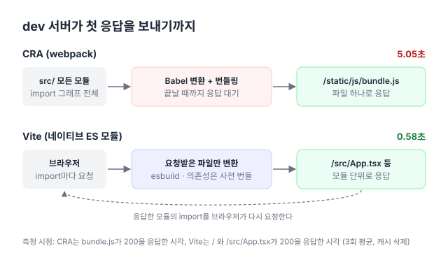

**한국어** | [English](en/migration-cra-to-vite.md)

# CRA → Vite 마이그레이션

Create React App(CRA)으로 만든 프로젝트를 [Vite](https://vite.dev/)로 옮겼다([#12](https://github.com/hyeoniverse/MacFolio/pull/12)). dev 서버 시작은 5.05초에서 0.58초로(약 8.7배), 프로덕션 빌드는 6.33초에서 1.88초로(약 3.4배) 단축되었고, 설치되는 패키지 수는 1,438개에서 171개로 줄었다.

## 왜 옮겼나

- **CRA는 더 이상 관리되지 않는다.** React 팀이 2025년 2월에 CRA를 공식 deprecated했다([Sunsetting Create React App](https://react.dev/blog/2025/02/14/sunsetting-create-react-app)). 새 React 버전과 도구 체인 대응이 예정되어 있지 않다.
- **개발 중 대기 시간이 길었다.** CRA는 webpack으로 앱 전체를 번들링한 뒤에야 dev 서버가 응답한다. Vite는 브라우저의 네이티브 ES 모듈을 이용해 요청받은 파일만 그 시점에 변환한다([Why Vite](https://vite.dev/guide/why)).

- **의존성이 많았다.** `react-scripts` 하나가 webpack, Babel, Jest, ESLint와 그 설정을 모두 의존성으로 설치한다.

## 측정 결과

| 항목                           | CRA      | Vite     | 차이          |
| ------------------------------ | -------- | -------- | ------------- |
| dev 서버 시작 (캐시 없음)      | 5.05초   | 0.58초   | 약 8.7배 빠름 |
| 프로덕션 빌드 (타입 체크 포함) | 6.33초   | 1.88초   | 약 3.4배 빠름 |
| 프로덕션 빌드 (번들링만)       | –        | 1.32초   |               |
| JS 번들 (gzip)                 | 138.2 KB | 127.7 KB | 7.6% 감소     |
| CSS 번들 (gzip)                | 30.2 KB  | 28.3 KB  | 6.3% 감소     |
| 설치 패키지 수                 | 1,438개  | 171개    | 88% 감소      |
| `node_modules` 크기            | 548 MB   | 276 MB   | 50% 감소      |

시간은 3회 측정한 평균이다.

### 측정 방법

- **비교 대상**
  - CRA: Vite 전환 직전 커밋 `bca7095d` (태그 `v1-cra`, react-scripts 5.0.1 / webpack 5.97.1)
  - Vite: Phase 0 정리 후 커밋 `432039cc` (Vite 6.2.1, @vitejs/plugin-react 4)
  - 두 버전 모두 React 19.0.0이다.
- **환경:** Apple M4 Pro, 메모리 24 GB, macOS 26.7, Node.js 23.10.0, npm 11.19.1
- **dev 서버 시작**
  - 매 회 캐시(`node_modules/.cache`, `node_modules/.vite`)를 삭제하고 측정했다.
  - CRA는 `/static/js/bundle.js`가 200을 응답할 때까지를 측정했다. 이때 앱 전체 컴파일이 끝난다.
  - Vite는 `/`와 `/src/App.tsx`가 200을 응답할 때까지를 측정했다. Vite는 나머지 모듈을 브라우저가 요청할 때 변환하므로, 이 수치는 첫 화면이 완전히 렌더링되기까지의 시간보다 짧다.
- **프로덕션 빌드**
  - CRA는 `react-scripts build`를 `GENERATE_SOURCEMAP=false`로 실행했다. Vite 기본값에 맞춰 소스맵을 끈 것이다.
  - CRA 빌드는 타입 체크를 포함하므로, Vite도 `tsc && vite build`로 함께 측정했다.
- **번들 크기:** 소스맵을 제외한 `.js`, `.css` 파일의 합이다. 두 버전 모두 `gzip -9`로 압축해 측정했다.

### 해석할 때 주의할 점

- 두 커밋 사이에 도구 전환 외의 코드 변경도 있다(`src/` 39개 파일). 번들 크기 차이는 도구만의 효과가 아니다. 크기는 "비슷하거나 약간 작아졌다" 정도로만 해석한다.
- HMR 반영 속도와 Lighthouse 점수는 브라우저가 필요해서 아직 측정하지 않았다.

## 변경 사항

| 영역           | CRA                                           | Vite                                                            |
| -------------- | --------------------------------------------- | --------------------------------------------------------------- |
| HTML 진입점    | `public/index.html`, `%PUBLIC_URL%` 치환      | 루트 `index.html`, `<script type="module" src="/src/main.tsx">` |
| 환경변수       | `process.env.REACT_APP_*`                     | `import.meta.env.VITE_*`                                        |
| 타입           | `react-app-env.d.ts` (react-scripts 타입)     | `vite-env.d.ts` (`vite/client` + `ImportMetaEnv`)               |
| React 플러그인 | 내장 (Babel)                                  | `vite.config.ts`에 `@vitejs/plugin-react`                       |
| 빌드 출력      | `build/`                                      | `dist/` (`firebase.json`의 `public`도 변경)                     |
| 테스트         | Jest (내장)                                   | 제거. 이후 Vitest 도입 예정                                     |
| 기타 제거      | `web-vitals`, `browserslist`, `setupTests.ts` |                                                                 |

## 전환하면서 놓쳤던 것

전환 직후 빌드는 성공했지만 아래 네 가지가 오류 메시지 없이 잘못 동작하고 있었다. 빌드·실행 단계에서 에러가 발생하지 않아 발견이 늦었다.

- **배포 경로:** `firebase.json`이 여전히 `build/`를 가리켜서, 배포하면 예전 CRA 빌드가 올라갈 수 있었다.
- **환경변수 접두사:** 한 파일이 `import.meta.env.REACT_APP_IMAGE_URL`을 읽고 있었다. Vite는 `VITE_`로 시작하는 변수만 노출하므로([Env Variables and Modes](https://vite.dev/guide/env-and-mode)) 값이 `undefined`가 되어 이미지가 깨졌다.
- **React 플러그인 미적용:** `@vitejs/plugin-react`는 설치만 되어 있고 `vite.config.ts`가 없었다. Vite가 esbuild로 JSX를 변환하기 때문에 앱은 동작했지만 Fast Refresh[^fast-refresh]는 동작하지 않았다.
- **누락된 의존성:** `react-dom`과 `typescript`가 `package.json`에 없었다. 기존 `node_modules`에 남아 있어서 로컬에서는 드러나지 않았다.

`vite-env.d.ts`에 `ImportMetaEnv`를 선언해 자동완성을 지원했다. 하지만 Vite 기본 타입에 인덱스 시그니처(`[key: string]: any`)가 있어서, 선언하지 않은 이름을 사용해도 타입 에러가 발생하지 않는다. 환경변수를 읽는 곳은 Phase 2([#4](https://github.com/hyeoniverse/MacFolio/issues/4))에서 `config/env.ts` 한 곳으로 통합했다(현재 경로 `apps/react/src/shared/config/env.ts`).

## 관련 글

- [CRA에서 Vite로 옮기기](https://macfolio.hyeoniverse.com/memo/cra-to-vite)
- [성능 측정 리포트 — 휴대폰 LCP 25.7초에서 3.2초로](https://macfolio.hyeoniverse.com/memo/site-performance-report)

[^fast-refresh]: 컴포넌트 파일을 수정하면 페이지를 새로 고치지 않고 그 컴포넌트만 교체하면서 state를 유지하는 React의 HMR 방식이다. Vite에서는 [`@vitejs/plugin-react`](https://github.com/vitejs/vite-plugin-react)가 제공한다.
