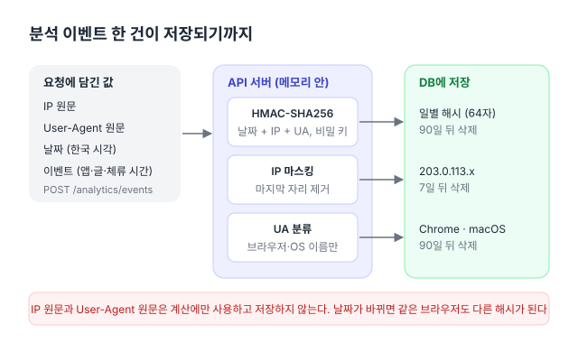

**한국어** | [English](en/privacy.md)

# 개인정보: 수집 항목과 보관 기간

MacFolio(macfolio.hyeoniverse.com)가 방문자에 대해 서버에 저장하는 정보를 모두 정리한다. 코드가 바뀌면 이 문서도 함께 수정한다.

## 트래픽 분석

사이트를 열면 브라우저가 이벤트를 수집해 API(`POST /analytics/events`)로 전송한다. 집계 결과는 '활동 상태 보기' 앱에서 조회한다. 구현은 [#102](https://github.com/hyeoniverse/MacFolio/issues/102)([#120](https://github.com/hyeoniverse/MacFolio/pull/120) API, [#121](https://github.com/hyeoniverse/MacFolio/pull/121) 수집)에서 했다.

- **누구나 조회 가능:** 날짜별 방문·순방문자, 앱 실행 수, 평균 체류 시간, 앱·글·외부 링크별 횟수, 국가·기기·브라우저·OS·언어별 횟수, 유입 경로 분류(검색·소셜·직접·링크), 블로그 글별 조회수, Apple 메뉴의 "오늘 방문자 N명". 모두 개인을 식별할 수 없는 합계다. 관리자가 비밀 글로 지정한 글의 조회수·글별 횟수는 관리자만 조회한다
- **관리자만 조회 가능:** 유입 경로의 주소(호스트)와 검색엔진이 전달한 검색어, utm 값(출처·매체·캠페인과 그 조합, 검색어·내용. 링크를 게시한 곳이 드러날 수 있다), 실시간 방문 목록(방문 흐름, 마스킹된 IP), Google Search Console 검색어(아래)

### 수집 항목

| 값                                                                    | 수집 위치                                        | 예                                                                              |
| --------------------------------------------------------------------- | ------------------------------------------------ | ------------------------------------------------------------------------------- |
| 이벤트 종류와 수신 시각                                               | 브라우저, 서버                                   | 페이지 열기, 앱 실행, 글·프로젝트 조회, 외부 링크 클릭, 체류 시간               |
| 실행한 앱, 조회한 글·프로젝트, 클릭한 링크 주소                       | 브라우저                                         | `memo`, `memo/hello`, `github.com/hyeoniverse`                                  |
| 진입 주소                                                             | 브라우저                                         | `/memo/hello`                                                                   |
| 유입 경로의 **호스트만**                                              | 브라우저 (`document.referrer`)                   | `github.com` (경로는 전송하지 않고, 서버도 호스트 형식이 아니면 거부한다)       |
| 검색엔진이 유입 주소에 담아 전달한 **검색어** (전달한 경우만)         | 브라우저 (`document.referrer`의 검색어 파라미터) | `macfolio 포트폴리오` (네이버 등. 구글·빙은 전달하지 않는다. 소문자, 100자까지) |
| `utm_source`, `utm_medium`, `utm_campaign`, `utm_term`, `utm_content` | 주소 (읽은 뒤 주소창에서 제거한다)               | `linkedin`, `social`, `resume-2026` (소문자, 공백은 `-`로 바꿔 100자까지)       |
| 기기 종류 (화면 폭), 언어                                             | 브라우저                                         | `desktop`, `ko-KR`                                                              |
| 국가                                                                  | Cloudflare가 붙이는 `CF-IPCountry`               | `KR`                                                                            |
| 브라우저·OS **종류**                                                  | 서버가 User-Agent에서 추출한 값                  | `Chrome`, `macOS`                                                               |
| 일별 해시[^hmac]                                                      | 서버: `HMAC(날짜 + IP + User-Agent, 비밀 키)`    | 64자 16진수                                                                     |
| 마지막 자리를 마스킹한 IP                                             | 서버                                             | `203.0.113.x`, `2001:db8:1::`                                                   |
| 방문 ID                                                               | 브라우저가 페이지를 열 때마다 생성하는 무작위 값 | 한 방문의 이벤트를 묶는다                                                       |

utm 값은 진입 주소에서 한 번 읽고 즉시 주소창에서 제거한다 (`history.replaceState`, 다른 쿼리는 유지). 주소를 복사해 공유하거나 새로 고침해도 같은 캠페인 방문이 중복 집계되지 않고, 링크를 게시한 곳이 다른 사람에게 전달되지 않는다.

### 수집하지 않는 항목

- **IP 원문.** 일별 해시를 계산할 때만 사용하고 저장하지 않는다. 화면에는 마지막 자리를 마스킹한 IP만 표시한다
- **User-Agent 원문.** 브라우저·OS 종류로 추출한 값만 저장한다
- **쿠키, 기기 지문.** 분석에는 쿠키를 사용하지 않는다. 방명록·댓글용 방문자 쿠키(아래)도 분석에 사용하지 않는다
- **날짜를 넘는 추적.** 일별 해시에 날짜가 포함되어, 날짜가 바뀌면 같은 사람도 다른 값이 된다. 따라서 순방문자는 일 단위로만 집계한다
- 유입 경로의 경로(검색엔진이 전달한 검색어만 남긴다), 입력한 글자, 마우스 움직임

### 집계에서 제외하는 방문

- 관리자로 로그인한 브라우저
- 관리자가 사용하는 IP에서 온 방문. 관리자로 인증된 요청(로그인, 관리자 API)의 IP를 HMAC으로만 저장하고, 그 IP에서 온 방문은 로그인하지 않은 기기(예: 휴대폰)라도 집계하지 않는다 (`apps/api/src/auth/admin-ip.service.ts`)
- 검색 로봇, 링크 미리보기, 자동화 도구 (User-Agent로 필터링한다)
- 브라우저가 [Global Privacy Control](https://globalprivacycontrol.org/)(`navigator.globalPrivacyControl`)을 켠 경우: 사이트가 전송하지 않는다 (사이트의 수집 코드)
- 로컬 개발과 화면 테스트(E2E)

### 보관 기간

| 값                                                                      | 기간                                       |
| ----------------------------------------------------------------------- | ------------------------------------------ |
| 마스킹된 IP                                                             | 7일 뒤 삭제                                |
| 관리자가 사용하는 IP의 HMAC                                             | 마지막 사용 후 30일 뒤 삭제                |
| 이벤트 (위의 표)                                                        | 90일 뒤 삭제                               |
| 일별 집계 (날짜별 방문 수, 유입 경로·검색어·utm·앱·글·국가·기기별 횟수) | 계속 보관. 개인을 식별할 수 있는 값이 없다 |
| Search Console 검색어 (날짜·검색어·페이지별 합계, 아래)                 | 계속 보관. 개인을 식별할 수 있는 값이 없다 |

서버는 한 시간마다 지난 날짜의 이벤트를 집계하고 보관 기간이 지난 값을 삭제한다 (`apps/api/src/analytics/analytics-rollup.service.ts`의 `maintain`). DB 백업(`ops/backup.sh`)에도 포함된다. 백업은 서버에 7일, 서버 밖(R2)에 30일 보관한 뒤 삭제한다 (기본값). 따라서 삭제한 값도 백업에는 그 기간만큼 더 남는다.

### Google Search Console

구글은 검색어를 사이트에 전달하지 않는다. 그래서 서버가 6시간마다 [Search Console API](https://developers.google.com/webmaster-tools)로 날짜·검색어·페이지별 노출 수·클릭 수와 평균 순위를 가져와 저장한다 (`apps/api/src/analytics/search-keywords.service.ts`). 구글이 검색 결과를 집계한 합계라 개별 방문이나 개인과 연결되지 않고, 개인을 식별할 수 있는 드문 검색어는 구글이 제외하고 제공한다. 관리자만 조회한다.

## 방명록·댓글 (방문자 쿠키)

메시지나 댓글을 처음 작성하는 브라우저에 무작위 토큰 쿠키(`macfolio_visitor`, 1년)를 발급하고, 그 토큰으로 이름(예: 🦊 날쌘 여우)을 정한다. DB에는 토큰의 HMAC만 저장한다. 반복 게시(스팸)를 차단하기 위해 IP의 HMAC과 앞 두 자리(예: `198.51`)를 함께 저장한다. 이 쿠키와 값은 분석에 사용하지 않는다.

## 연락 메일 (메일 앱)

메일 앱에서 보낸 메일(이름, 회신 주소, 제목, 내용)은 메일 발송 서비스 [Resend](https://resend.com/docs)를 거쳐 사이트 운영자의 메일함으로 전달되고, 서버에도 **1년** 보관된다. 회신 주소는 그 메일의 Reply-To가 된다.

- **조회 범위:** 보낸 브라우저(방문자 쿠키)의 보낸 편지함과 관리자의 받은 편지함에서만 조회된다. 서버가 방문자 쿠키의 HMAC으로 필터링하므로 다른 브라우저에서는 보이지 않는다. 쿠키를 삭제하면 그 브라우저에서도 더는 보이지 않는다
- **답장:** 관리자가 메일 앱에서 작성한 답장은 회신 주소로 발송되고, 보낸 사람의 보낸 편지함에서 해당 메일 아래에도 표시된다
- **보관 기간:** 1년이 지난 메일과 답장은 삭제한다 (메일을 보내거나 관리자가 받은 편지함을 열 때)
- 일일 발송 한도를 집계하기 위해 IP의 HMAC을 서버 메모리에만 저장하며, 날짜가 바뀌거나 서버를 다시 시작하면 사라진다
- 사람 확인(Cloudflare Turnstile)을 켜면 Cloudflare가 브라우저를 확인한다 (아래 [사람 확인](#사람-확인-cloudflare-turnstile))

## 문서 파일 (Finder의 이력서·포트폴리오·자격증)

Finder에서 여는 이력서·포트폴리오·자격증 파일은 Cloudflare R2에 저장하고 사이트 주소(`/files/…`)로 제공한다. 방문자에 대해 별도로 기록하는 정보는 없다(로그인·쿠키 없이 파일만 제공한다). 업로드하기 전에 전화번호·주소·생년월일·신분증 번호를 삭제한 공개용 파일만 저장한다.

## 사람 확인 (Cloudflare Turnstile)

메일·댓글·메시지를 작성할 때 사람인지 확인할 수 있다. 적용 위치는 관리자가 시스템 설정의 **개인정보 보호 및 보안**에서 정한다 (기본값은 메일만). 누구나 같은 화면에서 현재 적용 위치를 확인할 수 있다.

- 적용된 곳에서 글을 작성하면 [Turnstile](https://developers.cloudflare.com/turnstile/) 위젯이 브라우저를 확인하고 일회용 토큰을 발급한다. 서버는 그 토큰을 Cloudflare에 조회해 검증한다. 이때 Cloudflare는 IP와 브라우저 정보를 확인한다 ([Cloudflare 개인정보 처리 방침](https://www.cloudflare.com/privacypolicy/))
- 이 사이트는 토큰을 저장하지 않는다
- 관리자가 작성한 글은 확인하지 않는다

## 관련 글

- [트래픽 분석 1 - 쿠키 없이 순방문자 세기](https://macfolio.hyeoniverse.com/memo/analytics-api)
- [트래픽 분석 2 - 사이트에서 모아 보내기](https://macfolio.hyeoniverse.com/memo/analytics-collect)
- [트래픽 분석 5 - UTM 조합 표와 링크 생성기](https://macfolio.hyeoniverse.com/memo/utm-analytics)
- [무엇을 검색하고 들어왔나 - 검색어와 Google Search Console](https://macfolio.hyeoniverse.com/memo/search-keywords)
- [이름·비밀번호 없이 쓰는 메시지와 댓글 - 방문자 쿠키로 정하는 이름](https://macfolio.hyeoniverse.com/memo/visitor-identity)
- [메일 앱에서 진짜로 메일 보내기 - Resend와 Turnstile](https://macfolio.hyeoniverse.com/memo/contact-mail)
- [시스템 설정에서 사람 확인을 켜고 끄기](https://macfolio.hyeoniverse.com/memo/privacy-security-settings)

[^hmac]: HMAC(Hash-based Message Authentication Code)은 비밀 키를 섞어 계산하는 해시다. 비밀 키를 모르면 같은 IP·User-Agent로 해시를 다시 계산해 대조할 수 없다. 서버는 SHA-256을 사용한다 (`apps/api/src/analytics/rules.ts`의 `dayHash`).
