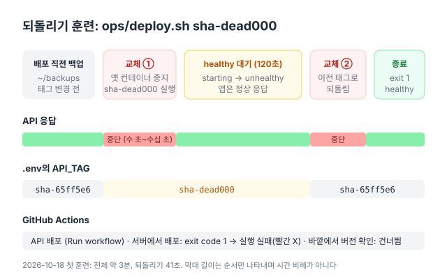

**한국어** | [English](en/rollback-drill.md)

# 되돌리기 훈련 (서버)

헬스 체크가 실패하는 버전을 **운영 서버에 의도적으로 배포**해서, `ops/deploy.sh`가 이전 버전으로 되돌리고 GitHub Actions가 실패로 알리는지 확인한다. [#100](https://github.com/hyeoniverse/MacFolio/issues/100)의 남은 두 항목을 완료하기 위한 절차다([#254](https://github.com/hyeoniverse/MacFolio/pull/254)).

- 한 번 의도적으로 실패시켜 되돌리기 확인 (헬스 체크가 실패하는 이미지)
- 헬스 체크가 실패하는 버전은 이전 버전으로 돌아가고 Actions가 실패로 알린다

로컬 레지스트리 환경에서는 [#104](https://github.com/hyeoniverse/MacFolio/pull/104)에서 확인했다. 이 훈련은 Actions → SSH(배포 전용 키) → `ops/deploy.sh` → 터널까지 운영 배포와 같은 경로로 실행한다.

## 방법: 코드를 바꾸지 않는다

main에 실패하는 코드를 머지하지 않고, 저장소에 훈련용 스위치도 추가하지 않는다. 대신 **서버에서 현재 이미지 위에 "항상 unhealthy"인 레이어 하나만 추가한 훈련용 이미지**를 빌드하고, 실제 커밋과 겹치지 않는 태그(`sha-dead000`)를 붙인다.

- `ops/deploy.sh`는 서버에 그 태그의 이미지가 있으면 GHCR에서 내려받지 않고 그대로 사용한다. 그래서 GHCR에 아무것도 업로드하지 않는다
- 배포 전용 키는 태그 하나만 전달할 수 있으므로, 컨테이너에 환경 변수를 넘기는 스위치를 만들려면 새 입력 경로를 추가해야 한다. 이 방법은 그런 경로를 만들지 않는다. 새 비밀 값, 새 권한, 새 워크플로 입력이 없다
- 훈련용 이미지는 서버에만 있고 훈련이 끝나면 삭제한다. 실수로 활성화될 스위치가 남지 않는다

훈련용 이미지는 Dockerfile의 [`HEALTHCHECK`](https://docs.docker.com/reference/dockerfile/#healthcheck)만 `false`로 변경한다. 앱은 현재 버전 그대로 실행된다. 서버 `compose.yml`의 api에는 `healthcheck:`가 없어서 이미지의 `HEALTHCHECK`를 사용한다. 따라서 컨테이너는 `starting` → `unhealthy`가 되고, `ops/deploy.sh`는 `HEALTH_TIMEOUT`(120초) 동안 기다린 뒤 되돌린다. (훈련용 이미지의 `/health` version도 현재 태그라서 `sha-dead000`과 일치하지 않는다. 두 조건 모두 실패한다.)

## API 중단 시간

`ops/deploy.sh`는 블루·그린 배포[^blue-green]가 아니다. `docker compose up -d api`가 **옛 컨테이너를 중지하고 새 컨테이너를 실행한다**. 그래서 훈련 중 API 응답이 두 번 짧게 중단된다.



| 시점                        | 길이                                                                                | 원인                                                                              |
| --------------------------- | ----------------------------------------------------------------------------------- | --------------------------------------------------------------------------------- |
| 훈련용 컨테이너로 교체할 때 | 수 초~수십 초 (`prisma migrate deploy`와 Nest 시작까지, 적용할 마이그레이션은 없다) | 옛 컨테이너를 중지하고 새로 실행한다                                              |
| 기다리는 120초              | 중단되지 않는다                                                                     | 훈련용 컨테이너도 앱은 정상이라 터널로 오는 요청에 응답한다 (version만 현재 태그) |
| 이전 버전으로 되돌릴 때     | 수 초~수십 초                                                                       | 다시 컨테이너를 교체한다                                                          |

정리하면 **두 번, 합계 1분 이내**다. 업타임 감시(`uptime.yml`)가 그사이에 실행되면 실패 알림이 한 번 발송될 수 있다. 방문이 적은 시간대에 진행한다. 배포 직전 백업(`~/backups`)도 평소처럼 하나 생성된다.

## 준비

- 서버에 평소 사용하는 SSH 키(관리자 키)로 접속할 수 있다. 배포 전용 키가 아니다
- GitHub 저장소에서 Actions 워크플로를 [수동 실행](https://docs.github.com/en/actions/managing-workflow-runs-and-deployments/managing-workflow-runs/manually-running-a-workflow)할 권한이 있다
- 진행 중인 배포가 없다 ([Actions → API 배포](https://github.com/hyeoniverse/MacFolio/actions/workflows/deploy-api.yml)에 진행 중인 실행이 없다). main에 API 변경을 머지하지 않는다
- 현재 상태를 기록한다 (아래 1단계)

명령의 `sha-xxxxxxx`는 1단계에서 확인한 현재 태그로 바꿔 넣는다. `<…>` 같은 자리표시를 그대로 붙여 넣지 않는다.

## 절차

### 1. 현재 상태 기록 (서버)

```bash
cd ~/deploy
grep '^API_TAG=' .env                  # 예: API_TAG=sha-65ff5e6  ← 이것이 "이전 버전"이다
docker compose ps api                  # STATUS가 Up … (healthy)
curl -s https://macfolio-api.hyeoniverse.com/health; echo
```

예상:

```text
API_TAG=sha-65ff5e6
NAME             IMAGE                                          … STATUS
macfolio-api-1   ghcr.io/hyeoniverse/macfolio-api:sha-65ff5e6   … Up 3 days (healthy)
{"status":"ok","database":"up","version":"sha-65ff5e6"}
```

`sha-dead000`이 실제 커밋과 겹치지 않는지 확인한다. 출력이 없어야 한다.

```bash
git -C ~/macfolio rev-parse --verify -q dead000^{commit}
```

### 2. 훈련용 이미지 만들기 (서버)

```bash
cur=$(grep '^API_TAG=' ~/deploy/.env | cut -d= -f2)
docker build -t ghcr.io/hyeoniverse/macfolio-api:sha-dead000 - <<EOF
FROM ghcr.io/hyeoniverse/macfolio-api:$cur
HEALTHCHECK --interval=10s --timeout=5s --start-period=10s --retries=1 CMD false
EOF
docker image ls ghcr.io/hyeoniverse/macfolio-api
```

빌드는 레이어 하나만 추가하므로 몇 초 안에 끝난다 (빌드 컨텍스트가 없어 코드를 다시 빌드하지 않는다). 목록에 `sha-dead000`과 현재 태그가 함께 표시되면 정상이다.

### 3. Actions에서 배포 (GitHub)

1. [Actions → API 배포](https://github.com/hyeoniverse/MacFolio/actions/workflows/deploy-api.yml)를 연다. 첫 화면(All workflows)에는 버튼이 없으니 왼쪽 목록에서 **API 배포**를 누른다
2. 오른쪽 위 **Run workflow** 버튼을 누른다
3. Branch는 `main` 그대로, tag에 `sha-dead000`을 넣는다
4. 초록 **Run workflow** 버튼을 누른다

### 4. 진행 상황 확인 (서버, 선택)

워크플로가 실행되는 동안 다른 터미널 창에서 확인한다.

```bash
cd ~/deploy
tail -f deploy.log
watch -n 3 docker compose ps api       # 다른 창에서
```

컨테이너가 `sha-dead000`으로 교체되어 `(health: starting)` → `(unhealthy)`가 되었다가, 약 2분 뒤 이전 태그로 되돌아가 `(healthy)`가 된다.

### 5. 결과 확인

**Actions**: 실행이 빨간 X로 끝난다 (전체 약 2\~4분).

- **서버에서 배포** 단계가 실패하고, 마지막 줄이 `Error: Process completed with exit code 1.`이다
- **바깥에서 버전 확인** 단계는 건너뛴다 (회색)
- 저장소 알림 설정에 따라 실패 메일이 발송된다

**서버에서 배포 단계의 로그 (= `~/deploy/deploy.log`)**, 순서대로 이렇게 나온다 (시각은 다르다):

```text
… 배포 시작: sha-65ff5e6 → sha-dead000
… (백업 스크립트의 줄)
… 120초 안에 healthy가 되지 않았다
… 새 버전이 건강하지 않다. api 로그 끝:
api-1  | … Nest application successfully started …
… 이전 버전으로 되돌린다: sha-65ff5e6
… 배포 실패, 되돌림: sha-65ff5e6가 다시 떠 있다
```

앱 로그에는 오류가 없다. 훈련용 이미지는 헬스 체크만 의도적으로 실패시킨 것이므로 예상된 결과다.

**서버 상태**:

```bash
cd ~/deploy
grep '^API_TAG=' .env                  # API_TAG=sha-65ff5e6 (이전 버전 그대로)
docker compose ps api                  # IMAGE …:sha-65ff5e6, STATUS Up N minutes (healthy)
curl -s https://macfolio-api.hyeoniverse.com/health; echo
# {"status":"ok","database":"up","version":"sha-65ff5e6"}
```

`Up N minutes`의 N이 훈련 시각과 일치한다 (되돌리면서 컨테이너를 새로 생성했다). `.env`의 `API_TAG`가 `sha-dead000`이면 되돌리기가 완료되지 않은 것이다. 아래 [되돌리기가 실패하면](#되돌리기가-실패하면) 절차를 따른다.

**프론트엔드**: 수동으로 실행한 API 배포는 프론트엔드 `deploy` 작업을 호출하지 않으므로 영향이 없다.

### 6. 정리 (서버)

```bash
docker image rm ghcr.io/hyeoniverse/macfolio-api:sha-dead000
docker image ls ghcr.io/hyeoniverse/macfolio-api     # sha-dead000이 없다
ls -t ~/backups | head -n 1                          # 훈련 중 생성된 백업. 보관하거나 삭제한다
```

`deploy.log`의 훈련 기록은 보관한다. Actions의 실패한 실행도 기록으로 남긴다.

## 되돌리기가 실패하면

로그 끝이 `배포 실패, 되돌리기도 실패`이거나, 5단계에서 이전 버전이 `healthy`가 아니면 수동으로 이전 이미지를 지정한다. 이전 이미지는 서버에 남아 있으므로 다시 내려받지 않는다.

```bash
cd ~/deploy
docker compose ps api; docker compose logs --tail 100 api      # 원인을 먼저 확인한다
~/macfolio/ops/deploy.sh sha-65ff5e6                            # 1단계에서 적은 태그. 백업 → 교체 → healthy 확인까지 한다
```

스크립트가 다른 배포의 잠금(`flock`)을 기다리며 멈춰 있거나 스크립트가 실행되지 않으면, `.env`를 직접 수정한다.

```bash
cd ~/deploy
sed -i 's/^API_TAG=.*/API_TAG=sha-65ff5e6/' .env
docker compose up -d api
docker compose ps api                  # (healthy)가 될 때까지 약 1분
curl -s https://macfolio-api.hyeoniverse.com/health; echo
```

그래도 healthy가 되지 않으면 훈련과 무관한 문제다 (DB, `api.env`, 디스크). `docker compose ps`로 db를, `df -h`로 디스크 여유 공간을 확인한다. 이전 이미지가 삭제되었다면 `docker compose pull api`로 GHCR에서 다시 내려받는다 (공개 패키지라 로그인이 필요 없다). 정리는 위 6단계를 그대로 한다.

## #100에 붙일 체크리스트

훈련 결과는 [#100](https://github.com/hyeoniverse/MacFolio/issues/100)에 아래 형식으로 기록한다.

<details>
<summary>체크리스트 원문 (복사용)</summary>

```markdown
### 서버 되돌리기 훈련 (docs/rollback-drill.md) — YYYY-MM-DD

- [ ] 훈련 전: `API_TAG=sha-_______`, `/health` version 같음, `(healthy)`
- [ ] 서버에 훈련용 이미지 `sha-dead000` (지금 이미지 + `HEALTHCHECK CMD false`)
- [ ] Run workflow `sha-dead000` → Actions 빨간 X, '서버에서 배포' exit code 1, '바깥에서 버전 확인' 건너뜀 (실행 링크: )
- [ ] 로그: `120초 안에 healthy가 되지 않았다` → `이전 버전으로 되돌린다` → `배포 실패, 되돌림: sha-_______가 다시 떠 있다`
- [ ] 훈련 뒤: `.env`의 `API_TAG`, `docker compose ps api`의 이미지, 바깥 `/health` version이 모두 이전 태그, `(healthy)`
- [ ] 끊긴 시간: 약 __초 (업타임 알림: 있음/없음)
- [ ] 정리: `sha-dead000` 이미지 지움
```

</details>

## 기록

### 2026-10-18 (첫 서버 훈련, #100 마무리)

- 훈련 전: `API_TAG=sha-7e7eac0`, `/health` version 같음, `(healthy)`
- 훈련용 이미지 `sha-dead000`을 서버에서 빌드 (4초)
- Run workflow `sha-dead000` → Actions "API 배포 #2" 실패 (3분, `Process completed with exit code 1`)
- 로그: `09:04:53Z 이전 버전으로 되돌린다: sha-7e7eac0` → `09:05:34Z 배포 실패, 되돌림: sha-7e7eac0가 다시 떠 있다`. 되돌리는 데 41초
- 훈련 뒤: `.env`, 컨테이너 이미지, 바깥 `/health` version 모두 `sha-7e7eac0`, `(healthy)`
- 정리: `sha-dead000` 삭제, 남은 이미지 `sha-0f5d74f`, `sha-7e7eac0`
- 발생한 문제: 접속 안내의 `ssh <평소 쓰는 서버 접속>` 자리표시 줄까지 함께 붙여 넣어 `syntax error near unexpected token 'newline'`이 발생했다. 나머지 줄은 정상 실행되어 결과에는 영향이 없었다. 위 [준비](#준비)의 주의대로 자리표시는 붙여 넣지 않는다

## 관련 글

- [되돌리기 훈련 - 헬스 체크가 실패하는 이미지를 서버에 일부러 올렸다](https://macfolio.hyeoniverse.com/memo/rollback-drill)
- [API 자동 배포 - 이미지는 Actions에서, 서버는 바꿔 끼우기만](https://macfolio.hyeoniverse.com/memo/api-auto-deploy)

[^blue-green]: 새 버전 컨테이너를 옛 버전과 함께 실행해 두고 health 확인이 끝난 뒤 트래픽을 전환하는 배포 방식이다. 전환하는 동안 응답이 중단되지 않지만, 두 컨테이너가 동시에 실행되는 동안 메모리를 더 사용한다. 이 서버(E2.1.Micro, 1GB)는 컨테이너 하나를 교체하는 방식을 사용한다.
